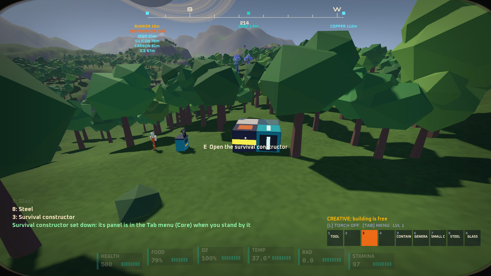
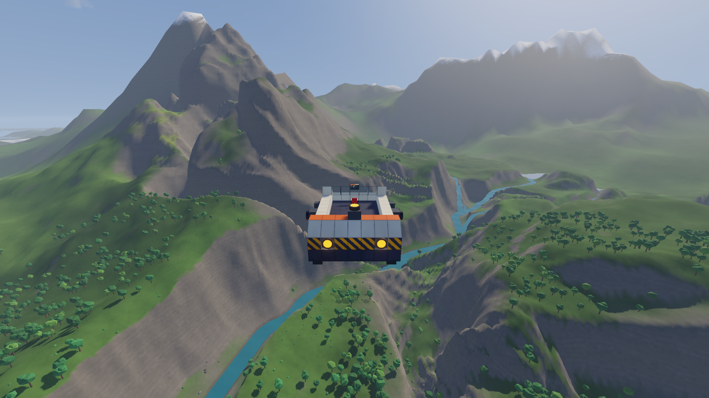
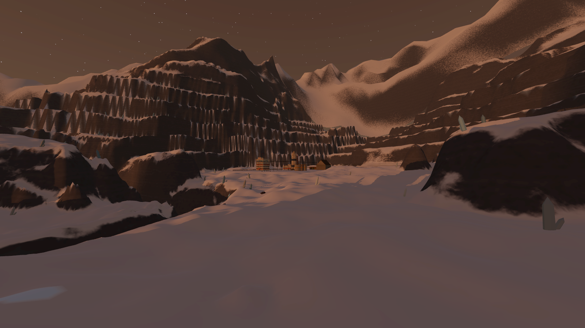
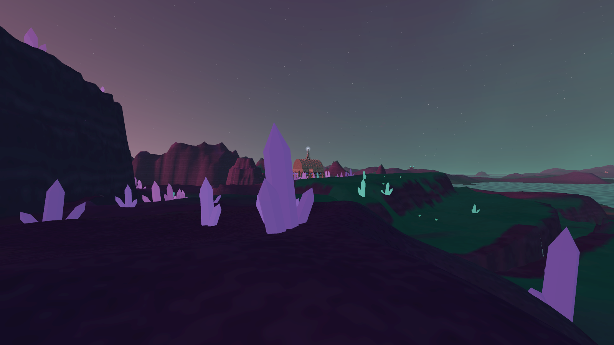
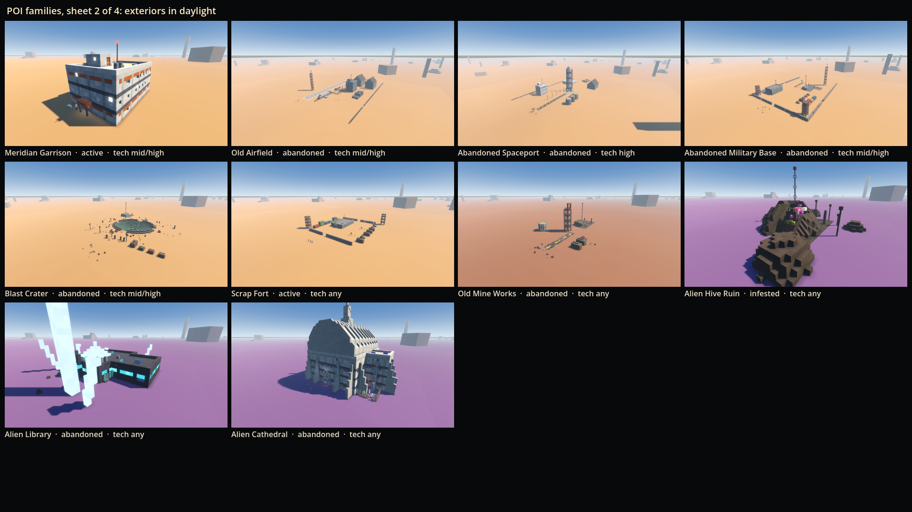
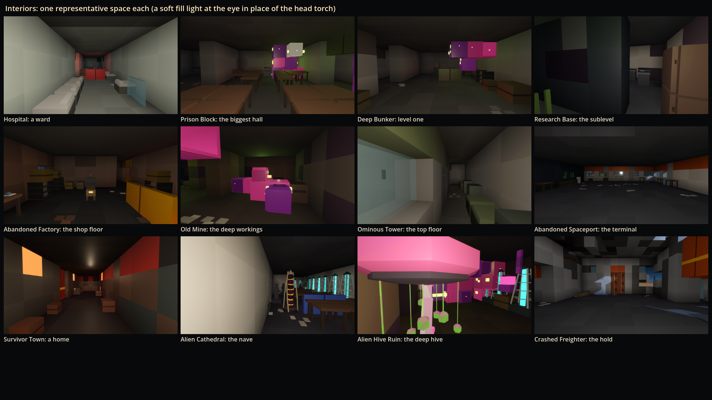
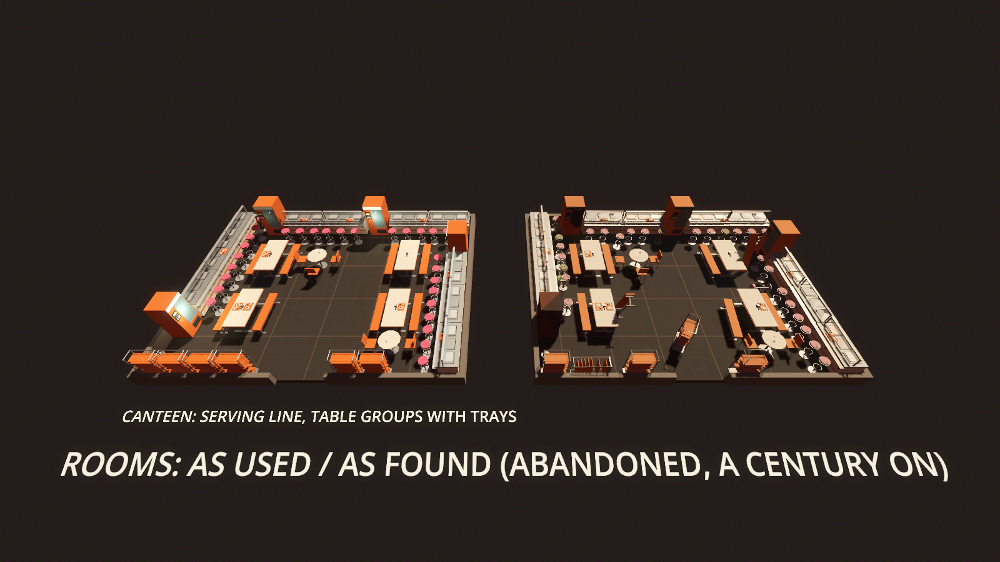

# GalHack

A first-person space survival sandbox for one group of friends: wake from cryosleep in a buried bunker on a ruined world long after the collapse, build your way up from a hover rover to a capital ship, and explore a procedurally generated galaxy full of strange worlds, ruins and wrecks.

GalHack is free and never sold. Every asset is credited in [CREDITS.md](CREDITS.md).

**GalHack is vibe coded.** One human sets the direction, playtests and makes the calls; AI agents (Claude Code) write the code, tests, design notes and procedural assets, working in parallel on branches that are reviewed and only merged when the full test suite passes.

## Gallery

Work in progress, straight from the prototypes. Click an image for full size.

<table>
<tr><td width="33%"><a href="prototypes/slice/screenshots/bunker.png"></a><br><sub>Waking in the cryo bunker</sub></td><td width="33%"><a href="prototypes/slice/screenshots/climb.png"></a><br><sub>Climbing out into the ruined world</sub></td><td width="33%"><a href="prototypes/slice/screenshots/menu-you.png"></a><br><sub>The Tab menu: bag, toolbar, suit fabricator</sub></td></tr>
<tr><td width="33%"><a href="prototypes/slice/screenshots/base.png"></a><br><sub>A first base and survival constructor</sub></td><td width="33%"><a href="prototypes/slice/screenshots/flying.png"></a><br><sub>Flying a self-built vessel</sub></td><td width="33%"><a href="prototypes/poi-generator/screenshots/far-abandoned-spaceport-dusk.png"></a><br><sub>A derelict spaceport at dusk</sub></td></tr>
<tr><td width="33%"><a href="prototypes/poi-generator/screenshots/far-alien-cathedral-dusk.png"></a><br><sub>An alien cathedral on a ridge</sub></td><td width="33%"><a href="prototypes/poi-generator/screenshots/families-2.png"></a><br><sub>Some of the POI families</sub></td><td width="33%"><a href="prototypes/poi-generator/screenshots/families-interiors.png"></a><br><sub>POI interiors</sub></td></tr>
<tr><td width="33%"><a href="prototypes/wildlife/screenshots/deep-ceiling.png"></a><br><sub>Cave crawlers on the ceiling</sub></td><td width="33%"><a href="prototypes/wildlife/screenshots/deep-food.png"></a><br><sub>A lurker taking its prey</sub></td><td width="33%"><a href="prototypes/deco/screenshots/canteen.png"></a><br><sub>A canteen as used, and a century on</sub></td></tr>
</table>

## Licence

GalHack's own code and data are licensed under the [PolyForm Noncommercial License 1.0.0](LICENSE.md): you may use, change, fork and share them for any noncommercial purpose, but not sell them or use them commercially. Third-party fonts and libraries keep their own licences, listed in [CREDITS.md](CREDITS.md).

## Design

The full game design document is [docs/DESIGN.md](docs/DESIGN.md), a published copy of the living doc that's refreshed as it changes.

Guiding rule 1: **stable and smooth first.** Nothing a player builds, drops or stores ever disappears.

## Stack

- Godot 4.7 (.NET build), C# for all game code
- Steam co-op for a small group of friends
- Everything that can be data is data (text files with schemas)

## Layout

Shared code lives in [`shared/`](shared/): modules that prototypes compile in rather than copy. [`shared/Physics/`](shared/Physics/README.md) is the one physics module (units, collision layers, forces, damage, craters, structures as bodies, riding, stuck-safety).

| Folder | What's in it |
| --- | --- |
| `prototypes/` | Throwaway prototypes that prove one risky idea each |
| `prototypes/walkable-ship/` | Walking around inside a ship while it flies, rolls and warps |
| `prototypes/planet-generator/` | Seeded planets in five archetypes, from orbit down to streamed terrain |
| `prototypes/terrain-digging/` | Remove-only grid digging: smooth Surface Nets terrain, dig anywhere but bedrock, blocks set flush into the ground, atomic audited saves |
| `prototypes/encounters/` | Encounter director: seeded, territory-aware spawns out of sight, fuzzy signal leads, nothing a player touched is ever cleaned up |
| `prototypes/building/` | Block building: the structure model every ship, base, POI and wreck is made of |
| `prototypes/boarding/` | Boarding a Vharn frigate: breach, fight to the core, hijack it in three stages or shoot it derelict |
| `prototypes/invasions/` | Vharn base invasions: warnings, sirens, crewed landings, breaching, offline and recovery |
| `prototypes/survival-vitals/` | Survival vitals: warned hazards, armor, replicators, healing and gentle respawns |
| `prototypes/ship-handling/` | Ships that handle like their build: four readable numbers, hover, gear, bumps and crashes |
| `prototypes/diegetic-ui/` | Screens on things in the world: consoles, a holo-table, a wrist computer and a helmet visor |
| `prototypes/weather/` | Forecast weather, wind that pushes by mass, lightning and tornadoes that are warned, never silent |
| `prototypes/coop/` | Steam co-op: friends walking around the same flying ship, zones, a dedicated server |
| `prototypes/saves/` | Crash-proof saves (shadow-paged plain files, audits, backups, migrations) and zone transitions; its `src/Persistence` is the core other prototypes adopt |
| `prototypes/wildlife/` | Procedural fauna for every planet: herds, hunting packs, telegraphed signature attacks, a discovery card on first sighting, day and night, cave crawlers, the fauna of places with food chains and fair tells, mutagenic worlds, settlements' animals, rare space creatures, no spawning near bases; a harvester hovercraft |
| `prototypes/poi-generator/` | Seeded points of interest from faction kits: four states, dressing, placement and validation |
| `prototypes/physics-sandbox/` | The shared physics module proven together: a blueprint ship flown over dug terrain in wind, real craters, severed wrecks, riding hulls and cabins, tornado flings |
| `prototypes/manufacturing/` | Materials and manufacturing: constructor tiers with self-planning queues and ammo restock, the deconstructor, the blueprint factory, survival and creative building from one shared storage, spill crates |
| `prototypes/capital-base/` | A capital ship lands on a real planet, becomes a base at its core console, is built onto and into the ground, parks a vessel, and lifts off clean, cut free; auto-transmit to Home |
| `prototypes/planet-surface/` | A whole planet to stand on: diggable streamed terrain on a torus, skies from each system, weather, seated POIs |
| `prototypes/slice/` | **The playable slice:** wake in a cryo bunker on a fresh random world, climb out with a place in view, gather, craft and build a base from the suit fabricator up, unlock tech, then build and fly a vessel; the Tab menu (You, Tech, Stats, Core, Map) and in-world screens |
| `prototypes/deco/` | The decorations library showroom: 226 procedural deco pieces in 22 theme sets with their damaged and aged variants, rooms and outdoor sites arranged then left as the collapse left them, ore surface tells; the library itself is `shared/Deco` and `shared/Items/data/deco*.json` |
| `shared/Terrain/` | The planet generator's worlds as diggable voxel terrain (caves, ore, bedrock, POI pads), wrapping both ways; compiled into prototypes that need it |
| `shared/Sky/` | The sky seam check: renders a sky looking straight at a cube's corners and edges, the poles, the axes and the azimuth's wrap, and fails on a line, a pinch or stars thinning at the axes; every prototype with a sky of its own runs it as `tests/SkySeamTest.tscn` |
| `shared/Items/` | The item catalogue as data on the five-step rarity ladder, the recipe tree from ore to every block, the production machines, mode-aware block placement, and ore deposit shapes ([README](shared/Items/README.md), [ore notes](shared/Items/ORE-NOTES.md)) |

## Requirements

- [Godot 4.7.2 .NET](https://godotengine.org/download) (the "mono" / .NET build, not the standard one)
- [.NET 10 SDK](https://dotnet.microsoft.com/download): every project targets `net10.0`
- Windows 10 or later (that's what everything is tested on); PowerShell for the scripts in `tools/`

## Running a prototype

Each folder under `prototypes/` is its own Godot project.

**Simplest:** open Godot 4.7.2 .NET, choose **Import**, pick `prototypes/<name>/project.godot`, then press **Play** (F5). Godot builds the C# the first time. Each prototype's own README lists its controls.

**With the repo's scripts:** `tools/` expects Godot and a portable .NET SDK inside a git-ignored `.tools/` folder at the repo root, so nothing is installed system-wide:

- Godot .NET 4.7.2 for Windows unpacked to `.tools/godot/Godot_v4.7.2-stable_mono_win64/`
- the .NET 10 SDK in `.tools/dotnet/`

Then run `.\tools\godot.ps1 -Project prototypes/<name> -Play`.

Steam co-op also needs Valve's `steam_api64.dll`, which isn't stored in the repo. Run `.\tools\steam-coop-test.ps1 -FetchSteamApi` to fetch and verify it.

## Testing

Every prototype has headless test scenes (`tests/*Test.tscn`, `tests/*Probe.tscn`) that exit 0 on success. Run them all before any merge to main:

```powershell
.\tools\test-all.ps1
```

Run one with `.\tools\test.ps1 -Project prototypes/<name> -Scene res://tests/<Scene>.tscn`.

The gate also fails if any Kenney asset is added: GalHack uses no Kenney assets of any kind.

A few checks must see rendered pictures (the sky seam checks, planet-surface's `SkyTest`). Headless runs draw nothing, so those scenes start themselves again in a normal window and pass on what it prints; they need a GPU, as playing does. Screenshots render in a normal window too.
