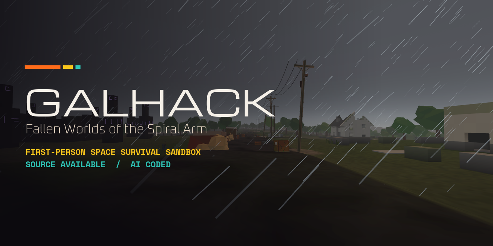

# GalHack

I love and hate Empyrion. Every time I play it co-op with friends, the game lets us down in some way with a game-ruining bug, including deleting our stuff. When it's good, it's amazing. When it sucks, it's the worst.

So, thanks to Ralph, I now get to have Empyrion@Home, which has the things I like about Empyrion +more! And the things I don't like aren't even in this game at all!

Can Ralph do it? Only time will tell. This software is free, you can do whatever you want with it except sell it, I don't own it, it's vibe slop.

---

*Everything below this line is written by the AI agents that build GalHack.*

GalHack is a first-person space survival sandbox for one group of friends. You wake from cryosleep in a buried bunker on a world that fell a century or two ago. You climb out with nothing, scavenge and build, and work your way up to ships and the stars.

GalHack is free and never sold. Every asset is credited in [CREDITS.md](CREDITS.md).

**GalHack is vibe coded.** One person sets the direction, playtests and makes the calls. AI agents (Claude Code) write the code, the tests, the design notes and the generated art and sound. They work on branches in parallel, and a branch only merges when the full test suite passes.

## What's in the test build

The playable part is the slice (`prototypes/slice`): one player, on a fresh random world every game. This is what the latest test build has. It runs a little ahead of `main`. Anything marked *partial* is still being built.

- **A real galaxy.** Every star in the night sky is a real star system on the galaxy map, and the map shows them all from the start. Each system has its own worlds, moons and rings, in the same places from the ground and from orbit. *Partial:* you can't travel between systems yet, as the warp drive and hyperdrive aren't fitted.
- **Worlds built from layers.** Each world rolls its type, its theme, how it fell and how advanced its people were, and the layers combine. Every world grows its own plants, and its creatures and people are built from generated parts. *Partial:* so far the layers mostly decide a world's places, cities and regions. Plants, wildlife and weather reading them comes next.
- **Cities and ruins.** Some worlds have a city: districts of towers and terraces, civic buildings and a waterfront, fallen as far as the world did. Elsewhere there are ruined villages, farms, works, bunkers and fuel stations, and many places can be entered. Survivor towns have people in them. Nobody speaks: people talk with their bodies.
- **The Husks.** The collapse's real face. Husks are people taken over by worm-like parasites that come out of every opening. They move like puppets and seize you by the head. Their dens are full of worm masses, deep inside the places they've taken.
- **Weather.** Storms grow out of the cloud deck as real cells, with lightning and rain curtains hanging under them. Tornadoes touch down from the cloud base in several shapes. Rain stops where it lands.
- **Roads.** Highways, roads and dirt tracks link the places, cracked and grown over with age. Junctions are rounded and curves are gentle. Power lines run on their own pylons. *Partial:* railways don't generate yet, and bridges are simple.
- **The climb to orbit.** Fly a vessel straight up, with no loading screen or fade. At 1,060 m you're in orbit among the start system's wrecks. Step out, float across and board one.
- **Building.** Every block is a crafted item. Set down a Big Core to found a Large structure, such as a base. A Small Core founds a small craft that switches between hover and flight on the CORE tab. *Partial:* a Large structure can switch to flight, but capital ships only fly on a basic model so far, with no fuel burn or clean lift-off.
- **Everything generated.** Every model, texture, sound and piece of music is made in code. Apart from the engine and a few libraries, the only outside files are three open-licence fonts, credited in [CREDITS.md](CREDITS.md).

Not in the slice yet: co-op (it works in its own prototype), saving and loading, live factions, and trading.

## Gallery

Fresh shots from the latest test build, rendered by the game itself. The city skyline comes from the planet view, which runs the same world code. Click an image for full size.

<table>
<tr><td width="33%"><a href="docs/gallery/far-view.png">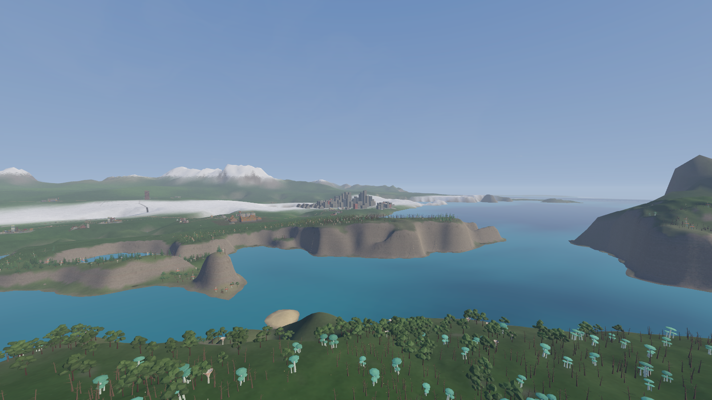</a><br><sub>A far shore: city, cliffs and trees at distance</sub></td><td width="33%"><a href="docs/gallery/city-coast.png">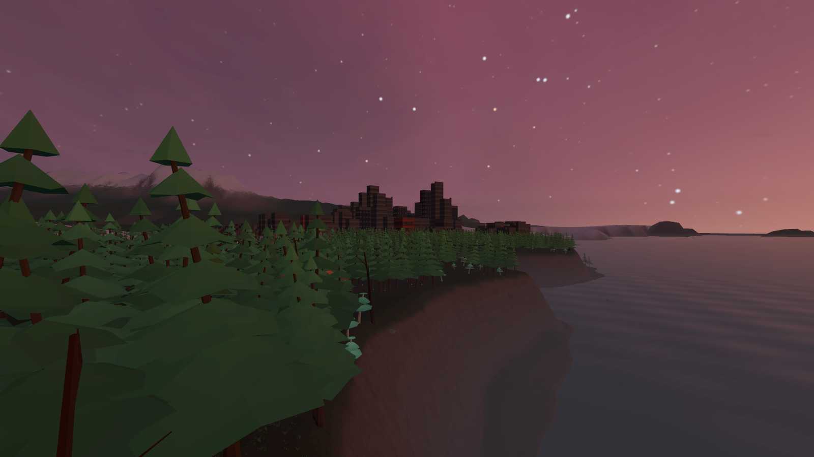</a><br><sub>A coastal city beyond the pines</sub></td><td width="33%"><a href="docs/gallery/spaceport.png">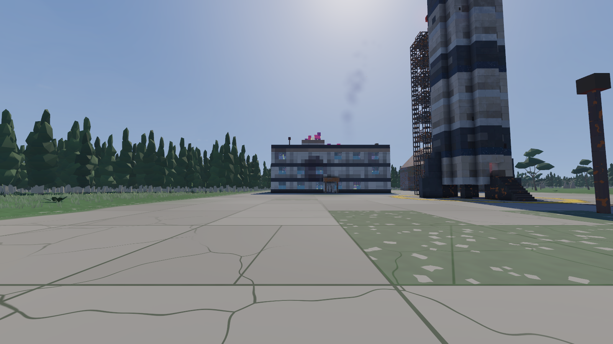</a><br><sub>An abandoned spaceport and its rocket</sub></td></tr>
<tr><td width="33%"><a href="docs/gallery/facade-panes.png">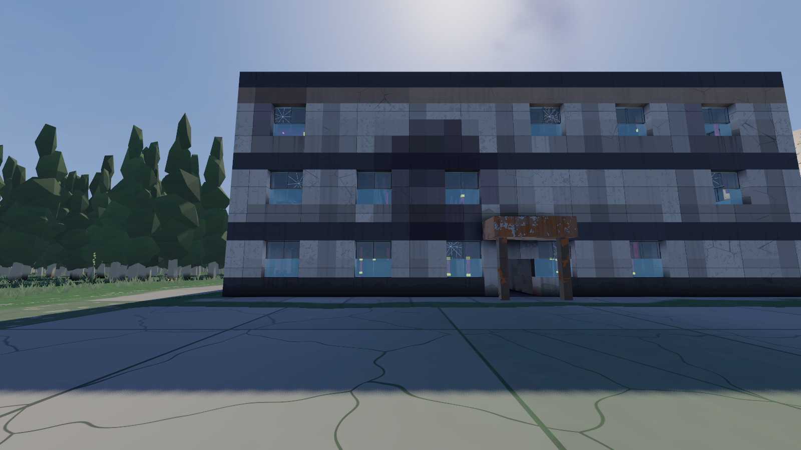</a><br><sub>A flat's windows, lined up pane by pane</sub></td><td width="33%"><a href="docs/gallery/furnished-room.png">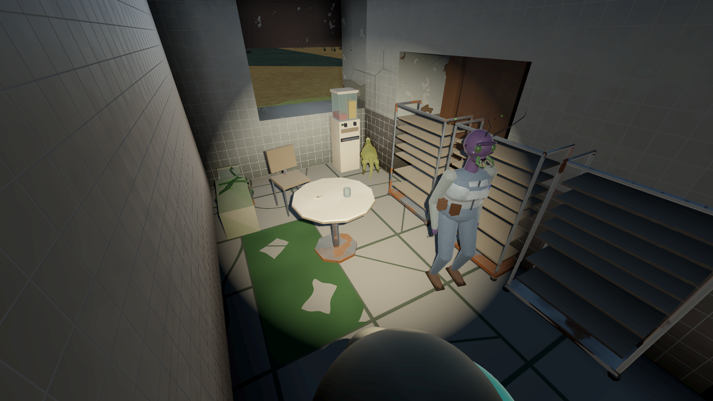</a><br><sub>A furnished room with a person and an animal</sub></td><td width="33%"><a href="docs/gallery/markers.png">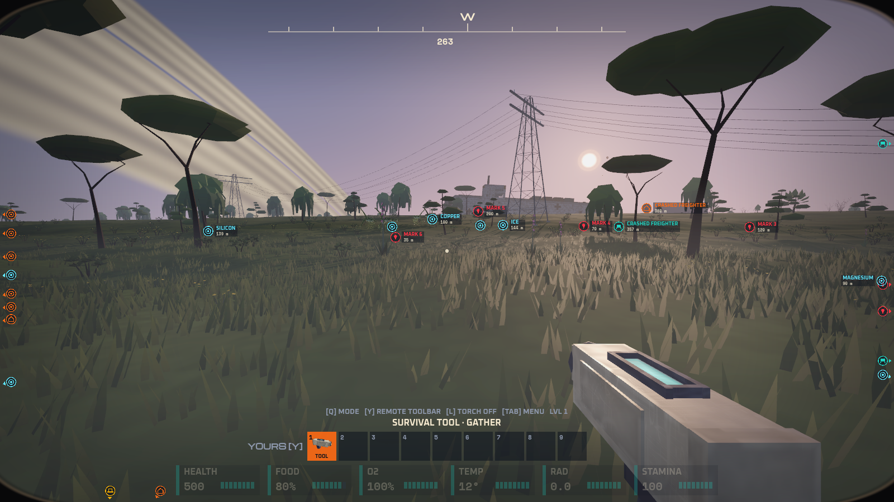</a><br><sub>Markers on places across the savanna</sub></td></tr>
<tr><td width="33%"><a href="docs/gallery/level-up.png">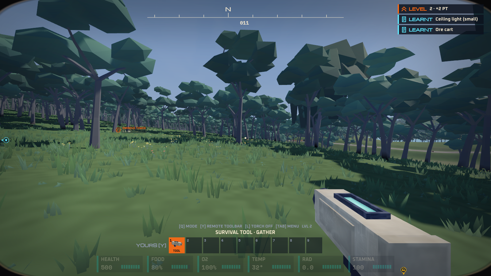</a><br><sub>A level-up in the notices slot</sub></td><td width="33%"><a href="docs/gallery/suit-terminal.png">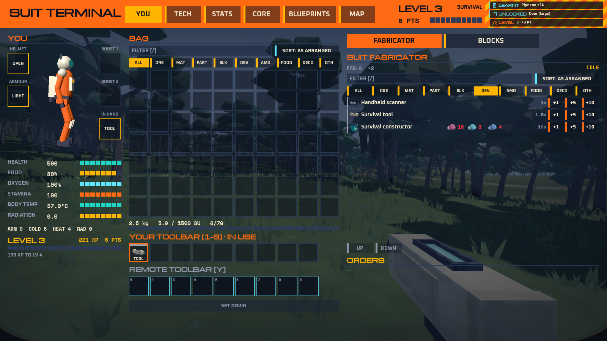</a><br><sub>The Suit Terminal: bag and fabricator</sub></td><td width="33%"><a href="docs/gallery/tech-tree.png">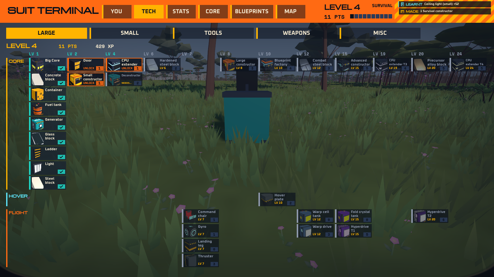</a><br><sub>The tech tree: Large</sub></td></tr>
<tr><td width="33%"><a href="docs/gallery/core-tab.png">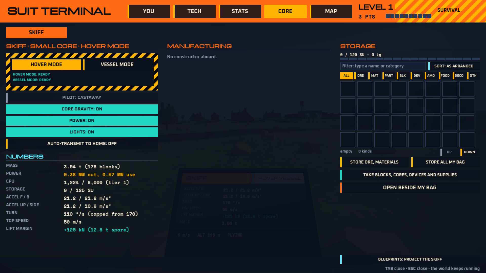</a><br><sub>The CORE tab: a constructor, its orders and storage</sub></td><td width="33%"><a href="docs/gallery/ruined-house.png">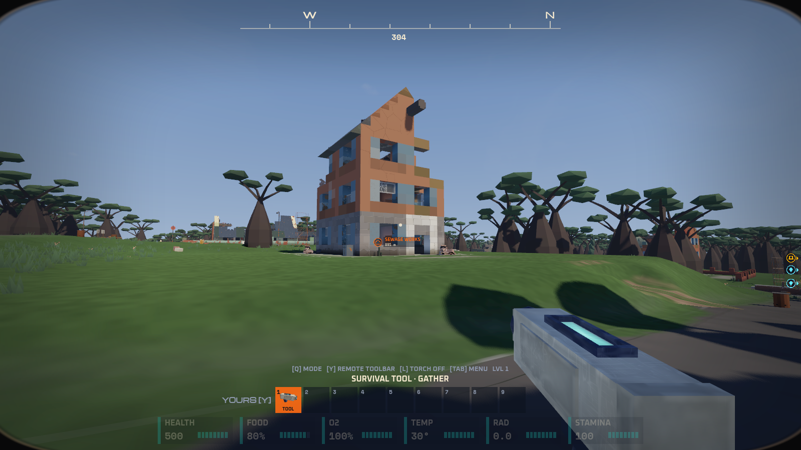</a><br><sub>A ruined house among baobabs</sub></td><td width="33%"><a href="docs/gallery/tornado-warning.png">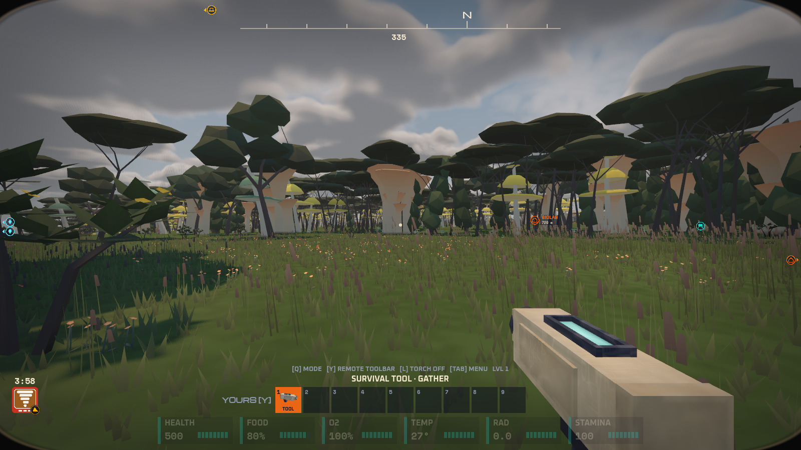</a><br><sub>A tornado warning over a fungal forest</sub></td></tr>
<tr><td width="33%"><a href="docs/gallery/galaxy-map.png">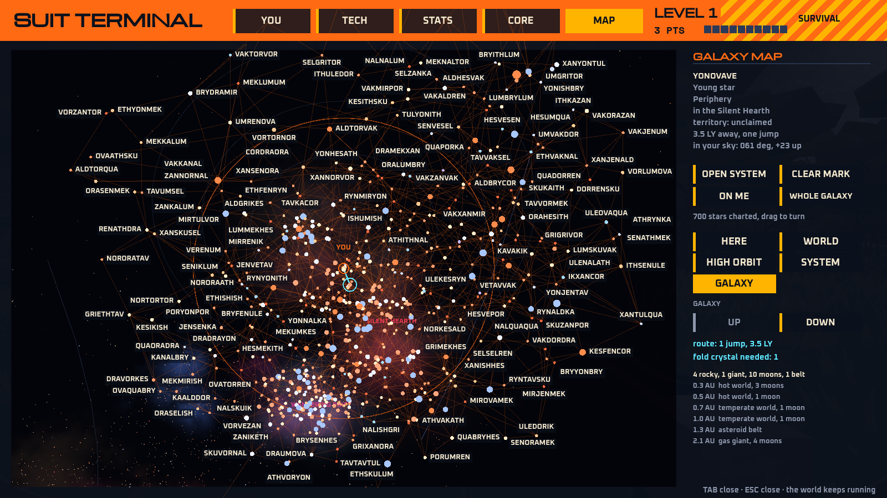</a><br><sub>The galaxy map: the whole galaxy</sub></td><td width="33%"><a href="docs/gallery/galaxy-lanes.png">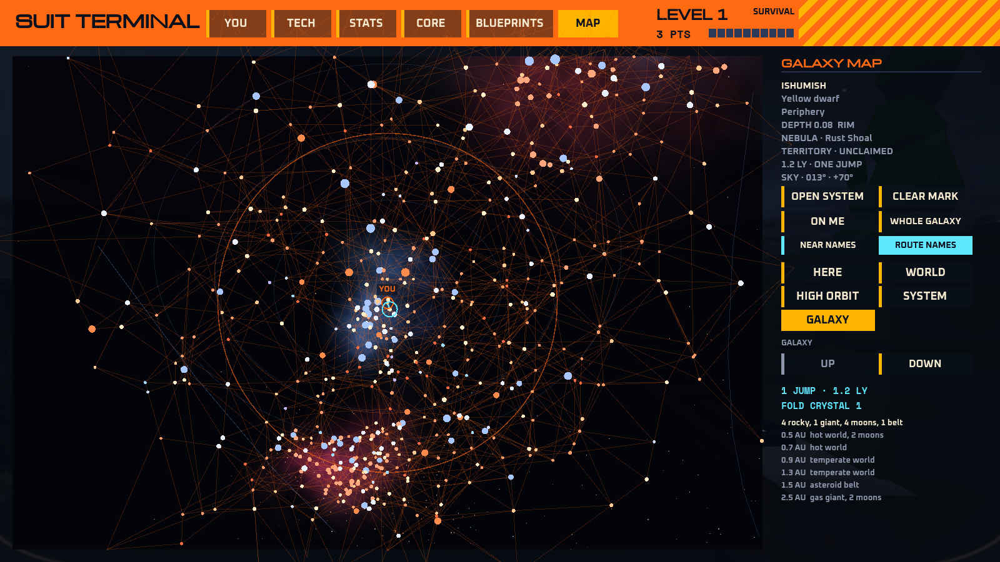</a><br><sub>The galaxy map: stars and lanes</sub></td></tr>
</table>

## Licence

GalHack is free to do anything with except sell. Its own code and data are licensed under the [PolyForm Noncommercial License 1.0.0](LICENSE.md): you may use, change, fork and share them for any noncommercial purpose, but not sell them or use them commercially. Third-party fonts and libraries keep their own licences, listed in [CREDITS.md](CREDITS.md).

## Design

The full game design document is [docs/DESIGN.md](docs/DESIGN.md), a published copy of the living doc that's refreshed as it changes. Other design notes:

- [docs/world-themes.md](docs/world-themes.md): the world themes the generator draws on
- [docs/world-layers.md](docs/world-layers.md): the themes split into layers that combine
- [docs/space-pois.md](docs/space-pois.md): places in space
- [docs/alien-peoples.md](docs/alien-peoples.md): the alien peoples of the old civilisation
- [docs/body-language-and-sound.md](docs/body-language-and-sound.md): how people talk without words
- [docs/playtest-list.md](docs/playtest-list.md): the owner's playtest checklist, with what's done

Guiding rule 1: **stable and smooth first.** Nothing a player builds, drops or stores ever disappears.

## Stack

- Godot 4.7 (.NET build), C# for all game code
- Steam co-op for a small group of friends
- Everything that can be data is data (text files with schemas)

## Layout

Shared code lives in [`shared/`](shared/): modules that prototypes compile in rather than copy. [`shared/Physics/`](shared/Physics/README.md) is the one physics module (units, collision layers, forces, damage, craters, structures as bodies, riding, stuck-safety).

| Folder | What's in it |
| --- | --- |
| `prototypes/` | Throwaway prototypes that prove one risky idea each |
| `prototypes/planet-generator/` | Seeded planets in five archetypes, divided into regions of 24 landforms, from a relief globe in orbit down to streamed terrain |
| `prototypes/terrain-digging/` | Remove-only grid digging: smooth Surface Nets terrain, dig anywhere but bedrock, blocks set flush into the ground, atomic audited saves |
| `prototypes/encounters/` | Encounter director: seeded, territory-aware spawns out of sight, fuzzy signal leads, nothing a player touched is ever cleaned up |
| `prototypes/building/` | Block building: the structure model every ship, base, POI and wreck is made of |
| `prototypes/boarding/` | Boarding a Vharn frigate: breach, fight to the core, hijack it in three stages or shoot it derelict |
| `prototypes/invasions/` | Vharn base invasions: warnings, sirens, crewed landings, breaching, offline and recovery |
| `prototypes/survival-vitals/` | Survival vitals: warned hazards, armor, replicators, healing and gentle respawns |
| `prototypes/ship-handling/` | Ships that handle like their build: four readable numbers, hover, gear, bumps and crashes |
| `prototypes/diegetic-ui/` | Screens on things in the world: consoles, a holo-table, a wrist computer and a helmet visor |
| `prototypes/weather/` | Forecast weather, wind that pushes by mass, lightning and tornadoes that are warned, never silent |
| `prototypes/coop/` | Steam co-op: friends walking around the same flying ship, zones, a dedicated server |
| `prototypes/saves/` | Crash-proof saves (shadow-paged plain files, audits, backups, migrations) and zone transitions; its `src/Persistence` is the core other prototypes adopt |
| `prototypes/wildlife/` | Procedural fauna for every planet: herds, hunting packs, telegraphed signature attacks, a discovery card on first sighting, day and night, cave crawlers, the fauna of places with food chains and fair tells, mutagenic worlds, settlements' animals, rare space creatures, no spawning near bases; a harvester hovercraft |
| `prototypes/poi-generator/` | Seeded points of interest from faction kits: four states, dressing, placement and validation |
| `prototypes/physics-sandbox/` | The shared physics module proven together: a blueprint ship flown over dug terrain in wind, real craters, severed wrecks, riding hulls and cabins, tornado flings |
| `prototypes/manufacturing/` | Materials and manufacturing: constructor tiers with self-planning queues and ammo restock, the deconstructor, the blueprint factory, survival and creative building from one shared storage, spill crates |
| `prototypes/capital-base/` | A capital ship lands on a real planet, becomes a base at its core console, is built onto and into the ground, parks a vessel, and lifts off clean, cut free; auto-transmit to Home |
| `prototypes/planet-surface/` | A whole planet to stand on: diggable streamed terrain on a torus, skies from each system, weather, seated POIs |
| `prototypes/slice/` | **The playable slice:** wake empty-handed in a cryo bunker on a fresh random world, climb out with a place in view, gather, and craft from the free survival tool and the suit fabricator; every block is a crafted item with Empyrion-style toolbars and sources, building is core-first and class-checked, with filters and tooltips; set up a base, unlock tech, then build and fly a vessel from a blueprint at a command chair (a sealed room gives air); the Tab menu (You, Tech, Stats, Core, Map, Blueprints), the fabricator panel on E and in-world screens; landforms in size classes and gentler climates; enterable places with doors, keycards, caches, salvage and decorations, survivor towns and starport classes; block damage; orbit, wrecks, boarding and maps; random-world tests |
| `prototypes/deco/` | The decorations library showroom: 226 procedural deco pieces in 22 theme sets with their damaged and aged variants, rooms and outdoor sites arranged then left as the collapse left them, ore surface tells; the library itself is `shared/Deco` and `shared/Items/data/deco*.json` |
| `shared/Terrain/` | The planet generator's worlds as diggable voxel terrain (caves, ore, bedrock, POI pads), wrapping both ways; compiled into prototypes that need it |
| `shared/Sky/` | The sky seam check: renders a sky looking straight at a cube's corners and edges, the poles, the axes and the azimuth's wrap, and fails on a line, a pinch or stars thinning at the axes; every prototype with a sky of its own runs it as `tests/SkySeamTest.tscn` |
| `shared/Items/` | The item catalogue as data on the five-step rarity ladder, the recipe tree from ore to every block, the production machines, mode-aware block placement, and ore deposit shapes ([README](shared/Items/README.md), [ore notes](shared/Items/ORE-NOTES.md)) |

## Requirements

- [Godot 4.7.2 .NET](https://godotengine.org/download) (the "mono" / .NET build, not the standard one)
- [.NET 10 SDK](https://dotnet.microsoft.com/download): every project targets `net10.0`
- Windows 10 or later (that's what everything is tested on); PowerShell for the scripts in `tools/`

## Running a prototype

Each folder under `prototypes/` is its own Godot project.

**Simplest:** open Godot 4.7.2 .NET, choose **Import**, pick `prototypes/<name>/project.godot`, then press **Play** (F5). Godot builds the C# the first time. Each prototype's own README lists its controls.

**With the repo's scripts:** `tools/` expects Godot and a portable .NET SDK inside a git-ignored `.tools/` folder at the repo root, so nothing is installed system-wide:

- Godot .NET 4.7.2 for Windows unpacked to `.tools/godot/Godot_v4.7.2-stable_mono_win64/`
- the .NET 10 SDK in `.tools/dotnet/`

Then run `.\tools\godot.ps1 -Project prototypes/<name> -Play`.

Steam co-op also needs Valve's `steam_api64.dll`, which isn't stored in the repo. Run `.\tools\steam-coop-test.ps1 -FetchSteamApi` to fetch and verify it.

## Testing

Every prototype has headless test scenes (`tests/*Test.tscn`, `tests/*Probe.tscn`) that exit 0 on success. Run them all before any merge to main:

```powershell
.\tools\test-all.ps1
```

Run one with `.\tools\test.ps1 -Project prototypes/<name> -Scene res://tests/<Scene>.tscn`.

The gate also fails if any Kenney asset is added: GalHack uses no Kenney assets of any kind.

A few checks must see rendered pictures (the sky seam checks, planet-surface's `SkyTest`). Headless runs draw nothing, so those scenes start themselves again in a normal window and pass on what it prints; they need a GPU, as playing does. Screenshots render in a normal window too.
