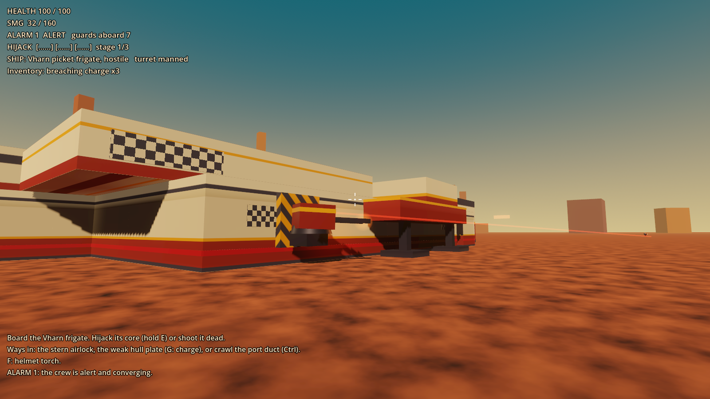
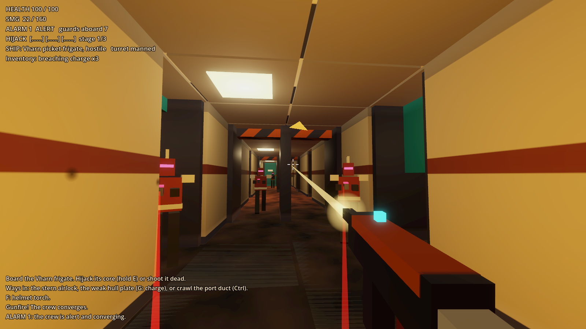
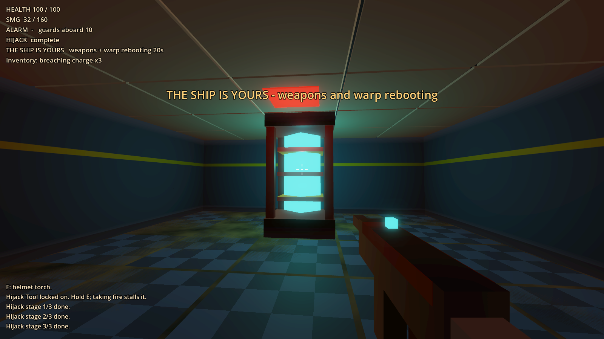
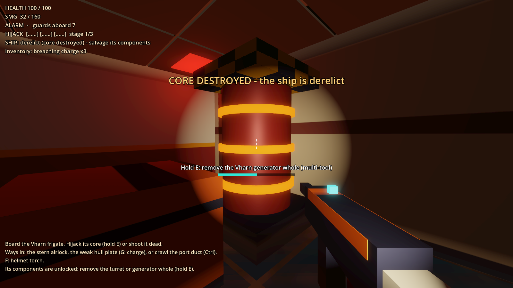

# Prototype: boarding and core hijacking

Proves the boarding loop: get into a landed Vharn Dominion frigate past its crewed turret, deal with its crew, and either hijack its core with the Hijack Tool or shoot the core dead and strip the wreck. Everything is built in code from data; nothing is imported.






## What it proves

- **Ships as block grids from data.** `data/vharn_picket.txt` is an ASCII grid: 8 rooms plus a spine corridor, airlock, a marked weak hull plate, a crawl duct, security doors, bulkheads, the core vault, gunner station, turret mount, patrol loop, guards and loot. Every wall, door and component is its own body with hit points. Damaged blocks split 2x2x2 and lose pieces near the hit (with real holes in their collision), and a destroyed block opens its cell.
- **A\* on the block grid.** Doors, sealed bulkheads, crates and blown-out walls all come from one passability question. Paths are string-pulled only where a body of the guard's full radius fits. Other guards add path cost, and guards ease apart with light separation steering. A guard that stops making progress re-paths, then side-steps, then walks to the nearest free cell, and snaps there as a last resort.
- **Alarm levels** 0 Unaware, 1 Alert (sighting or loud breach; guards converge on the last known position), 2 Lockdown (30 s of combat aboard, or a hijack starting; bulkheads seal), 3 Last stand (hijack stage 2 done, or hull under 25%; 90 s self-destruct, shown all the way).
- **Security doors** open three ways: hold E to hack (3 s, silent), a breaching charge (fast, loud, raises the alarm), or an officer's keycard (silent; the officer drops it).
- **Breach routes:** hack or blow the airlock, blow any hull plate (the striped one is weak), or crouch through the port duct.
- **The Hijack Tool** channels while you hold E at the core. Taking damage stalls it, idle time slowly decays it, and finished stages stay done. Each stage fires the core's next response, in data order: a reinforcement wave from the barracks lift (with a minigun enforcer), every bulkhead and security door slamming shut, and a power surge that kills the lights. Finishing the hijack flips ownership, cancels the self-destruct, unlocks the doors, stands the turret down and reboots weapons and warp for 20 s. Remaining guards fight on.
- **Or shoot the core dead:** the ship goes derelict and the multi-tool can take the turret and generator off whole. While the enemy core lives, removal is refused.
- **A crewed turret:** it fires only while its gunner sits at the gunner station. Kill him (or wreck the station) and it goes silent. There are no drones.
- **Hostile fire is fair through aim, not damage caps.** Damage is never scaled: a capital shell (150) vaporises a player on foot. Instead, every engagement opens with warning shots that are guaranteed to miss (the first 3, and everything in the first 0.75 s), land 1 to 2.4 m outside you and make you flinch. After that the cone tightens to the shooter's baseline over 2 s, and losing line of sight resets it. Baseline is shooter class × target class (infantry, small craft, capital against on foot, hover, small vessel, capital), times the weapon type (minigun sprays, rail and laser are precise, rockets track, artillery only suits big targets). Shots are projectiles you can see: rifle bolts at 380 m/s, capital shells at 300 m/s. All of it is in `data/hostile_fire.txt`.
- **Gunplay:** an SMG, a breacher shotgun and the survival tool's shoot mode. Shots resolve on the frame you click. Recoil follows a fixed, learnable pattern (pull down, slightly against it), and a short burst settles back. There are muzzle flashes with light, tracers, surface-matched sparks and decals (metal, armour, machinery, the core, rock, alien ichor), a camera kick, hit markers (white body, yellow head) and a red KILL confirmation. Enemies flinch, stagger under heavy fire, duck behind crates, and fall.
- **Crouch (hold Ctrl)** lowers the camera, shrinks the capsule, slows you and halves footstep noise. You can't stand up under the duct. Guards hear noise by radius: sprinting, gunfire and charges carry, a crouched walk barely does.
- **Loot:** two strongboxes in the vault and a cache in the hold.

## Play it

From the repo root, in PowerShell:

```powershell
.\tools\godot.ps1 -Project prototypes/boarding -Play
```

| Key | Action |
| --- | --- |
| WASD, mouse | Move and look |
| Shift / Space / Ctrl (hold) | Sprint / jump / crouch |
| Left mouse, right mouse | Fire, steady aim |
| R, 1 2 3 or wheel | Reload, switch weapon (SMG, shotgun, survival tool) |
| E (hold) | Hack or keycard a door, Hijack Tool on the core, crack loot, remove a component |
| G | Stick a breaching charge on the wall or door you're looking at |
| F | Helmet torch |
| Esc | Free the mouse |

You start at the landing site off the frigate's port quarter, inside the turret's arc. Use the boulders.

## Test it

```powershell
.\tools\test.ps1 -Project prototypes/boarding -Scene res://tests/BoardingTest.tscn
```

`tests/BoardingTest.tscn` runs 76 checks headless (about 40 s) and exits 0 or 1:
- A* goes around walls through doors; locked doors block it until hacked or swiped open
- a hack opens a security door with no alarm and no noise; a keycard does it silently in 0.4 s
- a breaching charge on the hull raises the alarm and sends guards pathing to the gap
- the hijack channel only progresses while held, stalls on damage and decays while idle; starting it means lockdown
- stage 1 brings a wave, stage 2 seals the bulkheads and raises the alarm to 3 with the countdown, stage 3 blacks out the lights; completion flips ownership, cancels the countdown and the HUD says the ship is yours
- damage is never scaled; the first 3 shots (and first 0.75 s) of every engagement always miss and land close; the cone reaches baseline 2 s after the warnings; breaking line of sight resets it; real guards and the real turret obey all of it
- killing the gunner silences the turret
- component removal is refused while the core lives and works once it's dead
- crouching shrinks the capsule and halves noise, and you can't stand under the duct
- a guard blocked by an obstacle the grid doesn't know about escalates through every unstick step and is never frozen for 3 s

The navigation soak test runs 50 seeded 8 s runs (alarms on random cells, a wave, random doors opened, firefights with a relocating player). It fails if any guard is stuck over 3 s, and prints the worst stuck time (0.80 s, with no unstick steps needed). Use a fixed frame rate so it runs faster than real time (about 40 s):

```powershell
. .\tools\env.ps1
& $GodotConsole --headless --fixed-fps 60 --path prototypes/boarding res://tests/SoakTest.tscn
```

`tests/Screenshot.tscn -- --view=exterior|firefight|hijack|derelict --out=file.png` renders a view (windowed). `--view=perf` prints frame time and draw calls instead: about 1.1 to 1.6 ms a frame uncapped on the dev machine.

## Data

| File | What's in it |
| --- | --- |
| `data/vharn_picket.txt` | The ship: ASCII grid with legend, spawn point, loot tables |
| `data/tunables.txt` | Hijack timings and responses, alarm thresholds, door and charge numbers, player movement and noise, guard and turret stats, block hit points |
| `data/hostile_fire.txt` | Warning shots, accuracy ramp, rating cones, shooter × target table, situational multipliers, weapon types and projectile speeds |
| `data/weapons.txt` | Player weapons, including the recoil patterns |

## Known limits

- **The ship is stationary.** Everything aboard is placed and queried in ship-local space, and the ship stands at an angle to prove nothing assumes its frame is the world's. But blocks are static bodies under a plain `Node3D` and guards are character bodies parented to it, so flying it needs the moving-cabin (ghost cabin) approach from the walkable-ship prototype.
- One deck. The layout format allows `[deck N]` sections, but only deck 0 is built, and there are no stairs or lifts.
- No audio at all yet: it's silent, and no Kenney audio is used. A warning shot is "heard" as a flinch and a yellow near-miss chevron.
- The power surge fires as stage 3 completes, so the lights go out at the moment of capture and stay out through the reboot, not during the channel.
- After a hijack the turret simply stands down; manning it isn't implemented.
- Guard tactics are simple: crates are the only cover, there's no flanking, and guards don't throw anything. Guards are blocky procedural figures with no skeletal animation.
- Deck and roof slabs are indestructible; walls, doors, hull and components are not.
- The HUD is debug text.
- About 2,000 draw calls outside (one mesh per block and tile), which is fine here but should become MultiMesh before ships get bigger.
- Single player only.
