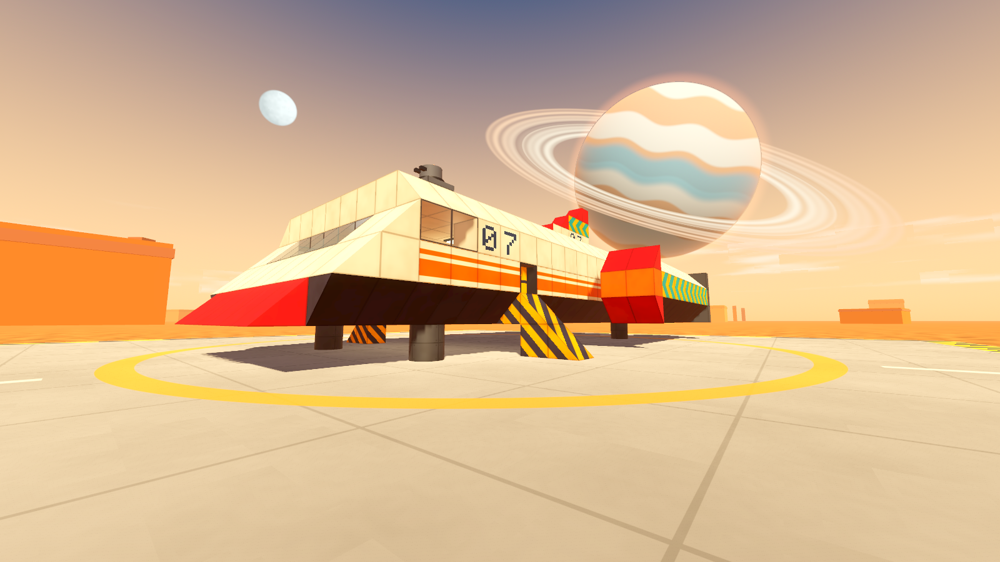
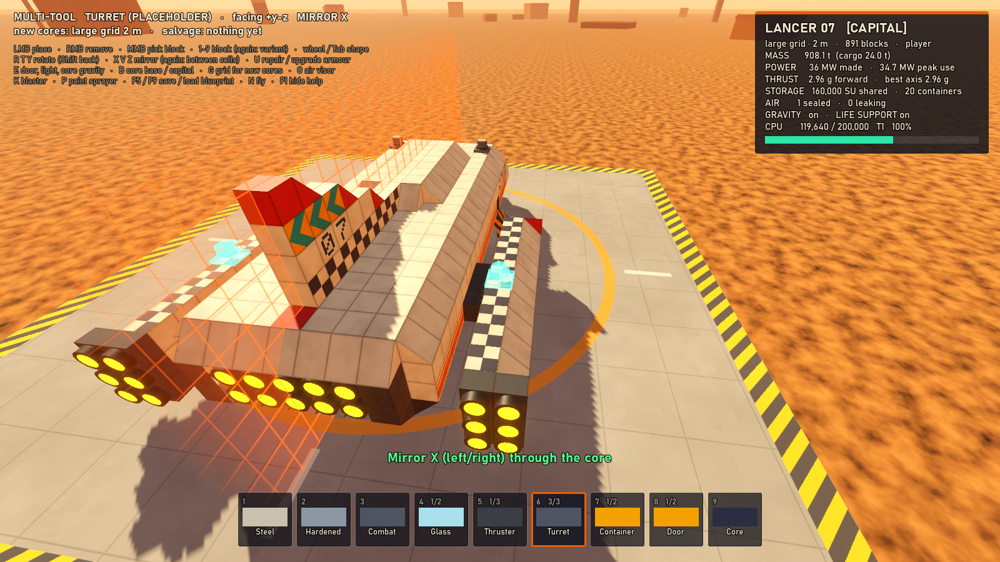
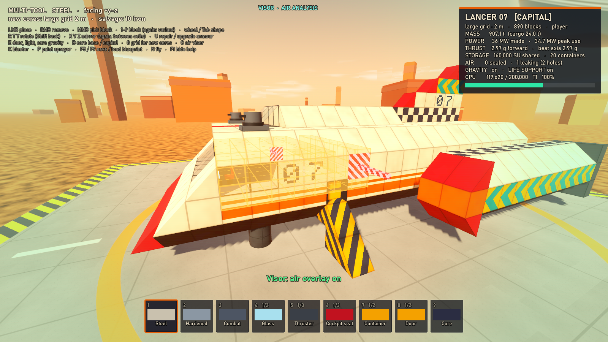
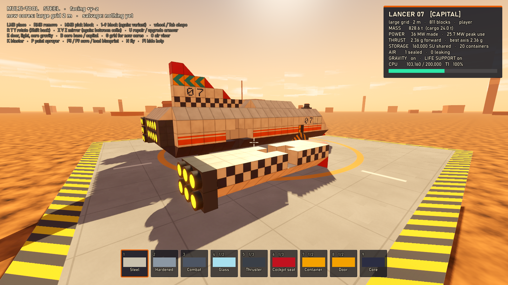

# Prototype: block building

The canonical structure model for GalHack (pillar: **build what you fly**). Ships, bases, POIs, boarding layouts and wrecks are all one thing: a `Structure`, a grid of blocks around one core. The model is plain C# with no engine dependencies, so the other prototypes can adopt it as is. A creative-mode build scene on a desert landing pad shows it off.






## What it proves

- **One model for everything.** Large grid (2 m) for bases and capital ships, small grid (0.5 m) for small vessels. A large core switches between **base** and **capital** mode; every material, block and recipe works in both, and switching never touches a block (tested with every block type and shape).
- **Building is intuitive.** Ghost preview, grid snapping, rotation on every axis, mirror symmetry on up to three axes, blocks attach through a shared face, and components that mount by one face (lights, ladders, seats, turrets) turn to the surface you click.
- **Nothing a player builds disappears.** Removing or destroying a block that holds a section on splits that section off as an unowned wreck (a free rigid body) with its paint, damage and share of the cargo. Block counts are conserved, and the tool asks for a second click before it cuts anything loose.
- **Data-driven.** Grids, materials, shapes and components are JSON in `data/`. A shape is just a list of points: volume, full faces (for attaching and sealing) and mirror symmetry are worked out from the geometry.
- **Readable, hand-writable blueprints.** The example ship is 891 blocks in about 130 hand-written lines, and it loads on start.
- **Fast enough.** 20,000 blocks mesh in about 55 ms; a single-block edit remeshes in about 6 ms.
- **Sealed rooms, found automatically.** Leaks are reported as the fewest faces that would seal the room (a min cut), so a missing block reports its own face and an open door reports the doorway.

## Play it

From the repo root, in PowerShell:

```powershell
.\tools\godot.ps1 -Project prototypes/building -Play
```

| Key | Multi-tool (build) | Paint sprayer (P) |
| --- | --- | --- |
| Left click | Place (the ghost turns amber before a CPU tier is crossed) | Spray the face (hold to sweep, Shift for the whole block) |
| Right click | Remove; materials go to the inventory (click again to cut a section loose) | Strip back to bare metal |
| Middle click | Pick the block you're looking at | Pick its paint |
| 1–9 | Block slot; press again for its variants (glass/concrete, thruster/generator/fuel tank…) | Colour (Shift: accent colour) |
| Wheel / Tab | Shape: cube, slope, corner, inverted corner, wedge, half block, thin plate, cylinder | Pattern: none, stripes, chevrons, checkerboard, hazard |
| R / T / Y | Rotate about Y / X / Z (Shift: back) | R: texture (panel, smooth, plates, ribbed) |
| [ / ] , - / = | | Stencil digit, grime level |
| X / V / Z | Mirror left/right, up/down, front/back; press again for a plane between cells, again for off | Same; mirrored faces are painted too |
| U | Repair a damaged block, otherwise upgrade armour (steel → hardened → combat), keeping shape and paint | |
| E | Open/close a door, switch a light, toggle the core's gravity | |
| O | Air visor: sealed rooms in teal, leaking rooms in amber, leaking faces in red | |
| K | Debug blaster: explosive damage, to test severing | |
| G | Grid for new starter cores (large/small). Aiming at a structure always uses its grid. | |
| B | Core mode: base / capital | |
| F5 / F9 | Save / load the structure you're looking at (`saves/quicksave.gbp`) | |
| WASD, Shift, Space, Ctrl, N | Walk, sprint, jump, crouch (hold), fly toggle | |
| F1, Esc | Hide the controls, free the mouse | |

Start something new by picking the core (9) and clicking the pad. Claim a wreck by placing a core on it.

The design asked for X/Y/Z mirrors and R/T/Y rotation, which both want Y, so the up/down mirror is on **V**.

## The blueprint format

One statement per line; `#` starts a comment. Coordinates are cells (x right, y up, -z forward) and `a..b` is an inclusive range, so a hull plate is one line.

```
schema galhack.blueprint
version 1
name "Lancer 07"
grid large                       # large (2 m) or small (0.5 m)
mode capital                     # base or capital
cargo 24000

paint hull base=ece3c8 grime=1
paint stripe base=ece3c8 accent=e85d04 pattern=stripes
paint n7 base=ece3c8 accent=1d3557 stencil=7

block 0 0 3 core
block -3..3 0 -9..2 steel paint=hull
block 4 1 -7..-4 steel paint=hull +x=stripe        # one face overridden
block 4 2 -5 steel paint=hull +x=n7                # a stencilled hull number
block -4 0 -9..-4 steel slope rot=-y-x paint=hull  # rot = where up and forward point
block -4 1 -3 door rot=+y-x open
```

- `block <x> <y> <z> <type> [shape] [rot=<up><forward>] [paint=…] [+x=…] [hp=<n>] [open] [off]`. The type is a material (`steel`, `hardened`, `combat`, `glass`, `concrete`) or a component (`core`, `cockpit`, `thruster`, `generator`, `fueltank`, `container`, `door`, `light`, `turret`, `cpuext`, `ladder`).
- `paint=<name>` paints all six faces and `paint=a,b,c,d,e,f` paints them in the order +x -x +y -y +z -z (`-` is bare metal). `+x=<name>` and its siblings override one face (write them after `paint=`).
- A paint has `base` and optional `accent` colours (rrggbb), `pattern` (stripes, chevrons, checker, hazard), `texture` (panel, smooth, plates, ribbed), `stencil` (a digit) and `grime` (0–3).
- Saving writes the canonical form (paints in use, blocks sorted by y, z, x, runs along x merged, defaults left out), so save → load → save is byte-identical.
- The validator rejects syntax errors, an unknown schema or version, no core or two cores, overlapping blocks, unknown block, shape or paint ids, impossible rotations, shapes on components, hit points above the maximum, and blocks that are not attached to the core.

See [data/blueprints/lancer.gbp](data/blueprints/lancer.gbp) for the whole ship.

## Test it

```powershell
.\tools\test.ps1 -Project prototypes/building -Scene res://tests/BuildTest.tscn
.\tools\test.ps1 -Project prototypes/building -Scene res://tests/PlayTest.tscn
```

`tests/BuildTest.tscn` (119 checks) covers placement rules (no overlaps, attach through a shared face, start from a core), mirror symmetry on three axes, removal returning materials, severing (a wreck, block count and cargo conserved, the core side keeps its owner, claiming with a core), mass, CPU sums and tiers, soft overshoot efficiency and extender tiers, shape volume scaling, upgrading in place, paint surviving save and load, sealed rooms (closed box, one missing block reported at its face, a ladder inside, closed and open doors, glass), shared storage and its caps, byte-for-byte blueprint round trips, every validator rejection, core modes (including every block type surviving base ↔ capital), cheap small-grid recipes from common materials, the nav export, and a meshing benchmark:

```
20000 blocks in 16 chunks of 16³, 69,632 triangles, 3352 collider boxes, 2455 convex hulls
full build: 54.6 ms total (39.3 ms meshing, 14.9 ms making ArrayMeshes), 3.39 ms average per chunk, 8.96 ms worst chunk
single-block edit: 6.21 ms average, 14.69 ms worst (1.3 chunks rebuilt per edit)
```

`tests/PlayTest.tscn` (13 checks) drives the real input paths headless: aim, place, mirror, remove, upgrade, paint, the visor, core mode, the blaster, a starter core and F5/F9.

`tests/Screenshot.tscn -- --view=ship|build|air|wreck|livery --out=file.png` renders a view (windowed).

## Adopting the structure core

- `src/Structures` (namespace `GalHack.Structures`) is plain C#: copy it with `data/`. Load the catalogue with `Catalogue.Load(name => text)` or `Catalogue.LoadDirectory(path)`, and structures with `Blueprint.Load(text, catalogue, out errors)`.
- Edit only through `Building` (place, mirror, remove, upgrade, repair, paint, toggle) and `Damage`. Any call that can cut a section off returns the new wrecks; give each one a body.
- Read `StructureStats.Compute` for mass, CPU tier and efficiency, power, thrust and storage; `Rooms.Detect` for air (life support, the visor); `NavGrid.Build` for crew and boarders (walkable cells plus door and ladder links, with a small A*).
- To draw one, `src/Presentation/StructureView` is a ready RigidBody3D (frozen while it has a core), or call `ChunkMesher.Build` per dirty chunk for your own nodes. The walkable ship's cabin world can take the same box and hull colliders.
- `Structure.Version` and `Structure.DirtyChunks` tell a view what changed; nothing in the core calls back into the engine.

## How damage looks

A block's health picks its stage (`Damage.Bucket`): over 75% whole, then scuffed, cracked and dented, and holed under 25%. Its material picks how that looks (`damageLook` in `materials.json`).

| Stage | Metal | Concrete | Alien alloy | Glass |
|---|---|---|---|---|
| Scuffed | Scratches through the paint, small scorches | Pale chips and dust | Dark bruises, faint glow | A small star crack |
| Cracked | Peeled to bare metal, cracks, broken edges, a dent | Wide cracks, broken corners, a dent | Glowing veins, a dent | Long spokes and rings |
| Holed | Soot, the plate torn open and bent in, the frame and strut behind it, the odd hot seam | Rubble, rusty rebar, the same hole | A burned shell over bright wounds, the same hole | Whole shards gone |

Dents and holes are real geometry on cube faces, and their outer edges stay where they were, so nothing opens up against the next block. Shaped blocks and components are drawn by the shader alone. Colliders never change until a block is destroyed. Each look comes from a hash of the block's cell and face, so a remesh can't change it.

A hit also throws sparks, leaves an impact mark and, if it was hard enough, throws chips that land, lie there and fade (`DamageFx`). Badly damaged devices smoke until they're repaired, and smashed lights go out. Wear redraws only the block's own chunk and leaves `Structure.Version` alone (`Structure.SetHp`). `Structure.RecentHits` is how the effects hear about hits, and it's capped because nothing has to read it.

Crashes go through `Damage.Crash`, which spreads the impact from where it struck and ignores flat armour (it's meant for one round on one plate), though kinetic resistance still counts. Repairs cost that share of the block's recipe, rounded up, and restore the look stage by stage.

The stages follow the brief's summary of how Empyrion works (worse damage textures, destroyed blocks gone, repairs restoring them). No Empyrion page was read for this, and the design doc wins.

## Known limits

- Repairing in the slice has its rule and tests (`VesselDamage.Repair`), but no tool in the player's hands yet.
- A wall holed on both faces costs about 6 ms a chunk to redraw, so a barrage across four such chunks takes four frames, not one or two.

- Every block fills exactly one cell; there are no multi-cell blocks yet.
- Two structures never merge: a block touching two structures joins the one you aimed at. A wreck rejoins only by being claimed with its own core.
- Colliders are greedy boxes plus one convex hull per sloped block, all on the structure's single body, so Jolt rebuilds that body's compound shape on each edit. Fine at these sizes; very large edited structures may want a body per chunk.
- Two partial faces always count as touching, even where their areas don't overlap (two slopes facing opposite ways).
- Leaking rooms are found among air the hull encloses along all six axes, so a room with a whole wall missing reads as outside rather than as a leaking room. Rooms with more than 48 independent holes are reported as wide open, without faces.
- The nav export knows floors, doors and ladders; slopes are not ramps for it yet.
- Creative inventory: placing and repairing are free and removing pays out.
- The CPU, power, thrust and recipe numbers are first guesses, all in the data files.
- Quick save only (one slot, written under `saves/` when running from source).
- The HUD font is the system's Bahnschrift, falling back to Segoe UI or Arial. No font, sound or texture assets are used: every sound is synthesised in `Sfx.cs`.
