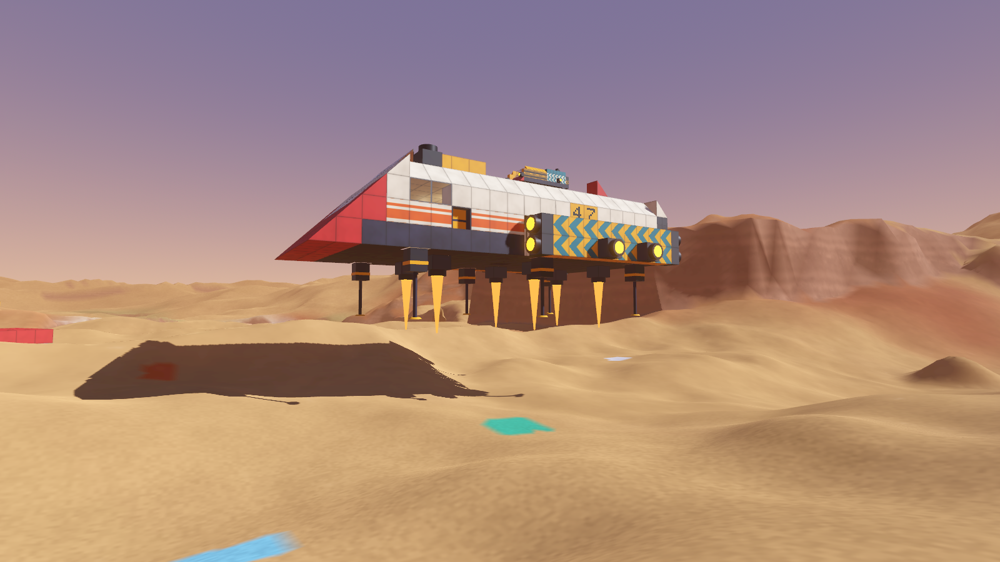
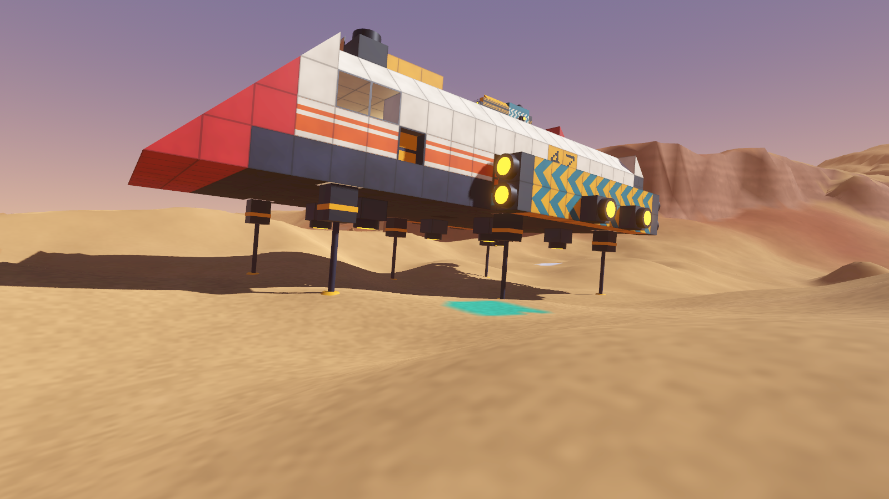
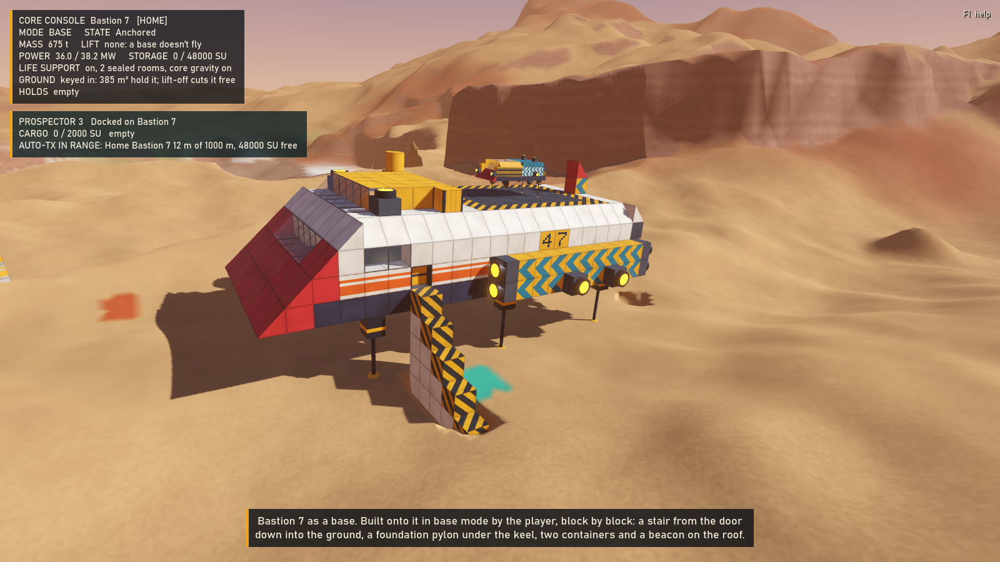
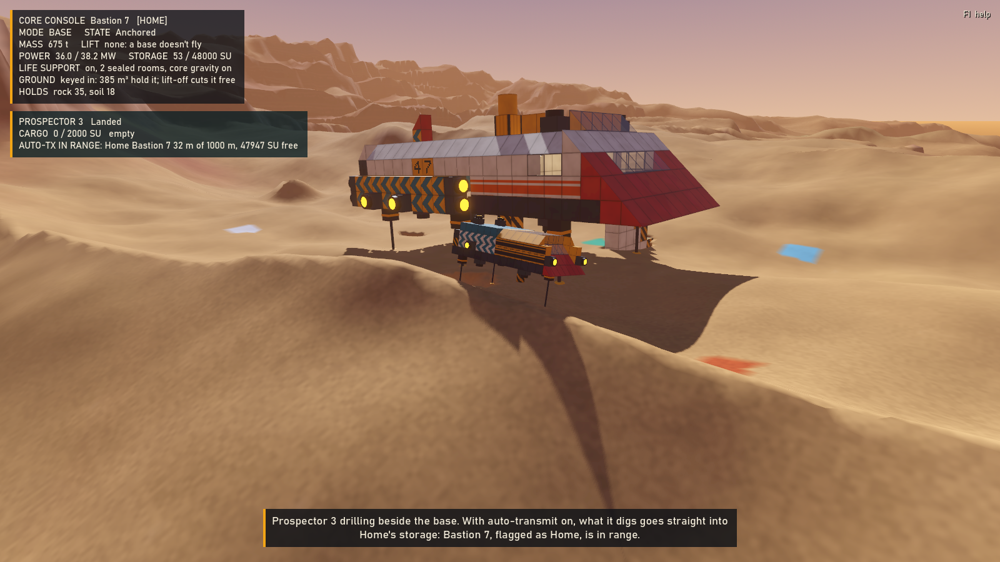
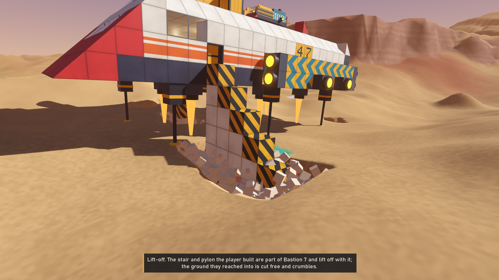

# Prototype: capital ship to base and back

GalHack's core building loop, proven end to end: a capital ship flies down onto a real planet, settles on its legs on uneven ground, and its core is switched to **base mode** at the console. It is a base now: it can't fly and no wind moves it. You build onto it (into the ground too), dig round it, park a small vessel on it, and its storage, power and life support carry on. Switch the core back to **capital mode**, lift off, and the ground it was built into is cut free as it rises, the parked vessel riding along. A harvesting vessel with **auto-transmit** on sends what it digs straight to whichever structure you flagged as **Home**. Everything is saved and loaded at every stage, and every block and item is counted after every step.

One core, two modes. No block, material or recipe cares which mode the core is in, so a switch never rebuilds, removes or converts anything: it changes one field.







The screenshots, in order:

1. **descent**: Bastion 7 coming down on its lift jets, gear out.
2. **landed**: settled on its six legs on uneven ground; the legs telescope onto the ground under each foot.
3. **anchored**: base mode, with the core console. The stair from the door down into the ground, the foundation pylon under the keel, the two roof containers and the beacon are **ordinary blocks the player built onto the base**, one at a time, as anyone would with the build tool. Nothing deploys by itself; there is no ramp feature.
4. **farm**: Prospector 3 drilling beside the base, auto-transmit on, Home in range.
5. **liftoff**: back in capital mode, lifting off. The stair and pylon are part of the structure, so they lift off with it; the ground they reached into is cut free through the terrain's edit API and crumbles away. (A player who doesn't want a stair hanging under the hull takes it off first: its materials go back to them.)

## What it proves

- **Land on real terrain.** A planet from the planet generator, as `shared/Terrain`'s diggable voxels, meshed and drawn by planet-surface's own mesher, palette and terrain shader, with far rings out to the horizon. Bastion 7 (584 blocks, 653 t, a blueprint in building's format) is flown down by ship-handling's handling model through `shared/Physics`, and settles on its gear on dunes whose ground under the six feet differs by 0.6 to 0.8 m, tilted 4 to 5° (the gear allows 12°).
- **Anchor.** Base mode at the core console: anchored exactly where it stood, every block and the pose unchanged to the bit. Its handling model has no thrust, lift-off is refused, and a 40 m/s hurricane puts 0 N on it and moves it exactly 0 m.
- **Run as a base.** Blocks are built onto it, in creative (free) and survival (paid from the player's materials, refused when they can't pay), including a foundation pylon into the ground, whose ground is cleared through the edit API; the ground round it is dug, and the cells under its landing feet (its footings) refuse the dig tool. Prospector 3 lifts off its pad, farms, lands back on the pad and parks there, sheltered: 0 N of wind on it in a hurricane. Power, storage and its contents, life support, core gravity and sealed air (2 rooms, 213 cells) are identical before and after every switch.
- **Lift off clean.** Back in capital mode, lift-off cuts every cell of ground within 0.75 m of the hull's path out of the ground (36 to 205 cells in the tests: soil and rock), logged, deterministic (the same plan twice), and climbs straight up through the cut: never snagged (0 stalls), never launched (top climb speed 2.4 to 2.6 m/s against a 3 m/s command), no stuck rescues and no ground impacts. The parked vessel rides along, still exactly on its pad. Every block, item and vessel is accounted for.
- **Too heavy is refused.** A 24-block combat-steel bunker (96 t) on a 680 t ship: "LIFT-OFF REFUSED: TOO HEAVY. 770 t (with 5.6 t parked aboard) needs 7549 kN of lift and the lift jets give 7200 kN. Drop 35.6 t or add 1 lift jet." Nothing is cut, nothing moves. Take the bunker off and it lifts.
- **Auto-transmit to Home**, every case: in range, out of range, Home part-full, the Home flag moved, Home freeing room, and Home flying away and back.
- **Nothing lost.** 22 save-and-load round trips through the saves prototype's persistence core, one at every stage, each rebuilding the whole world from its records and checked against the world before it to the bit (every craft's blocks, state, pose, cargo and host, Home, the inventory, the ground's edit hash). The persistence core's ledger refuses any save whose item or block totals don't add up, and 30 more counts in between check every step.
- **The full cycle three times in a row** on one ship, at three spots, with no reset in between.

## Anchoring: how a base stands

The simplest stable rule: **a base is held by its core, not by the ground.** Switching to base mode locks the structure's pose exactly where it stands on its legs. From then on nothing integrates it (it sleeps through every tick, held by a `Pinned` controller in place of its vessel controller), so gravity, wind, a ram or the ground dug from under it can never move it, and no physics can ever make it creep. This is the same promise a planted base makes in Empyrion: bases don't fall.

The legs stay planted on the ground they settled on, and the cells under each landing foot become the base's **footings**: a 3 × 3 patch two cells deep that the dig tool refuses while it is a base (so a player can dig anywhere round it without it ever looking undermined), released on lift-off. The stuck guard leaves pinned structures alone: a base may stand partly in the ground because its builder put it there.

A landed capital ship that has blocks built into the ground is held the same way ("keyed in") until lift-off cuts it free, so digging nearby can't wake it into ground it overlaps. One that isn't keyed in is just a landed ship.

## Lift-off: cutting free

Lift-off is a console command, refused (with the reason, and nothing touched) in base mode, without power, when too heavy, or when the ground holding the hull won't give way. Otherwise:

1. **Plan** (`src/Core/CutFree.cs`, pure): every block of the hull, and of every vessel parked on it, is a box. Each box, grown by `liftoff.margin` (0.75 m) plus how far it could swing if the wings level on the way up (its distance from the core times the sine of the hull's tilt), is swept straight up through the climb. Every terrain cell whose centre lies in a sweep is to be cut. The climb is at least `minClimb` (3 m) and long enough that each block's own column is open sky for `clearBand` (3 m) above it, up to `maxClimb` (40 m). A cell the terrain refuses (bedrock, a POI's anchored ground) refuses the lift-off; so does a cut of over `maxCells` (6000) cells. The plan is sorted, so it is the same on every machine.
2. **Cut**: the cells go through planet-surface's `PlanetTerrain.DigCells`, terrain-digging's own rules and edit log, every copy across a seam included. The session's terrain history logs what was cut and why. Each cut cell sheds a clod of its own colour that tumbles and fades: the ground crumbles away.
3. **Wait** until the voxel patch has rebuilt the cut chunks' colliders, so the hull can't meet ground that no longer exists.
4. **Climb** straight up at `climbSpeed` (3 m/s), flown by the handling model like any other flight (the stick held at "up" in the world's frame), through exactly the volume the cut was made for. Then the pilot has it.

Nothing is cut from under the hull's path, so nothing pushes it; nothing is left in its path, so nothing snags it. The tests watch the climb tick by tick for both.

The cut ground isn't owned by anyone: like a crater, it is gone (logged). Everything the player built, dug and stored is kept.

## Parking and the wind

A vessel parks on a base or capital ship by landing on it: when it settles with a structure's hull under it, it docks there (`Pinned` again, this time at a fixed pose in the host's frame). Every tick, after the host has moved, it is put back on the host with the host's velocity at that point, so it rides along exactly however the host flies, lands or lifts off. Thrust undocks it, moving with its host.

The wind rules, applied through which bodies weather pushes: **bases are never pushed, and neither is anything parked on a base or capital ship; capital ships and vessels that are flying or simply landed are.** (A landed ship stays put unless a tornado-strength push wakes it, the shared module's rule.) Cruising at 12 m/s with nobody at the controls, a hurricane blows Bastion 7 3 to 7 m off its line in 3 s, while its parked vessel feels 0 N all the way. Another agent is adding these rules to `shared/Physics` itself; this prototype states them in one place (`CapitalWorld.UpdateWind`), so it can switch to the shared version without changing behaviour.

## Auto-transmit to Home: the decisions

- **Home**: the player flags exactly one base or capital ship as Home. It is one field (`HomeFlag`), so a new flag replaces the old one and two Homes can't exist. Small vessels can't be Home.
- **Radius: 1 km** (`autoTransmit.radius`, data), from the vessel to Home's core, the short way round the planet. Far enough to farm a whole valley around the base; near enough that an expedition has to come back.
- **Straight to Home**: what a vessel with auto-transmit on digs goes into Home's storage as it is dug, while it is in range and Home has room.
- **Part-full: transfer what fits, never delete.** Whole units move in item order until the next one wouldn't fit; the rest stays in the vessel's own cargo. Every `autoTransmit.interval` (0.5 s) whatever the vessel holds goes across the same way, so it empties by itself once it is back in range or Home frees room. The drill won't dig more than the vessel and (in range) Home can hold together.
- **Indicator**: the vessel's console line, one of `AUTO-TX OFF`, `AUTO-TX: NO HOME FLAGGED`, `AUTO-TX IN RANGE: Home Bastion 7 35 m of 1000 m, 39944 SU free`, `AUTO-TX OUT OF RANGE: Home Bastion 7 1200 m (range 1000 m), holding 26`, `AUTO-TX HOME FULL: Outpost 2 has 0 SU free, holding 16`.
- **A moving Home** works because range is measured to wherever Home's core is each pass: in the test, 354 units reached Bastion 7 while it flew at up to 45 m/s; as it flew out past 1 km, 288 units were held aboard; when it came back they went across by themselves.

Items are a stand-in until `shared/Items` lands: whole units of `soil`, `rock`, `deep-rock` and `ore` (one per dug cell, 1 SU each, data in `items` and `yield`), in a stack per item in building's one shared storage (its containers' capacity). Cargo mass feeds building's stats and so the handling model.

## Building in either game mode

Building onto the base goes through building's own `Building.Place` with the player's `Inventory`: in creative it is free, in survival each block costs building's recipe from the player's materials and is refused if they can't pay. Taking a block off pays its materials back (building's rule). The mode is the inventory's `Creative` switch (`M` in play), so `shared/Items` can plug in behind it. A block placed where there is ground clears the cells inside it (grown by `build.margin`, 0.1 m) through the edit API: that is how blocks reach into the ground. Where that space holds bedrock or a POI's anchored ground the block is refused, as terrain-digging's own placement rule says (not covered by a test: bedrock lies 30 m under the valley floors).

## Play it

```powershell
.\tools\godot.ps1 -Project prototypes/capital-base -Play
```

The world is saved in `prototypes/capital-base/.saves/play` (git-ignored) and continued next time; `-- --new` starts again, keeping the old save beside it.

| Key | Action |
| --- | --- |
| Tab | Select Bastion 7, Prospector 3 or Outpost 2 |
| WASD, Space, Ctrl | Fly the selected craft (strafe, up, down) |
| Arrows, Q, E | Pitch and yaw, roll |
| Shift | Boost |
| G | Land here (autopilot) |
| B | Core console: switch base / capital mode |
| L | Lift off |
| H | Flag the selected structure as Home |
| X | Prospector 3: drill the ground under it |
| T | Prospector 3: auto-transmit on or off |
| K | Weather: calm or hurricane |
| Left click | Build a block where you point (1 to 5: steel, concrete, container, glass, light) |
| Shift + left click | Take a block off (its materials to you) |
| Middle click | Dig the ground where you point |
| M | Game mode: creative or survival |
| F5, F9 | Save, load |
| Right drag, wheel | Orbit and zoom the camera |
| F1 | Help |

## Test it

```powershell
.\tools\test.ps1 -Project prototypes/capital-base -Scene res://tests/CapitalTest.tscn
```

`tests/CapitalTest.tscn` runs headless with `--fixed-fps 60` (from `CapitalTest.args`) in about 20 s and exits 0 or 1. 157 checks:

- **Pure rules**: part-full transfers and haul splits lose nothing; the link's five states; exactly one Home; the cut planner on synthetic ground (a block 1 m in cuts 18 cells, all within its margin, sorted, the same twice; a hull clear of the ground cuts nothing; bedrock and a 70 m burial refuse).
- **The cycle, three times on one ship** at three spots: fly and land (settled at 4.4°, 5.2° and 0.7°, the third resting partly on foundations from earlier cycles); base mode (pose and blocks unchanged to the bit, no lift, no wind: 0 N and 0 m in a 34 to 41 m/s hurricane); build onto it in creative or survival, a pylon into the ground and a container each time (survival pays 56 iron and refuses what it can't pay for); dig round it (58 to 66 cells into the player's pack, the footings refuse); Prospector 3 undocks, flies out, drills 50 to 56 units straight to Home, flies back and parks on the pad (sheltered: 0 N in a hurricane); capital mode (keyed in by 36 to 205 m³); lift off clean (above); and the too-heavy bunker in cycle 3.
- **Saves**: 22 save-and-load round trips, one at every stage; 30 more conservation counts.
- **Wind on a capital ship** in flight (blown off its line) with its parked vessel sheltered.
- **Auto-transmit**: in range, out of range (1200 m: 26 units held), back in range (sent within 0.5 s), the Home flag moved to Outpost 2, Home part-full (10 of 26 sent, 16 held), Home freeing room (the 16 sent), a moving Home (above). Saved and loaded in the middle.
- **Timing**, judged on the best of three windows so a busy machine can't fail it: planning a lift-off cut for 913 blocks about 4 to 6 ms (budget 25 ms); the shared physics step with all three crafts about 0.1 ms a tick (budget 2 ms).

## Screenshots

```powershell
. .\tools\env.ps1
dotnet build prototypes/capital-base/CapitalBase.csproj
& $GodotEditor --fixed-fps 60 --path prototypes/capital-base res://tests/Screenshot.tscn -- --view=landed --out="$PWD/shot.png"
```

Views: `descent`, `landed`, `anchored`, `farm`, `liftoff`. Each runs the real scene and scripts the moment through the same console commands and building calls a player uses.

## How it fits together

| Piece | Where | What |
| --- | --- | --- |
| Rules that are new here | `src/Core` (plain C#) | `CutFree` (the lift-off plan), `Cargo` and `AutoTransmit` (storage, Home, the link), `CapitalRules` (data/capital-base.json) |
| The world | `src/World` | `CapitalWorld` (the console, building, digging, drilling, parking, the ledger), `Craft` (a structure as a body: hull, colliders, look, legs, flames), `Pinned`, `LiftOff`, `Ground` (every terrain edit and the footings), `TerrainPatch`, `Sites` (landing spots), `Pilot` (an autopilot for tests and "land here"), `Debris` |
| Saves | `src/Records/SaveGame.cs` | Records for each craft, the ground and the player, through prototypes/saves' persistence core |
| Shared modules | `shared/Physics`, `shared/Terrain` | Compiled in where they live |
| Other prototypes' cores | building `Structures`, ship-handling `Handling`, terrain-digging `Terrain`, weather `Model`/`Forces`, planet-generator `Gen`/`Look`, poi-generator `Gen`, saves `Persistence` | Compiled in, unchanged |
| Bridges | physics-sandbox `src/Bridges` (structure, handling, weather, terrain field) | Compiled in, unchanged |
| Presentation helpers | building's `ChunkMesher` and `BlockMaterials`; planet-surface's `PlanetWorld`, `VoxelMeshing`, `FarBuilder`, `GroundPalette`, `SkySystem`; its terrain shader, read where it lives with its includes resolved | Compiled in (or read) unchanged |
| Data | `data/capital-base.json`, `data/blueprints` | The new numbers; Bastion 7, Prospector 3 and Outpost 2, hand-written in building's blueprint format |

Bastion 7: large grid, 26 × 42 m, a sealed bridge with a door, an engineering hall (four containers, three generators under fuel tanks, four gyros), a landing pad on the roof, six legs and six lift jets under the keel, engine nacelles with retros and side jets. Prospector 3: small grid, a glazed cab, a cargo body of sixteen containers (2000 SU), three legs, a drill column. Outpost 2: a concrete blockhouse base with a footing a block into the ground. Liveries after Chris Foss: cream and saffron, red rakes, teal chevrons, hazard stripes, big stencilled numbers.

Everything is generated in code or read from the other prototypes. No sound, font, model or texture assets are added (the HUD uses the system's Bahnschrift, falling back to Segoe UI or Arial).

## References

Empyrion: Galactic Survival's community pages were read for how its players handle the same problems; nothing was copied. Our rules differ where they say so: one core, two modes, everything interchangeable.

- [base to CV convert?](https://empyriononline.com/threads/base-to-cv-convert.8324/) (Empyrion community forums): players describe converting a base into a capital vessel as a workaround, not a switch, partly because bases sit in the ground and buried parts clip. Here the switch is one field, and lift-off cuts buried parts free.
- [Cannot Dock Ship](https://steamcommunity.com/app/383120/discussions/0/4343229540498795095) (Steam discussions): a small ship docks through its landing gear touching the host's surface. Here a vessel parks by settling on any structure's hull, and thrust takes it off again.

## Decisions to review

- **Anchoring is by rule, not by physics**: a base is pinned at its pose. Simple and unbreakable; it means a base dug out from under stays where it is (as in Empyrion), which the footings make unlikely to look odd.
- **Footings**: the ground under each landing foot of a base refuses the dig tool. A small, visible promise; easy to drop.
- **Landing on blocks**: a ship whose own blocks reach lower than its legs (a foundation it was given as a base) settles on them by the gear's own rule (slow, nobody on the stick, within a hand's width of the ground for half a second), so a ship can always land.
- **The parked vessel's mass counts in the lift-off check** (the message says so), but not in the host's handling numbers in flight.
- **Lift-off cuts ground, it never moves it.** The cut ground is gone, like a crater's; it isn't anyone's.
- **A lift-off is not saved mid-climb**: a save during one stores the ship flying, and on load it holds station where it was.

## Known limits

- **One fixed square of ground.** The voxel patch is 14 × 14 chunk columns (224 m) around the site, with far rings beyond it; there is no streaming, so a ship flying far away has no ground to land on (the tests fly Home 1.3 km away at altitude). planet-surface's streamer is player-centred and builds colliders only near the player, which doesn't suit a ship.
- **No walking player.** The console is the HUD and the camera orbits the selected craft; walking round the base is physics-sandbox's and walkable-ship's work, not repeated here.
- **Items are a stand-in** until `shared/Items`: four ground materials, one per dug cell.
- **The legs telescope to their ground for the look.** Physically the ship settles on a plane fitted through its feet; on rough ground a foot can be up to about 0.7 m above its ground, and the drawn leg reaches down to it.
- **The lift-off climb drifts a little sideways** (up to 0.23 m) while the handling model's axes come up to speed at different rates; the 0.75 m margin covers it.
- **Ore outcrops** show as flat coloured patches on the dunes (planet-surface's known limit).
- **Debug HUD, keyboard and mouse only, single player.**
