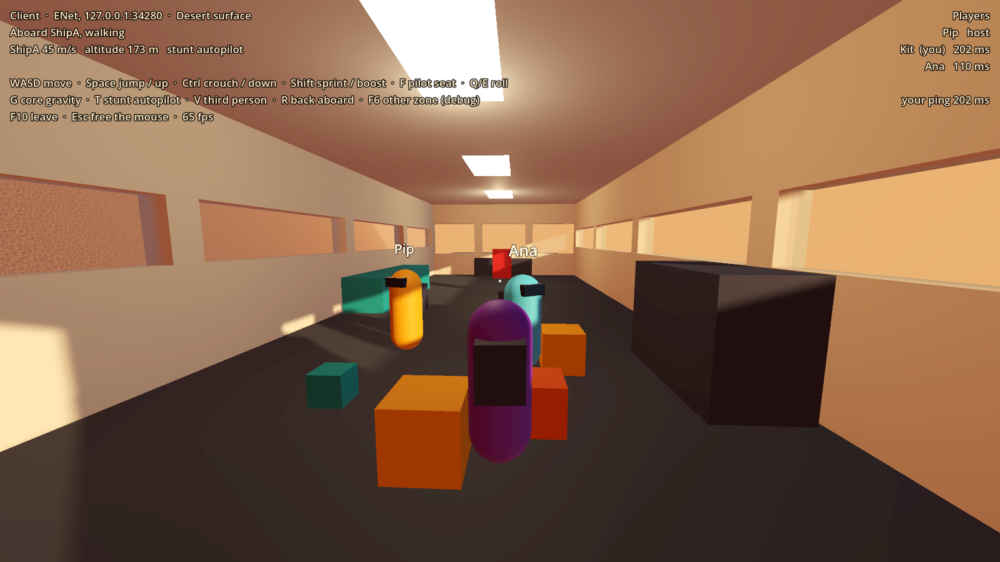
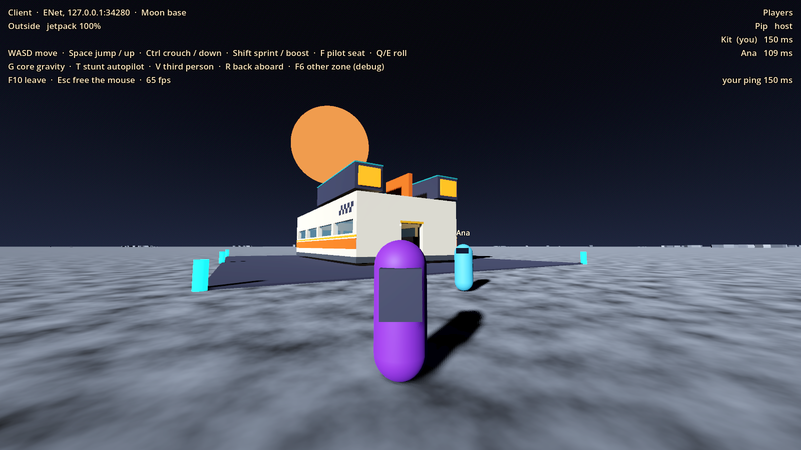
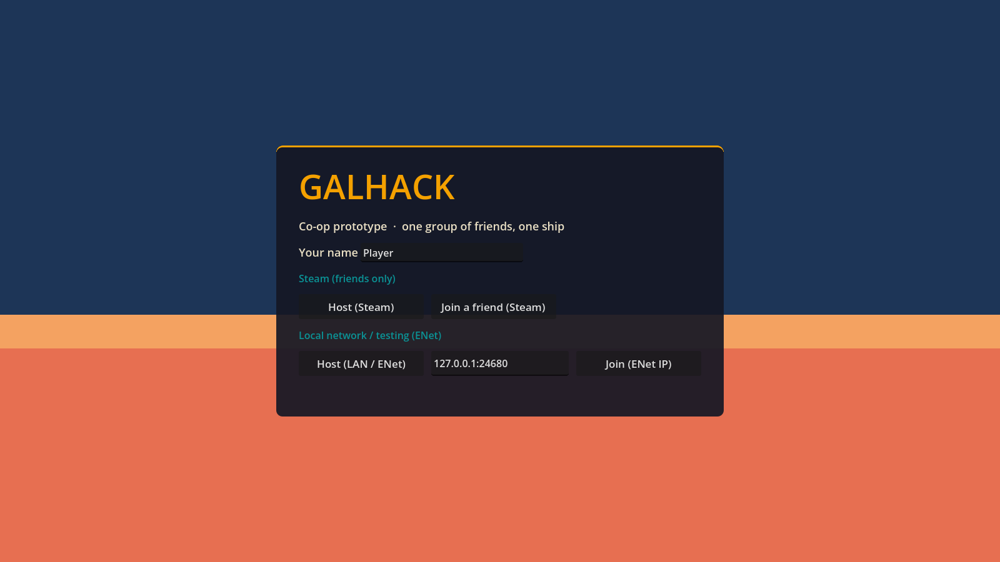

# Prototype: Steam co-op

Proves that a group of friends can share GalHack's moving ships: walk around inside the same ship while one of them flies barrel rolls, without anyone sliding, lagging behind the ship or popping about. The networking runs the same over Steam (P2P through Steam's relays, friends-only lobbies) and over plain ENet (LAN, direct IP, a headless dedicated server).





Built on `prototypes/walkable-ship` (cabin worlds, two ships, walking aboard moving ships).

## How it works

**Trust model.** The host owns the world: ships, cargo, and every interaction (the pilot seat, core gravity, the stunt autopilot, shoving a crate), which clients ask for by RPC. Each player's own movement is trusted: their client moves them and reports where they are. It keeps play smooth and the code simple. It is fine for one group of friends: no PvP, no anti-cheat, no matchmaking, no public server browser. Everyone shares one faction (there are no weapons in this prototype; friendly fire would be a host option, off by default).

**Ship-relative positions.** A player aboard a ship reports the ship's ID plus a ship-local position and look direction. Everyone else draws them at *their own* copy of that ship × that local position, so a passenger stays exactly on the deck however fast the ship flies. In a world-space scheme they would trail the ship by the interpolation delay: 10 m at 100 m/s. Remote ships and players are drawn from an interpolation buffer about 100 ms in the past. Each snapshot carries its sender's clock, and the buffer tracks the clock offset from the fastest recent arrivals, so jitter doesn't shake anything. Ships interpolate along cubic curves using their velocities.

**Zones.** Every networked thing carries a zone ID. Each zone is a world of its own (a SubViewport with its own World3D, like the cabin worlds), so zones never touch. The host simulates every zone; a client loads only its own. The replicated nodes (`NetShip`, `NetPlayer`) are spawned by `MultiplayerSpawner`s, and their `MultiplayerSynchronizer`s have zone visibility filters. Godot only spawns a node on peers in its zone, despawns it when they leave, and only sends them its updates while they are there. The prototype has two zones: the desert surface (ships A and B) and a moon base (ship C), with **F6** as a debug transfer key.

**Networking is separate from gameplay.** `src/Net` (namespace `GalHack.Net`) knows nothing about ships or players:

| Piece | What it does |
| --- | --- |
| `ITransport`, `EnetTransport`, `SteamTransport` | Make Godot `MultiplayerPeer`s. Steam adds friends-only lobbies, invites and the "friends hosting now" list. |
| `SteamMultiplayerPeer` | A `MultiplayerPeerExtension` over Steam networking sockets, so RPCs, synchronizers and spawners work unchanged over Steam. It talks to an `ISteamSockets` layer: `SteamworksSockets` is the real one, `FakeSteamNetwork` an in-process fake for tests. |
| `NetSession` | Host, join, leave, reconnect (3 tries, 1/2/4 s apart), a headless dedicated server, the player list with pings, a protocol version check. When the host leaves on purpose, clients are told and end gracefully instead of timing out. |
| `ConditionedPeer` | Wraps any peer to add latency, jitter and loss for tests, and counts bandwidth. |
| `SnapshotBuffer`, `NetSync` | The interpolation buffer, and synchronizers with zone filters built in code. |

The game-specific part is `src/Coop`: `CoopWorld` (the replicated containers and spawners, zones, remote ship copies, avatars, the interaction RPCs), `NetShip` / `NetPlayer` (the replicated state) and `CoopGame` (one session; it rebuilds the world on a reconnect).

What is replicated:
- **Players:** zone, mode (outside, aboard, piloting), ship ID with a ship-local position, look, crouch. Sent by the owner at 30 Hz; the host passes them on to the same zone.
- **Ships:** transform, velocity, spin and pilot, at 30 Hz; gravity and stunt state when they change.
- **Cargo:** crates are simulated on the host and sent at 20 Hz while any is moving, once a second when they're all asleep. On clients they are frozen copies the local player still bumps into.

A dropped player's avatar is removed everywhere. A rejoining player gets a fresh spawn in the host's current world; real persistence is the save-system prototype's job. If the host leaves, everyone's session ends with "The host ended the session".

## Run it on one PC (two windows over ENet)

From the repo root, in PowerShell:

```powershell
. .\tools\env.ps1
dotnet build prototypes\coop\Coop.csproj -nologo -v q
Start-Process $GodotEditor -ArgumentList '--path','prototypes/coop','--resolution','960x540','--position','0,40','--','--host','--name=Pip'
Start-Process $GodotEditor -ArgumentList '--path','prototypes/coop','--resolution','960x540','--position','960,40','--','--join=127.0.0.1','--name=Ana'
```

Or start it twice with `.\tools\godot.ps1 -Project prototypes/coop -Play` and use **Host (LAN / ENet)** and **Join (ENet IP)** on the title screen. Other command-line options: `--port=24680`, `--sim=80,10,1.5` (simulate an 80 ms round trip, 10 ms jitter and 1.5% loss), and `--dedicated` for a server with no local player:

```powershell
& $GodotConsole --headless --path prototypes/coop -- --dedicated --port=24680
```

LAN friends join with your IP address; over the internet, forward UDP port 24680 to the server.

## Test it over Steam (with a friend)

This is the part only you can test: it needs your Steam account and a friend's. Both of you need this same commit, plus Godot 4.7.2 .NET and the .NET SDK, or you can export a build and send it to them.

```powershell
.\tools\steam-coop-test.ps1 -FetchSteamApi   # once: fetches Valve's steam_api64.dll and checks it is the signed original
.\tools\steam-coop-test.ps1 -Smoke           # optional: a one-machine check of your Steam setup (see below)
.\tools\steam-coop-test.ps1 -HostGame        # you: host a friends-only lobby
.\tools\steam-coop-test.ps1                  # your friend: title screen, then "Join a friend (Steam)"
```

1. The host presses **I** in game to invite the friend through the Steam overlay. The friend accepts with the game already running, or opens **Join a friend (Steam)** and picks the host.
2. You both appear in the player list (top right) with a ping, and see each other's avatars.
3. One of you sits in the pilot seat (**F** at the front) and flies; the other walks around inside. Press **T** for stunts. The passenger must stay glued to the deck, and look smooth to the pilot (**V** for third person).
4. **G** toggles gravity for both of you; the crates float the same on both screens.
5. **F6** takes you to the moon: the other player and the desert ships vanish for you, and come back when you return.
6. The friend presses **F10** to leave, then rejoins: their old avatar is gone and the world is up to date.
7. The host presses **F10**: the friend's game ends with "The host ended the session".

**About app ID 480.** Development runs as Spacewar, Valve's shared test app (`steam_appid.txt`). Steam shows you both as playing Spacewar. Every developer testing on 480 shares its lobby space, so GalHack lobbies are friends-only and tagged, and anything else is ignored. If the friend accepts an invite while the game is *not* running, Steam launches the real Spacewar, so start the game first. Steam's "Join game" in the friends list has the same catch. Steam dedicated game servers aren't used: the dedicated server is ENet by IP.

**A real app ID** costs the Steam Direct fee and gives GalHack its own name, invites that launch it, and its own lobbies. That is your decision for later; nothing here needs it.

## Controls

| Key | Action |
| --- | --- |
| WASD, mouse | Walk and look; fly and steer when seated |
| Space | Jump, or up (zero-g, flying, jetpack outside) |
| Ctrl | Crouch on foot, or down (zero-g, flying) |
| Shift | Sprint, or boost when flying |
| F | Ask for the pilot seat (front of the cabin), or leave it |
| Q / E | Roll |
| G | Ask the host to toggle core gravity |
| T | Ask the host for the stunt autopilot |
| V | Third person |
| R | Back aboard |
| F6 | Go to the other zone (debug) |
| I | Invite friends (Steam overlay; when hosting over Steam) |
| F10 | Leave the session (a host ends it for everyone) |
| Esc | Free the mouse |

## Tests

```powershell
.\tools\test.ps1 -Project prototypes/coop -Scene res://tests/NetTest.tscn
```

`tests/NetTest.tscn` never touches Steam. It runs, in order:

1. **Unit tests, in process.** `SteamMultiplayerPeer` against the fake socket layer: connect and disconnect events (leave, kick, timeout, host closing, nobody hosting, refused), channel and transfer-mode mapping to Steam send flags, packet ordering (reliable; unreliable-ordered with packets reordered in flight; plain unreliable), loss, targeting, 200 KB messages. Then Godot's high-level multiplayer (RPCs, a spawner, a synchronizer with a zone filter) over that peer, the network simulator, and the interpolation buffer.
2. **A listen host and 3 clients**, as separate Godot processes over ENet loopback. The clients run on an 80 ms round trip, 10 ms jitter and 1.5% loss. The host flies ship A in barrel rolls at 100 m/s while client A walks circles aboard. Client B must draw A at the right ship-local spot, compared against A's own recorded path, without jumps. Also checked: bandwidth per client with 4 players; gravity toggled by one client's RPC applies everywhere; floating, then settled, cargo matches on every client; the stunt and pilot seat RPCs, with the client actually flying; a client in zone 2 gets no zone-1 entities and vice versa; a client leaves and rejoins into a consistent world (changed while it was away) with its old avatar gone everywhere; and when the host leaves, every client ends gracefully.
3. **A headless dedicated server and 2 clients:** no local player, the same position check, bandwidth, the gravity RPC, a graceful end.

Exits 0 if everything passed. Numbers from the last run (all 56 checks passed):

```text
position error (B watching A aboard ship A, 100 m/s barrel rolls): 721 samples, mean 0.1 cm, p95 0.1 cm,
  max 0.6 cm; largest jump between frames 2.6 cm (A's own largest step 2.5 cm); avatar missing 0/751 frames
position error (dedicated server, E watching D): mean 0.1 cm, max 0.2 cm; largest jump 2.7 cm

bandwidth per client, 4 players in one zone, ship stunting (payload / UDP incl. ENet headers):
  down 10.5 KB/s / 11.0 KB/s (35 packets/s), up 1.4 KB/s / 1.7 KB/s (31 packets/s)
bandwidth per client, 2 players on the dedicated server: down 5.1 KB/s, up 1.4 KB/s

cargo: floating within 0.2 cm on every client, settled within 0.0 cm
rejoin: ship A within 0.016 m, moved ship B within 0.000 m, gravity matches, 3 players seen
```

`tests/SteamSmokeTest.tscn` is **opt-in** and uses the real Steam client on this machine (`.\tools\steam-coop-test.ps1 -Smoke`). It starts the Steam API as app 480 and checks relay network access and ping readiness. It creates a *private* lobby, sets and reads its metadata, then leaves it. It runs `SteamMultiplayerPeer`, and Godot's high-level multiplayer on top, over a real Steam socket pair on this machine, and shuts the Steam API down cleanly. It never contacts friends, never changes your profile or online status, and skips (exit 0) if Steam isn't running.

`tests/Screenshot.tscn` (run windowed) renders the screenshots above from a real session: a headless host and client, and the window as a third client.

## Known limits

- **Piloting has round-trip lag.** The host flies every ship, so a client pilot's controls take one round trip (about 80 ms) to bite, and they see their ship the usual 100 ms in the past. Fine for cruising, soft for racing. Next step: predict the piloted ship on the pilot's client, or hand flight to the pilot.
- **Players don't collide with each other**, and a client can't shove crates directly: crates are frozen copies on clients, and shoves are sent to the host, so they move a moment later.
- **No validation of trusted movement.** That's the design for friends; a stranger could teleport.
- **Bandwidth isn't squeezed.** Full-precision state is sent at 30 Hz, even for a parked ship (about 10 KB/s down per client with 4 players). Quantising and resting detection would cut it a lot.
- **The host simulates every zone all the time.** Ships don't travel between zones yet; only players do, with a debug key.
- **No host migration**: the host leaving ends the session (by design for now). A dedicated server avoids it.
- **Automatic reconnection is untested.** A client that loses the host unexpectedly tries 3 times (1, 2 and 4 s apart), but the tests only cover leaving and rejoining on purpose; a real cable pull over Steam is part of the manual test.
- **Steam is only tested on one machine** (fake sockets, plus real loopback in the opt-in smoke test). Two-player Steam play, invites and relays across the internet need the manual test above.
- The on-screen text is a debug overlay. The ring course from the walkable-ship prototype was left out.
