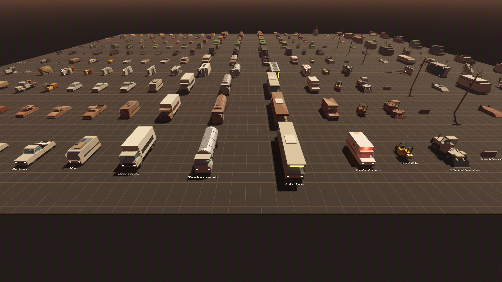
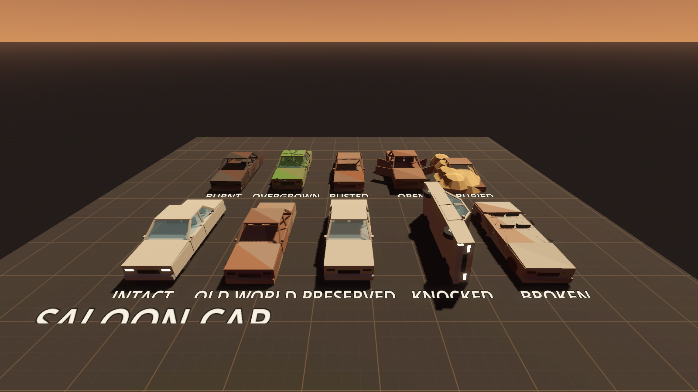
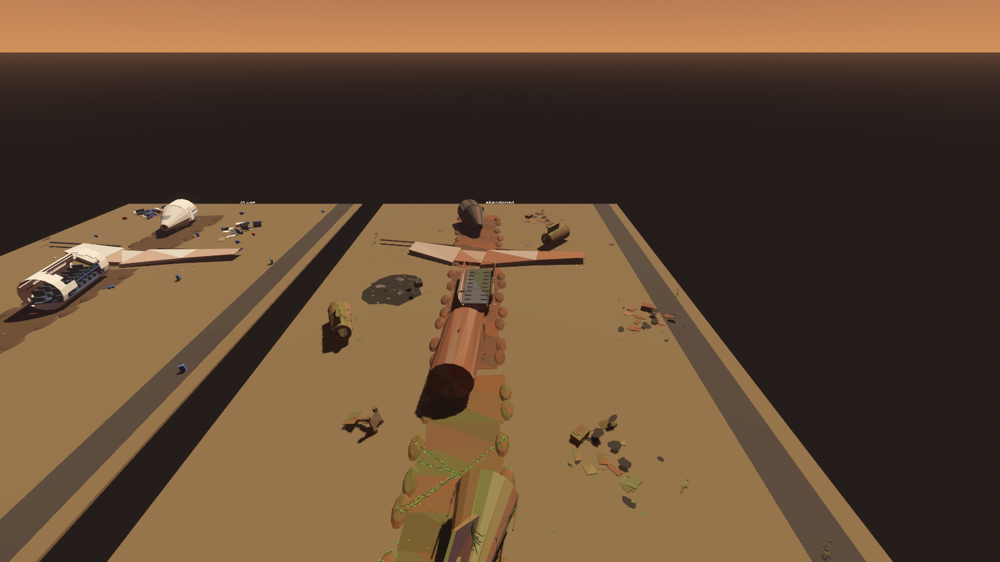
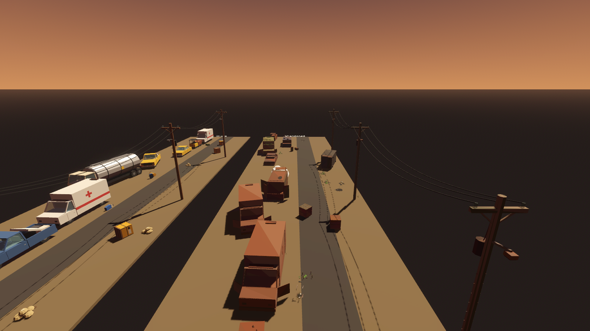
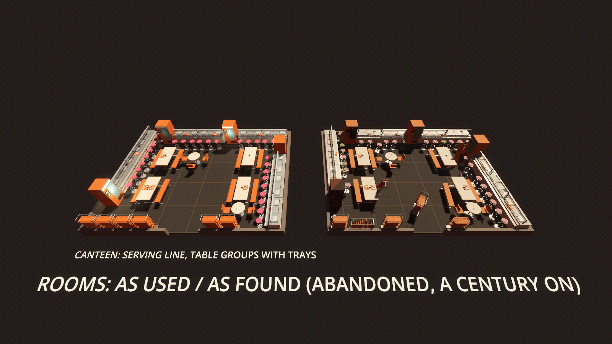
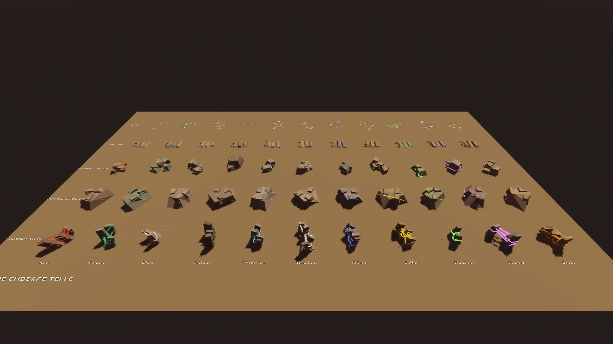

# Prototype: decorations library

The deco pieces that dress GalHack's points of interest and that players unlock and build with: 226 chunky, flat-shaded procedural pieces in 22 theme sets, each in every state the collapse could leave it in. On top of the pieces sit arrangement templates that furnish a room as it was used, and a seeded disorder pass that leaves it as it was found: knocked over, broken, burnt, overgrown, rusted, a chair still pushed back from the table. Outdoor sites (an evacuation jam, a crashed airliner, a derailed train...) are dressed the same way, and ore deposits get rock formations as surface tells. Everything is plain C# data and code in `shared/`, with a thin Godot adapter, so the POI generator, the slice and the building code can all use it. Nothing here is an imported asset: every mesh is built from boxes, wedges, cylinders and domes in code.








## Run it

```powershell
.\tools\godot.ps1 -Project prototypes/deco -Play
```

| Key | |
| --- | --- |
| WASD, mouse | fly, look (click to capture the mouse, Esc frees it) |
| Space / Ctrl (or E / Q) | up / down |
| Shift | fast |
| [ / ] | previous / next set |
| T | the rooms and sites: each as used (left) and as found (right) |
| 1 to 4 | room state: active, abandoned, infested, ruined |
| R | reseed the rooms and sites |
| O | the ore surface tells |
| F1 | hide the help |

Each set is a strip: one column per piece, one row per state (intact, old world, preserved, knocked over, broken, burnt, overgrown, rusted, doors open, half-buried), labelled. Lights and animations (flicker, blink, pulse, sparks) run on the intact row.

## The catalogue

`shared/Items/data/deco.json`, loaded by `shared/Items/Core/DecoCatalogue.cs`. Each piece has an id, name, set (and `also` sets it furnishes), roles (desk, chair, bed... what templates and POI props ask for), a footprint in small-grid cells (0.5 m, front facing -z; on the large grid it rounds up to whole 2 m cells), the grids it goes on, its mount (floor, wall, ceiling, or on top of a desk or counter at that piece's `surface` height), a bill of items from `items.json` (validated against the item catalogue), a tech-tree node per grid in the same shape as the slice's block unlocks (level, cost, parent, tab `deco`; a set's first piece is its root and the rest hang under it), the states it has, the ways it can fall, an optional light (range, energy) and animation, a tech level (low, mid, high), a salvage class for wrecks, and an optional own palette. `uniqueOnly` marks the pieces whose bill needs precursor alloy, a unique find, so they come from salvage only.

| Set | Pieces | Set | Pieces |
| --- | --- | --- | --- |
| office | 10 | ship | 8 |
| canteen | 9 | mine | 7 |
| medical | 9 | reaver (scrap camps) | 8 |
| military | 8 | civic (chapel, park, hall) | 9 |
| industrial (with the factory pieces) | 17 | alien (chitin, lattice and bloom looks) | 10 |
| lab | 8 | precursor | 8 |
| residential | 10 | farm | 14 |
| resort | 7 | vehicles | 23 |
| themepark | 9 | rail | 15 |
| cryo | 6 | aviation | 17 |
| spaceport | 7 | prison | 7 |

226 pieces; with borrowed pieces every room set has 9 to 38 to choose from. By tech level: 49 low, 115 mid, 62 high, and each level has its own vehicles (low: farm cart, tractor, plough, trailer, old truck, ore tram, diesel locomotive, log wagon; mid: hatchback, saloon, pickup, van, box truck, tanker, bus, ambulance, forklift, wheel loader, coaches and wagons; high: hover skimmer, cargo hover, sky flyer, agri-drone, harvester, maglev head and coach). The alien set has three looks unlike the Precursor set's bronze and stone: chitin and resin, a glowing teal lattice, and a pink bloom.

**Vehicles, trains and airliners.** Vehicles are whole pieces with wheels that sit on the ground, doors that open and glass that breaks. Trains are rolling stock (diesel and maglev locomotives, coaches, box, tank, flat and log wagons with their loads) plus a track kit (track, maglev guideway, buffer stop, signal, level crossing, platform edge, station canopy). Airliners come in sections, a prop or turbofan liner and a high-tech skyliner: nose and cockpit, fuselage, a torn-open cabin with its seats, wings, tail, engines, landing gear, debris and a crash scar, plus boarding stairs and an airbridge.

**Salvage.** Vehicles and wreck sections carry a salvage class (light, medium, heavy, huge) whose yield table is in `deco.json`; see Integration for the deconstructor hook.

## Surfaces

Every part is drawn from what it is made of: wood (grain along the board, rings on its sawn ends, boards across a wide face), paint (a fine orange peel, sheet seams on a wide face), brushed steel, polished chrome, brass and bronze, moulded plastic, cloth (weave, stitched seams, soft rounded edges), leather (pebbled, creased, stitched), paper and card, glazed ceramic (tiles and grout on a wide face), rubber (a tyre's tread and wall rings), stone and concrete (mottle, aggregate, pits), screens and glass. A part takes its finish from its slot and flags (body and trim are painted, dark parts plastic, cushions and cloth in a body colour fabric, hay and food organic, a tyre rubber, a pane glass), or a model says so with `.As(DecoFinish.Leather)`. Wear follows the piece's state and age: dust on what faces up, chipped paint at the edges, rust blooms on bare metal and paint lifting over rust outside, faded and stained cloth, cracked leather, crazed glaze, greyed and split timber. The finish and wear ride in the vertex colour's alpha and each vertex's place on its face in UV and UV2, so a place still shares the same six materials (`shared/Deco/Engine/DecoShaders.cs`); every pattern fades as it shrinks below a few pixels.

## States, age and exposure

Every state is made from the intact model, so all pieces get them for free:

- **Knocked over**: the piece is tipped onto its side, back or front and rolled until its centre of mass sits over what it rests on, so it lies flat and still on the floor.
- **Broken**: screens cracked, glass shattered, loose parts gone and lying beside it, the frame bent; vehicles and wreck sections are crushed instead, roofs down and tyres flat.
- **Burnt**: soft things (cushions, cloth, paper, tyres) burnt away, the rest charred, a scorch on the floor.
- **Overgrown**: vines ray-cast over its surfaces, moss and tufts at its foot; infested places get the Hollow Bloom instead.
- **Rusted**, **doors open** (and glass smashed), **half-buried** in sand or snow (sunk, with a drift against it).

The **age** axis is separate: *fresh* (in use), *old world* (the fall was a century or two ago; the default for any place not in use) and *preserved* (sealed: dusty, or frosted in the cold). Age works with **exposure** (outdoors, or a breached room):

- Fast-rotting things (hay, food, produce, crops) are gone or a remnant and a stain.
- Sturdy furniture indoors survives worn, faded and dusty, cushions and all; left in the weather it loses its soft parts.
- Exposed timber has rotted and collapsed.
- Vehicles outdoors are rusted hulks: no tyres (sitting on their hubs), no soft trim, glass mostly gone, grass through them.
- A rare *still powered* piece keeps glowing on a long-life cell.

**Cables.** Every wire, cable, rope, chain or hose is attached: between two anchors it hangs in a real catenary; from one anchor it drops straight down and lies on the ground. When a state removes or moves what a cable hung from, the cable is re-hung or falls. Power poles carry named anchors (`a`, `b`, `c`) that site wiring strings between; when a pole is down, the standing pole's wire runs to the ground. The helper is `shared/Deco/Core/DecoCable.cs` (`DecoCables.Span`, `Drop`, `Path`, `Tubes`).

## Arranging and disorder

`shared/Items/data/deco-arrangements.json` holds 29 templates (table groups and cafe pairs, desk, lab, console and workbench stations, ward, cot and cell bays, rows of racks, lockers, shelves, pods, tanks and pillars, counter lines with stools, pew rows facing an altar, hay, sack and crate stacks, an assembly line, a racking aisle, greenhouse rows), a mix of them per set, six room recipes (barn, feed store, greenhouse, assembly hall, warehouse, control room), 12 outdoor sites, and the maps from the POI generator's room ids, faction kits, tags and generic props to sets and pieces.

`DecoPlanner` furnishes a rectangular room with doorways: it keeps aprons inside every doorway and an L-shaped walkway joining them, lines the walls with wall templates, puts island templates on a lattice (or nudges them aside when the walkway runs through), sets pews in rows facing their focus, and fills gaps with single pieces. Every placement is checked against a 0.25 m raster: a walker of the room's width must still get from every doorway to every other.

`DecoDisorder` then applies the room's state (active, abandoned, infested, ruined) and age: power first, then a few frozen moments (a chair pushed back from a set table, a tray dropped mid-aisle, a gurney left out, a cupboard door left open), then pieces gone, knocked over (whatever stood on them falls too), scattered, broken, burnt in spreading clusters, overgrown from one side, and rusted when exposed. Each change is kept only if nothing overlaps, nothing goes through a wall, the doorways stay clear and the path still joins them.

`DecoSites` dresses the outdoor sites, each keeping a drivable (or walkable) lane end to end: evacuation jam, car park, roadblock, crash pile-up, depot yard, loading dock with a truck backed in, airliner crash along a scar, airliner left at the gate (stairs and airbridge up), derelict train on the line, derailed and jack-knifed train, train at a station platform, rusting rail depot. The site's tech level picks its vehicles; old-world sites are rusted, grassed and half-buried in one drift (sand or snow).

## Ore surface tells

`shared/Deco/Core/DecoOreTells.cs` builds the rock formations over a deposit from the ore's colour and glow (the planet generator's `DepositLook`) and a seed:

- **Outcrop**: weathered slabs, a knuckle of bedrock, or a boulder cluster, 1 to 4 m, with ore-coloured veins wrapping through them and a faint glint on metallic and crystal ores.
- **Fracture**: split slabs with a hairline of ore in the cracks, and rubble.
- **Scree**, which replaces the old flat stain: scree, pebbles and a mineral crust with a slight tint, and the odd stunted plant.

Only formations 0.8 m or bigger are solid; scree never is.

## Tests

```powershell
.\tools\test.ps1 -Project prototypes/deco -Scene res://tests/CatalogueTest.tscn
.\tools\test.ps1 -Project prototypes/deco -Scene res://tests/ArrangeTest.tscn
```

**CatalogueTest** (11,451 checks, all pass, about 4 s):

- The data loads and validates: bills name real items, no id clashes with blocks, unlock parents exist, unique names, and every set has 6 or more pieces of its own.
- Every piece has a mesh for every state it claims, each different from the intact one, and the intact mesh fits its declared grid footprint. Collision boxes cover the mesh and stay inside it.
- Knocked-over poses lie on the floor and are stable: 387 poses checked.
- Every cable is anchored at both ends, or at one end with the other lying on the ground: 366 cables in pieces checked.
- The Godot conversion works: 1,234 meshes, 2,609 surfaces, 9,720 collision boxes.
- Tech and salvage: each tech level has vehicles, and wrecks have a salvage class.
- 1,482 meshes, 826,252 triangles (557 per mesh on average).

**ArrangeTest** (4,024 checks, all pass, about 11 s):

- Every POI room id dresses, and every generic POI prop (bench, machine, shelf, locker, crate, table, bunk, bed, pod, tank, statue, crystal, cell, pillar, barricade, planter, screen) maps to a piece in every set.
- The same seed gives the same placements and disorder (also from a fresh forge); another seed gives a different room.
- 2,400 rooms are dressed and audited: every set mix and recipe, four sizes from 6 x 5 to 20 x 3 m, one to three doorways, all four states, two seeds (64,187 placements). The audit has its own path search, separate from the planner's. Nothing pokes out of the room, through the floor or ceiling, or overlaps anything else. Things on desks and tables sit on them. No doorway is blocked, and a walker gets from each doorway to every other.
- Templates are used as meant: chairs face their tables, ward bays have curtains, an assembly line has robot arms, a low-tech barn has hay and nothing beyond its tech level, and pews face the altar.
- Disorder: ruined rooms have knocked and burnt pieces, abandoned ones have frozen moments, rooms in use have nothing knocked over, and still-powered pieces are rare. Old-world hay is mostly gone, while a sheltered sofa keeps its cushions. An outdoor car is a hulk on its hubs.
- Sites: 108 dressings (every site in three tech levels and three states) are audited the same way, with the lane clear end to end. 210 wires are checked: each hangs from a standing pole's anchor and reaches the next pole's anchor, or lies on the ground. Low- and high-tech jams are mostly vehicles of their own tech level. In 36 dressings of each (three tech levels, three states, four seeds), the airliner at the gate is whole with its airbridge and stairs, the crash lies in sections along its scar, and every train site has a train of three or more.
- Ore tells are deterministic, sit on the ground, stay within their size, and are solid only when big.
- Frame cost, best of three, for a 12 x 9 m canteen of 64 pieces:

  | Step | Time |
  | --- | --- |
  | Plan plus disorder | 4.4 ms |
  | Meshing its 22 looks from nothing (once per POI load) | 7.0 ms |
  | Building its nodes from cached meshes | 4.6 ms |
  | Planning an evacuation jam site | 0.9 ms |

  The budgets are 30, 250, 16 and 120 ms.

`.\tools\test-all.ps1` runs both with every other prototype; all 28 test scenes pass.

## Screenshots

`tests/Screenshot.tscn` renders one view to a PNG off-screen:

```powershell
godot --path prototypes/deco res://tests/Screenshot.tscn -- --view=<view> --out=shots/x.png
```

| View | Shows |
| --- | --- |
| `set:<id>[:<part>/<parts>]` | a set's whole strip |
| `front:<id>:<part>/<parts>` | the intact row at eye level |
| `piece:<id>` | one piece in every state |
| `room:<demo>` | a demo room or site as used and as found |
| `close:<demo>:before\|after` | one copy of a room or site up close |
| `ores` | the ore surface tells |

Add `--state=ruined` (or `active`, `infested`) for rooms. The renders go to `shots/`, which git ignores. The chosen ones are in `screenshots/`:

| Shot | Shows |
| --- | --- |
| [vehicles](screenshots/vehicles.png) | mid-tech vehicles, intact at the front and every state behind |
| [piece_sedan](screenshots/piece_sedan.png), [piece_sofa](screenshots/piece_sofa.png) | one piece in every state: a car outdoors, a sofa indoors (old world keeps its cushions) |
| [alien](screenshots/alien.png), [rail](screenshots/rail.png) | the alien set's three looks; rolling stock |
| [canteen](screenshots/canteen.png), [ward](screenshots/ward.png), [assembly_hall](screenshots/assembly_hall.png), [barn](screenshots/barn.png), [greenhouse](screenshots/greenhouse.png), [vault](screenshots/vault.png) | rooms as used (left) and as found, abandoned a century on (right) |
| [evacuation_jam](screenshots/evacuation_jam.png), [pile_up](screenshots/pile_up.png), [airliner_crash](screenshots/airliner_crash.png), [derailed_train](screenshots/derailed_train.png) | sites from their near end: in use (left), abandoned (right) |
| [airliner_gate](screenshots/airliner_gate.png) | an airliner left at the gate, airbridge at the nose door and stairs at the rear |
| [ores](screenshots/ores.png) | the ore surface tells: rows of outcrop slabs, bedrock and boulders, fractures and scree for each ore |

## Layout

| Path | What's in it |
| --- | --- |
| `shared/Items/Core/DecoCatalogue.cs` | Loads and validates `deco.json`: sets, pieces, palettes, unlocks, salvage |
| `shared/Items/data/deco.json` | The catalogue |
| `shared/Items/data/deco-arrangements.json` | Templates, set mixes, recipes, sites, POI room, kit, tag and prop maps, disorder rules |
| `shared/Deco/Core/DecoForge.cs` | Builds, settles, ages and damages a piece into a mesh (`DecoLook` to `DecoMeshData`) |
| `shared/Deco/Core/Models/` | One builder per piece, in groups of sets |
| `shared/Deco/Core/DecoModel.cs`, `DecoMesh.cs`, `DecoMath.cs`, `DecoPalette.cs` | Parts, the builder, flat-shaded emission, collision boxes, deterministic RNG and geometry |
| `shared/Deco/Core/DecoCable.cs` | The cable helper |
| `shared/Deco/Core/DecoOreTells.cs` | Ore surface tells |
| `shared/Deco/Core/Arrange/` | Rooms, layout checks, planner, disorder, sites, and `DecoPoi`, the one call POI dressing makes |
| `shared/Deco/Engine/` | Godot adapter: materials, mesh cache, `DecoNode` (one piece with collision, light and animation), `DecoPlanView` (a whole dressed room) |
| `prototypes/deco/` | This showroom and its tests |

## Integration

These are changes to other agents' files, written out here rather than made. In the snippets, names that are not deco API (`storeyHeight`, `kitId`, `deposit.Seed`...) stand for the caller's own values.

### 1. Deco pieces as blocks (slice: `ItemCatalogue`, `BlockBills.cs`, `Progress.cs`)

Load the deco catalogue next to the item catalogue and add its bills:

```csharp
var deco = DecoCatalogue.LoadDirectory(dataDir);   // shared/Items/data
foreach (string problem in deco.Validate(items)) GD.PushError(problem);
deco.AddBillsTo(items);                             // one BlockBill per piece, both grids
```

Once the slice's `Unlock` record and `BlockBill.UnlockSmall/UnlockLarge` are on main, change `DecoCatalogue.AddBillsTo` to carry the unlocks over (the shapes match field for field, and the node ids already use `BlockBill.NodeId`'s `id@small` / `id@large`):

```csharp
static Unlock U(DecoUnlock u) => u == null ? null : new Unlock(u.Level, u.Cost, u.Parent, u.Tab);
items.Blocks.Add(new BlockBill { BlockId = p.Id, Small = p.Bill.Clone(), Large = p.Bill.Clone(), UniqueOnly = p.UniqueOnly,
                                 UnlockSmall = U(p.UnlockSmall), UnlockLarge = U(p.UnlockLarge) });
```

- Add a `deco` tab to the tech tree. Each set's first piece is the root; the others hang under it.
- Only the intact piece is a survival block. The damaged states are Creative and POI blocks with the ids `DecoPiece.BlockId(state)` (`office-desk.broken`, `sedan.rusted`...). They have no bill and no unlock.
- A deco block takes its footprint in cells. Use `SizeX/Y/Z` on the small grid and `LargeCells` on the large one.
- Render a deco block with `DecoMeshCache.Mesh(look)`, or a whole `DecoNode.Create(cache, look, transform)` with its collision, light and animation.

### 2. POI dressing (POI generator: `BuildingRooms.Furnish`, `Dressing.cs`)

In `Furnish(RoomPlan r, Plan plan)`, dress each room with one call instead of placing generic props cell by cell:

```csharp
var room = new DecoRoom
{
    Width = r.X1 - r.X0 + 1, Depth = r.Z1 - r.Z0 + 1, Height = storeyHeight,      // 1 m POI cells, so metres
    RoomId = r.Def?.Id, State = inst.State.ToString().ToLowerInvariant(),        // active, abandoned, infested, ruined
    Exposed = inst.State == PoiState.Ruined || roomIsBreached || roomIsOutdoors,  // weather: things rot and rust
    Tech = worldTech, KitBody = kitWallColour, KitTrim = kitTrimColour, Seed = perRoomSeed,
};
room.Tags.AddRange(inst.Family.Tags);
foreach (var d in doorwaysInto(r)) room.Doors.Add(new DecoDoor(wallOf(d), offsetAlongWall(d), widthOf(d)));
DecoPlan plan = decoPoi.Dress(room, kit: kitId);   // a kit of "precursor", "vharn", "kessari" or "mine" picks its set
foreach (DecoPlacement p in plan.Placements)
{
    // the block p.Look (piece, state, fall, powered, cover, palette, doors, age, exposed)
    // at room origin + (p.X, p.Y, p.Z), turned p.Yaw degrees about up
}
```

- **Walls.** North is z = 0, south is z = Depth, west is x = 0, east is x = Width. A door's offset runs along its wall from x = 0 or z = 0.
- **Rooms that aren't rectangles.** Dress each rectangle separately, joined by doors. `DecoRoom` has no keep-out mask yet. For secret-wall tells and rubble slopes, drop any placement whose `DecoLayout.Footprint` covers a keep cell.
- **Story props and generic props.** Generic props still placed by hand map to pieces with `decoPoi.PropPiece("bench", room.Set, seed)`. Every prop maps to a piece in every set.
- **Grids.** POI cells are 1 m, deco footprints are 0.5 m cells, and the planner places pieces freely on a 0.25 m raster. Placements as used could be snapped to 0.5 m and 90 degrees if they must be player-editable blocks. Disordered placements are off-grid on purpose, and stay as POI blocks.
- **Outdoor sites.** Use `decoPoi.SiteRoom(site, seed, tech, state)` with `Drift` set from the biome (Ice gives snow, Desert gives sand), then `decoPoi.DressSite(room)`. The site runs north to south along z and keeps its lane clear. `plan.Cables` holds the power lines. Draw them with `DecoCables.Path` and `Tubes`, as `DecoPlanView` does.

### 3. Deconstructor salvage (manufacturing / slice deconstructor)

When a deco block whose piece has a `Salvage` class is deconstructed (any state: a rusted bus is still a bus), yield `deco.SalvageYield(piece.Salvage)` scaled by the deconstructor's rate. Pieces without a class refund their bill as other blocks do.

### 4. Ore tells (terrain / planet surface)

At each `Tell` of a `DepositBody` (`shared/Items/Deposits`), where the chunk's surface is known:

```csharp
DecoTellKind kind = tell.Kind switch { TellKind.Outcrop => DecoTellKind.Outcrop, TellKind.Fracture => DecoTellKind.Fracture, _ => DecoTellKind.Scree };
Rgb c = DepositLook.Color(ore);
DecoMeshData m = DecoOreTells.Build(kind, new DecoRgb(c.R, c.G, c.B), DepositLook.Glow(ore), glints: metallicOrCrystal,
                                    seed: deposit.Seed ^ (ulong)tellIndex, radius: (float)tell.Radius, rock: biomeRock);
// a MeshInstance3D from DecoGodot.ToMesh(m), at (tell.X, groundY, tell.Z); StaticBody3D shapes from DecoGodot.ToShapes(m)
```

The mesh is centred on the tell and stands on y = 0, so sink it a few centimetres on slopes. Its collision boxes cover only formations 0.8 m or bigger.

### 5. Wiring for the infrastructure network

The later infrastructure agent can string its power and rail networks with the same helper: `DecoCables.Span(a, b, slack)` for a hanging span, and `Drop` for a wire from a fallen pole. `DecoPlanCable` records a wire by placement and anchor name. The `power-pole` piece has anchors `a`, `b` and `c`, and `DecoPoi.AnchorAt(placement, name)` gives any anchor's position in the room. Rail sites already lay `rail-track` and `maglev-guideway` in 4 m segments along z, with the rail top at 0.32 m and the guideway top at 0.9 m.

## Not done, and limits

- Rooms are rectangles with doorways. There is no keep-out mask, and nothing is placed on walls above furniture beyond the wall-mounted pieces.
- Some items are only in the catalogue, not yet in the game:
  - Deco blocks are not registered with building or the slice's tech tree. The steps are above.
  - The deconstructor hook is described above; the salvage tables are data only.
- The showroom shows exposure only for pieces in outdoor sets. Fences, scarecrows and wells in the farm strip age as if sheltered; in a POI, `Exposed` decides.
- No sounds.
