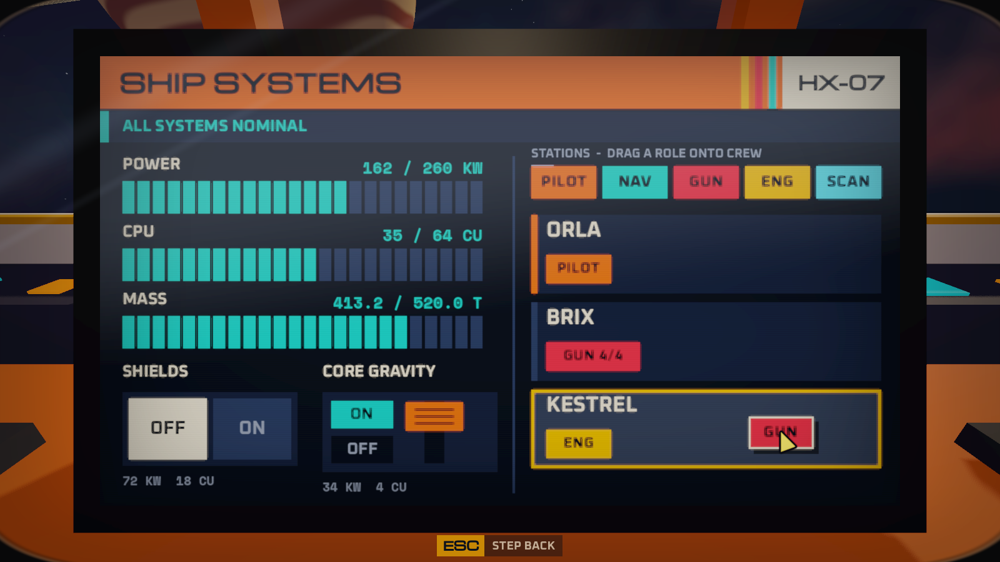
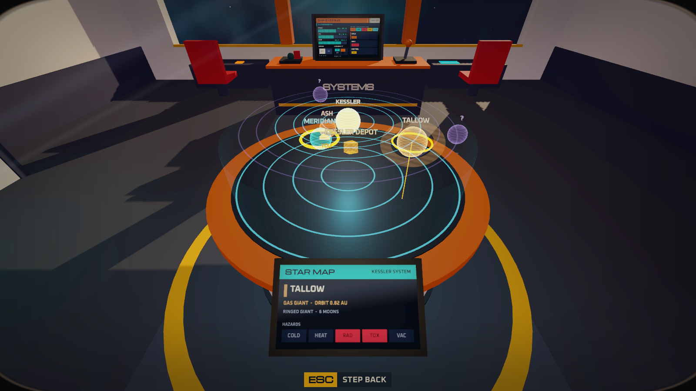
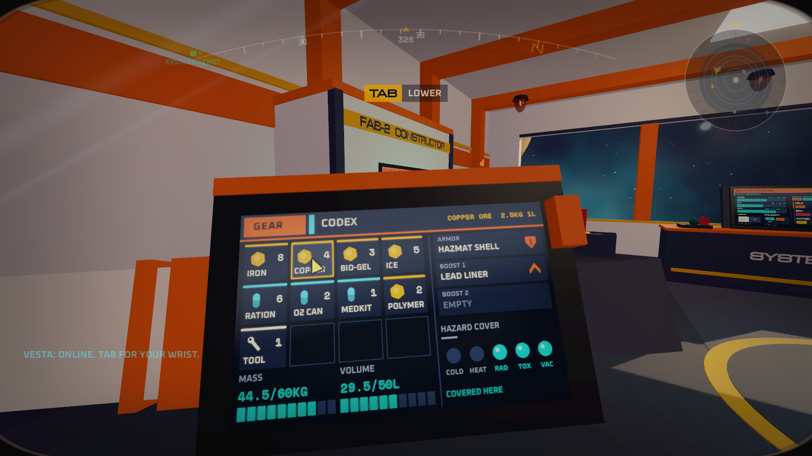
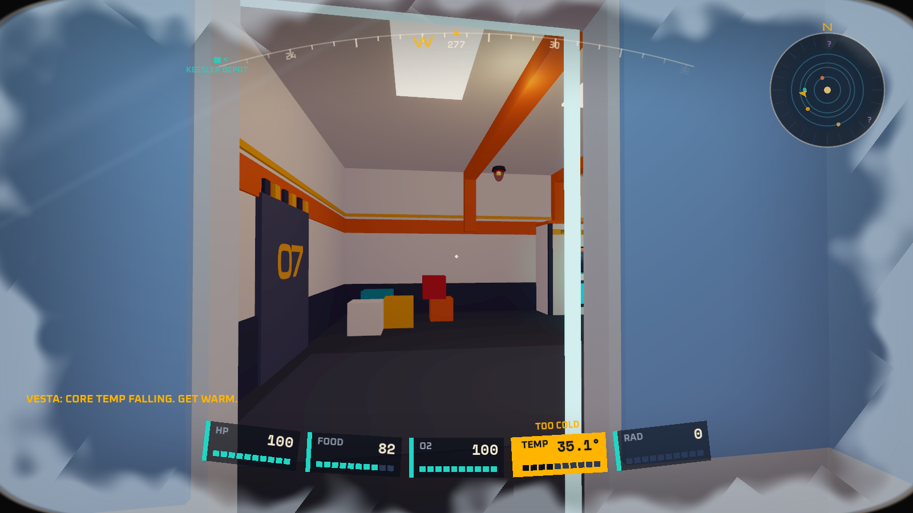
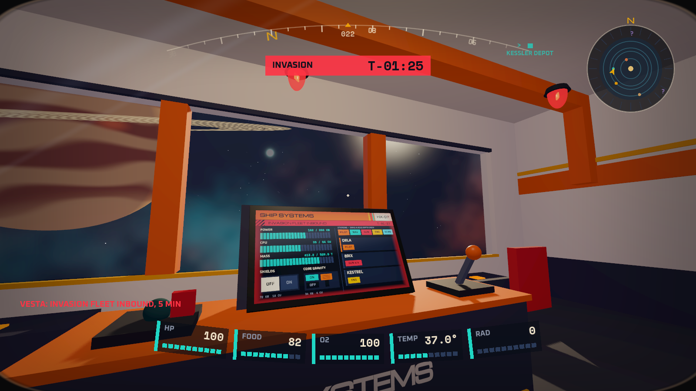
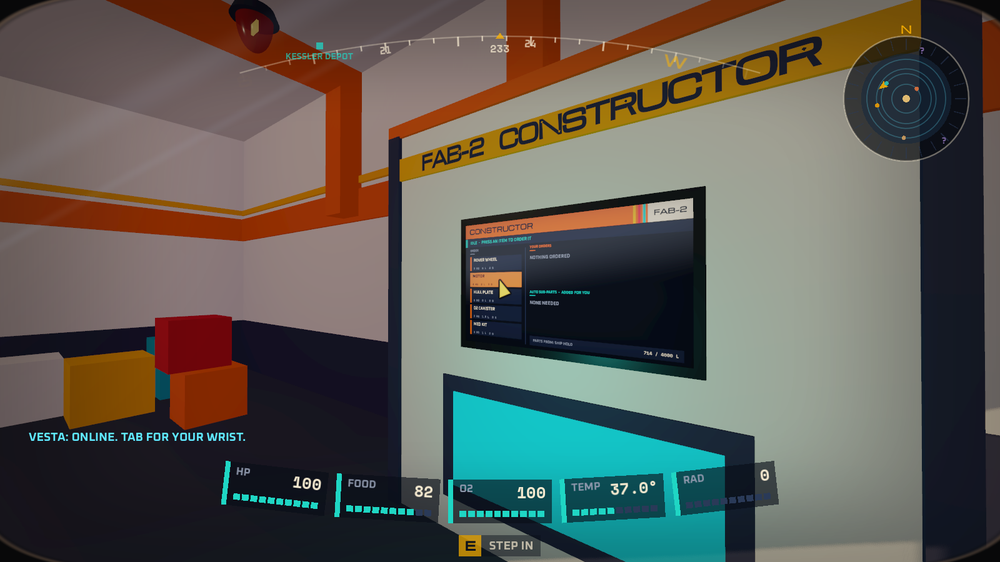

# Prototype: diegetic UI

Proves that GalHack's interface can live on things in the world, stay quick to use and cost almost nothing on a low-end PC: screens on consoles you walk up to, a holo-table, a wrist computer you raise, and a helmet visor. The hidden numbers (power, CPU, mass, oxygen, temperature) show up at the moment you make a choice.

In the game, the primary interface is a full-screen Tab menu. In-world screens are usable flavour that show the same panels, so this prototype's screen component hosts any panel built for that menu (see [the panel contract](#the-panel-contract)).








## What it proves

- **A reusable in-world screen** (`src/Screens`, see [Using the screen component](#using-the-screen-component)). Any UI panel (a Godot `Control`) is drawn into a `SubViewport` and shown on a panel in the world through a scanline-and-glow surface shader. Look at it from within reach and a cursor sits on the glass where you aim: what's under it lights up, and the mouse clicks, drags and scrolls there. Press E to ease the view in and frame it for close work. Either way every mouse event becomes a ray from the camera; the ray is intersected with the panel's plane, converted to UV and then to viewport pixels, and pushed into the SubViewport as an ordinary mouse event, so stock Controls, our widgets and panels built for the full-screen Tab menu all work unchanged. The world keeps running throughout.
- **Screens at eye height.** Walk-up screens hang with their centres near standing eye height (1.62 m) and face you, so you look at them, not down at them. `ScreenMount` places them and checks them.
- **Screens cost nothing while idle.** A SubViewport is switched off (`UpdateMode.Disabled`) until its page changes; the screen watches every Control on the page, so a page needn't tell it. It then redraws once, and only if the camera could read it: it must be close enough, facing you and inside the frustum. `ScreenManager` runs these redraws within a small per-frame budget, with the screen in use going first. Background animation is capped at 30 Hz. The cursor, scanlines, flicker and alert pulse all live in the surface shader, so moving the mouse costs no redraw.
- **Gameplay logic is pure C#** (`src/Logic`, no engine types), so it can be tested headless:
  - vitals with a warning line well ahead of the harm line
  - a warning timeline that announces threats at 10, 5 and 1 minutes
  - inventory with mass and a hard volume cap
  - a constructor queue that plans its own sub-parts
  - a station roster with exactly one pilot and shared gunnery
  - trade with sell-all-wanted
  - ship power, CPU and mass
  - the star map
  - the focus state machine (Free, Entering, Using, Leaving), which the camera, the input routing and the cursor all read from, so they can never disagree
- **A shared theme** (`src/Theme`):
  - the faction palette (`Palette.Helios`)
  - three OFL fonts:
    - Michroma for titles, a wide face like those on 70s paperbacks
    - Oxanium for labels
    - Space Mono for numbers
  - chunky vector widgets:
    - segmented bars that preview what a switch would cost before you flip it
    - a rocker switch
    - a lever you can drag or click
    - block buttons
    - row lists with "wanted" rows lit
  - a page style: a colour-block header with racing stripes, and a status strip that every console turns into the red countdown during a threat

## What's on the bridge

| Thing | What it shows |
| --- | --- |
| Ship systems console | Live power, CPU and mass bars. The shields rocker and the core-gravity lever preview their cost on the bars while the cursor is on them. A real lever on the desk follows the on-screen one. Drag station roles (PILOT, NAV, GUN, ENG, SCAN) onto three crew cards: the pilot can't be dropped, and gunnery splits the turrets |
| Holo-table | A glowing hologram of the system. Discovered worlds are named; unsurveyed contacts are dim violet with a "?". Click a world to set a waypoint: the rim screen describes it, and the visor's compass and mini-map mark it |
| Constructor | Order on the left. Two queues on the right: your orders above, and the sub-parts it added for you below, each saying which order it feeds. Missing raw materials show in red |
| Trade link | Depot buys (wanted items in solid yellow) and sells, beside your suit and the ship's hold. Each sell-all button shows what it pays before you press it. Click a row to buy or sell one |
| Wrist computer (Tab) | A forearm comes into view. GEAR is the inventory grid with mass and volume totals, the armor and booster slots, and hazard lamps showing what the worn gear covers. CODEX is one entry, read out by VESTA, the suit's assistant (text for now). You can keep walking while it's up |
| Visor | Vitals along the bottom curve of the glass, a compass arc with contacts, and a mini-map with unsurveyed space left dark. It fades out when all is well. A vital flashes while it is still only a warning, before it costs health. The readouts lag slightly behind fast head turns. The glass frosts in the cold, pulses red when you're hurt, and flashes on the side a warning shot came from |
| Sirens | Rotating red beacons that wake with the invasion warning and spin faster as it gets closer |

## Play it

From the repo root, in PowerShell:

```powershell
.\tools\godot.ps1 -Project prototypes/diegetic-ui -Play
```

| Key | Action |
| --- | --- |
| WASD, mouse | Walk and look |
| Shift | Sprint |
| Space | Jump |
| Ctrl (hold) | Crouch |
| Look at a screen | A cursor appears on it where you aim, within reach. Click, Shift-click, drag (hold and turn) and scroll there |
| E | Step in: frame the screen or holo-table you're looking at, with a free cursor (easier for dragging roles) |
| Mouse, left button | Use the cursor on the screen; drag roles and the lever |
| Esc | Step back from a screen (or free the mouse when walking) |
| Tab | Raise or lower the wrist computer |
| C | Debug: shove into the cold store (-60 °C); the temperature vital flashes, then hurts |
| I | Debug: invasion warning in fast time (a minute a second): 10, 5 and 1 minute calls, sirens, console countdowns |
| F | Debug: a hostile's warning shot misses the ship; the visor flashes toward it and the cockpit chirps |

The siren whoop and the warning chirp are synthesised in code (`src/World/Sfx.cs`). No audio files are used.

## Test it

```powershell
.\tools\test.ps1 -Project prototypes/diegetic-ui -Scene res://tests/UiTest.tscn
```

`tests/UiTest.tscn` runs headless and exits 0 if every check passes, or 1 otherwise. It checks:

- the temperature vital flashes 6.7 s before damage starts, at full health; thermal gear stops it altogether
- warnings fire once each at 10, 5 and 1 minutes and on arrival, on a simulated clock. A big step that crosses several marks announces them in order, and a late-scheduled threat skips stale marks
- inventory mass and volume totals are exact, and the volume cap holds for both all-or-nothing and partial adds
- ordering 2 rover wheels auto-queues 3 plates, 6 wires and 2 motors in build order, and building them uses exactly those parts. Raw materials that no recipe makes are reported as missing
- the pilot role moves and can't be dropped; gunnery splits 4 turrets 2/2, then 2/1/1
- sell-all removes exactly the wanted items and credits the amount shown on the button
- the ray-to-pixel mapping is within 0.003 px over 25 rays at five angles, up to 80° off-axis, and every ray picks the right collider
- the three walk-up screens are within 10 cm of standing eye height and within 15° of facing a standing player
- the look cursor:
  - aiming at the constructor puts the cursor on the aimed pixel (0.000 px off) and lights the button under it
  - it reads the same size on your view at arm's length and at 2.5 m
  - a click there orders, with no E
  - looking away takes it off and the button goes dark; out of reach there is no cursor
- a stock panel (a container, a label, a button) hung with `ScreenMount` fills the screen and takes its theme; the cursor lights the button with no help from the panel, a click toggles it, and looking away lets it go
- the focus state machine, on its own and in the scene:
  - looking at the console puts the look cursor on it; E then eases in with no cursor
  - the framed cursor appears only once the screen is in use, and only on that screen
  - walking is locked
  - a click flips the shields
  - dragging GUN onto a crew card shares gunnery; dragging the pilot off is refused
  - Esc removes the cursor at once and eases back to the head, then the look cursor returns
- the wrist raises and lowers with Tab, and you can walk while it's up
- the cold store flashes TEMP at full health, before any damage
- a warning shot's visor flash points toward the shooter
- performance, with all 5 screens in view:
  - a full refresh is spread across frames within the budget
  - nothing redraws while idle (0 redraws over ~2 s)
  - one change redraws only the screen that shows it
  - a busy constructor redraws at its 12 Hz refresh, not every frame

Run it windowed (`$GodotConsole --path prototypes/diegetic-ui res://tests/UiTest.tscn`) and it also prints what each SubViewport costs per redraw on your machine.

`tests/Screenshot.tscn -- --view=console|holo|wrist|cold|invasion|invasion-late|fire|constructor|trader|look|overview --out=file.png` renders a view to a PNG. Run it windowed, not headless.

## Using the screen component

Everything below lives in `src/Screens` (plus the theme in `src/Theme`) and depends only on Godot, so another prototype compiles it in from here, as the slice and manufacturing do:

```xml
<Compile Include="..\diegetic-ui\src\Screens\**\*.cs" />
<Compile Include="..\diegetic-ui\src\Theme\**\*.cs" />
<Compile Include="..\diegetic-ui\src\Logic\FocusMachine.cs" />
<Compile Include="..\diegetic-ui\src\Logic\Items.cs" />
```

A minimal setup, one screen showing one panel:

```csharp
var screens = new ScreenManager { Camera = camera };               // redraws screens only when they change and can be seen
var pointer = new ScreenPointer { Camera = camera, Reach = 3f, BlockMask = walls };
AddChild(screens);
AddChild(pointer);

var screen = new WorldScreen
{
    Pixels = new Vector2I(1280, 720), SizeMeters = new Vector2(1.6f, 0.9f),
    Transform = ScreenMount.OnFace(facePoint, outward, floorY),   // centre at eye height, facing out
};
AddChild(screen);
screen.SetContent(new MyPanel());                                  // any Control

// In _UnhandledInput, before your own mouse handling:
if (pointer.HandleInput(e)) { GetViewport().SetInputAsHandled(); return; }
```

| Piece | What it does |
| --- | --- |
| `WorldScreen` | The screen: a SubViewport, the glass, a bezel and a pick slab. `SetContent(Control)` puts a panel on it, sized to `Pixels`, themed with `UiTheme.GodotTheme` unless the panel brings its own theme. The screen watches the panel: a Control redrawing, showing or hiding, moving or resizing marks it dirty, and nothing else does. Options: `Pixels`, `SizeMeters`, `Bezel`, `BezelLit` (the bezel's colour while the cursor is on it), `PickLayer` (a physics layer your project leaves free; default layer 2), `SurfaceShader` (pass the shader if your project reads it from elsewhere), `Pickable`, `RefreshHz` (how often an `IScreenPage` is polled), `ReadableDistance`, `CursorSize`. Also `RayToPixel`, `PixelToWorld`, `MarkDirty`, `SetAlert` |
| `ScreenPointer` | The look-and-click cursor. Each frame it casts from the middle of the view (the interpolated camera, so it sits under the crosshair) up to `Reach` against `PickMask` and `BlockMask`. On a screen's front it shows the cursor at the hit pixel and sends the page a mouse move whenever the aim moves. `HandleInput(e)` sends mouse buttons and the wheel there and returns true when it used them. A held button plus turning your head is a drag. The cursor is `CursorPixels` (26) tall on your view at any distance. `Enabled = false` lets go at once (set it while something else owns the mouse). `Target` and `TargetChanged` say which screen it is on. Run order: priority 500, after the camera moves and before `ScreenManager` |
| `ScreenManager` | Redraws each screen only when it is dirty and could be read (near, facing, in the frustum). The screen with the cursor goes first; the rest share `Budget` redraws a frame, at most `BackgroundHz` each |
| `ScreenMount` | Eye height: `OnFace(facePoint, outward, floorY, tipBackDegrees, rise)` gives a screen's transform on a wall or machine face, centre at `EyeHeight` (1.62 m) above the floor. `EyeOffset`, `FacingError` and `AtEyeHeight(screen, floorY, band, maxDegrees)` are the checks tests use |
| `HotSpots` | For panels that paint themselves in `_Draw`: register each clickable rectangle while painting it (`Add` returns true if the cursor is on it, so paint it lit), feed it the page's mouse moves (`Move`) and presses (`Press`). What can be clicked is always what is shown |
| `Interactor` | Optional: E eases the view in to frame a screen, with a free virtual cursor; Esc eases back out. Disable the pointer while it is busy (one cursor at a time) |

### The panel contract

The primary interface is the full-screen Tab menu; in-world screens are usable flavour that **show the same panels**. A panel written to this contract goes into a Tab menu tab or onto a machine's screen with no change:

- **What it is.** A `Control` (a container of stock controls, or one that paints itself). It knows nothing about screens: no `WorldScreen`, no `MarkDirtyFor`. It changes the game only through the model, never through the scene.
- **Sizing.** The host gives it a whole rectangle: the Tab menu its tab area, a screen its `Pixels` (anchored full-rect). Lay out to any size with anchors and containers, or fit a fixed design canvas uniformly inside `Size` (the slice's `MenuPanel` does this). Pick a screen's `Pixels` with the panel's aspect. For readable text, 1280 x 720 on a 1.6 m screen makes 26 px text 3.3 cm tall, which reads from 2 m.
- **Input.** Mouse only, through `_GuiInput` or the controls' own signals (`Pressed`, `Toggled`, `ValueChanged`). The screen pushes ordinary mouse events in the panel's own pixels: moves, left and right buttons (with Shift), the wheel, and drags (a held button plus moves). Don't poll `Input` or `GetViewport().GetMousePosition()`, don't change the mouse mode, and don't need the keyboard: on a screen the keys walk the player. Clear any hover you track yourself on `NotificationMouseExit`: the screen sends it when the cursor leaves the glass.
- **Redrawing.** Redraw only when something changes: `QueueRedraw` on a change, and set controls only when their values differ (Godot's setters already skip equal values). Or implement `IScreenPage.Refresh()` to be polled. A panel that redraws every frame still works, but a screen showing it then redraws every frame while you aim at it and up to 30 times a second while it is in view.
- **Theme.** Bring none: the host gives it `UiTheme.GodotTheme` (the screens always do; the Tab menu should too). That theme carries the fonts and dresses stock buttons, toggle buttons, sliders, progress bars and panels in the palette. For text, use its label type variations `Title`, `Heading`, `Caption` and `Readout` (mono numbers), or draw with `UiTheme`'s fonts and `Palette` directly. A project that reads the fonts from this folder rather than `res://fonts` sets `UiTheme.FontRoot` first.

Proven by manufacturing's base console, which shows a structure-settings panel written this way (stock controls, no fonts of its own, nothing about screens). Its probe drives that panel through the look cursor (hover, click, a slider drag) and through a second copy hosted full-screen, the way the Tab menu hosts it.

## Known limits

- Screens are flat quads. Curved glass would need its own ray-to-UV mapping, though the rest of the component wouldn't change.
- The look cursor sends mouse input only. A panel that needs typing (a name field) would need the keyboard handed to it while the cursor is on it, and walking paused.
- `ViewportTexture` has no mipmaps, so a small screen seen from far away is only supersampled a little in the shader. Text stays readable to a few metres, which is how far you'd stand from it anyway.
- Pages are hand-laid at fixed pixel sizes. A data-driven layout would be the next step once there are many consoles.
- Roles are dragged with our own simple drag code rather than Godot's drag-and-drop, so drags behave the same through pushed input events.
- The visor's curve is drawn as geometry (arcs and tilted pills), not as a lens distortion over the whole frame.
- The codex voice is text only. The tech tree, the trader's buy/sell confirmations and ammo on the visor aren't built yet.
- Single player. In co-op, view-models would live on the host, and screens would only read them.
