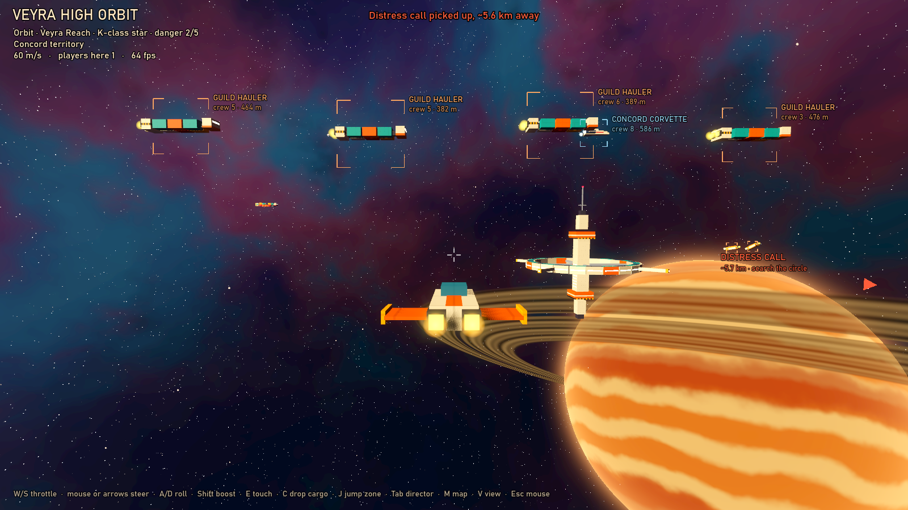
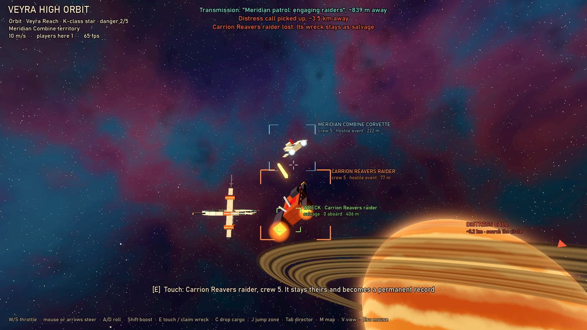
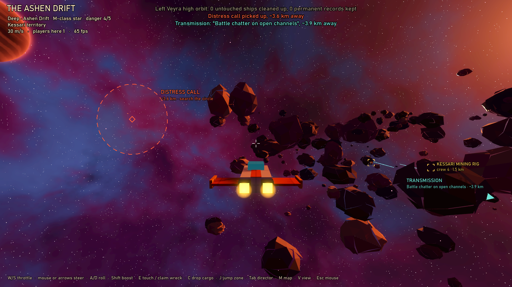
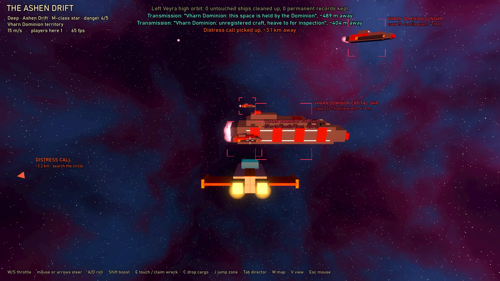
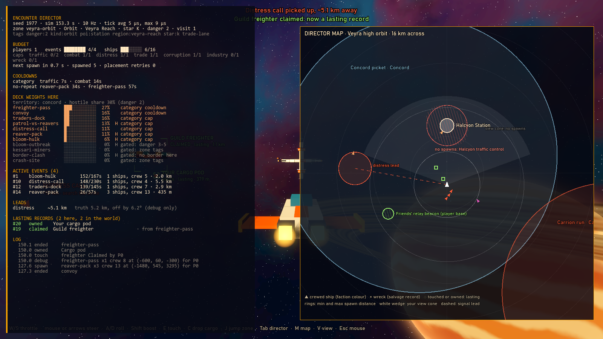

# Prototype: encounter director

Proves that the galaxy can feel alive without being simulated. An **encounter director** deals small events from a weighted deck into the zones players are in, keeps them out of sight until they are underway, scales them by the players present, and cleans them up when players leave. Only lasting facts outlive a zone: what players own, what they touched, and the wrecks they saw.







## How it works

**The director is pure C#** (`src/Director`), with no scene nodes and no engine types. The host feeds it each player's zone, position and view direction, plus a clock. It reads back ships, records and leads to draw. It runs on a fixed 10 Hz simulated tick and draws from its own seeded random streams, so the same seed and the same inputs give the same events.

**Everything tunable is data** (`data/`):

| File | What's in it |
| --- | --- |
| `zones.json` | Zones and their tags (kind, region, star class, danger grade, free tags such as `nebula` and `gas-giant`) and circles (faction territory, POIs, player bases, no-spawn areas). The director, the map and content gating all read it. |
| `deck.json` | The event deck. Each event has a weight, tag conditions, faction and territory rule, hostility, crewed ship groups (or creature groups), scripted behaviour, speed, duration, cleanup rule, wrecks and signal. |
| `director.json` | Spawn distances and the view cone, budgets for ships and creatures and category caps, gaps, cooldowns and the no-repeat window, hostile share by danger grade, despawn distances, touch range, lead fuzz, and the creatures' clearance round player bases. |
| `gunnery.json` | A hook for future combat (see below). |

**Factions** are the design document's: the Meridian Combine (corporate fleet; patrols), the Ledger Exchange (neutral merchants; freighters, convoys, traders), the Carrion Reavers (pirates), the Kessari (robot clans; miners), the Hollow Bloom (corruption), the Vharn Dominion (the main enemy; patrols, capital ships and surface garrisons, only in their own territory) and the Freeholders (settlers; haulers and mining skiffs round their outposts). The Ledger Exchange and the Freeholders are marked `"fights": false`: the deck refuses to load a hostile card that uses them, and they never take a side in a border clash.

**Weighing the deck.** At a spot in a zone, tags gate cards in or out (`kind:orbit|kind:deep`, `poi:station`, a danger range). Faction territory then applies:
- `inside` cards need their faction's territory.
- `any` cards are 2.5x as likely at home.
- `border` cards need two territories to meet, and take those two factions as their sides.

Unclaimed space has no territory. The danger grade sets the hostile share outright: 15% at danger 1, 60% at danger 4. Each spawn first picks hostile or peaceful by that share, leaning towards whichever has fallen behind, then draws a card within that pool. This keeps per-category caps from skewing the mix that actually spawns.

**Spawning.** Every ship of a new event must start:
- outside the 70° view cone of *every* player in the zone,
- at least 1.8 km from each of them,
- inside the zone, and outside every no-spawn circle and player base.

Nothing pops into view. Each zone instance has its own concurrent budget, scaled by its players. With one player that's 4 events and 16 ships, plus 1.5 events and 6 ships for each extra player. On top of the budget come per-category caps, a spawn gap that shortens with more players, category cooldowns, and a no-repeat window per event type. Combat events add a ship per extra player.

**Space fauna.** Rare creatures come as event cards too. A fauna card has creature groups instead of ships. Each group's `kind` is a space form of the wildlife prototype, which builds, animates and drops loot for it (see its README). Creatures have no crew, no faction and no territory, and count against their own creature budget (14, plus 4 per extra player).

They follow every spawn rule ships do: out of every view cone, at least 1.8 km from every player, inside the zone, outside no-spawn circles. They also start at least 1 km outside every player base's circle, measured from its edge: no wildlife spawns near bases. Ships, attackers included, are not held back by that margin.

Each card only turns up where its creatures live:

| Card | Where | How it plays out | Lead |
| --- | --- | --- | --- |
| Veil drifters | zones tagged `nebula` | a shoal of 5 to 9 drifting slowly across the zone | life signs |
| Rock rays | zones with an asteroid field | a shoal of 3 to 6 swimming in through the field | none |
| Sky mantas | zones tagged `gas-giant` (a giant's upper skies) | a shoal of 2 to 4 riding the storm bands | life signs |
| Hull leeches | zones with a derelict | 3 to 6 (plus one per extra player) already on the derelict. The derelict must lie 1.8 to 5 km from the player and out of everyone's sight. Hostile. | life signs |
| Void leviathan | deep space or nebulae at danger 3 and up | one, passing the player a few hundred metres off. Hostile. | life signs |

The leviathan is very rare. Its card has a tiny weight (0.3% of the Ashen Drift's deck) and its own category, capped at one, with a three-hour cooldown. In six simulated hours in the Drift it turned up twice.

Creatures are wildlife: E can't mark or claim one, they never become permanent records or salvage, and they go when the zone closes. This prototype draws them as simple stand-ins at the right size.

**Ships are crewed and scripted.** Every ship has a crew count; there are no drones. Flights are closed-form functions of time: pass, convoy, dogfight (tail-chasing pairs on tilted circles), dock, mine and drift. The director samples them on its tick, and the renderer samples the same functions every frame, so ships move smoothly without the director ticking faster. When an event's time is up its ships depart. They are removed once no player can see them go, or once every player is far away. A distress call nobody answers is lost and becomes a wreck.

**Permanent records.** The moment a ship becomes lasting, it moves out of its zone instance into the `PermanentRecords`, which has no remove method at all. A ship becomes lasting when a player touches it, when a player owns it, or when it is wrecked within sight of a player.

Touching never takes a live ship: E on a live ship only marks it as a permanent record, and it stays its crew's. In the design a live ship becomes yours only by boarding it and hijacking its core, which this prototype doesn't have. A wreck's core is destroyed, so E on a wreck claims it as salvage and it becomes yours. The director's `DebugClaim` stands in for boarding in the tests; no game key uses it. Cleanup only ever sees a zone instance's transient ships, so it cannot reach anything lasting. As a safety net, the one removal path refuses anything lasting and keeps it instead, counting a "guard trip". When the last player leaves a zone, the zone instance is dropped. Coming back starts fresh events, and the records are still there.

**Signal leads.** Distress calls and faction transmissions give every player in the zone a lead: the true direction turned by up to 10°, and the true distance scaled by up to ±20%. The HUD shows a dashed search circle and the map shows the lead's uncertainty. Contacts are only bracketed within 2.5 km, so a lead stays a search, not a waypoint. Leads resolve within 700 m.

**Multiplayer shape.** The host runs one zone instance per occupied zone, each with its own random stream. Two friends in two zones get separate events; four friends in one zone get more and bigger ones. The scene has one player; the tests run up to seven.

## Play it

From the repo root, in PowerShell:

```powershell
.\tools\godot.ps1 -Project prototypes/encounters -Play
```

| Key | Action |
| --- | --- |
| Mouse, or arrow keys | Steer |
| W / S | Throttle up or down (it holds when you let go) |
| A / D | Roll |
| Shift | Boost |
| E | Touch the nearest ship within 250 m. A live ship becomes a permanent record but stays its crew's; a wreck is claimed as your salvage. |
| C | Drop a cargo pod. It's yours, so it never goes away. |
| J | Jump between Veyra orbit and the Ashen Drift, with a fade |
| Tab | Director overlay: events, deck weights here, budget, caps, cooldowns, leads, permanent records, log |
| M | Director map: territories, POIs, no-spawn circles, your view cone and spawn ring, ships, wrecks, records and leads |
| V | Cockpit or chase camera |
| Esc | Free the mouse (click to capture it again) |

Fly towards a distress lead's circle and search it. Drop a pod, jump away and come back: it is still there, and so are the wrecks and anything you touched or claimed. Everything you didn't touch has gone. Holt outpost, 6 km out from Veyra's station, has Freeholders at work; the Ashen Drift's south-west corner is Vharn space.

## Test it

```powershell
.\tools\test.ps1 -Project prototypes/encounters -Scene res://tests/DirectorTest.tscn
```

The tests run `tests/DirectorTest.tscn` headless, on a simulated clock (about 6 s), and exit 0 or 1. They check:

- **Spawn rules under churn.** Over 8,000 spawns and 18,000 ships (seven players in four zones), nothing spawns inside a view cone, nearer than 1.8 km or inside a no-spawn circle. The budget and category caps are never exceeded, no event type repeats inside its window, and no Ledger Exchange or Freeholder ship ever appears in a hostile event.
- **Deck weights follow zone tags:**
  - The hostile share matches the danger grade, in the weights and in what spawns.
  - Kessari miners appear only in Kessari space, and Meridian patrols only in Meridian space.
  - Reavers are 2.5x as likely at home, and border clashes happen only where territories meet.
  - Unclaimed space has no faction events.
  - Crash sites appear only on surfaces, traders only where there's a station.
- **The Vharn Dominion and the Freeholders.**
  - Every Vharn card is hostile and needs Vharn territory. Patrols and capital ships come only in Vharn space, garrisons only on Vharn surfaces. A player in Vharn space meets patrols; a player outside never does.
  - Every Freeholder card is peaceful and works round an outpost in Freeholder territory. A player at Holt meets them; a player away from it never does.
  - Reaver and Freeholder territory overlap at Holt, but there is no border clash there. The deck refuses to load a card where Freeholders attack.
- **No-spawn circles and player bases** are never spawned in, even when they block much of the spawn ring.
- **Space fauna:**
  - Five fauna cards, creatures only, with no crew or faction. Each kind turns up only where it lives.
  - The leviathan is 0.3% of the Drift's deck, capped at one, with a three-hour cooldown. In six simulated hours with the real rules it turns up once or twice, never two at once.
  - In a busy hour in the Ashen Drift (three players, cooldowns cut to a tenth), every creature spawns out of view and at least 1.8 km away, the creature budget is never exceeded, and every leech is found on its derelict.
  - Fauna send life-sign leads within the fuzz.
  - A creature can't be touched into a record, and creatures go when the zone closes.
- **No wildlife near bases:** in an hour of churn round two player bases, no creature spawns within 1 km of a base's edge, while ship spawns, raiders included, still land in that band.
- **Leaving a zone** removes all its untouched ships. Touching a live freighter makes it a permanent record but not the player's, and touching a wreck claims it. Both stay, with the witnessed wrecks.
- **Player-owned things survive.** 32 player-owned things survive 120 zone hops, including crates dropped inside a fight and a ship taken mid-event with the debug claim. A ship touched mid-event stays not theirs. A ship marked owned behind the director's back is caught by the guard.
- **Determinism.** The same seed and inputs give a byte-identical log; a different seed gives a different one.
- **Zones and scaling.** Two players in two zones get their own events, and four players in one zone get more events and ships than one.
- **Leads** are within 10° and 20% across 1,000 distress calls, never exact, and resolve when you arrive.
- **Tick cost.** Six players in four zones average about 14 µs per tick at 10 Hz. The check judges the best of three ten-minute windows (average under 100 µs, worst tick under 2 ms), so another program busy on the machine can't fail it.
- **The gunnery hook** follows its rules.
- **Export.** The export preset includes the data files.

Screenshots render windowed:

```powershell
. .\tools\env.ps1
dotnet build prototypes\encounters\Encounters.csproj -nologo -v q
& $GodotEditor --path prototypes/encounters res://tests/Screenshot.tscn -- --view=orbit --out=shot.png
```

The views are `orbit`, `skirmish`, `distress`, `frontier` and `overlay`. A sixth, `jump`, presses J and fails unless the zone changed.

## Known limits

- **Creatures are stand-ins here.** The director moves a shoal or a leviathan along a scripted path like a ship; the real bodies, behaviour, attacks and drops are the wildlife prototype's. The gas giant's skies are a data-only zone.
- **No combat or boarding.** Fights are scripted: who is wrecked and when is decided at spawn, and tracers are presentation only. E stands in for every interaction. Nothing shoots at the player.
  - `data/gunnery.json` and `Gunnery.cs` are an unwired hook for the gunnery rules (warning shots, a 2 s ramp reset by losing line of sight, a shooter-against-target class table, weapon modifiers, slow capital shells). Damage is never capped.
- **No collisions.** You can fly through ships, rocks and the station. Traders hold beside the station rather than docking.
- **Ships don't steer.** Flights are kinematic paths, so a departing ship can turn sharply, and wrecks coast for a second, then stay put.
- **Circles are cylinders.** They are measured on the X/Z plane and reach up and down without limit. The view cone is a 70° cone, not the camera frustum; very wide screens would want it wider (it's in `director.json`).
- **Salvage piles up.** Records only grow. Wrecks are kept only if seen (within 8 km), but nothing merges or ages salvage yet. There is no save/load: the permanent records, their next id and the zone data are what a save would hold.
- **Determinism is per machine.** It holds for the same build on the same machine. Float trig can differ across CPUs, which is fine while only the host runs the director, but this is not a lockstep simulation.
- **The danger mix is approximate under tight caps.** With only two hostile cards in a zone and heavy churn, danger 4 spawns 51% hostile against a 60% target.
- **No real multiplayer yet.** The scene has one player; networking is not implemented.
- **The sky costs per pixel.** It runs a 5-octave noise per pixel every frame. Check it on a low-end GPU; it could be baked to a cubemap once per zone.
- **Exports.** `export_presets.cfg` (a Windows preset) includes `*.json`, so the data files ship in the pack. The repo ignores export presets, so this prototype's `.gitignore` re-includes it. Godot 4 keeps export credentials in `.godot/`, not in this file.
- **No audio.** The prototype is silent.
- **Debug-style UI.** The HUD, overlay and map are debug-styled, not the diegetic UI.
