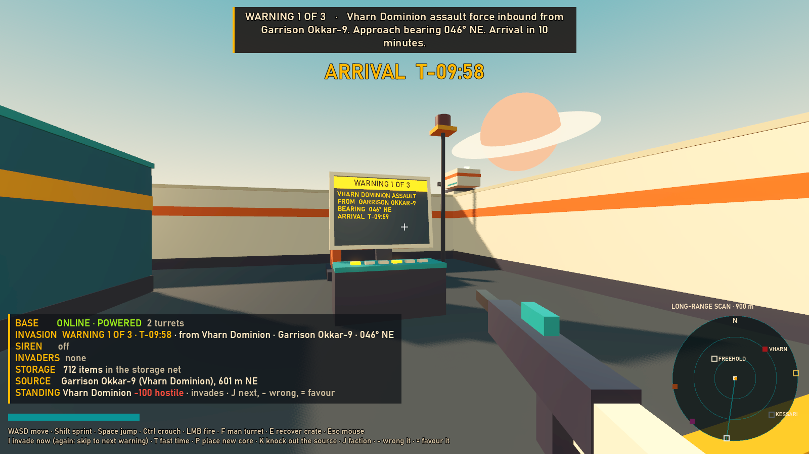
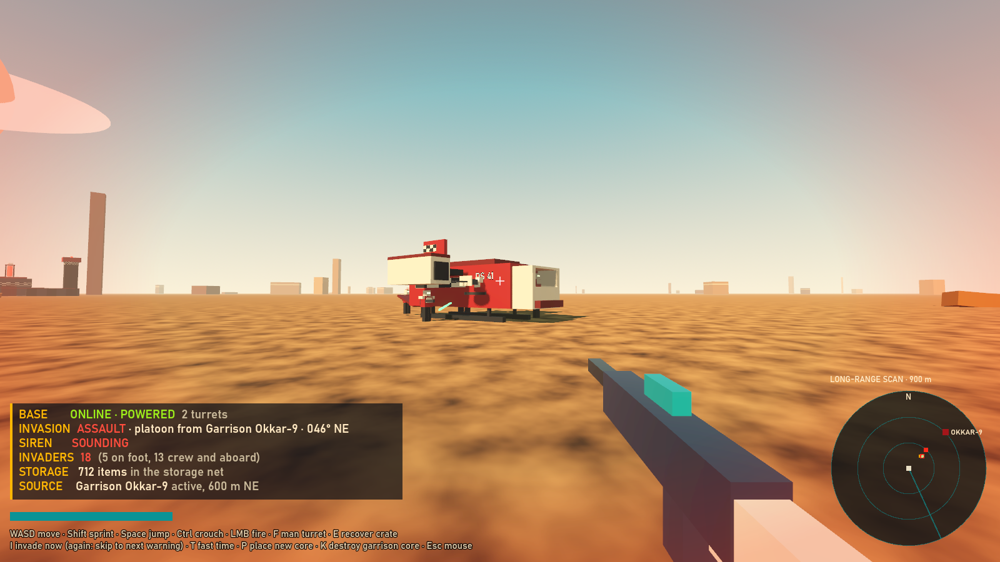
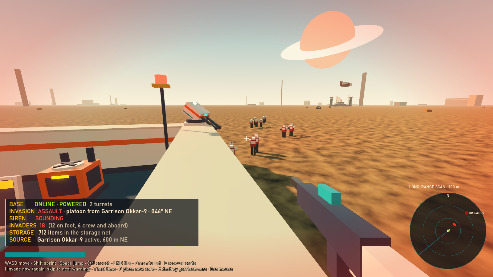
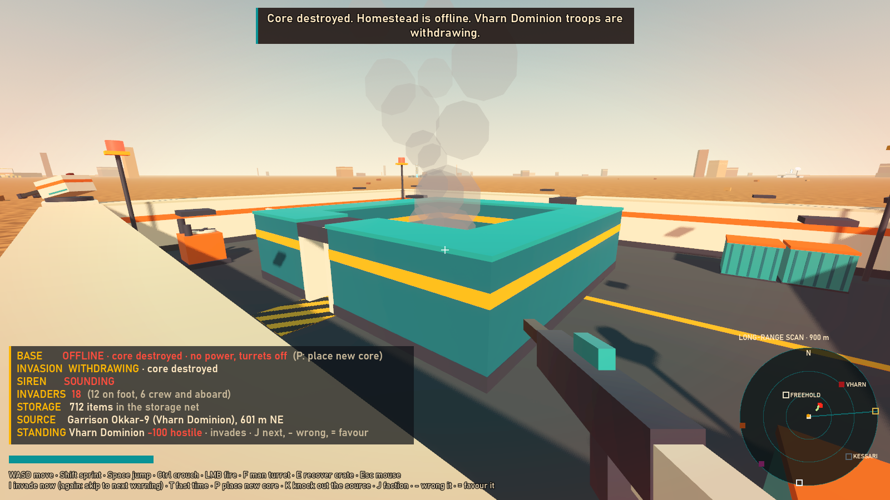
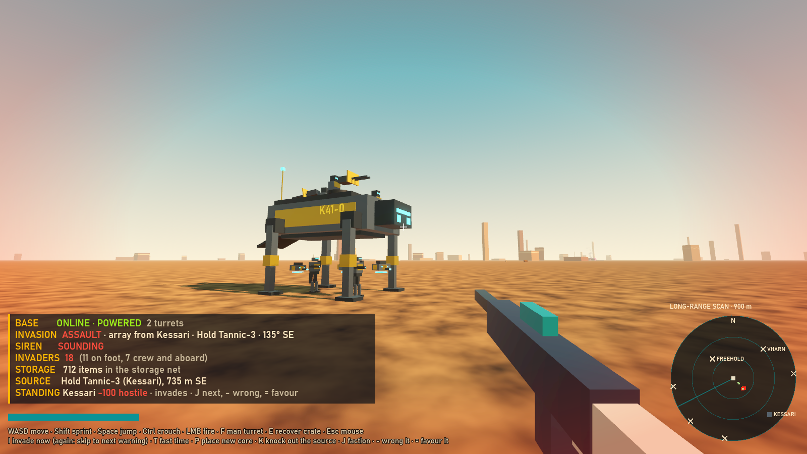
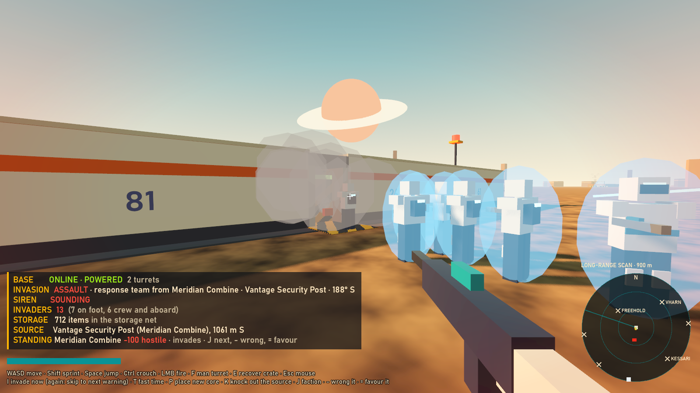
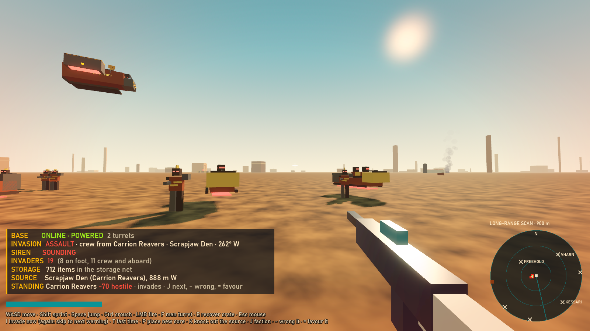
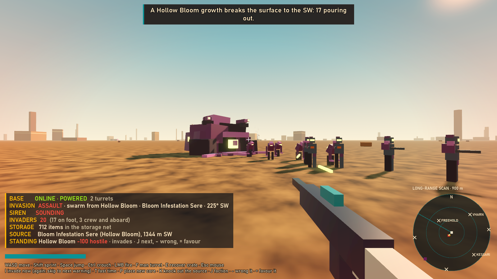

# Prototype: base invasions

Proves the invasion loop. Any faction the players are hostile with can attack a player base with troops, but only while someone is home. The attack comes from the nearest base of a hostile faction (or by ship if none is in range). It is announced at 10, 5 and 1 minutes. Each faction brings its own crewed vehicles, troops and tactics, sets them down a few hundred metres out (or closer), and fights toward the core through the walls. Loot is never at risk.






The other factions' invasions:






## How it works

| Layer | Where | What |
| --- | --- | --- |
| Director | `src/Director` | Pure C#, seeded, simulated clock. Scheduling, the presence rule, standing with each faction, source choice, the warning timeline and siren state, force composition, outcomes. |
| Base model | `src/Model` | Pure C#. Block grid with hit points, the shared storage network, spill crates, core and power, vehicle crews, fire control, player health, the breach planner. |
| Scene | `src/World` | Builds everything in code. `InvasionController` feeds the director (presence, base stats, invader counts) and turns its events into warnings, sirens, landings and withdrawals. It also runs force-level tactics such as a raid running for home. |
| Combat seam | `src/Combat` | `IDamageable`, `IInvaderTroop`, `IInvaderVehicle`, `ICombatFactory` and `IAssaultPlanner`, with simple **placeholder** soldiers, vehicles and navigation behind them. One soldier class serves every faction, driven by `data/factions.json`; `Looks.cs` dresses each faction. |

### Who invades

- **Standing.** The players have a standing with each faction from -100 to 100 (`FactionStandings`). At or below -40 a faction is hostile. Each faction has a floor and a ceiling. A deliberate wrong counts in full. An accidental wrong counts by the faction's accident weight.
- **The source rule.** The invasion comes from the nearest active base, within 1500 m, of any faction that invades and is hostile. With none in range it comes by ship from one of those factions, picked by ship-raid weight, if the server allows ship raids. A faction that stops being hostile stands down: an incoming invasion is called off, and an assault under way withdraws. Destroying or hijacking a base stops its invasions.
- **Each faction's nature:**

| Faction | Invades? | Standing |
| --- | --- | --- |
| Vharn Dominion | Yes. The main enemy. | Starts at -100. It can't rise above -60, so the Vharn are always hostile. |
| Kessari (robot clans) | Only if wronged. | Starts at 0. Accidents don't count, only deliberate wrongs. |
| Meridian Combine | Only if the players made it hostile. | Starts at 10. Accidents count half. |
| Carrion Reavers | Yes, they raid. | Starts at -70. They can be paid off to a truce (0), never to friendship. |
| Hollow Bloom | Yes, from its infestations in Bloom space. It has no ships. | Fixed at -100. |
| Ledger Exchange | Never. | Accidents don't count. Even hostile on purpose, it never invades. |
| Freeholders | Never, and they never attack. | Accidents don't count. Even hostile on purpose, they never invade. |

### How each faction fights

All of it is data in `data/factions.json`: carriers by source kind, vehicles, troop roles, tactics and wording.

| Faction | Troops | Tactics | Vehicles |
| --- | --- | --- | --- |
| Vharn Dominion | Riflemen, breachers, heavies (minigun) | Disciplined infantry. Breachers plant charges (340), and everyone else shoots the wall and pushes to the core. The current behaviour. | APCs (6 seats, autocannon and rockets) and dropships (8 seats, two door miniguns) |
| Kessari | Machine frames (pulse rifles, 130 hp), cutters, lancers (rail) | Cutters hover. They are Kessari themselves, not remote drones, and they burn through walls with a beam (120 damage a second). The clans plan straight through walls rather than round to a door (wall cost 90 hp a cell, not 30). | Striders: four-legged walkers, 6 seats, rail and autocannon. Lifters: ducted-fan flyers, 8 seats, two lasers. |
| Meridian Combine | Officers (carbines), breachers, wardens (minigun) | Every trooper has a personal shield (30 to 140) that soaks hits before health and recharges after 3 s. Damage still goes through in full. Two breachers per squad set shaped charges (650: one opens a wall). The officers stack up and hold fire on the wall for 7 s to let the charges work, then shoot it themselves. | Security carriers: white hover transports, 6 seats, autocannon and rockets. Shuttles: 8 seats, door miniguns. |
| Carrion Reavers | Raiders (scatterguns, fast), wreckers (charges), brutes (minigun) | They go for the storage containers first, then the core. They run for their rides as soon as every container is broken open, or 60 s after landing. They can't take anything: wrecked containers spill into crates that they can't shift. | Hover bikes: a rider and two raiders, no guns, 34 m/s, set down 75 m out. Gunships: 4 seats, cannon and rockets, set down 110 m out. |
| Hollow Bloom | Mutants (fast, acid spit, 55 hp), corrupted crews (rifles), bursters | A swarm: 1.4 times the bodies the base alone would draw. A growth breaks the surface 100 m out and spreads tendrils toward the walls. The swarm pours from its maw, one every 0.22 s. Bursters burst against the walls (420). | The growth: its heart is the "driver" and two spitter pods are the gunners. Kill the heart and the growth dies, along with the pods and the unborn. Withdrawing, it sinks back into the ground. |

### The rules every faction keeps

- **Presence.** The countdown to the next invasion only runs while a player is in the base's zone. If everyone leaves for 60 s, an incoming invasion is called off and an assault withdraws.
- **Warnings.** These fire at exactly T-10, T-5 and T-1 minutes on the simulated clock, however coarsely the clock is stepped. The first names the attacking faction, the source base and the bearing. The second puts the force on long-range scans. The third starts the sirens, which sound until the last invader is down or gone. A faction can word its own warnings.
- **Scaling.** Threat is stored goods value, plus block count, plus turrets. Troops are scaled by that threat, by the players present, by the source and by the faction's swarm multiplier, then capped by the source. A small outpost faces a squad (a Bloom "brood", a Reaver "gang"), and a fortress faces an army.
- **Outcomes.** If the core falls, the base goes offline (no power, turrets dead) and the invaders withdraw to their vehicles. Placing a new core brings it back with every surviving block. All invaders down or gone with the core standing is a victory.
- **Loot.** Storage is one shared inventory across all of a structure's containers. A wrecked container's contents spill into a crate that never despawns, and E puts them back into storage. Invaders never take anything.
- **Crews.** Every vehicle is block-built and crewed by a driver or pilot plus a gunner per gun (the growth's heart and pods count). Kill a gunner and his gun goes quiet. Kill the driver and the vehicle stops. Troops still aboard climb out of the wreck and fight on. The crew bail out when the force leaves.
- **Fire.** Damage is never reduced or capped. Instead, a hostile that starts on a player fires warning shots: they land close but can't hit. Its spread then tightens to a baseline over 2 s, and losing sight starts that over. The baseline comes from a shooter class by target class matrix and the weapon. Rounds are projectiles with travel time (capital guns 280 m/s, small-craft guns 600 m/s). Every faction weapon is in `fire_control.json`.
- **Navigation (placeholder).** Obstacles are inflated by the agent's radius on the grid. A spill crate only closes its own cell, so the aisles beside the storage stay open. Walls and doors are passable at a breach cost (per faction), and invaders hold and break them rather than grinding. A rifleman engages its target from within reach rather than queueing for the last cell. Routes are smoothed only where a full-radius line is clear. Agents separate from each other and avoid things locally. A stuck agent re-paths at 1.5 s, side-steps at 2 s and hops to the nearest free cell at 2.6 s.
- **Siren.** A synthesised WW2 mechanical siren (`src/Audio/SirenSynth.cs`): two rotors a minor third apart winding up and down in a slow wail for the alert, and a steady all-clear when the invasion ends. No recorded audio is used, and there are no third-party assets: everything is built from boxes in code.

## Play it

From the repo root, in PowerShell:

```powershell
.\tools\godot.ps1 -Project prototypes/invasions -Play
```

| Key | Action |
| --- | --- |
| WASD, mouse | Walk and look |
| Shift / Space / hold Ctrl | Sprint / jump / crouch |
| Left mouse | Fire (placeholder rifle) |
| F | Man or leave a turret (the turret AI fights on its own otherwise) |
| E | Put a spill crate's contents back into storage |
| I | Start an invasion now; press again to skip to the next warning |
| T | Fast time: the clock runs 60x, so 10 minutes of warnings take 10 s |
| P | Place a new core when the base is offline |
| K | Knock out the base that would send the next invasion (or shoot its core out) |
| J | Pick a faction for the standing keys (shown on the visor) |
| - / = | Wrong the picked faction on purpose / do it a favour |
| Esc | Free the mouse |

The neighbourhood has one base per faction. The Vharn garrison is 600 m NE, a Freeholder steading 410 m NW, a Kessari hold 735 m SE, the Reaver den 888 m W, a Meridian post 1060 m S, a Ledger Exchange depot 1250 m E and a Bloom infestation 1340 m SW. At the start the Vharn invade. Press K and the Reavers take over, K again and it's the Bloom. Pick the Kessari with J and press - twice, and their hold, now the nearest hostile base, invades next.

## Data

Every tunable lives in `data/`:

| File | What |
| --- | --- |
| `server.json` | Invasion frequency, jitter, ship raids on or off, fast-time scale, seed |
| `invasions.json` | Warning timeline and messages, presence grace, source rules, scaling formula, tiers, force size by source kind, approach distances, planner cost |
| `factions.json` | The standing model. Per faction: whether it invades, its standing range, accident weight, ship raids and ship names, tier names, carriers by source kind, vehicles (body, seats, guns, speed, drop distance), troop roles (weapon, reach, pace, health, shield, how it breaks walls), tactics, tracer colour and its own wording |
| `fire_control.json` | Warning shots, accuracy ramp, accuracy grades, the shooter by target matrix, weapons (spread, projectile speed, damage, rate, homing) |
| `base.json` | Base layout (ASCII), block hit points, container capacity, items and their values, starting goods, siren and light positions |

## Test it

```powershell
.\tools\test.ps1 -Project prototypes/invasions -Scene res://tests/InvasionTest.tscn
```

Exits 0 if all 154 checks pass, 1 if any fail. It takes about 13 minutes, mostly the five soaks (about 2.5 minutes each). Every timing in it is simulated time (physics frames or the director's clock), never wall-clock, so it holds under load.

- **Director:** the original checks still pass.
  - No invasion is scheduled without a player home.
  - Warnings fire at exactly T-10, T-5 and T-1, even with uneven clock steps.
  - The siren runs from T-1 to the end.
  - The force grows with stored value, size, defences and players.
  - The nearest active base is the source.
  - A destroyed or hijacked source stops its invasions.
  - The same seed replays the same invasions.
- **Factions:**
  - All seven design factions are present, and every weapon they name exists.
  - Seven factions' bases at 150 to 1200 m: the nearest hostile one sends the invasion, not the nearer peaceful ones. Wrong the Meridian Combine on purpose and its nearer post takes over. Knock that out and the Reavers are next. An accident doesn't turn the Kessari, and a deliberate wrong does.
  - The Ledger Exchange and the Freeholders can't be made hostile by accident. Made hostile on purpose, they still never become a source or invade, and never come by ship.
  - The Meridian Combine turned friendly calls off its incoming assault, and the next invasion comes from the next nearest hostile base. A Kessari assault under way withdraws when they are befriended.
  - Each faction's nature holds: the Vharn and the Bloom can't be won over, the Reavers only to a truce, and accidents count half against Meridian and not at all against the Kessari.
  - Ship raids come only from hostile factions with ships, by weight; never the Bloom, the Exchange or the Freeholders.
  - Every faction composes its own force for every source kind: its vehicles and bodies, its roles, every troop seated and every squad with its breacher. The Bloom swarms from one growth, and the Reavers set down close.
  - Kessari plans cut straight through walls: fewer cells than the Vharn's from four sides.
- **Base model, fire control and siren:** as before. Wrecked containers keep the item total, core loss and a new core work, crews silence guns and stop vehicles, warning shots, the ramp, the matrix, damage never scaled, and the siren's wail and all-clear.
- **Scene (real nodes, headless, faster than real time with 1/60 s steps):** as before, plus:
  - Troops aboard a carrier whose driver dies climb out.
  - K moves the source to the next nearest hostile base. With all of them down, a ship raid comes.
- **Faction rosters and tactics.** Each of the five invades a live scene in turn, with its base the only hostile one, and its own vehicle classes set down its own troops. Then:
  - Vharn breachers plant charges.
  - Kessari cutters burn through a wall.
  - Meridian shields soak hits first, then pass the rest through uncapped, and recharge. Officers stack up while the breachers charge.
  - Reavers go for the storage, break it open and run with the core standing, leaving every item behind.
  - A Bloom growth spreads and pours, bursters burst, and killing a growth's heart kills its pods and its unborn.
  - No item is lost in any of them.
- **Navigation soak, once per faction:**
  - 50 seeded forces among vehicle hulks, crates and rubble.
  - No invader is stuck for more than 3 s.
  - Every invader reaches its target (the core room, a breach or a container) within 40 s.
  - `-- --soak=N` changes the count, `--soak-faction=ID` runs one faction, `--soak-first=N` starts at a seed, and `--only-soak` skips the rest.

Other tools:

- `tests/Screenshot.tscn -- --view=warning|arrival|firefight|offline --out=file.png` renders a view (windowed, not headless). `--view=faction --faction=kessari|meridian|reavers|hollow` renders that faction's invasion.
- `tests/SirenPreview.tscn` renders 20 s of the siren (alert, then all-clear) to `audio-preview/siren-preview.wav`.

## Known limits

- **Combat is a placeholder until the boarding prototype's combat is merged in.**
  - The soldiers, vehicles, turret AI, player rifle and `InvaderNavigator` are deliberately simple.
  - Swap them in through `ICombatFactory` (spawning, by faction and vehicle body), `IInvaderTroop` (`Assault`, `Withdraw`), `IInvaderVehicle` (crew, pickup, departure), `IDamageable` (anything shootable, with its target class) and `IAssaultPlanner` (routes on the block grid; `CombatWorld.MakePlanner` gives a faction its own wall cost).
  - `FireControl` and `data/fire_control.json` are meant to stay and be used by the new soldiers.
- **Standing is a stand-in.** `FactionStandings` is a number per faction with a floor, a ceiling and an accident weight. Nothing in this prototype wrongs a faction except the debug keys and tests, and the real reputation system should drive `InvasionDirector.Wrong`, `Favour` and `SetStanding`.
- **"Bloom space" is not modelled.** Infestations are simply where the world puts them; the Bloom invades from any infestation in range and has no ships.
- **The Reavers' raid** ends when the storage is all broken open. A base with no storage gets the core attacked until the raid timer runs out. Raiders don't try to lift the crates; they just leave.
- Base turrets are very poor against infantry by design (capital/base vs on foot), so the players have to fight the troops themselves. Vehicle guns knock turrets out.
- Only the director (and force composition) replays bit-for-bit from a seed. The fight itself runs on physics and is not deterministic.
- Single player. Presence counts the one local player, though the director takes any count.
- Vehicles move kinematically on flat ground and ignore terrain. A flyer whose pilot dies drops where it is. A strider's legs are animated, but it moves like a wheeled carrier.
- Destroyed blocks leave no rubble. Debris is cosmetic, and only crates and hulks become obstacles.
- The HUD and console text are debug-grade, and the long-range scan is drawn in 2D.
- The siren audio is synthesised; a licensed recording could replace it later.
- The soak runs 250 invasions, so the suite takes about 13 minutes.

## References

Empyrion: Galactic Survival was used for ideas only. Nothing was copied. Our design rules win where they differ: warnings at 10, 5 and 1 minutes, loot never taken, no damage caps, and no drones, so every invader is a crewed trooper or vehicle.

- [Alpha 10 release candidate notes](https://devtrackers.gg/empyrion/p/b179ee30-alpha-experimental-10-release-candidate): reputation affects how likely a faction is to attack a base. Here that becomes a hard rule: only factions hostile by standing invade.
- [v1.11 patch notes](https://devtrackers.gg/empyrion/p/45b41aeb-v1-11-patch): the attack is chosen from the base's attack and defence rating. That matches the existing scaling by stored value, size and turrets.
