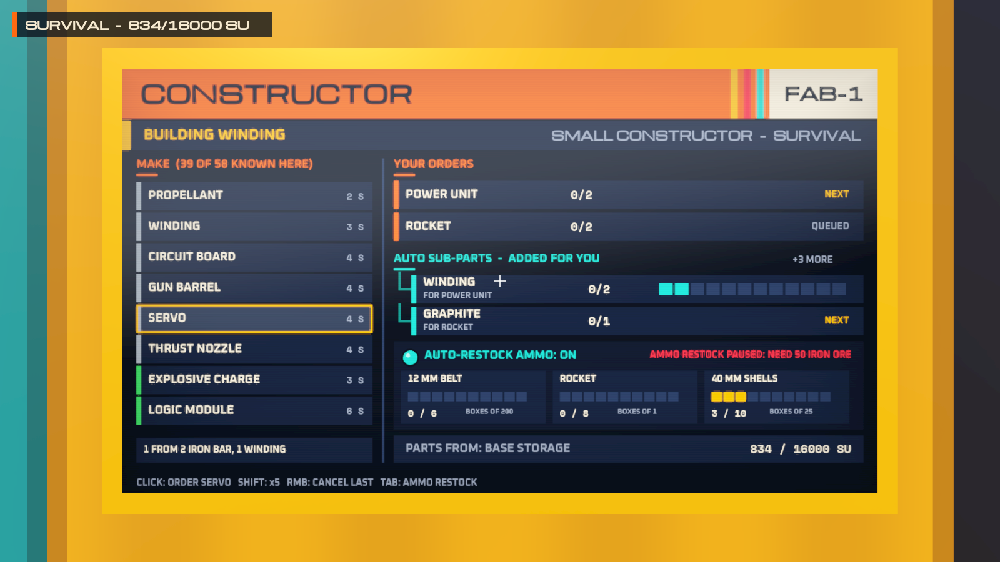
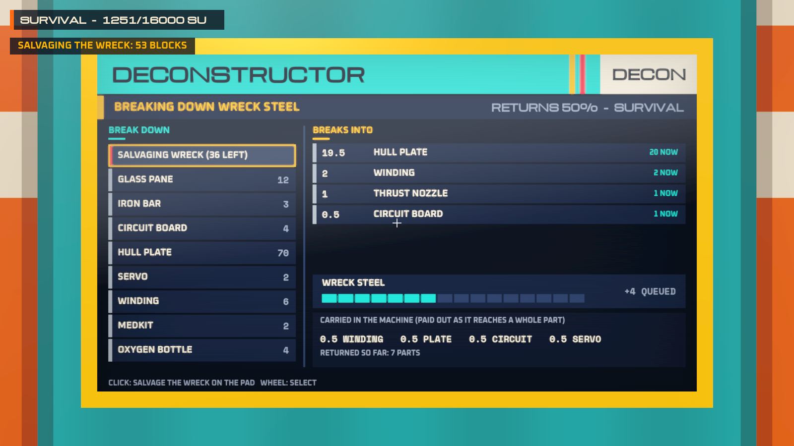
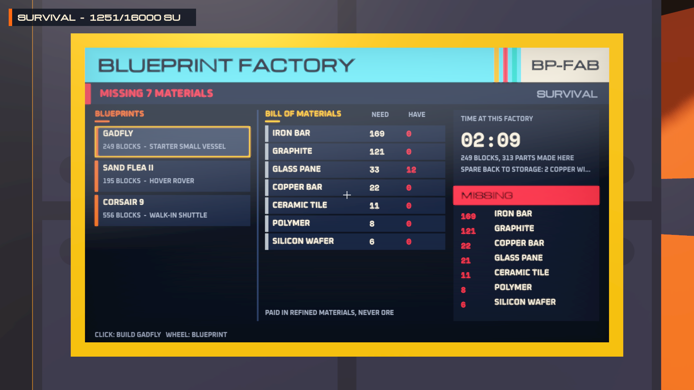
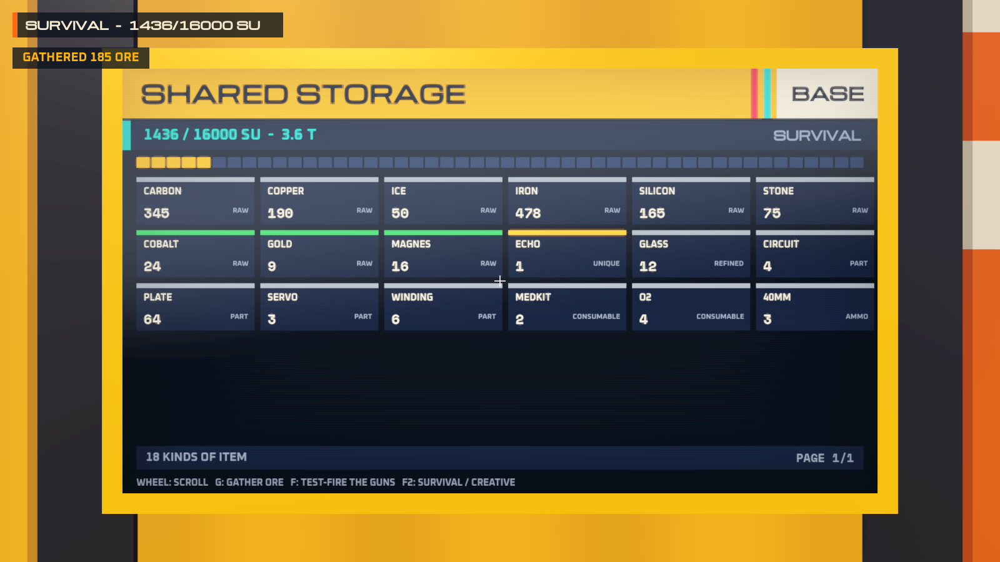
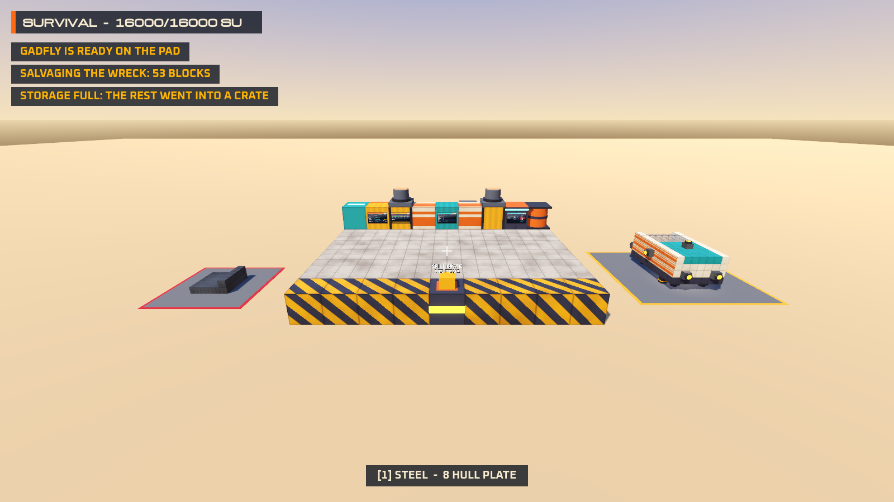

# Prototype: materials and manufacturing

Proves GalHack's manufacturing loop on top of [`shared/Items`](../../shared/Items/README.md): ore turns into refined materials, parts and components through constructor tiers whose queues plan their own sub-parts; a deconstructor breaks things back down at a stated rate; a blueprint factory builds whole ships from a bill of materials; guns keep their ammo stocked; and building costs materials in survival and nothing in creative. Everything works from one shared storage per structure, and nothing is ever lost: what storage can't take goes into a crate that never despawns.







## What it proves

- **The whole catalogue is data**, 81 items on the five-step rarity ladder, and a recipe tree runs from ore to every block in building's catalogue (and the sandbox's vessel parts), checked for paths, cycles and rarity.
- **Constructor tiers** from the carried survival constructor (half speed, basics) to the advanced one (3x, exotics), each built from what the tier below makes. Order something you lack the parts for and the constructor queues every missing part itself, in build order, one line per part, each saying which order it feeds; raw ore it can't make shows as missing, in red, with exact counts.
- **Ammo restock.** With the toggle on, the constructor keeps each gun's ammo at its threshold, in its own lowest-priority lane, from materials nobody reserved, and pauses saying exactly what it needs.
- **The deconstructor** returns 50%, carrying fractions so nothing rounds away; wreck blocks come back as whole components.
- **The blueprint factory** prices a blueprint in refined materials, refuses with the missing list, and builds it in a stated time; the Gadfly, the Sand Flea II and the Corsair 9 are on its list.
- **Survival and creative building.** The multi-tool pays each block's bill from storage and refunds it whole; with storage full the refund spills to a crate. F2 switches the world to creative: free, unlimited, every block, machines with no material checks, blueprints at once.
- **Screens on the machines**, in diegetic-ui's look (its palette, its fonts and its glass shader, read in place from `prototypes/diegetic-ui`).

## Play it

```powershell
.\tools\godot.ps1 -Project prototypes/manufacturing -Play
```

You stand on the workshop floor. The back wall holds, from the left: a generator, the **small constructor**, a container with the **storage** screen, the **deconstructor**, a container, the **blueprint factory** and a fuel tank. Two turrets stand on the containers; a gatling and a rocket pod point out of the back. The wreck is on the red pad to the left; built blueprints land on the yellow pad to the right.

| Key | Action |
| --- | --- |
| WASD, Shift, Space, N | Walk, sprint, jump, fly |
| Look at a screen | Use it: the wheel or arrows select, left click or Enter acts (Shift for five), right click or Backspace cancels the last order |
| Tab, R, [ ] | On the constructor: switch to the ammo panel, restock on/off, lower/raise the selected ammo's threshold |
| 1 to 9 | Multi-tool block: steel, glass, concrete, container, door, light, turret, hardened, ladder |
| Wheel, Q | Shape (cube, slope, corner, half, plate), when not looking at a screen |
| Left / right click | Place (pays in survival) / take down (refunds) on the base |
| U | Upgrade armour in place (steel to hardened to combat) |
| G | Gather a load of common ore (a stand-in for mining) |
| F | Test-fire the guns: each spends a box of its ammo, and restock refills it |
| E | Empty a spill crate you're looking at into storage |
| F2 | Survival / creative |
| F1, Esc | Hide the help, free the mouse |

## Test it

```powershell
.\tools\test.ps1 -Project prototypes/manufacturing -Scene res://tests/ItemsTest.tscn
.\tools\test.ps1 -Project prototypes/manufacturing -Scene res://tests/ProductionTest.tscn
.\tools\test.ps1 -Project prototypes/manufacturing -Scene res://tests/WorkshopProbe.tscn
```

- `ItemsTest` (297 checks): the catalogue keeps every design rule; no cycles (and a cycle slipped into the data is refused and named); rarity never drops along a recipe; every building block has a path from mined ore or is unique-only; unique finds are never mined; names are GalHack's own; breaking anything down returns exactly 50% of its ore value, never more; the constructor ladder builds itself; the starter vessel's price and time; the four deposit shapes (volume, depth band, determinism, richness, shape metrics); deposit rules; performance on the best of three windows.
- `ProductionTest` (144 checks): sub-parts in build order; orders first come, first served; exact missing lists and resuming; tiers and CPU slow-down; cancelling refunds; replanning when storage is drained; ammo restock up to the threshold and never above, the toggle, player jobs keeping their order, never touching reserved materials, pausing with "Ammo restock paused: need 24 iron ore" and resuming, conservation; the deconstructor's rate, carry, refusals and full-storage tray; build then deconstruct never creating material; the blueprint factory's exact bill (worked out by hand), refusal with the missing list, time and leftovers; the same placement sequence in survival (consumes and refunds exactly) and creative (consumes nothing, never refuses); spilling to a crate that only goes when emptied; upgrades conserving; creative machines; planning and ticking costs.
- `WorkshopProbe` (19 checks): the real scene headless: four screens draw, the base's guns set the restock ammo and it fills, the multi-tool pays and refunds, the screens take keys, the factory refuses then spawns in creative, the wreck is salvaged, a full storage spills to a crate, and a frame with every screen redrawing.

Output from the vessel check:

```
Gadfly: 249 small blocks, 4384 kg, thrust/weight 3.5 g, flies: True
  ore:   250 Carbon ore, 44 Copper ore, 4 Ice, 338 Iron ore, 69 Silicon ore, 12 Stone  = 717 ore
  craft: 527 constructor runs, 18.9 min on a small constructor
Foothold base: 156 Carbon ore, 46 Copper ore, 1 Ice, 186 Iron ore, 3 Silicon ore = 392 ore, 21.0 min on the survival constructor
Fuel (20 energy cells): 40 ore
TOTAL first vessel from the crash: 1149 ore; gather 26 min at 45/min, craft 41 min, place 5 min
  => 46 to 72 minutes for an experienced player (the design asks for 1 to 2 hours)
```

`tests/Screenshot.tscn -- --view=constructor|deconstructor|factory|storage|overview --out=file.png` renders a view (windowed).

## How it's put together

- `shared/Items` is compiled in where it lives; so are building's `src/Structures` and `src/Presentation` (the structure model and its chunk mesher). Building's data is read from `prototypes/building/data`, with the machines, guns and precursor armour from `shared/Items/data` appended, and the gyro, hover pad and landing leg from the physics sandbox's `vessel-parts.json`. Nothing is copied or changed in another prototype.
- `src/Game/Workshop.cs` is the engine-free heart of the scene (the base, its storage, the machines, the wreck, the crates, the mode); `Main.cs` draws it and routes input; the probe drives the same entry points.
- `src/Screens` holds one page per machine and a small screen kit in diegetic-ui's style. Screens redraw only when their page changes, polled ten times a second.

## Known limits

- Gathering is a key, not mining: the deposit shapes are generated and tested in `shared/Items/Deposits` but this scene has no terrain.
- Only the base can be built on; spawned blueprints are for looking at.
- Screens take keys while you look at them rather than a mouse cursor on the glass (diegetic-ui has the full cursor; adopting its `WorldScreen` would bring it).
- The fonts and the glass shader are read from diegetic-ui's folder at run time, which works from source only; an exported build would need them packed.
- There is no audio.
