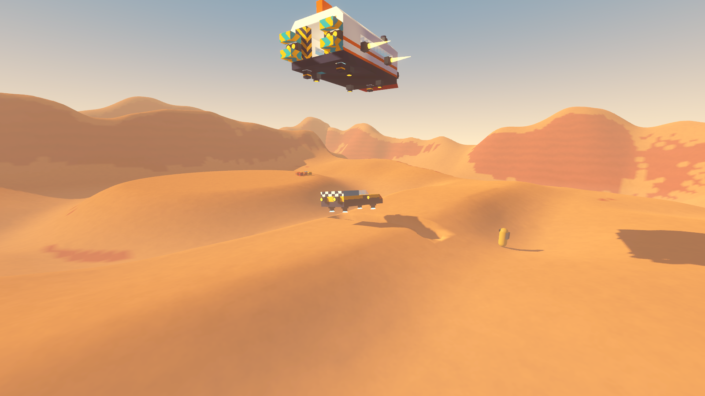
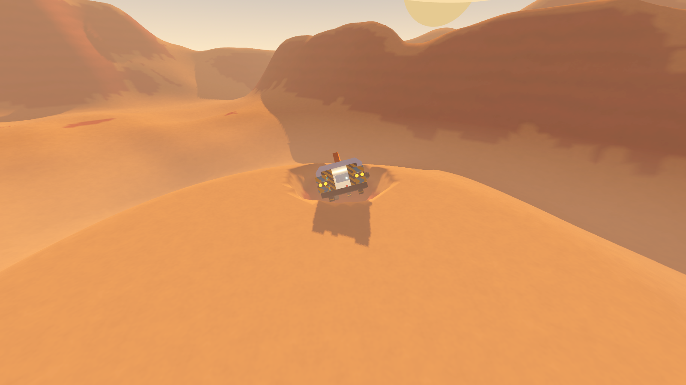
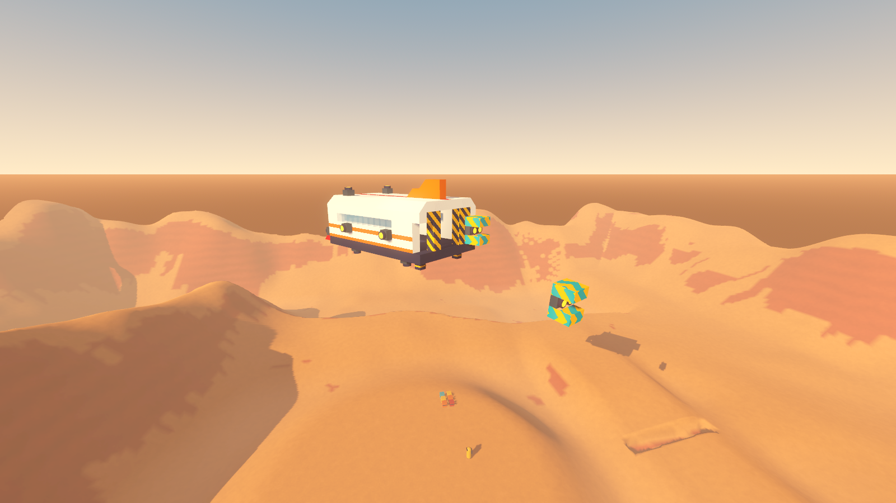
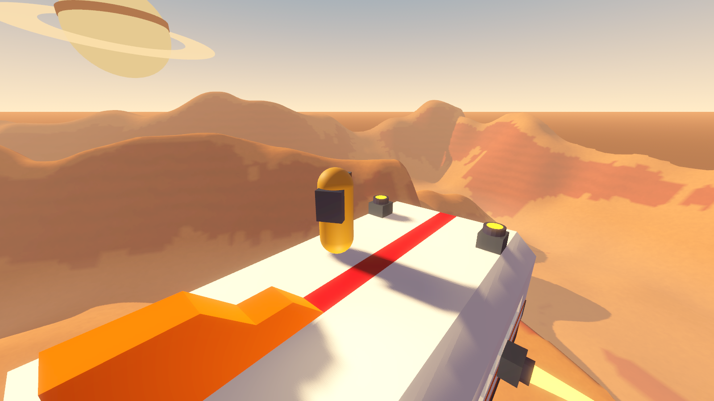
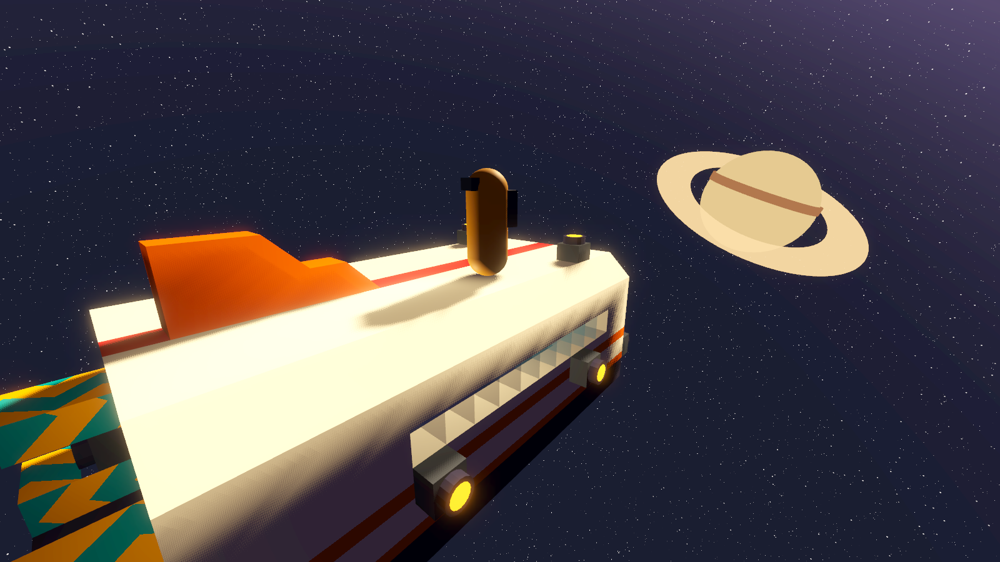
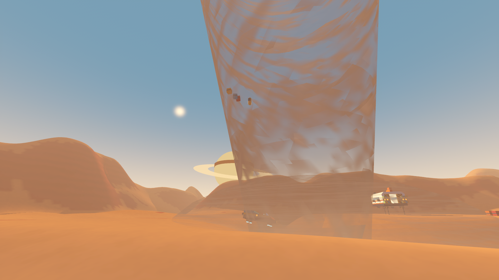

# Prototype: physics sandbox

Proves the shared physics module (`shared/Physics`) in one place: a small vessel built from a blueprint and flown by the handling model over diggable terrain in weather wind, landing gear on dug ground, a crash that cuts a real crater, a section shot off into a tumbling wreck, a player walking in the cabin while it flies, riding its roof, and spacewalking round its hull in orbit in mag boots, a tornado flinging a crate and the player (who survives at 15%), and a hover rover crossing a dug trench. It uses only `shared/Physics` and the other prototypes' pure-C# cores, compiled from where they live.








## How it fits together

| Piece | Where | What |
| --- | --- | --- |
| Shared physics | `shared/Physics` | Every physics rule. See its README. |
| Handling model | `prototypes/ship-handling/src/Handling` (compiled in) | The four numbers and the flight rules, unchanged |
| Terrain core | `prototypes/terrain-digging/src/Terrain` (compiled in) | Chunk store, edit rules, edit log, Surface Nets, stuck resolver, unchanged |
| Structure core | `prototypes/building/src/Structures` (compiled in) | Blocks, blueprints, stats, damage and severing, unchanged |
| Weather | `prototypes/weather/src/Model`, `src/Forces`, `src/Glue.cs` (compiled in) | The weather model and its wind and tornado forces, unchanged |
| Bridges | `src/Bridges` | The only code that knows both sides: a structure as an `IVesselStructure`, the handling model as `IFlightRules`, craters through `ChunkStore.Crater` into a session `EditLog`, terrain and structure stuck fields, weather forces onto the force path, a health sink that asks weather for the fling floor, and the sandbox's landscape behind terrain-digging's `ITerrainSource` |
| World | `src/World` | Ships, crates, creatures and the player as registered bodies; the terrain view (8 collision blocks per chunk, as terrain-digging); a structure mesher with paint patterns; sky, flames, funnel, camera, HUD, keys |

Data is read where each prototype keeps it: `shared/Physics/physics.json`, `ship-handling/data/handling.json` (flight numbers and the parts table), `building/data` (the catalogue, with `data/vessel-parts.json` appended: gyros, hover pads and landing legs, which the catalogue doesn't have yet) and `weather/data/weather.json`. The two vessels are hand-written small-grid blueprints in `data/blueprints`:

| | Corsair 9 (small vessel) | Sand Flea II (hover rover) |
| --- | --- | --- |
| Blocks | 556, one body of 60 colliders | 195, one body |
| Mass | 9.0 t | 3.7 t |
| Accel fwd / back / up / side | 16.8 / 8.4 / 16.8 / 8.4 m/s² | 20.4 / 10.2 / hover / 10.2 m/s² |
| Turn | 67°/s | 163°/s |
| Lift margin | +62 kN (6 t spare) | +124 kN, rides 1.5 m |
| Inside | a 3.5 × 2 × 7 m cabin, a windscreen, side windows, a doorway at the back onto a porch | an open cockpit |

A third blueprint, the Deck Barge (`barge.gbp`), is a flat test hull for the mag-boot tests: an 8 m deck 1 m thick with square edges, a superstructure two blocks tall and a lip one block tall.

The landscape (`SandboxTerrain`) has real relief: rolling hills, a rocky ridge to the north, a 13 m bank dropping into a basin to the east, a level landing field in the middle and a gentle lane to the south where the trench is dug.

## Play it

From the repo root, in PowerShell:

```powershell
.\tools\godot.ps1 -Project prototypes/physics-sandbox -Play
```

You start beside the Corsair, landed on the field with its doorway open behind it. The rover waits on the lane to the south, short of a 2 m trench.

| Key | Action |
| --- | --- |
| WASD, mouse | Walk and look; thrust and steer when seated |
| Space | Jump, hold in the air for the jetpack; up when flying |
| Shift / Ctrl | Sprint; boost / down when flying |
| F | Sit in the pilot seat (front of the cabin) or leave it |
| Q / E | Roll |
| G / C | Landing gear / cruise |
| 1 / 2 / 3 | Into the Corsair's cabin / the rover's seat / onto the Corsair's roof |
| 4 | Spacewalk: the Corsair parked in orbit, core gravity off, you on its roof in mag boots |
| Y | The ship's core gravity on or off: float in the cabin |
| K | Shoot an engine pod off the Corsair (port, then starboard) |
| B / N | Blast a crater / dig at the crosshair |
| T | A tornado forms 120 m ahead and comes for you |
| V | First person or chase camera |
| R | Start again |
| F1, Esc | Hide the help, free the mouse |

Things to try: walk up the doorway step into the Corsair (jetpack up if it's landed high), take the seat and fly it while the dust blows; stand on its roof (3) and have it flown; go into orbit (4), walk off the roof's edge, down the side and under the belly, then round to the porch and in through the door; jump off and drift away; dive it into the field at full boost and walk to the hole; press K in flight; drive the rover over the trench; call a tornado and stand your ground.

## Test it

```powershell
.\tools\test-all.ps1
```

runs `tests/PhysicsTest.tscn` with `--fixed-fps 60` (from `tests/PhysicsTest.args`), so it takes about 7 s. To run it alone, as fast:

```powershell
. .\tools\env.ps1; & $GodotConsole --headless --fixed-fps 60 --path prototypes/physics-sandbox res://tests/PhysicsTest.tscn
```

`.\tools\test.ps1 -Project prototypes/physics-sandbox -Scene res://tests/PhysicsTest.tscn` works too, in real time (under 2 minutes); its performance check then times only the module's own step. Both give the same results, check for check. The 53 checks, with typical numbers on a Ryzen 7 5800X3D:

- **Pure rules:** rotation conventions; the damage formula for every mass and speed (uncapped: 2000 m/s does 992× the hull); reduced mass; crater sizes and the 6 m cap; toughness per tonne; the greedy box merge covers every solid cell once (20 random chunks); joining a ship and letting go keep world position, velocity and orientation; the let-go rule (a jump at once, 0.4 s out of contact or 1.5 m off, never from inside); turning onto a new up keeps forward forward.
- **Determinism:** two whole sandbox worlds in their own physics spaces, 7 s of a dust storm with the Corsair flown and crashed (a crater), the rover driven and crates flung by a tornado: 3780 body-ticks, max difference exactly 0, identical terrain edits.
- **Structures:** each blueprint's body mass equals its blocks' and the handling model's; thrust per direction is building's; one body of 60 shapes for 556 blocks; a one-block edit rebuilds 1 of 8 chunks' colliders (about 3 ms with mass and centre of mass).
- **One force path:** vessel, wreck, crate, creature and player all accelerate at ΣF/m through gravity, dust-storm wind, thrust, legs and a 600 N probe (error ≤ 1e-7); the sums hold every source.
- **Damage and craters:** a 23 m/s belly landing does exactly 9.0 t × (23 − 8)² × 0.001; a 96 m/s dive does 2× the hull, uncapped, cuts a 279-cell crater capped at 6 m (the formula said 6.9) with every cell in the edit log, and leaves a free wreck in its hole; a ram hurts both sides equally from the reduced mass and knocks the parked ship loose; a 30 m fall costs a player 37% with no floor.
- **Severing:** shooting through a pod's mounting while the ship turns at 1 rad/s keeps total mass (8953.1 kg) and momentum (267 108.7 kg·m/s, off by 0.03) with the shot-out blocks counted; the engine's wreck changes by exactly gravity and drag one step later; the other pod tumbles away at up to 9 rad/s and the ship's forward acceleration drops to 0.
- **Riding, on the hull and in the cabin:** a player who lands on the flying Corsair joins its cabin world and stays put on the roof through a 10 s manoeuvre (68 m/s, a 121° turn, a climb, a stop: 0.0 cm), their view turning with the ship; a dust-storm wind pushes them on the hull (148 N) but flying at 51 m/s through still air doesn't; a jump lets go at once with the ship's 25 m/s plus the jump; landing on a hull flying at 34 m/s joins it without a jolt (0.09 m/s, 4.4 cm); in the cabin through a full barrel roll they move 0.00 cm; walking 0.5 s covers 2.5 m of deck while the ship carries them 24 m; core gravity off lets the planet's gravity in, on is ship-down again.
- **Spacewalking in mag boots** (in orbit, core gravity off): on the roof through a barrel roll (0.00 cm); off the roof, over the bevel, down the side and round under the belly, still and while the ship rolls, never out of contact; a bump that throws them off for 0.30 s doesn't let go; knocked off hard they let go after 0.37 s and drift away at a constant 2.4 m/s; a jump from the underside lets go at once and drifts off with the ship's 24 m/s plus the jump; from the porch in through the door never leaves the cabin world (boot down outside, core down inside), and with the core off they float inside and the boots catch them on the porch; on the Deck Barge, over two square 90° edges onto the underside (still and rolling), up a wall two blocks tall and onto its roof, and a lip one block tall stays a step.
- **Rover and gear:** the rover crosses the 2 m dug trench at 23 m/s without touching it (engines dip to 1.16 m); the Corsair's legs drop by themselves and it settles tilted 10.5° on ground 0.5 m uneven, every foot within 1 cm.
- **Tornado:** caught at 40% health, carried 36 m up and flung, the 26 m/s landing would cost about 65% and leaves exactly 15.00%; the crate beside them is flung too and is still there; the same fall without a fling leaves 0%.
- **Stuck-safety:** 1000 random digs, craters, teleports into the ground, blocks built onto bodies, hard landings and zone loads: about 1250 rescues, every one within 2 frames, nothing ends inside terrain or a structure, nothing falls out of the world.
- **Performance:** 20 vessels (all moving) + 50 crates in a dust storm: a whole physics tick (shared module, Jolt step, scripts and an empty headless frame) about 1.7 ms on average; the module's own step about 1.1 ms.

`tests/Screenshot.tscn -- --view=flight|crash|sever|hull|spacewalk|cabin|tornado --out=file.png` renders a scripted moment to a PNG (windowed, not headless).

## Decisions to review

- **Riding (reworked after review):** one mechanism, the cabin world, for inside and out on the hull alike; you join a ship by landing on it and let go by jumping or losing contact (0.4 s grace, 1.5 m). The earlier explicit carry on the outer hull is gone. See `shared/Physics/README.md`.
- **Mag boots (on, `riding.magBoots`):** out on the hull, down is the face underfoot; sharp outside edges up to 90° are carried round by a probe, and walls a step or more tall are climbed (`riding.insideCorners`, on). Both proved simple and stable in the tests; either can be switched off in `physics.json`.
- **Colliders:** one body per structure, compound shape built per 16³ chunk, only changed chunks rebuilt; runs of sloped blocks share one convex hull.
- **Free bodies are Jolt rigid bodies** fed by the shared force sums (gravity and damping off in the engine); vessels and characters are integrated by the module.
- **Vessels feel the wind's push, not still-air drag:** their top speed already is their air resistance, so the four numbers stay true. Crates, wrecks and players feel full relative drag.
- **Riders on a hull feel weather relative to the hull,** bridged into its cabin world; a tornado still lifts them off a parked ship. Above the atmosphere nobody feels any.
- **Toughness per tonne** makes one damage formula fit everything; a player is 0.5 hull points per tonne.
- **Crater cap is terrain-digging's 6 m,** not ship-handling's 14 m decal: the hole and the look agree.
- **Parking:** an unmanned vessel holds course (ship-handling's rule) unless it is parked or nearly stopped, when it holds station; otherwise wind or a ram would carry a parked ship away.
- **Out of the world counts as stuck** for anything falling (thrown over the rim), never for a rider of a ship or anything above the atmosphere; rigid boxes count as stuck once their centre is under the ground.
- **Core gravity costs no power and needs none** here; building's `StructureStats.GravityActive` still asks for a powered core.
- **Missing components:** gyros, hover pads and landing legs are appended to building's catalogue from `data/vessel-parts.json`; their function numbers come from the handling model's parts table.

## Known limits

- The world is terrain-digging's fixed 256 × 256 m box: a vessel crosses it in seconds at top speed. Out over the rim there's no ground.
- Impact damage goes to a structure's hull points, not to individual blocks; weapons (`Damage.Blast`) do the blocks.
- A destroyed vessel keeps its 20% glance bounce when it becomes a wreck, so a crash on a slope can skid the wreck out of its crater.
- Hulls don't spin from hits; a ship flown into a player pushes them aside without hurting either.
- The doorway is a step up from the ground on landing gear: use the jetpack (or 1).
- A rider out on a hull collides only with that ship (its cabin world), not with terrain, other ships or crates; the stuck guard keeps them out of the terrain.
- Characters have no automatic step-up: a lip lower than a step has to be jumped, and on the outer hull a jump lets go of the ship.
- Above the atmosphere the sky turns to space, but there is no planet below: the terrain is a 256 m square far underneath.
- The tornado funnel and flames are simple shaders; there's no audio and no particles.
- Debug HUD, keyboard and mouse only, single player.
