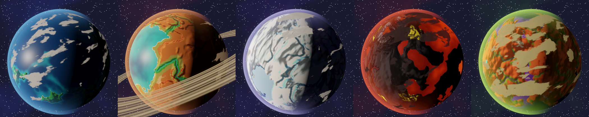
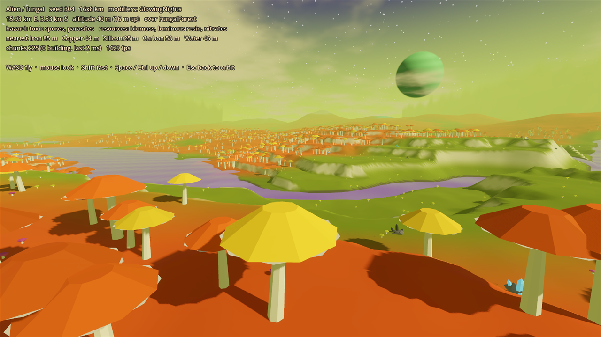
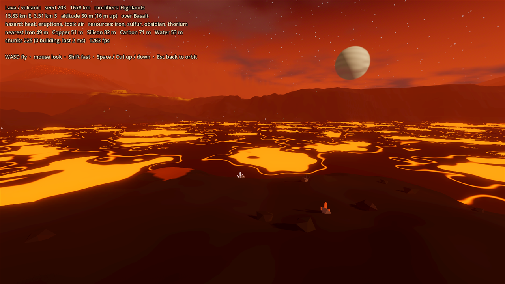
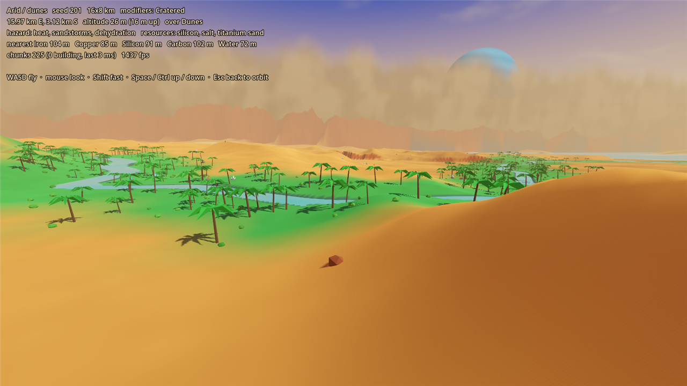
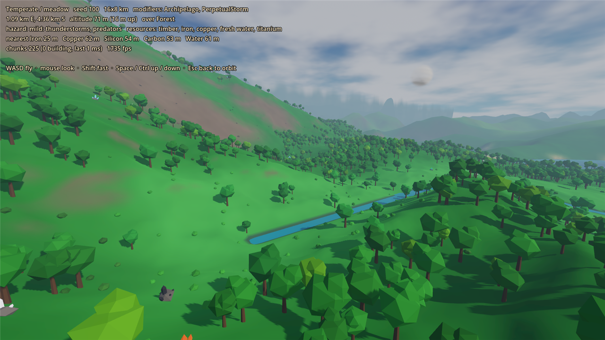

# Prototype: planet generator

Proves that GalHack can generate planets that are varied, distinct and good-looking from one seed: a globe you can spin from orbit, and the same world under your feet when you land, streamed without hitches.








## How it works

Generation is pure C# in `src/Gen`, with no engine types, and deterministic from a `PlanetSpec` (seed, archetype, variant, modifiers, size). Presentation lives in `src/Look` (palettes, colour maps), `src/Orbit` and `src/Surface`.

1. **One height function for every scale, on a torus.** `TerrainModel` gives the elevation at any point and sample spacing. The map wraps both ways: walk off the north edge and you come in at the south edge at the same x, as you do east-west. Every noise field is 4D simplex noise sampled on a flat torus (x round one circle whose circumference is the map width, y round another whose circumference is the map height), so both seams and the corner where they meet are invisible and a metre is a metre in both directions. Octaves finer than the spacing are dropped, so the 32 m world map and the 2 m terrain near the player come from the same function and always agree.
2. **Continents and oceans first.** Sea level is the quantile that leaves each planet's rolled land target (inside its variant's band) above water. Mountains gather into ranges with lowland between them. Then landforms that only make sense on land: plateaus and escarpments with jagged, wandering cliff edges (some stretches sheer, some walkable ramps), mesas, canyons and gorges whose width and depth wander along them, dunes, crystal spires, ice shelves. Volcanoes and craters sit on jittered grids that wrap on both axes.
3. **Rivers.** Priority-flood fills pits, flow follows the steepest descent, catchments add up, and cells draining enough area become rivers. Neighbours wrap on both axes, so rivers flow across either seam. River surfaces never climb downstream: where a river leaves a basin it cuts a gorge rather than floating over the rim. The rivers become smoothed polylines, and the fine terrain cuts channels along them, meandering a few tens of metres off the polyline so the coarse grid never shows.
4. **Climate and biomes.** Temperature comes from latitude and altitude; humidity from distance to water. The equator is the middle row and both map edges are the pole, so the polar band runs straight across the north-south seam: cold country, never a wall. Each archetype variant has a short rule list for its biomes, riverbanks get their own biome, and colours blend across wandering borders.
5. **Starter materials.** The planet is cut into 200 m cells, and every cell with usable land gets a surface or shallow (3 m deep at most) deposit of each common material for a small vessel: iron, copper, silicon, carbon and water. From any walkable spot on any planet type, all five are within about 230 m. That keeps the early game short (a small ship within 1–2 hours). Each archetype also scatters its signature resource.

**From orbit**, the globe's texture is the generator's own colour map, wrapped as an equirectangular projection. The map's top and bottom rows each pinch to a pole on the globe, which shows no seam. Enter lands you on a riverside or coastal spot near whatever faces the camera.

**On the surface**, terrain streams in 160 m chunks on worker threads:
- **Near chunks:** 2 m grid with full scatter within 2 chunks of the camera, 4 m with trees within 4, and 8 m out to 7 chunks (about 1.1 km).
- **Far ring:** drawn straight from the world map, it reaches the horizon and cuts a hole wherever detailed chunks are loaded.
- **Wrapping:** chunk coordinates wrap on both axes, and every chunk is drawn at whichever copy of it lies nearest the camera.
- **Upload budget:** finished chunks reach the scene within 3 ms of main-thread time per frame.
- **Scatter:** low-poly flora and deposits use one MultiMesh per kind per chunk.

## Relief

`Relief.Measure` puts numbers on how dramatic the land is, on dry ground:
- **Range in 2 km:** highest minus lowest ground (sea at its surface) in 2 x 2 km windows. Median over the windows.
- **Slopes:** the share of ground steeper than 30° and 45° across 8 m (a hillside or a cliff face, not a bump underfoot). 45° is about where walking stops and the jetpack starts.
- **Canyon depth:** how far ground sits below walls on both sides within 150 m, at the 95th percentile.

`GenTest` measures every variant on two fixed seeds and holds each to a floor. Before (the cylinder generator this prototype shipped with) and after the relief work:

| Variant | Range in 2 km | Slopes > 30° | Slopes > 45° | Canyon depth |
| --- | --- | --- | --- | --- |
| Temperate meadow | 582 → 947 m | 44 → 49% | 25 → 32% | 46 → 61 m |
| Temperate rainforest | 397 → 494 m | 38 → 52% | 19 → 33% | 42 → 57 m |
| Arid dunes | 224 → 245 m | 14 → 26% | 5 → 11% | 23 → 31 m |
| Arid canyon | 231 → 324 m | 18 → 29% | 12 → 22% | 62 → 108 m |
| Ice glacier | 477 → 620 m | 30 → 53% | 16 → 36% | 34 → 69 m |
| Ice hot spring | 435 → 412 m | 34 → 38% | 7 → 19% | 22 → 44 m |
| Lava volcanic | 290 → 498 m | 19 → 36% | 10 → 18% | 22 → 41 m |
| Lava ocean | 320 → 404 m | 31 → 42% | 13 → 23% | 21 → 35 m |
| Alien crystal | 452 → 482 m | 31 → 46% | 18 → 29% | 28 → 64 m |
| Alien fungal | 309 → 343 m | 28 → 39% | 13 → 18% | 25 → 46 m |

What changed: mountains gather into ranges with lowland between them, with fewer fine octaves so faces read as rock walls rather than noise; plateaus and escarpments rise along a slow noise field with jagged, wandering edges (sheer in places, a walkable ramp in others); canyons and gorges vary in width and depth and only cut some regions (stepped walls on canyon and lava worlds, V-shaped gorges elsewhere); mesa steps fade out up the flanks of real peaks; river channels meander off their coarse polylines with ragged gorge walls where they cut through high ground.

## Archetypes

Every archetype differs from every other on terrain shape, palette, sky, flora, hazard and resources.

| Archetype | Variants | Terrain | Palette and sky | Flora | Hazard | Signature |
| --- | --- | --- | --- | --- | --- | --- |
| Temperate | meadow, rainforest | mountain ranges, escarpments and tablelands, river gorges, rolling or domed hills, many rivers | greens and teal seas under a blue sky | broadleaf, conifer, jungle trees | storms, floods | titanium, resin |
| Arid | dunes, canyon | dune seas with rocky escarpments; mesas and plateaus cut by deep stepped canyons | orange and red rock, turquoise water, dusty peach horizon, big blue moon | palms on oases, cacti, scrub | heat, sandstorms | titanium, gemstones |
| Ice | glacier, hot spring | high ranges, broad glacial valleys, ice tablelands, coastal ice cliffs | white and pale blue under an indigo and pink sky | ice shards, frost rock | cold, geysers | cobalt, sulfur |
| Lava | volcanic, lava ocean | tall volcano cones with calderas and gullies, basalt escarpments and stepped lava channels | black basalt, glowing lava seas and rivers, red sky | lava rocks, obsidian | heat, eruptions | thorium, titanium |
| Alien | crystal, fungal | knife-edge crystal ridges, plates and stepped gorges; bulbous fungal domes | violet and teal under a ringed sky; orange and cream under lime | giant crystals; giant mushrooms | radiation, spores | crystal, resin |

Each planet also rolls 1–2 modifiers:
- **Terrain modifiers:** archipelago, highlands, cratered, mesas and canyons change the terrain.
- **Look-only modifiers:** ringed sky, perpetual storm and glowing nights change only the sky, clouds and night-side glow.

## Play it

From the repo root, in PowerShell:

```powershell
.\tools\godot.ps1 -Project prototypes/planet-generator -Play
```

| Key | Action |
| --- | --- |
| 1–5 | Archetype: temperate, arid, ice, lava, alien |
| V | Next variant |
| N | New seed |
| M | Reroll modifiers |
| S | Planet size: 8x4, 16x8, 32x16, 64x32 km |
| Tab | Flat map |
| Enter | Land near the part of the globe facing you |
| WASD, mouse | Fly (on the surface) |
| Shift | Fly fast |
| Space / Ctrl | Up / down |
| Esc | Back to orbit |

On the surface, the HUD shows the distance to the nearest deposit of each starter material.

## Test it

```powershell
.\tools\test.ps1 -Project prototypes/planet-generator -Scene res://tests/GenTest.tscn
.\tools\test.ps1 -Project prototypes/planet-generator -Scene res://tests/ViewTest.tscn
```

`tests/GenTest.tscn` runs headless in about 40 s and checks (`-- --only=Relief,Distinctness` runs just the named checks):
- **Determinism:** identical map hash and identical fine terrain from the same spec.
- **Seamless wrap, both ways:** the step across each seam falls within the range of every other column (or row) pair. The fine terrain is continuous across both seams and at all four corners at once: height and normal differences shrink tenfold when the gap does.
- **Poles:** no wall. The steepest polar ground stays within what the rest of the planet has, the polar band is colder than the equator, and its temperature carries across the north-south seam.
- **Land fraction:** inside each variant's band over 20 seeds.
- **Rivers:** every river cell drains to the sea, and riverbank cells exist, on every variant. Some rivers cross the north-south seam, never climbing downstream, with their channel carved on both sides.
- **Starter materials:** all five within 300 m of any walkable spot and of landing sites (worst about 205 m and 180 m). Over 98% of deposits are on dry ground, none deeper than 3 m.
- **Performance:** a 16x8 km map in 75–125 ms; a 2 m chunk of fine terrain in about 10 ms on one thread.
- **Relief:** see above; every variant must clear its floor.
- **Distinctness:** a nearest-centroid classifier on colour and terrain features, trained on some seeds and scored on 100 unseen planets, names the archetype 100% of the time (it must stay at 95% or above).

`tests/ViewTest.tscn` runs headless and is the views' stability check. It lands, flies at boost speed north-east across the corner where both seams meet, returns to orbit, switches planet and lands again. It checks that streaming settles and that the main thread never stalls (worst frame about 9 ms).

`tests/Atlas.tscn` writes [atlas/atlas.png](atlas/atlas.png): 20 unlabelled flat maps (5 archetypes x 4 seeds, shuffled) for a human blind test. The answers are in [atlas/atlas_key.txt](atlas/atlas_key.txt); don't peek.

`tests/Screenshot.tscn` must run in a window:

```
-- --view=orbit|flat|surface|pole --archetype=0-4 --variant=0|1 --seed=N --out=file.png [--mods=Mesas,Cratered] [--hud=0]
```

It also prints the frame time with vsync off, plus primitives and draw calls. On the development machine, the surface draws 0.65–0.95 M primitives (shadow passes included) in about 200 draw calls.

## Known limits

- **Lakes:** none. Pits drain through gorges, and inland ground below sea level fills with sea (or lava) at sea level.
- **Collision:** none. The camera only clamps to the ground. The heightfield is on a regular grid (1 m cells conceptually) and ready for a HeightMapShape3D and A*.
- **Time of day:** the surface is always day; glowing nights only show on the globe's night side.
- **Gameplay:** hazards and resources are labels and deposits.
- **Build settings:** the csproj sets `Optimize` even in Debug. The generator is tight numeric loops that run 3–5x slower unoptimised, which made streaming stutter in editor play.
- **Determinism across machines:** checked on one machine and runtime only. Seeds that must match across players need a cross-platform check of the trig in the cylinder mapping.
- **Low-end hardware:** not yet tested on real low-end GPUs. A low preset (fewer detail rings, no scatter shadows, merged MultiMeshes) is the obvious next step.
- **Engine noise:** none. All noise is our own, so FastNoiseLite's determinism doesn't matter.
- **Assets:** none. Everything, meshes included, is built in code, so there's nothing to credit.
