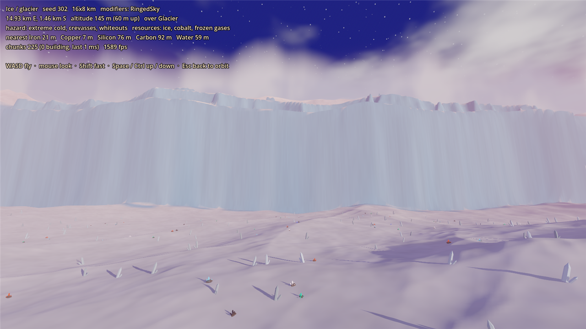

# Prototype: planet generator

Proves that GalHack can generate planets that are varied, distinct and good-looking from one seed: a globe you can spin from orbit, and the same world under your feet when you land, streamed without hitches.




## How it works

Generation is pure C# in `src/Gen`, with no engine types, and deterministic from a `PlanetSpec` (seed, archetype, variant, modifiers, size). Presentation lives in `src/Look` (palettes, colour maps), `src/Orbit` and `src/Surface`.

1. **One height function for every scale.** `TerrainModel` gives the elevation at any point and sample spacing. Noise is sampled on a cylinder whose circumference is the map width, so the east-west seam is invisible. Octaves finer than the spacing are dropped, so the 32 m world map and the 2 m terrain near the player come from the same function and always agree.
2. **Continents and oceans first.** Sea level is the quantile that leaves each planet's rolled land target (inside its variant's band) above water. Then landforms that only make sense on land: mesas, canyons, dunes, crystal spires, ice shelves. Volcanoes and craters sit on jittered grids that wrap east-west.
3. **Rivers.** Priority-flood fills pits, flow follows the steepest descent, catchments add up, and cells draining enough area become rivers. River surfaces never climb downstream: where a river leaves a basin it cuts a gorge rather than floating over the rim. The rivers become smoothed polylines, and the fine terrain cuts channels along them.
4. **Climate and biomes.** Temperature comes from latitude and altitude; humidity from distance to water. Each archetype variant has a short rule list for its biomes, riverbanks get their own biome, and colours blend across wandering borders.
5. **Polar caps.** The map's north and south edges rise more than 400 m in under 40 m. A churning storm curtain (or a blizzard behind ice cliffs) makes the edge of the world read as weather.
6. **Starter materials.** The planet is cut into 200 m cells, and every cell with usable land gets a surface or shallow (3 m deep at most) deposit of each common material for a small vessel: iron, copper, silicon, carbon and water. From any walkable spot on any planet type, all five are within about 230 m. That keeps the early game short (a small ship within 1–2 hours). Each archetype also scatters its signature resource.

**From orbit**, the globe's texture is the generator's own colour map. A 2:1 map is exactly an equirectangular projection, with the caps at the poles. Enter lands you on a riverside or coastal spot near whatever faces the camera.

**On the surface**, terrain streams in 160 m chunks on worker threads:
- **Near chunks:** 2 m grid with full scatter within 2 chunks of the camera, 4 m with trees within 4, and 8 m out to 7 chunks (about 1.1 km).
- **Far ring:** drawn straight from the world map, it reaches the horizon and cuts a hole wherever detailed chunks are loaded.
- **Upload budget:** finished chunks reach the scene within 3 ms of main-thread time per frame.
- **Scatter:** low-poly flora and deposits use one MultiMesh per kind per chunk.

## Archetypes

Every archetype differs from every other on terrain shape, palette, sky, flora, hazard and resources.

| Archetype | Variants | Terrain | Palette and sky | Flora | Hazard | Signature |
| --- | --- | --- | --- | --- | --- | --- |
| Temperate | meadow, rainforest | ridged mountains, rolling or domed hills, many rivers | greens and teal seas under a blue sky | broadleaf, conifer, jungle trees | storms, floods | titanium, resin |
| Arid | dunes, canyon | dune seas, mesas, terraced plateaus cut by canyons | orange and red rock, turquoise water, dusty peach horizon, big blue moon | palms on oases, cacti, scrub | heat, sandstorms | titanium, gemstones |
| Ice | glacier, hot spring | smooth ice sheets, coastal ice cliffs, terraced ice caps | white and pale blue under an indigo and pink sky | ice shards, frost rock | cold, geysers | cobalt, sulfur |
| Lava | volcanic, lava ocean | volcano cones with calderas and gullies, basalt steps | black basalt, glowing lava seas and rivers, red sky | lava rocks, obsidian | heat, eruptions | thorium, titanium |
| Alien | crystal, fungal | knife-edge crystal ridges and plates, bulbous fungal domes | violet and teal under a ringed sky; orange and cream under lime | giant crystals; giant mushrooms | radiation, spores | crystal, resin |

Each planet also rolls 1–2 modifiers:
- **Terrain modifiers:** archipelago, highlands, cratered, mesas and canyons change the terrain.
- **Look-only modifiers:** ringed sky, perpetual storm and glowing nights change only the sky, clouds and night-side glow.

## Play it

From the repo root, in PowerShell:

```powershell
.\tools\godot.ps1 -Project prototypes/planet-generator -Play
```

| Key | Action |
| --- | --- |
| 1–5 | Archetype: temperate, arid, ice, lava, alien |
| V | Next variant |
| N | New seed |
| M | Reroll modifiers |
| S | Planet size: 8x4, 16x8, 32x16, 64x32 km |
| Tab | Flat map |
| Enter | Land near the part of the globe facing you |
| WASD, mouse | Fly (on the surface) |
| Shift | Fly fast |
| Space / Ctrl | Up / down |
| Esc | Back to orbit |

On the surface, the HUD shows the distance to the nearest deposit of each starter material.

## Test it

```powershell
.\tools\test.ps1 -Project prototypes/planet-generator -Scene res://tests/GenTest.tscn
.\tools\test.ps1 -Project prototypes/planet-generator -Scene res://tests/ViewTest.tscn
```

`tests/GenTest.tscn` runs headless in about 20 s and checks:
- **Determinism:** identical map hash and identical fine terrain from the same spec.
- **Seamless wrap:** the step across the east-west seam falls within the range of every other column pair. The fine terrain is continuous there: the difference shrinks tenfold when the gap does.
- **Polar caps:** walls on every column, no route from the equator to either edge up slopes of 45° or less, and walls at 87° at 2 m resolution.
- **Land fraction:** inside each variant's band over 20 seeds.
- **Rivers:** every river cell drains to the sea, and riverbank cells exist, on every variant.
- **Starter materials:** all five within 300 m of any walkable spot and of landing sites (worst 228 m and 255 m). Over 98% of deposits are on dry ground, none deeper than 3 m.
- **Performance:** a 16x8 km map in 60–80 ms (64x32 km in about 1.1 s); a 2 m chunk of fine terrain in about 10 ms on one thread.
- **Distinctness:** a nearest-centroid classifier on colour and terrain features, trained on some seeds and scored on 100 unseen planets, names the archetype 99% of the time.

`tests/ViewTest.tscn` runs headless and is the views' stability check. It lands, flies at boost speed across the seam, returns to orbit, switches planet and lands again. It checks that streaming settles and that the main thread never stalls (worst frame about 9 ms).

`tests/Atlas.tscn` writes [atlas/atlas.png](atlas/atlas.png): 20 unlabelled flat maps (5 archetypes x 4 seeds, shuffled) for a human blind test. The answers are in [atlas/atlas_key.txt](atlas/atlas_key.txt); don't peek.

`tests/Screenshot.tscn` must run in a window:

```
-- --view=orbit|flat|surface|cap --archetype=0-4 --variant=0|1 --seed=N --out=file.png [--mods=Mesas,Cratered] [--hud=0]
```

It also prints the frame time with vsync off, plus primitives and draw calls. On the development machine, the surface draws 0.65–0.95 M primitives (shadow passes included) in about 200 draw calls.

## Known limits

- **Lakes:** none. Pits drain through gorges, and inland ground below sea level fills with sea (or lava) at sea level.
- **Collision:** none. The camera only clamps to the ground. The heightfield is on a regular grid (1 m cells conceptually) and ready for a HeightMapShape3D and A*.
- **Time of day:** the surface is always day; glowing nights only show on the globe's night side.
- **Gameplay:** hazards and resources are labels and deposits.
- **Build settings:** the csproj sets `Optimize` even in Debug. The generator is tight numeric loops that run 3–5x slower unoptimised, which made streaming stutter in editor play.
- **Determinism across machines:** checked on one machine and runtime only. Seeds that must match across players need a cross-platform check of the trig in the cylinder mapping.
- **Low-end hardware:** not yet tested on real low-end GPUs. A low preset (fewer detail rings, no scatter shadows, merged MultiMeshes) is the obvious next step.
- **Engine noise:** none. All noise is our own, so FastNoiseLite's determinism doesn't matter.
- **Assets:** none. Everything, meshes included, is built in code, so there's nothing to credit.
