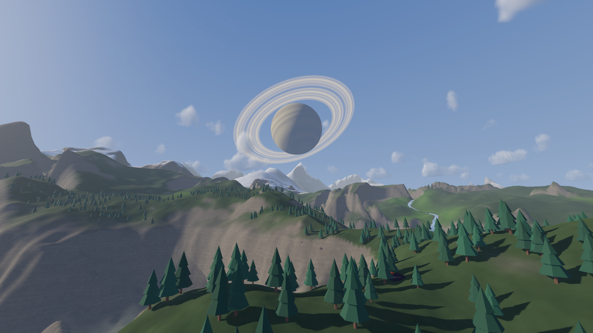
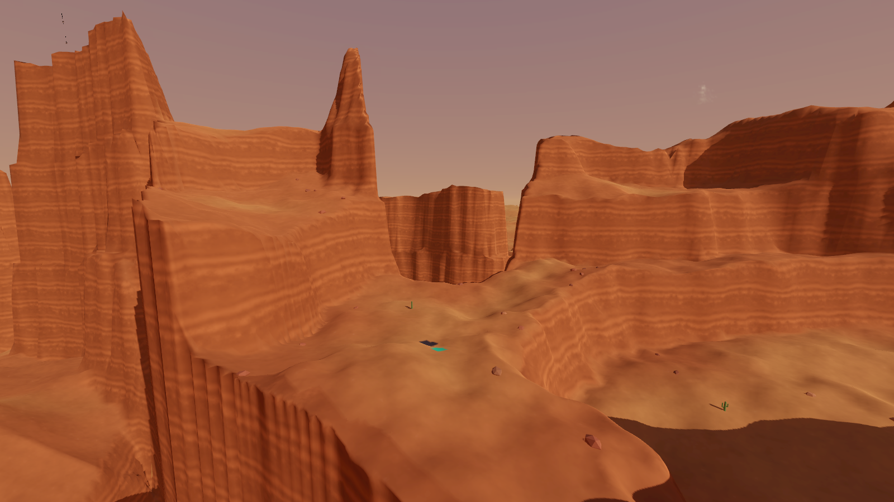
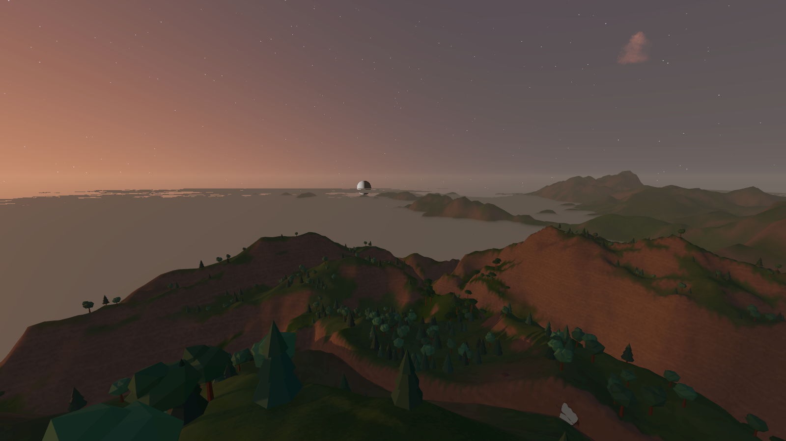
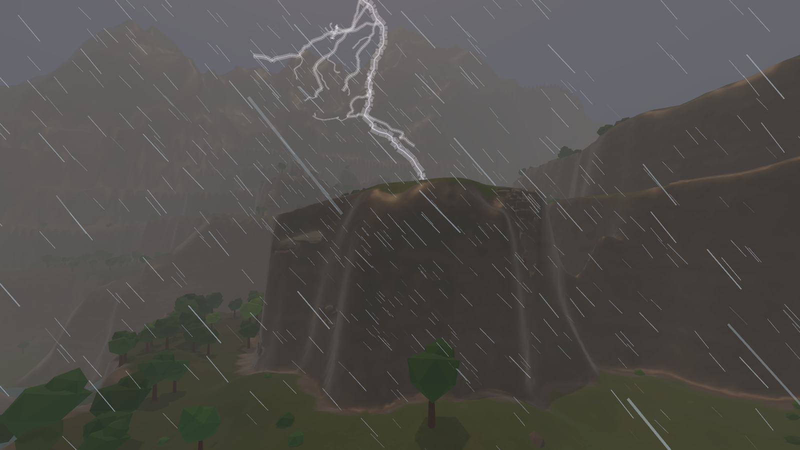
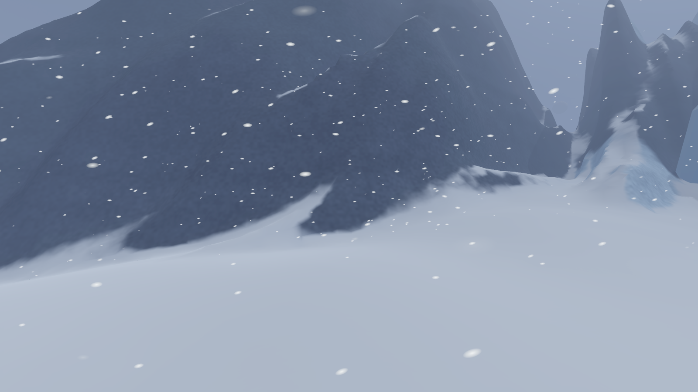
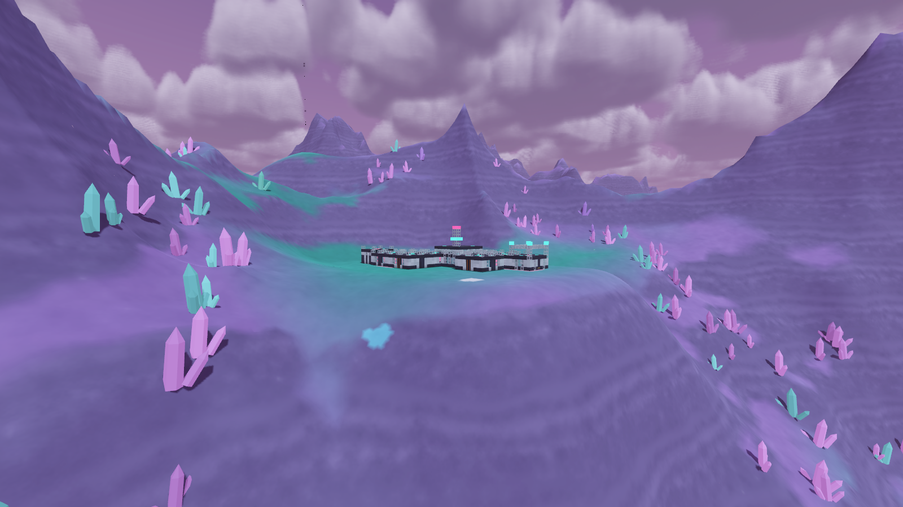
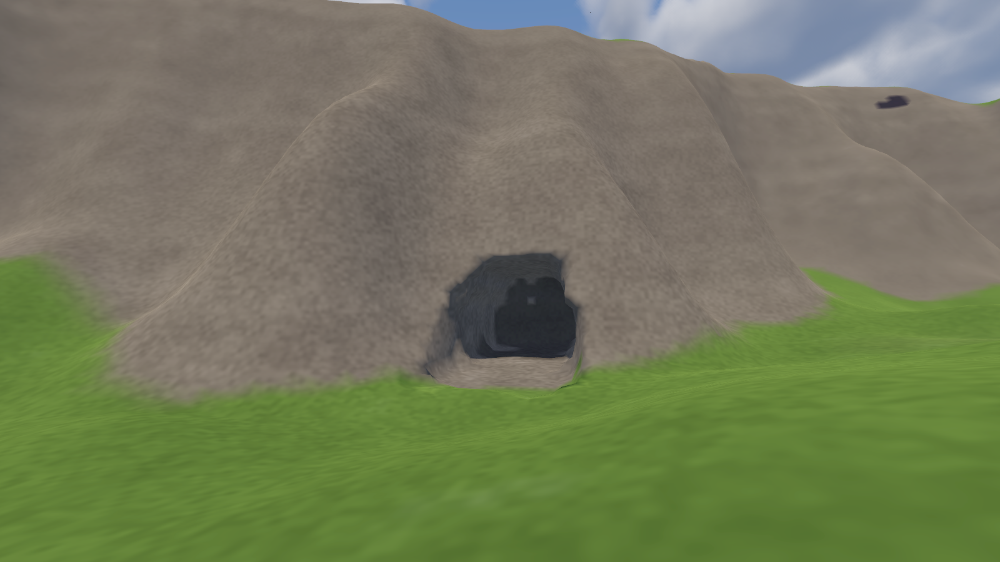
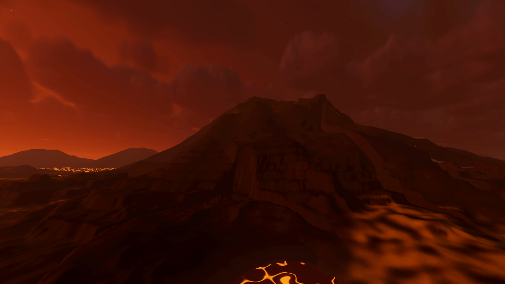

# Prototype: planet surface

The first whole planet you can stand on. The planet generator's worlds, as diggable 1 m voxel terrain with caves, ore and bedrock, streamed around you out to a 7 km horizon. Each has its own sky and its own weather, places from the POI generator seated into the slopes, and edits that are never lost. The map is a torus: walk far enough north or east and you come back from the south or west, with no edge and no polar wall.










## What it proves

- **The generator's planets are diggable.** `shared/Terrain` turns a `WorldMap` into terrain-digging's `ITerrainSource`. Every column's surface is the generator's own height at 1 m. Below it lies soil (thinner on slopes), rock, deep rock, and ore bodies under the deposit map's deposits. Caves are winding tubes 3–36 m down that sometimes break the surface. Bedrock lies 30 m below the nearby valley floors, so a mountain can be tunnelled through but the world has a floor. Terrain-digging's chunk store, Surface Nets mesher, edit log, saves and stuck safety are reused as they are.
- **A torus without seams.** The generator samples 4D noise on a flat torus, so terrain, climate and rivers all carry across both edges, and the equator runs through the middle of the map with a pole at each edge. The terrain store keeps the planet plus 8 ghost chunks beyond each seam. Every edit lands on every copy, and crossing a seam moves the frame by one planet width, re-keying the loaded chunks instead of rebuilding them.
- **Streaming that keeps up with a ship.** Near the player, voxel chunks within 5 chunk columns (80 m) are meshed on worker threads. Collision covers 2 columns, built only where needed. Beyond that come generator heightfield rings out to about 900 m, then a horizon mesh out to 7 km. The rings' 128 m chunks tile the planet both ways: where its size isn't a multiple of 128 m (8 km is 62.5 chunks), the last chunk before the seam is cut short, ground and flora alike. Each layer cuts a hole where the finer one lies, so they never overlap, and dives under the finer layer's edge first: the horizon under the rings, the rings under the voxels. Far chunks hang a curtain from every edge, down past wherever any level of detail draws that edge, so a cliff crossing from one level to the next is closed however far the two disagree, and a long curtain is painted as rock. The main thread only uploads meshes, within a 3 ms budget shared between near and far.
- **Dramatic ground.** Ranges of mountains hundreds of metres high, escarpments and mesas with jagged edges, canyons and gorges, rolling lowland between, all varying by archetype (see the planet generator's [relief numbers](../planet-generator/README.md#relief)).
- **Cliffs that read as rock.**
  - *Where the cliff really is.* Near the player, the cells beside a cliff take their distance to the cliff's own line (found between each pair of 1 m columns it falls between) as their density, so a wall stands where the generator put it, not on a staircase of metre columns with striped normals and a toothed rim. In the far rings, the grid points beside a cliff slide onto its top and its foot (points on the 16 m lines where levels meet only slide along them), are sampled again where they stand, and each square is split along the diagonal that follows the ground, never one that turns a triangle over; their normals come from the triangles drawn. The far rings' fixed diagonal had made every cliff crossing a square at a corner into a fin, and down a long wall the fins became tall teeth.
  - *Rock by rule* (`shaders/rock.gdshaderinc`, `RockLook`): horizontal beds whose colours come from the world's own rock, its two commonest minerals and its soil, dipping slowly across the land; hard beds standing out as ledges with a shadowed undercut and dark streaks below; water-worn flutes; joints and fractures; varnish streaking down from the rim (damp stains and lichen on a wet world with life); a paler caprock at the top; a wet, salt-stained foot by the sea; scree on the ground at the foot. Each region's landforms set how much of each a face shows: mesas banded under a caprock, canyon walls banded and fluted, sea cliffs jointed, mountain crags all blocks and fractures, karst fluted, badlands thin-bedded. Every mesh carries in UV2 how far the ground rises above and falls below each vertex within 16 m (the top and foot of its cliff). Fine detail eases out by the size of a pixel, so nothing shimmers.
  - *Talus.* Rocks lie along a cliff's foot in the near scatter, more and bigger under a taller face, where nothing else grows and off roads, pads, water and dug ground.
- **The sky follows the place.** `SkySystem` derives each sky from the world:
  - The star's class sets the light's colour.
  - Rayleigh scattering of that light gives the clear-sky colour (blue under a yellow star, paler under a white one, warmer under an orange one).
  - The air and archetype tint it further: dusty, humid, thin, ash-laden or exotic, with exotic air allowed to be pastel or neon.
  - Neighbouring bodies appear where the system has them: moons with phases, a gas giant (ringed if the planet has the RingedSky modifier), stars and a nebula at night.
  - Clouds are a slab, raymarched against the sun at half resolution, with lit tops and dark bases.
  - **No seams anywhere on it.** The night backdrop is looked up along the 3D direction itself: the nebula from 3D noise inside one texture tile (a longitude-latitude map pinched it into a starburst at its pole and tore it along a meridian), the stars as points through a thin shell of a 3D lattice, each kept or dropped by itself (cutting the lattice with the sky's sphere left a star-free hole ringed by bands at each axis). Stars fade out below the horizon instead of stopping at a line. The cloud march starts each pixel at a well-spread depth (interleaved gradient noise) and takes more steps where its path through the slab is long, so cloud edges no longer slice into combs and streaks, and the reflection map's cloud cover eases in over the horizon instead of switching on there.
  - **A low sun never drenches the picture.** Near the horizon its light comes through more air: under half from about 17° down (`SkyRig.AirMass`, the same curve in the shader's `sun_air`), for the sunlight, the sun's disc (warmer too) and its wide halo. Haze and fog are lit as the ground is, by a sun clear of the horizon's air, so under a low sun they are dim and warm, not a white wall; the glow toward the sun through fog (sun scatter) is modest. Glow only comes from what is really bright (HDR threshold 2). Morning valley fog forms overnight and burns off: after noon only the weather's own ground fog lies in the valleys, so a setting sun brings none. And once the camera is down in a bank of valley fog it becomes distance fog instead of height fog, so the ground at your feet stays readable.
- **Weather from the weather prototype.** Its model and forces are compiled in unchanged. Clouds, fog, valley fog at dawn, rain, snow, dust, embers, thunderstorms with visible lightning, and tornadoes are driven by its deterministic conditions; wind pushes the walker by mass. Rain and snow stop under rock.
- **Places seated into the land.** POIs are placed by the POI generator's own rules on a 3.2 km map around the landing site. Each one is then fitted to the ground its kind prefers (ridge, valley, flat or any) and stamped with a pad: cut and fill blended into the slope, its rooms carved out below, and caves kept out from under it.
- **Nothing is lost.** Edits persist through unloading, reloading, leaving the planet and coming back, and save/load.
- **Seas and rivers you can go into.** Water is a volume, not a surface: under the sea's level where the world map lies below it, and under a river's surface in its channel, exactly where the water is drawn (`PlanetTerrainSource.WaterSurfaceAt`). The walker wades in the shallows and swims once deep enough, by the shared physics module's water rules and numbers (`shared/Physics/physics.json`, water): buoyancy and drag on the share of it under water, floating with its head out, Space and Ctrl to swim up and down. Under water the view turns to the liquid's own murk (its colours from the world's look, fogging thicker with depth) behind a tint, and the HUD shows the vitals flag: the suit is on its own oxygen. A lava world's seas are lava, and aren't entered.
- **Solid trees and boulders.** Trees, cacti, crystals and rocks bigger than a pebble get one simple collider each, a trunk cylinder or a box sized from the instance's own scale (`data/flora-solids.json`), in the near rings only, where the ground has collision: the finest far rings list them on the workers, and each near 16 m column gets one static body of shared shapes. The survival tool fells a tree for wood (its collider goes the same frame), and felled trees stay felled through streaming and saves. A player inside a trunk or a boulder is moved out beside it.

Everything is generated in code or shaders. Sounds are synthesised from filtered noise. There are no third-party assets.

## Play it

```powershell
.\tools\godot.ps1 -Project prototypes/planet-surface -Play
```

You land near the landing site of a temperate world. The help in the bottom right lists the keys.

| Key | Action |
| --- | --- |
| WASD, mouse | Walk and look |
| Shift | Sprint |
| Space | Jump; hold in the air for the jetpack; swim up in deep water |
| Ctrl (hold) | Crouch; swim down in deep water |
| Left mouse | Dig (1.4 m ball, anywhere but bedrock); at a tree, fell it for wood |
| Right mouse | Place a block |
| F | Free-fly (Shift fast, Space and Ctrl up and down) |
| 1 to 5 | Planet: temperate, arid, ice, lava, alien |
| V | Next variant of this archetype |
| N | New seed |
| K | Next weather |
| L | Lightning strike |
| O | Tornado |
| T | Time ×20 |
| Y | Jump to dawn, noon, dusk, night |
| F5, F9 | Save, load |
| H | Hide the help |
| Esc | Free the mouse |

## Test it

```powershell
.\tools\test.ps1 -Project prototypes/planet-surface -Scene res://tests/SurfaceTest.tscn
```

Runs headless in about 100 s and exits 0 or 1. Add `-- --only=Heights,Flight` to run just the named checks. It checks that:

- weather is deterministic from its seed, and each of the 12 states sets its own fog, cloud and valley-fog values
- every archetype variant's surface has its relief: range in 2 km, slopes over 30° and 45°, canyon depth
- POIs on five worlds are seated: no corner off its floor, no missing ground under or around their rooms, nothing buried, no blocked way in
- streamed voxel heights match the generator exactly (300 columns), and the walkable mesh is within 0.08 m of it
- neighbouring chunks share their border vertices bit for bit
- an edit survives unloading and reloading, a save round trip, and leaving the planet and coming back
- stuck safety frees a buried player and leaves one standing in a fresh pit alone
- the walker steps up onto anything a step tall by the shared physics module's step-up (`shared/Physics/Engine/Steps.cs`) and step height (0.6 m): walked into a sheer 0.5 m slab it is up on top without a jump, and the same slab 1 m tall stops it
- water is a volume: from a shore found near the landing site the player walks into the sea until they swim, swims out over deep water floating with their head out, dives until their head is under (the vitals flag set, the view tinted and fogged) and comes back up, never inside or below the ground and never rescued
- shores (`--only=Shores`), on three fresh temperate worlds, at river mouths, rivers widening toward them, banks further up and plain coasts, each a 64 m window on a half-metre grid as the near ground (the voxels' surface with the finest river sheets) and each far level draw it, with the water the shader keeps: no ground a river raised out in the sea round its mouth; a river's water at the sea's level where it meets it, and no step between the two; the water's own outline never more than 10 cm over the land beside it, at every level; near the eye, water at its own level and no ground showing through it, and shorelines on the land's own line, turning sharply only where it does and never straight across a slope; far levels' shorelines within their grid step of the near one (95%)
- solid flora, in a pine forest: colliders only in the near rings (25 in 10 bodies, none past the collision reach, of about 300 solids loaded); walking into a trunk stops the player at the trunk's radius, and a navigation grid's query marks it blocked; a big boulder stops them, a rock under 0.6 m is walked over; a hull the size of a hover rover, swept the way the shared physics module moves vessels, is stopped by a grove and by a boulder; the survival tool fells a conifer for wood, its collider gone the same frame, and it stays felled after unloading its ground and after a save and load; a player put inside a trunk is moved out, and the landing site is clear
- flying 2 km at 100 m/s keeps streaming's main-thread cost under 8 ms a frame (about 4 ms) in the best of three windows of the flight, and catches up after landing; GC pauses that land inside streaming are left out of that figure and reported beside it, along with the flight's collections
- chunks beyond the north edge match their twins at the south edge (heights to 0.24 mm, normals to 0.005°), as does the corner beyond both seams
- the far grid tiles the planet across the north-south seam: the last 64 m strip before it has its far ground and its flora
- an edit straddling the north-south seam is removed on both sides and kept through save and load
- walking north across the edge keeps you on the ground and at speed in every one of three walks (simulation ticks, so load can't shorten one), with no frame over 8 ms of game code (about 3 ms; the crossing frame about 1.6 ms) and no engine stall between frames in the best of the three

`tests/FaceTest.tscn` doesn't take the mesher's word that nothing can be seen through. In about 50 s, on three fresh worlds (`-- --worlds=N`, and `--seed=N` to replay one it names), it casts millions of rays at the triangles actually drawn, their front faces only, and walks the same rays through the blocks and the ground:

- a ray from anywhere, round a place or ruin as decay left it, over it, under the ground or from its rooms, never enters a solid block or deep ground without meeting a drawn face first: with all the ground dug away, with the real ground, and from a pit really dug round it
- every other shape (pillars, ramps, doors, furniture) has its faces from above, below and the side, wound the right way
- built as a near place is, a chunk at a time, with blocks taken out and only the chunks they touch redrawn, the same holds
- the ground stays behind a room's walls, and at the foot of every wall the ground as drawn lies level with the ground a stride off, at every height, slopes and half-buried ruins too: within 15 cm

`tests/SteepGroundTest.tscn` holds the ground itself to the same standard: you must never see through it. On fresh worlds (`-- --worlds=N`, default 3, the barren rugged ones first; `--world=Arid:1:SEED` replays one it names; about 2.5 minutes), it finds the steepest ground near the landing site, puts the camera at several distances from it on the ground and in the air, and also flies past at 100 m/s. From each spot it gathers the triangles being drawn at that moment, voxels, far rings and horizon, with the hole and sink numbers the shader has, and it fires rays through the places where a boundary between levels of detail crosses steep ground. There is no tolerance:

- a ray from open air to a point in solid ground with drawn ground over it must cross a front face on the way
- a ray that hits a sheer face must land on rock, shaded with a normal that faces the eye: soil paint or a normal turned away is the pale streak that looks like a tear with the sky behind it
- near the camera, what is drawn is what is solid: the same ray hits collision in the same place

`tests/SkyTest.tscn` renders, so a headless run starts itself again in a normal window and passes on what it prints (`shared/Sky/SkySeams.cs`). In about 2 minutes it checks that:

- the sky alone, from the slice's world (`SkyRig` with no ground), looked at straight along a cube's corners and edges, the zenith, the axes and the azimuth's wrap, by day under broken cloud with the sun well up and in the afternoon west, at dusk and under heavy cloud, and a nebula world's sky at midnight (and its backdrop alone, brightened six times): shows no line where the colour jumps, no crowd of jumps, no swirl round a pole, and stars as dense along the axes as anywhere else
- a low sun never drenches the picture: on a temperate coast and in arid hills, at dawn and at dusk with the sun 5–7° up, looking toward it, across it and away from it, in clear air and in fog: under 2% near-white pixels, never brighter than noon in the same place and weather, and the ground never a bright, flat wall of lit haze (it keeps contrast of its own)

The frame checks judge the best of three windows (or walks), and print all three: a machine busy with other work stalls some frames, but a real slowdown shows in every one. Everything else waits for a state (streamed in, colliders built, standing, at rest), or counts simulation ticks where the limit is simulation time, never wall-clock seconds.

Frame costs are measured per frame by `tests/FrameProbe.cs`. Godot's own monitors give only the slowest process and physics passes of a whole second, possibly from different frames, and up to a second stale.

## Screenshots

```powershell
. .\tools\env.ps1
dotnet build prototypes/planet-surface/PlanetSurface.csproj
& $GodotEditor --path prototypes/planet-surface res://tests/Screenshot.tscn -- --view=mountains --out="$PWD/shot.png"
```

Views are `mountains`, `canyon`, `foggy_valley`, `thunderstorm`, `blizzard`, `poi_hillside`, `cave` and `volcanic_dusk`. `cliff:<mesa|canyon|sea|crag>[:<seed>[:far]]` finds a rock face of that kind on a fresh world and takes it from 80 m, 20 m, at a slant and from the air, lit by the time of day (`far` draws it all with the far rings); `--frames=N` prints the GPU's mean time per frame over N frames. Each finds its own spot from the terrain (a peak, the deepest canyon, a ridge over low ground, a POI on a slope, a rock face to tunnel into), so none depend on hand-picked coordinates. `--debug=1` shows cloud cover, `--debug=2` cloud colour, `--debug=3` the night backdrop alone, six times as bright.

### Sky settings the slice inherits

The slice uses this prototype's `SkyRig` and `shaders/sky.gdshader` as they are, so these changes reach it:

| Where | Setting | Was | Now |
| --- | --- | --- | --- |
| `SkyRig` environment | glow intensity, bloom, HDR threshold | 0.6, 0.03, 1.2 | 0.5, 0.02, 2.0 |
| `SkyRig.Apply` | sun light energy | star's energy × weather | also × `AirMass(sun height)`: 0.45 at the horizon, 1 from about 17° up |
| `SkyRig.Apply` | fog light | haze × daylight (full from 7° up) | haze × light that rises from 9° below the horizon until about 14° up (about 0.8 at 7°), so a low sun lights haze and fog a little dimmer and warmer |
| `SkyRig.Apply` | fog sun scatter | 0.15 + 0.25 × air density | (0.08 + 0.12 × air density) × (1 − overcast) |
| `SkyRig.SetValleyFog` | valley fog | morning fog whenever the sun was low | morning fog only before noon; down in the bank, distance fog instead of height fog |
| `Atmosphere` | new: `GroundFog`, `ValleyFogDepthOf` | | the weather's own ground fog, for the evening |
| `sky.gdshader` | the sun's disc and wide halo, the sunset glow | full strength at any height | dimmed and warmed by `sun_air` near the horizon; sunset glow 0.45 + 0.35 × density |
| `sky.gdshader` | cloud march | 40 steps, a third of a step of jitter by direction | 24–64 steps by path length, a whole step of jitter by pixel |
| `sky.gdshader` | stars, nebula, horizon | lattice cut by the sphere; longitude-latitude nebula; stars cut off below the horizon | shell stars; 3D nebula (`nebula_noise`, `nebula_detail`, set by `SkyRig`); stars fade out below it |

## The world around the places

**The world profile comes first.** `PlanetWorld.Build` rolls the world's profile (`PlanetWorld.Profile`, `PoiGenerator.Gen.WorldProfile`) before anything else: whether it was ever inhabited, its old population, starport and trade, and its tech levels before the fall and now (low, mid or high each). The POIs are placed by it; see the POI generator's README.

**Infrastructure** (`src/World/Infra/InfraNetwork.cs`, `PlanetWorld.Infra`; design doc "Infrastructure"). On once-inhabited worlds only:

1. **Plan first.** A spanning tree joins the places people built (not wrecks, alien or Precursor sites) by importance, with about one link in ten added back as loops.
   - Highways join cities and spaceports, and towns on worlds that built them (mid and high tech).
   - Roads go to towns, bases, mines, works and farms; tracks out to everything else.
   - Railways run through the places that mattered most: diesel lines on low and mid worlds, maglev guideways on high ones.
2. **One path engine.** A* runs over 16 m cells of the whole torus, with a cost table per kind of route:
   - grade against the kind's limit (highway 6%, road 9%, track 15%, railway 3%);
   - water dearest (a bridge), and the open sea never on a frontier world;
   - other places' pads never;
   - a route already laid cheap, so new links join it at junctions instead of running beside it.
3. **A deck.** Each path is smoothed and given a deck: the ground averaged along it, held to the kind's grade, pinned to the gate's pad height and to the deck of any route it joins. Over water the deck clears the water.
4. **Spans.** Where the deck stands well over the ground it becomes a bridge or viaduct (out to where it meets the bank, so the abutment never leaves a step). Where it cuts deep into a ridge it becomes a tunnel (out to where the slope is about a bore high, a portal face).
   - Past what its builders could span or bore (a frontier road: 40 m; a modern road: 200 m), a route follows the land instead, steep where it must be but always walkable.
   - Tracks never tunnel.
   - A railway that would be mostly viaduct and tunnel is never built.
5. **Tech and decay.**
   - Surfaces: dirt and gravel on frontier worlds; tarmac on modern ones; concrete highways on high ones.
   - Bridges: timber trestles, steel and concrete, or composite.
   - A century of neglect cracks and buckles decks, drifts sand and soil over them, lets grass and shrubs (never trees) back onto the road, drops a span or two out of an old bridge into the valley, and floods a tunnel whose middle lies low.
   - Routes serving a place a faction holds, or a settlement, are kept up.
6. **Into the terrain.** Routes are laid as road stamps (`StampShape.Road`, about 100 m each) after the places' own stamps, so they show in the near voxels and the far rings alike.
   - Each stamp cuts and fills to its deck, with banks easing back at a walkable slope.
   - Under a bridge's end the embankment spills down round the abutment; tunnels keep their bore open.
   - Roads never touch a place's footprint or apron, and of overlapping road beds only the nearest applies (the legs of a switchback meet at a step, as at a retaining wall).
   - `PlanetTerrainSource` indexes stamps in 64 m buckets, so a height query composes only the few near it.
7. **Drawn.** `src/Infra/InfraLayer.cs` streams 256 m tiles within 900 m of the camera. It draws bridges (deck, parapets, piers, abutments, fallen spans lying broken below), tunnel portals and their flooded water, railway sleepers and rails, and maglev guideways on pylons, all with collision. Other systems add their own pieces through `InfraLayer.Sources`.

**Power lines** (`src/World/Infra/PowerLines.cs`, `PlanetWorld.Infra.Power`) run only where they made sense. They follow roads and highways out of the places that needed power: on frontier worlds only out to mines and works, never across open country.
- Wooden poles stand beside roads, steel lattice pylons beside highways on modern and high-tech worlds.
- Each pole goes as far on from the last as its spacing allows while every wire still clears the ground, so a hump in the land brings the next pole closer.
- Every wire is anchored. It is strung with its sag between two standing poles, or, where a pole has fallen or a wire snapped on a neglected line, it hangs from the pole that still holds it and lies on the ground toward where it went (`PowerLines.Path`).
- Poles never stand on a road bed, a bridge or a place's pad.

**Abandoned vehicles** (`src/World/Infra/Wrecks.cs`, `PlanetWorld.Infra.Wrecks`) come from the deco library's sites (`InfraDeco`), set on the ground piece by piece:
- evacuation jams and rusted pile-ups on highways and roads;
- roadblocks within a short drive of places soldiers held;
- car parks beside towns;
- derelict and derailed trains on straight stretches of line, on the line's own track;
- an airliner down in a field on worlds that flew them.

Each road site lies on a straight, nearly level stretch with its lane down the road's centre line, so the way stays open, and none stands on a place's pad. The vehicles are the library's pieces with collision. `WreckSite` and the dressed plan's placements are what the slice's survival tool can salvage.

**Flavour ruins** (`src/World/Infra/FlavourRuins.cs`, `PlanetWorld.Infra.Ruins`) are small ruins that aren't places of their own, few enough to mean something: long empty stretches of road, then a reason to leave it.
- Houses stand together along a street laid off a junction or on the way into a town, with shops at its road end. The stop on the road stands right on a highway or at a crossroads, open to it, and each age kept its own: a coaching inn or a cart stop on a low-tech world, a petrol station or truck stop on a mid-tech one, a charging and fuel-cell depot with grav vehicles in mind on a high-tech one, and now and then a waystone nobody here built. A farmstead lies out in the fields with a track to it. A shed or a lone house turns up now and then.
- Each lot is turned to face its road and joined to it by `FlavourRuin.Drive`, a road stamp of its own (a gravel drive, a farm track, a concrete apron). No road marking runs on to a wall.
- The buildings are drawn by `Homes.cs` in the POI generator (a house is put together from parts by the house rules, `HomeBuild.cs` and `data/homes.txt`, every house on a street from the street's one culture and climate), at real size against a 1.8 m person, on the player's 2 m lattice and in the player's shapes, in `flavour_house`, `flavour_farmstead`, `flavour_shed`, `flavour_wayside` and `flavour_shop`, at the world's pre-collapse tech level.
- Each gets a small pad of its own, laid before the roads, and no cell below it: the ground runs flush up to the walls. None stands on a road bed, a place's pad or another ruin.
- A ruin is spawned from its own seed when its tile comes near, and decays believably (`PlainRuin.cs`): holes through the roof, a stretch of wall gone, rubble where it fell, nothing left hanging, chimneys and foundations standing, weeds last on what's left. No block trees.
- `FlavourRuin.Yields` is what the survival tool can salvage from one (scrap metal, wiring, glass, plastics, rubble), by what its blocks are made of. In the slice, `RuinLoot` opens its caches.

**Ore tells.** Deposits show in the ground over them as a rock, about one in eight in open country and more in rock country (`InfraLayer.OrePieces`, the deco library's `DecoOreTells`); the rest show only as broken patches in the soil and on the scanner:
- a deposit breaking the surface stands as an outcrop (slabs, a bedrock knuckle or a boulder cluster with the ore's colour in its veins);
- a shallow one shows as scree, a deep one as a fracture.
- The veins are matte, and exposed ore cells show their colour as speckle and streaks in the rock rather than a flat stain, with only a faint glow: the ore reads by its rock and texture first.

**Blast sites.** A blast reaches past its site into the land round it:
- a ring of flavour ruins flattened outward from ground zero;
- the ground burnt ash-grey to three times the site's dead radius, fading back to the land's own colours by four times its fade radius;
- nothing grows in the dead zone, and little where it fades (`GroundPalette.DeadZones`, `Deadness`).

**The start: the edge of a ruined town** (`src/World/Infra/StartTown.cs`, `PlanetWorld.StartTown`). A start world is built with `PoiSiting.StartWorld` set, and it always has a ruined town:
- It sits on a flat, dry spot 200 m to 1.2 km from the landing site, with a ruin or wreck that nobody holds 420 m to 1.15 km beyond it.
- Its streets are a grid on the map's axes, joined to the old network by a spur: a main street toward that place, three cross streets, a back street along their ends. (The sewers run under them.)
- Abandoned houses line the streets, a stalled jam of rusted cars stands on the main street, and grass and shrubs are taking it all back.
- No living settlement stands within 3 km of the landing site, so none is within 1.5 km of the town's edge (`StartTown.NoSettlement`).
- `StartTown.EdgeX`/`EdgeZ` is a point on the town's edge, toward the place in view, that a person can walk out from: open 60 m in at least three of eight directions. `StartTown.Heading` faces the place.

**Under the town** (`Underground` in the POI generator, `src/World/Infra/UnderTown.cs`, `src/Infra/UnderPieces.cs`). A pure function of the street grid and the ground, built in one-metre blocks on the map's axes:
- Sewers under every street to a flooded sump at the grid's lowest end, with a junction chamber and a manhole at each crossing.
- A storm drain under the back street, and a drainage pipe from the sump out to a culvert's headwall where the ground falls away to it (or to a fall of rock where it never does).
- On mid and high worlds, a service gallery beside the main sewer and a metro station under the main street: stairs from a small pad beside the street, a service shaft from the sewers, running tunnels ending where their roofs came in. Brick and no metro on a low-tech world, concrete on mid, composite and maglev guideways on high.
- The ground is opened by `TerrainStamp.Buried` stamps (the surface over them doesn't change). `UnderTown.Reserved` keeps house lots clear of the stairs.
- It's dark: its blocks answer only to lamps and torches (no sky, no sun), with water in the low parts. What daylight reaches (the head of the stairs, the culvert) is drawn like anything outdoors.
- `UnderBuilt.Spaces` lists rooms and stretches of tunnel for creatures: box, depth, dark, wet, links. They map onto the wildlife prototype's `PoiRoom`: Tunnel to Corridor, Junction and Sump to Room, Hall to Hall, Shaft and Stairs to Descent, Outfall to Entrance. `UnderBuilt.Solid` answers `CaveFauna`'s `ISolidSpace`.

**Water and the ground.** Water sits in ground that contains it:
- `RiverFit` brings each river's level down to the lowest land beside its line, only ever falling, a metre in seven at the steepest, with tributaries meeting their main river. Hydrology's levels come from the filled coarse map, so left alone a river crossed a basin the fine terrain never filled, up to 100 m in the air.
- Where a river reaches the sea (its levee would reach where the sea is drawn) it comes down to the sea's level, 32 m and its half width above that point, and rises from there no steeper than a tributary to its main river: an estuary, its water and the sea's one surface. Left at the land's level it stood up to 2 m over the sea at its mouth.
- `GroundSample.Bank` is the height the ground must keep beside a river (any river's, where two meet at different levels); stamps can't cut it (`PlanetTerrainSource.Banked`), except on a place's own footprint. Never out in the sea: a river's line runs on into the first sea cell, and its levee stood there as a ring round the mouth.
- The sea is drawn where the map, before rivers cut their channels into it, lies under 1.5 m above sea level (`WorldMap.SeaDepth`, `SeaFrom`): in under the shore, so the land's own surface makes the water's edge. (With the map's coarse cells as the edge, and rivers' channels carved into them, the shore ran in straight lines and triangles of sea up the lower rivers.) Past it, land under the water is raised just clear of it, easing back to its own height by the map's coast. In the slice, a pit dug under sea level where the sea runs in under the shore stays dry (`SurfaceZone.DugDry`).
- River sheets run a square past the channel at its level, in under the banks: a rim vertex sinks under lower ground (at the finest level, the voxels' too). No squares are left out but over a place's opening, and the shader no longer frays the rim: the ground makes the edge. Where a river has come down to the sea the shader leaves it to the sea, and over its last 10 m of fall on the map its colour eases to the sea's at the shore.
- A flooded tunnel's water exists only under ground that covers the bore.

**Hillsides.** Stamped ground has no steps of its own:
- A terrace's or approach cut's ease is capped inside the reach it's indexed by. It used to run past it on cliffs, and stopped dead at 64 m bucket edges, up to 124 m high: most of the "stitches" on mountains.
- Road stamps count together, weighted by how near each deck is, so legs of a switchback meet in a slope, not a step halfway. Road banks give way to a place's pad as it blends in.
- A tunnel's mouth stands square in its hill: `TrimMouths` pulls it in to where both sides of the bore have ground over them, and short gaps between two bores become one tunnel.
- `Portal` is a built face 8 m forward of the mouth with a covered box back to the bore, wing walls down the cutting, and stone, timber, concrete or composite by tech level. The cutting opens to the face's width and its banks draw in to the walls, so the ground meets the slope over the bore with no cliff across it, and the far ring's ramp is behind the face.
- Generator caves are carved only in the near ring; the far ring draws the plain slope over them (see Integration).

Screenshot views:
- `infra:<road|highway|track|rail|bridge|viaduct|tunnel>:<archetype>[:<seed>]` frames the nearest one to the landing site.
- `infra:<town|sewer|drain|metro|culvert>:<archetype>[:<seed>]` frames a start world's ruined town and what runs under it, with a torch at the eye underground.
- `infra:<crossing|padwater|portal|portalfar>:<archetype>[:<seed>]`: a road over a river, a place beside water, a tunnel mouth from the road and from 300 m off.
- `infra:at:<archetype>:<seed>:<x>:<z>:<back>:<up>[:<bearing>[:start]]` looks at a point on the map.
- `infra:<house|farmstead|shed|wayside|shop|ore>:<archetype>[:<seed>]` frames the nearest flavour ruin of that kind, or an ore outcrop.
- `infra:<evacuation-jam|pile-up|roadblock|car-park|derelict-train|derailed-train|airliner-crash>:<archetype>[:<seed>]` frames the nearest site of that kind.

### Integration (the slice)

- **Terrain roads come for free.** The slice compiles `src/World/**`, so `PlanetWorld.Build` already lays the network's road stamps and fills in `PlanetWorld.Infra` and `PlanetWorld.Profile`.
- **To draw bridges, portals and track:**
  1. Add `<Compile Include="..\planet-surface\src\Infra\**\*.cs" />` to the slice's csproj.
  2. Make an `InfraLayer` node in the surface zone beside the POI layer, and call `Infra.Build(world)` where it calls `Pois.Build(world)`.
  3. Call `Infra.Clear()` where it clears the POI layer.

  Until then, roads in the slice reach the edge of each river and ravine and stop there: their bridges are missing.
- **Start-site search.** The bunker's `Fit` and `WalkableWays` read `GroundAt` and `Terrain`, which include the roads.
  - To start at the edge of the ruined town, search from the town's edge instead of the landing site: `Bunker.FindSite(zone, new Vector3((float)town.EdgeX, 0, (float)town.EdgeZ))` with `town = zone.Planet.StartTown` (fall back to `Zone.LandingSite` when it is null).
  - The search's own rules still apply (a place in view, walkable ways). The town's edge is chosen to pass them, with `StartTown.Landmark` the place in view.
- **Under the town.** Comes with `InfraLayer`. Ways in are in `StartTown.Under.Built.WaysIn` (world cells, on the surface). Players climb its ladders, so the slice's walker needs the POI ladder rule there. The head torch (L) is what lights it.
- **Flavour ruins and ore tells** are drawn by the same `InfraLayer`, so they come with it. Salvage: `FlavourRuin.Yields(ruin.Spawn(world.Profile))`, and `WreckSite` for vehicles.

## How it fits together

- `shared/Terrain`: `PlanetTerrainSource` (the planet as cells), `PlanetTerrain` (the ghost-band torus store, edits on every copy, save and load), `TerrainStamp` (POI pads), `PeriodicNoise` (3D noise whose lattice wraps with the planet).
- `src/Terrain`: `TerrainStreamer` (voxel, far and horizon layers; `TerrainStreamer.Solids.cs`, the near colliders of solid flora), `VoxelMeshing`, `FarBuilder`, `FloraSolids` (which flora is solid, from `data/flora-solids.json`), `GroundPalette` (soil and rock colours by biome and world), `RockLook` (what a world's cliffs are made of, for `shaders/rock.gdshaderinc`).
- `shared/Physics/Core` and `shared/Physics/Engine/Steps.cs` (compiled in): the shared physics module's water rules, which the walker swims by, and its step-up and step height, which it walks by.
- `src/Sky`: `SkySystem` (the sky as data, from the planet spec), `Atmosphere` (weather to fog and cloud), `SkyRig` (sun, moons, giant, environment).
- `src/WeatherView`: the weather prototype's model and forces as particles, lightning, tornadoes, sound and ground cover.
- `src/Poi`: placement, siting and meshes for the POI generator's places.
- `src/World/Infra`: the infrastructure network's plan (routes, decks, bridges and tunnels, the road stamps).
- `src/Infra`: the infrastructure layer, streamed tiles of what stands on the network.
- `src/Player`: the walker, survival tool, free-fly and stuck guard.

## Limits

- **GC pauses.** Streaming itself costs about 4 ms of main-thread time at 100 m/s, but .NET collections (about 16 MB allocated a second while flying fast) still pause for up to 6–9 ms now and then, so the slowest whole frame reaches about 10 ms. Walking stays under 3 ms.
- **POIs only near the landing site.** Places are generated on a 3.2 km map around it, not across the whole planet.
- **Water is static,** as in terrain-digging: you can go into seas and rivers, but they don't flow into dug holes, a pit dug below sea level stays dry, and there are no currents or waves. The sea's edge follows the world map's cells, so on a shallow shore its line can sit a metre or two off the voxel ground's.
- **Solid flora has one shape each:** trunks without canopies, boulders as boxes (a rock's knobbly outline is a little larger than its box). There are no vessels or creatures on this planet yet, so the checks sweep a rover-sized hull in their place, and nothing here breaks a tree by ramming it; the layer (`Layers.Flora`, the shared module's World) and the blocked-cell query (`TerrainStreamer.BlockedAt`) are there for them. A rock over the 0.6 m step height is jumped over or walked round.
- **Weather is global** for the planet. There are no local storm cells yet, apart from tornadoes.
- **Far rings are coarser than voxels.** A far ring draws a cliff's face as one strip between its top and its foot, so ledges partway up are the shader's, not the mesh's; where a point on a 16 m line can't slide, a wall keeps a step as wide as the ring's spacing.
- **Ore outcrops show their 1 m cells** where they break the surface.
- **Planets are 16 x 8 km** by default.
- Particles are hidden under rock only where the chunks overhead are already loaded.
