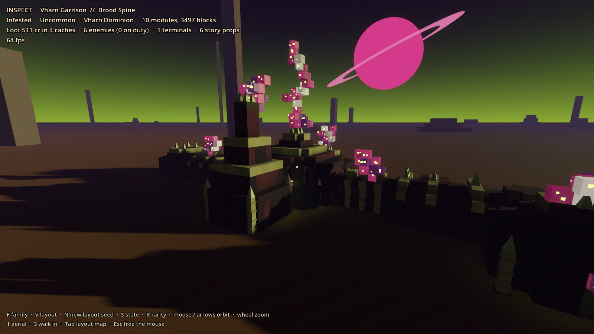
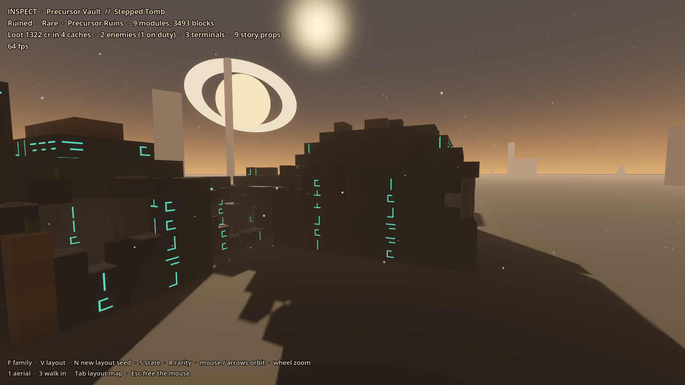
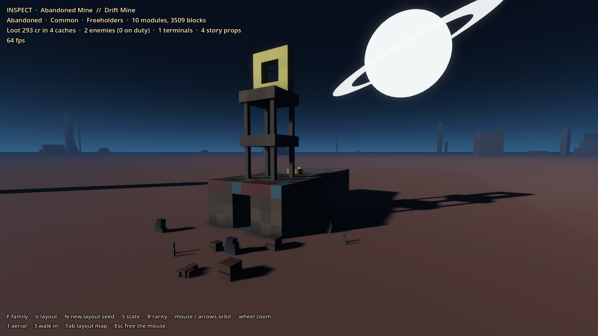
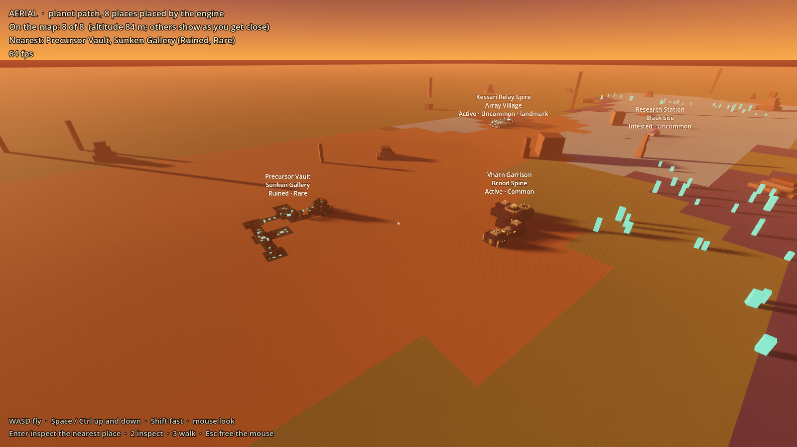

# Prototype: POI generator

Proves that GalHack can fill its planets with places worth finding: hand-authored faction kits assembled into whole buildings from a seed, one build turned into four very different sites (active, abandoned, infested by the Hollow Bloom, ruined), dressed with loot, defenders, story props and half-finished logs, and scattered across a planet by placement rules. Every result is checked: the way in always reaches the vault and the core by grid A*, nothing floats, nothing overlaps.







## Run it

From the repo root, in PowerShell:

```powershell
.\tools\godot.ps1 -Project prototypes/poi-generator -Play
```

You start in the air over a planet patch.

| Key | Aerial | Inspect | Walk |
| --- | --- | --- | --- |
| 1 / 2 / 3 | | switch to Aerial / Inspect / Walk | |
| WASD, mouse | fly, look | orbit (mouse or arrows), wheel zoom | walk, look |
| Space / Ctrl | up / down | | jump / hold to crouch |
| Shift | fast | | sprint |
| Enter | inspect the place you're looking at | | |
| F | | next family | |
| V | | next authored layout in the family | |
| N | | a new layout from a random seed | |
| S | | next state: active, abandoned, infested, ruined | |
| R | | next rarity: common, uncommon, rare | |
| E | | | read a terminal, cache, the core or a story prop |
| L | | | shoulder lamp (on by default except when active) |
| Tab | | layout map | layout map |
| Esc | free the mouse | | |

The Tab map shows the layout from above: walkable floor shaded by depth, key rooms outlined, the critical path from the way in to the vault, the vault, the base core, enemy spawns (defenders, turrets, Bloom, wildlife, bosses), caches, terminals and story props.

## How it works

Everything under `src/Gen` is plain C# with no Godot types, deterministic from a seed (its own SplitMix64 and FNV hashing, never `string.GetHashCode` or `System.Random`). `src/View` is the Godot side.

1. **Data** (`data/`): faction kits (`kits/*.kit`), families (`families.txt`), enemy rosters (`rosters.txt`), the loot pool (`loot.txt`) and log templates (`logs.txt`). `GameData` reads them with `FileAccess` and hands the text to the parsers, which reject mistakes with a file and line.
2. **Assembler** (`Assembler.cs`): joins modules socket to socket. The critical path runs entrance, steps from the family's recipe, vault; rarity inserts extra steps before the vault (uncommon +2, rare +4 and a boss room). Then side branches, then every unused socket is walled up. Modules never share a cell; the ground in front of the way in is kept clear; below ground a module may not poke above the surface (buried modules drop their decorative crowns). A failed attempt retries from a new sub-seed.
3. **Fixtures** (`Poi.cs`): the base core (in the deepest hall with a core slot), caches (every vault slot, about half the others), terminals, and doors in every doorway. Then a **protected mask**: shortest paths from the way in to the vault, the core, every cache, terminal and key room, with headroom and the floor under them.
4. **States** (`States.cs`) rewrite the blocks without touching the protected cells:
   - *Active*: power on, doors shut (they slide open as you approach), guards, turrets on the roofs, drones over the gate.
   - *Abandoned*: power off (one emergency lamp blinks by the vault), doors jammed or open, papers and toppled crates, litter outside, only wildlife.
   - *Infested*: Hollow Bloom masses grow over inside surfaces, corruption darkens the walls round them, tendrils hang from ceilings, pods sit at their feet, growth spills over the roofs and a twisting spire rises from the core room. Bloom-ridden defenders and Bloom creatures.
   - *Ruined*: holes punched until about a quarter of the structure is gone, a side room's roof dropped, anything left hanging falls as rubble, ash on floors open to the sky, weeds and moss. Glyphs dim but never go out.
   Crash sites (the freighter) also get baseline wreckage in every state.
5. **Dressing** (`Dressing.cs`): loot by rarity, enemies by faction and state, small story scenes (an abandoned meal, welded doors scratched from the other side, a scorched barricade, someone slumped at a terminal, drag marks leading deeper, a last stand by the core), and terminal logs that hint and mostly stop mid-sentence.
6. **Validator** (`Validator.cs`): A* reaches the vault and the core, a flood fill reaches every cache, terminal and key room, no block floats, no modules overlap, exactly one core.
7. **Placement** (`Placement.cs`): a 2D planet map of biomes, faction territory and rich deposits. Counts scale with planet size (small 3 commons and 1 uncommon, medium 5 and 2, large 7 and 2; a rare in about one system in three). Biome and territory rules, near and avoid rules (checked both ways, so a farm stays away from a garrison placed after it), spacing, no layout twice in a system, unseen layouts weighted 3 to 1. `MapReveal` shows a place once you're within its reveal distance (landmarks from orbit); `Regrowth` respawns cleared commons after a timer while no player is near.
8. **Mesher** (`Mesher.cs`): chunked vertex arrays with culled faces and per-corner ambient occlusion, a few boxes per prop, ramps, spikes, glyph inlays, the rock plug a place sits in, and collision triangles. Five materials for a whole place (matte, metal, glow, glass and Bloom flesh); colour is in the vertices.

The grid is one metre a cell. Everything sits on it, so enemies can path with plain A* (`Nav.cs`): a cell is walkable when a 1.8 m body fits and stands on something; moves are sideways or along ramps, with no jumps or drops, so every path walks back.

### Factions and families

Kits use the design faction ids: `meridian`, `exchange`, `vharn`, `kessari`, `reavers`, `freeholders`, `hollow`, plus `none` for Precursor ruins, which nobody living built. Kits so far: Vharn Dominion (8 modules), Meridian Combine (13: a buried lab set and a freighter hull set), Freeholders (13: farm and mine), Kessari Clans (7), and Precursor ruins (9). The Hollow Bloom is a state transform, not a kit.

| Family | Rarity | Kit | Layouts | Notes |
| --- | --- | --- | --- | --- |
| Vharn Garrison | common | vharn | 6 | in Vharn territory, within 3 cells of rich deposits |
| Freeholder Farm | common | freeholder (farm) | 5 | 10+ cells from any Vharn garrison and out of Vharn territory |
| Abandoned Mine | common | freeholder (mine), precursor deeper down | 4 | turns into a Precursor dungeon two levels down |
| Crashed Freighter | common | meridian (ship) | 4 | wrecked even when active; visible from 700 m |
| Research Station | uncommon | meridian (lab) | 4 | buried; hidden until you're within 120 m |
| Kessari Relay Spire | uncommon | kessari | 3 | a landmark, visible from orbit |
| Precursor Vault | rare | precursor | 3 | roster `precursor`; hidden until 150 m |

### Defenders and combat tags

Every roster line in `data/rosters.txt` names a kind, a **shooter class** (`none`, `infantry`, `small-vessel` or `capital`) and a **weapon** id, so the combat code (warning shots, an accuracy ramp to a class-versus-target baseline, slow capital rounds) can read them. Turrets are small-vessel or capital class; the heaviest bosses are capital. Bloom-ridden defenders keep their faction line, so they keep their class and weapon. Each `EnemySpawn` carries `Shooter`, `Weapon` and whether it's an on-duty `Defender`. No block is marked base-only or ship-only.

## Authoring a kit module as data

A kit is a palette plus modules. A palette line is `symbol type material colour[|colour...] role`; several colours make a patchwork, picked per cell. A module is a stack of ASCII layers, **bottom first**; in each layer rows run north to south and columns west to east, framed by `|` so trailing spaces survive editors.

```
kit vharn
faction vharn
light ffa040
palette
  #  cube   chitin  2a1328|301630   wall    plum-black carapace plates
  _  cube   resin   2a1824          floor
  =  cube   chitin  381a34          roof
  *  cube   lumen   ffa040          light   amber resin lamps
  o  rib    bone    d9c8a0          wall    bone ribs

module vh_gullet
  kind corridor          # entrance, corridor, room, hall, vault, tower or descent
  weight 2               # how often the assembler picks it
  layer fill _           # the floor: _ under every column any grid layer uses
  layer x3               # this grid three times: walls 3 m high
  |#DD#|
  |o..o|
  |#..#|
  |o..o|
  |#DD#|
  layer
  |====|
  |=**=|
  |====|
  |=**=|
  |====|
```

Reserved symbols: space is outside the module, `.` air inside it, `D` a socket (a doorway; a connected rectangle on one outside face, 2 wide and 3 high so all kits fit together), `X` the way in (entrances only), `$` loot, `T` terminal, `C` core, `!` enemy spawn, `B` boss, `?` story prop, and `^ v < >` ramps rising that way (made of the palette's `ramp` entry). Block types are the shapes the mesher knows (`cube`, `ramp`, `pillar`, `rib`, `pane`, `lattice`, `spike`, `pod`, `machine`, `crystal` and more); materials and roles are listed in `src/Gen/Blocks.cs`. Roles and materials matter: ruin never removes `floor` blocks, and losing power darkens every `lumen` block (lamps, lit windows, eggs, cryo cradles) while `glyph` and `crystal` keep glowing.

A family (`data/families.txt`) names its kits, rarity, biomes, territory, near and avoid rules, spacing, reveal distance and state weights, and 3 to 6 layouts, each a fixed seed and a recipe:

```
variant Brood Spine
  seed 1101
  path entrance corridor room corridor hall vault
  branches 1-2 room tower corridor>room
  grow corridor room
```

Steps can repeat (`corridor*1-2`) and come from a second kit (`deep:hall`). Change a module, run the tests: every layout of every family is generated in every state and rarity and validated.

## Test it

```powershell
.\tools\test.ps1 -Project prototypes/poi-generator -Scene res://tests/PoiTest.tscn
```

Runs headless and exits 0 or 1. It checks that:
- the data loads: 4 faction kits with 6+ modules, design faction ids, 7 families of 3 to 6 layouts
- the same seed gives the same layout and dressing, block for block
- 500 fresh layouts (random seeds, every family, rarity and state) and all 348 authored layout, rarity and state combinations pass validation
- active places are guarded; abandoned ones have no active guards; infested ones have Bloom growths and Bloom or corrupted enemies; ruined ones lose at least 15% of their blocks and keep the loot path open
- expected loot value rises with rarity, and every place has a vault cache
- ~500 placements over 24 systems respect biome, territory, near and avoid rules and spacing; farms keep 10 cells from garrisons; garrisons sit by deposits; counts grow with planet size
- no layout repeats within a system; unseen layouts are picked more often (6000 draws, and through the whole engine)
- regrowth: only commons, only once no player is near, never before the timer
- reveal: from orbit only landmarks; places appear only inside their reveal distance
- terminal logs are generated and most stop mid-sentence
- every armed defender and turret has a shooter class and a weapon
- performance: generate, validate and mesh 100 POIs (printed; about 21 ms each, 3,300 blocks and 16,000 quads per POI on the dev machine)
- a body really walks three critical paths (a garrison, the two-level mine and a ruined two-level lab) from outside to the vault, through doors and down every ramp, without falling through anything

`-- --only=Performance,Walk` runs just the named checks.

`tests/Screenshot.tscn -- --view=<view> --out=file.png` renders a view (run windowed): `garrison_active`, `garrison_infested`, `garrison_interior`, `vault_ruined`, `mine_abandoned`, `lab_infested`, `spire_active`, `overlay`, `aerial`, or `inspect:<family>:<variant>:<rarity>:<state>:<seed>:<yaw>:<pitch>:<distance>`.

## Adopting the canonical structure model

The generator only touches blocks through `IBlockStructure` (bounds, get, set, count) and the `Block` struct (type, material, colour, role, facing, a variant byte). When the canonical block-and-component model lands, implement `IBlockStructure` over it, map `BlockType` and `Material` onto its block definitions, and turn props (terminals, caches, the core, doors) into components. Kit modules could then become canonical blueprints with socket and slot markers, and the assembler, state passes, validator and mesher stay as they are.

## Known limits

- One cell is one metre and ramps are 45 degrees; there are no stairs, ladders or lifts, and no multi-storey rooms except descents and towers.
- Sockets are all 2 wide and 3 high. It keeps every kit compatible, but big halls get human-sized doors.
- Towers are dressing; you can walk into their base, not climb them.
- Figures are static stand-ins and doors don't collide: behaviour, combat and locked doors belong to other prototypes.
- The Ledger Exchange and Carrion Reavers have roster ids but no kits yet; Unique expeditions are out of scope.
- The planet map is a small flat patch (24 m cells); a real planet needs a projection and streaming.
- Data files are read with `FileAccess`, so an export must include `*.kit` and `*.txt` in its filter.
- The generator is built optimised even in debug (`<Optimize>true</Optimize>`), about five times faster.
- No audio.
