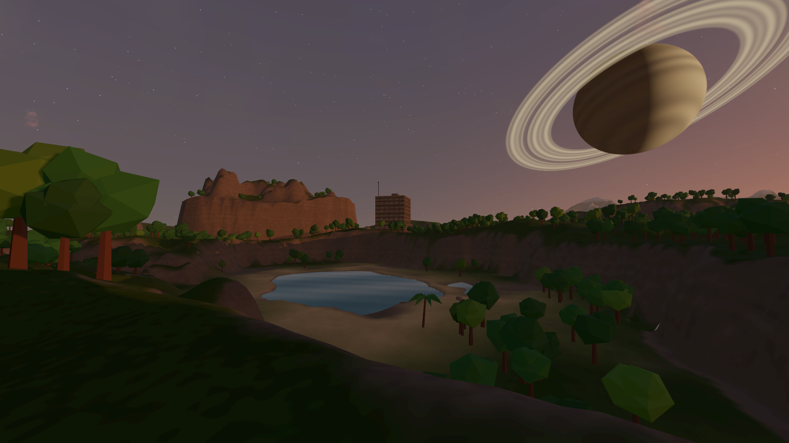
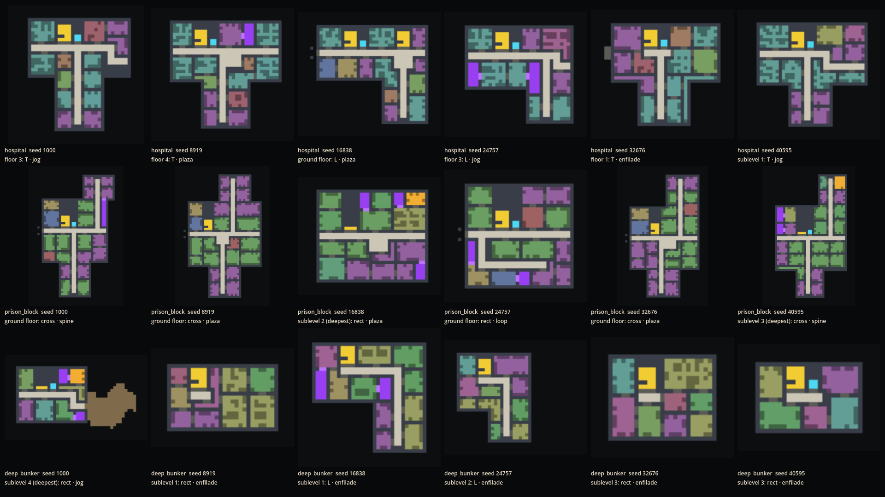
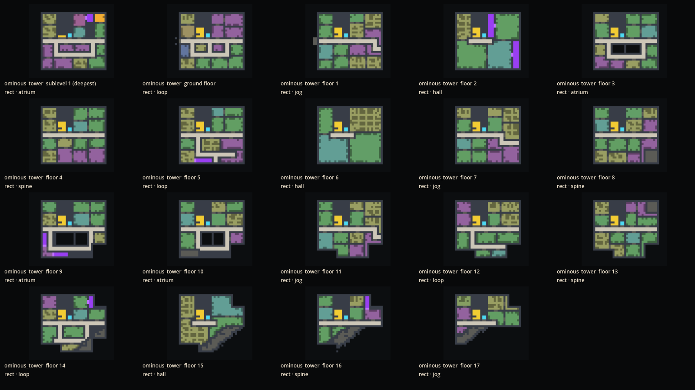
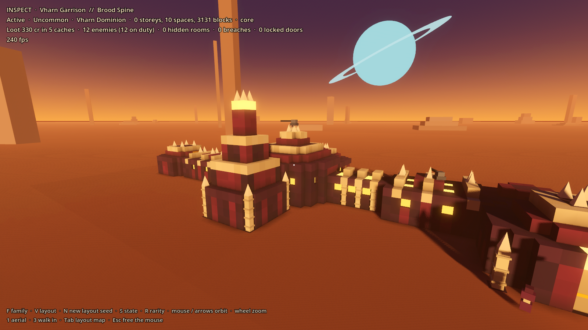

# Prototype: POI generator

Proves that GalHack can fill its planets with places worth finding. Some are hand-authored faction kits assembled into whole buildings from a seed. The rest are procgen places that an **architect** plans from a shared library: an airfield, a research base with sublevels, a tower that gets wrong as you climb, a bunker that gets worse with depth, an old mine, a hospital, a prison, a blast crater, alien ruins. Each layout becomes four sites (active, abandoned, infested by the Hollow Bloom, ruined). Each is dressed with loot from `shared/Items`, defenders and frozen moments, then scattered across a whole planet by themed placement.

Every result is checked: every room, storey and cache can be reached on foot, corridors are whole, nothing floats, and cores sit only where a faction holds the place.

The full list of places, built and still to come, is in [CATALOGUE.md](CATALOGUE.md).






## Run it

From the repo root, in PowerShell:

```powershell
.\tools\godot.ps1 -Project prototypes/poi-generator -Play
```

You start in the air over a planet patch.

| Key | Aerial | Inspect | Walk |
| --- | --- | --- | --- |
| 1 / 2 / 3 | | switch to Aerial / Inspect / Walk | |
| WASD, mouse | fly, look | orbit (mouse or arrows), wheel zoom | walk, look; climb ladders |
| Space / Ctrl | up / down | | jump / hold to crouch |
| Shift | fast | | sprint |
| Enter | inspect the place you're looking at | | |
| F | | next family | |
| V | | next authored layout in the family | |
| N | | a new layout from a random seed | |
| S | | next state: active, abandoned, infested, ruined | |
| R | | next rarity: common to unique | |
| E | | | use: take a keycard, break a cracked wall, call or ride a lift, open a cache |
| L | | | head torch (on by default except when active) |
| Tab | | layout map | layout map |
| Esc | free the mouse | | |

## How it works

Everything under `src/Gen` is plain C# with no Godot types, and deterministic from a seed (its own SplitMix64 and FNV hashing). `src/View` is the Godot side. The grid is one metre a cell. A storey is 4 m: a slab and 3 m of headroom. The ground floor walks at y 0, and each basement level is 4 m further down.

### Two generators, one format

- **Kits** (`Assembler.cs`): hand-authored faction modules joined socket to socket. The Vharn, Meridian, Freeholder, Kessari and Precursor families use them.
- **The architect** (`src/Gen/Arch`): plans a building from a **program** (`programs.txt`), or composes a **site** from parts (`sites.txt`). A **style kit** (`kits/*.kit`) re-skins either one.

Both produce the same `Layout` (blocks, modules, doorways, slots), so fixtures, states, dressing, the validator and the mesher are shared.

### The architect

1. **Massing.** A footprint by type and seed, beyond the rectangle: L, T, U, H, cross and courtyard, built from bars with wings. Basements have their own shape: the same, the main bar only, or a box. Towers shed corners as they climb, leaving terraces. A building has a stair core, an optional lift, and a second stair on long plans.
2. **Circulation per storey.** Each storey picks its own pattern from the program's weighted list:
   - a spine, or a jogged spine
   - a plaza (rotunda)
   - a loop: a full ring, a horseshoe or a figure of eight
   - an atrium, with galleries round a void
   - a courtyard ring
   - an open hall
   - an enfilade, with rooms opening through rooms
   - mine drifts with stopes
   - a radial hub with spokes to every side, a tiered atrium (galleries stacked round one void), a ward loop (two parallel corridors joined at both ends), a hub hall round the stair core, branching tunnels
   - round a courtyard: a full cloister walk, a horseshoe, or spokes out to the street

   A pattern already used on another storey is less likely again. A storey whose plan signature matches another storey's is planned again. Shape follows purpose: hospitals and prisons spread their wings, towers climb, bunkers and mines go down.
3. **Rooms.** The space left over is cut into rooms by recursive wall splits. Each room gets a purpose from the program's demands (`rooms ground lobby! nurses ...`) and from the room library (`rooms.txt`). The library gives each room its size, props, adjacency, and a deco set for the decorations library. Slivers become hidden rooms behind breakable walls, each with its tells.
4. **Doors and locks.** Every room reaches a corridor, either directly or through a room it belongs with. Some doors need a keycard, and the keycard always lies on the reachable side of its lock. The vault sits on the deepest level. A program's must-have rooms (`lobby!`) are guaranteed: a plan that leaves one out is planned again.
5. **Verticality.**
   - Stairs, with 3 cells of headroom over every step.
   - Ladders, and lifts with cars.
   - Holes where a floor fell through. They are warned.
   - Collapse breaches from the surface, down a rubble slope.
   - Caverns broken into from the end of a corridor.

   The terrain stamp opens every underground room in the planet's voxels.
6. **Ominous.** Wrongness rises with depth and height (`Decay.cs`):
   - Lights fail level by level: working, then flickering, then red emergency lamps, then dead.
   - Fog thickens, and the Bloom creeps in at the bottom.
   - Walls bruise. No room floods and no cell is ever water: a place's own water (a settling channel, a filter bed) is a surface over its floor (`LayoutExtras.Water`, drawn by `MeshBuild.Water`), with no collision, hiding nothing.
   - Sound hooks are placed: drips, hums, knocks, wind.

   From outside, one high window is still lit and a thin column of smoke rises. A place with no window keeps a work lamp burning over its door.
7. **Checked, then regenerated.** `LayoutCheck` checks every layout before it is used:
   - Corridor cells have a floor, walls, a ceiling and 3 m of headroom, and are two cells wide.
   - Every doorway sits in a wall, with floor on both sides.
   - Every door is the one standard door (`DoorSize`: one large block, 2 m wide and tall under a solid head; a place may open grander ways, a barn's or a garage's, but no person's door is lower), in every family: for 2 m either side nothing hangs lower than its head, out of doors nothing lower than a metre over it, and no opening between two walls is lower. A door is framed only in its building's own trim (`facade ... trim`), or not at all; hazard stripes go only on a dangerous opening's own door (a blast door, an airlock). PoiTest's `Doors` check walks every family.
   - Every stair has its headroom.
   - Every room and level can be reached on foot.
   - Hidden rooms open only when their wall breaks.
   - Breaches lead in.
   - Nothing floats.

   A layout that fails is thrown away and planned again from a new sub-seed, up to 24 times. `Architect.Stats` counts the generated, failed and regenerated layouts.

### Below ground

Places below ground are planned by `Depths` (`src/Gen/Arch/Depths*.cs`) from rules in `data/depths.txt`, not drawn by hand and not as a building's basements. Each purpose (shelter, command, cryo, biolab, research, ice, mine, silo, prison, hive, library) names the shared plan parts its levels draw on, by band of depth:

- a spine with rooms down both sides, hub and spokes, a ring round a central hall, a ring of pod halls, a grid of cross corridors with a room in every cell;
- a great hall with a gallery round three sides over it (a flight up to it, rooms off the floor and off the gallery), a round chamber with a gallery ring halfway up;
- a long gallery with alcoves, cell blocks round a guarded hub (or a tiered cell hall), winding drifts with stopes at their ends (raw rock), round and oval chambers on curved ways (alien);
- a structure through every level: a silo's shaft with a gallery ring at each level and the levels ringed round it, or a mine's shaft with a station on each level, ladders and a cage.

Levels stack on one core (a switchback stairwell or a ladderway, a lift beside it at higher tech) or step down by long stairs, ramps and ladders. Zones are parted by airlocks, decontamination chains and blast vestibules; service crawlways (2 m) run beside the main ways; dead ends keep vaults or hidden rooms behind them. The builders' tech (main ways about 8 by 6 m, 10 by 8 at high tech, 6 m at low) and habit (orderly, radial, linear, warren, a faction's own, organic for aliens), and the world's age and fall (`LayoutHints.Ruin`), tilt every weight, and the years mark the plan: a collapse across a corridor (with a way dug round it if there was none), a cave broken into, a squatters' tunnel, a door welded shut with the section reached another way, a breach from the surface. Underground places get a fresh seed on every world.

A head stands on the surface: a blockhouse with vents and a mast, a hatch, a low bermed portal, a shaft house, an alien dome. `part grand ... what below purpose P` is a whole place; `part below X Z rot N purpose P` puts one under a composed site (a research base's or a biolab's labs, a prison, the old mine's headframe, a military base). PoiTest's `Depths` check generates many of each family on fresh seeds, measures their plans (branching, loops, levels, room-size and corridor-width spread, the parts used), shows the families differ from each other and within themselves, and walks every one from its way in; `-- --only=DepthsSheet --depthsheet=FILE.png` draws six of them as plans.

### Shapes

A spawned place's plain cubes take the shapes its builders used, last of all, round whatever was set down (`Shaping.cs`, docs/place-patterns.md rule P6). The places' own block set on the 1 m grid adds half and quarter cubes, thin walls, beams, round columns and hung slopes (a chamfer and its two corners) to the cube, ramp, corner, post and pane; each is solid to the walking grids and collides as its real shape. Only a cube with nothing against it is shaped, and a top anything stands on stays whole.

- **Low and mid tech**: facades in panels set back between pilasters, a cornice under the roof's edge; walls with more behind them coved at the ceiling and panelled; joists across the ceilings with beams under them; thin walls between rooms; posts in big halls; mines timbered with posts and cap beams.
- **High tech** (and alien): every storey of a facade with a sloped foot and a chamfered head, the corners turned; rooms coved at the ceiling and cut back at the floor, their inner corners turned; ceilings folded in V-bays between ribs; round columns in big halls.
- **Every roof's edge and wall top** sloped (a coping or a chamfer), its corners turned.

PoiTest's Patterns check holds each manner and kind of place (`shapes` in `data/references.txt`) within 5 points of the reference bands, over the blocks a place shows.

### Places, states and loot

- **Plain ruins** (`src/Gen/Arch/Homes.cs`, `PlainRuin.cs`; families `flavour_*`) are the small roadside buildings, drawn by rule rather than planned. A house is put together from parts (`HomeStyles.cs`, `HomeBuild.cs`, `HomeParts.cs`, `HomeLots.cs`; families in `data/homes.txt`): its culture, era, tech, climate and wealth pick a family, the family weights each part (plan, storeys, roof form and cover, cladding, windows, porch, chimney, balcony, garage and its door, fence), and city houses and terraces come from the same rules. Each house records its service-drop fixing in `LayoutExtras.Service`. They are real size against a 1.8 m person and built as a player builds: a 2 m lattice in plan and storey (POI cells are 1 m, the player's large block 2 m), walls and slabs as large half blocks, 45 degree slope roofs, thin plate floors (a floor's finish stays under whatever is set on it, `BlockGrid.Under`, and what stands on it is drawn on top of it; only a full cube hides a face), the standard 2 m door with nothing low over the way to it, panes in the windows. `LayoutHints` turns a lot to face its road and picks its materials by tech level. Nothing goes below ground, and their decay takes everything above smooth collapses, so walls end in broken tops. Overgrowth runs last. They have no block trees (the big places still grow them).
- **Cores** appear only where a faction owns the place (`FamilyDef.HasCore(state)`). Wrecks, ruins, the old world's abandoned places and gang forts never have one.
- **States**:
  - *Active*: power and guards.
  - *Abandoned*: dead lights and wildlife.
  - *Infested*: the Hollow Bloom.
  - *Ruined*: holes and rubble.

  Cables and Bloom tendrils always hang from something. A ruin that lost its ceiling also loses what hung from it.
- **A century or two after the fall.** Each place has an age, and each room an exposure, for loot, dressing and the decorations library's disorder pass:
  - `PoiInstance.Age`: new (worked today), old-world (long abandoned) or preserved (frozen or airless).
  - `AgeOf(module)`: a sealed vault, cryo bay or hidden room keeps its own age.
  - `ExposureOf(module)`: indoors, outdoors, or breached (open to the sky).

  Old-world places hold no food outside sealed rooms. Unsheltered timber has rotted and fallen in, while concrete, stone and steel stand as shells. The generator leaves spots where trees could root in courtyards and breaches (`Growth.cs`); the planet plants its own flora there (planet-surface `RuinGrowth`), so a ruin's trees are the trees round it and a treeless world grows none.
- **Repair after decay.** Anything left floating comes down. Every spawn is then flood-filled from the way in, and rolled again from a new sub-seed if decay cut the way to the vault or the core.
- **Loot** comes from real `shared/Items` ids (`loot.txt`). The cache tier rises with rarity, depth and wrongness, and is higher for vaults, hidden stashes and infested places.
- **Frozen moments** replace text logs: an abandoned meal, welded doors scratched from the inside, drag marks leading deeper, a last stand by the core. Terminals are props.
- **Gangs** belong to no faction. Their camps and forts get spawn and patrol markers, and never a core.

### Alien and the distance read

- **Alien forms** (`BuildingAlien.cs`): curved massing from height fields (a ribbed barrel vault on the cathedral, a chitin mound over the hive, a faceted crystal dome over the library) and an alien cathedral (its own nave program) grows a tapering spire and leaning fins, a library leaning crystal columns and a monolith, a hive chitin mounds and vents; every alien way in gets a pointed portal beside and above the door. The viewer dresses alien rooms from the decorations library (`shared/Deco`, its alien set) as scenery.
- **Landmarks for 400 m**: towers stand 14-20 storeys with their tops torn open in steps (snapped columns on the exposed slabs, a leaning mast); spaceports stand a twelve-deck derelict ship; towers lose their tops (girders and slab stubs against the sky, `crown broken`), airfields get big hangars and a 34 m mast, factories and depots a tower crane, the sky railgun a 66 m barrel. On the planet surface beacons, lit windows and outdoor lamps carry a glow that fades in past 40 m; smoke columns are taller.

### Placement

- **Themes** (`themes.txt`): each kind of world has a weighted themed set and a share of outliers from outside it. Outliers are rarer and more ominous. Every planet gets at least one outlier, and none gets more than its theme's maximum. `WorldPlacement` scatters places over the whole planet (a torus) by Poisson disc.
- **Start worlds** (`ThemeParser.For(..., start: true)` or `ThemeDef.AsStart()`): no faction holds ground. Faction places appear only as ruins, with no core and no defenders.
- **Space** (`orbit.txt`, `OrbitPlacement`): places in space, as data, sited per system. A start system gets plenty of wrecks close to home, with danger 2 at most and no live faction.
- **Siting by purpose**: each family names the ground it wants (`siting`: peak, ridge, hillside, valley, flat, open or any), how high its landmark stands (`rise`), and its importance tier (`tier`).
- **Tech level**: a theme names its world's tech level (`tech low|mid|high`). Families with layouts per tech level (factories, farms) pick that level's layout.
- **The world profile** (`WorldProfile`, design doc "Tech level comes first"): rolled first from a world's seed and kind, with ideas from the Traveller tabletop RPG's world profiles under GalHack's own names.
  - It holds whether the world was ever inhabited, its old population (a power of ten), its old starport (none, strip, field, port, major, grand), its main trade (agricultural, industrial, mining, research, military, commerce), and two independent tech levels, low, mid or high.
  - **Before** (pre-collapse) decides the old world: which ruins and POI families appear, and with them the infrastructure, wrecked traffic and decorations.
  - **Now** (post-collapse) decides the living: settlements and any place a faction holds now, their layouts and their animals (working beasts where the living are low-tech; farms keep stock at any level).
  - Survivors usually live a level or two below the ruins round them. Now and then a faction brings stellar tech to a world of older ruins ("new on old"): `WorldProfile.NewOnOld`, `PoiInstance.NewOnOld`.
  - Families say which levels they belong to (`tech low mid high` before any variant; none means any). `WorldPlacement.Place(..., profile:)` then places a family only in a state whose level it fits, weights the set by the trade and the old population (farms on agricultural worlds, mines on mining worlds, labs on research worlds, more towns where many lived), puts no old-world place on a world never inhabited (wrecks, alien and Precursor sites still appear), and picks the layout built for that level.
  - The old starport sets the spaceport ruins: none below a field, then a landing field, the port, and a grand yard with two pads (`port` on a spaceport's variants).

## Worlds, regions and the large places

A world that was ever lived in is laid out in this order, all deterministic from its seed:

1. **Layers** (`data/world-layers.txt`, `src/Gen/WorldLayers.cs`): a world type, a theme, features and presences are rolled and their tables added together. Nothing in the generators names a theme.
2. **Region plan** (`src/Gen/Regions.cs`): towns first, each with what it needed (a sewage works downhill, water uphill), what it lived on, the plant that fed it, the depot its railway ended at and its farmland; then the port, camps, wrecks, and a share of places that break from the theme out in the wilds. Every place carries its reason, and most a link (road, rail, power). The planet's roads, railways, power lines and small ruins follow the plan; most of the land stays empty.
3. **Places**: the three large plans (`src/Gen/Arch/SewageWorks.cs`, `FarmEstate.cs`, `BrutalComplex.cs`) each have their own layout logic, and are drawn with `Plot`, in the player's 2 m blocks: walls a block thick, half-block decks, large slopes, the player's one-block door. A corridor is 8 m wide and 6 m high; a narrow passage is an exception. Each is built per tech level (variants' `tech`).
4. **Occupancy** (`src/Gen/Occupancy.cs`): who's in a place is its own layer, last of all: the same layout empty, nested, camped in, held by a gang, lived in, or two of those at once by floors or across a front line. The theme's mix sets the odds.

`BlockGrid` keeps 16 m chunks only where something stands, so a 300 m works costs what's in it. The mass tests cover the small places; `PoiTest --only=Grand` builds every large variant on fresh seeds, turned every way.

## Worlds, regions and the large places

A world that was ever lived in is laid out in this order, all deterministic from its seed:

1. **Layers** (`data/world-layers.txt`, `src/Gen/WorldLayers.cs`): a world type, a theme, features and presences are rolled and their tables added together. Nothing in the generators names a theme.
2. **Region plan** (`src/Gen/Regions.cs`): towns first, each with what it needed (a sewage works downhill, water uphill), what it lived on, the plant that fed it, the depot its railway ended at and its farmland; then the port, camps, wrecks, and a share of places that break from the theme out in the wilds. Every place carries its reason, and most a link (road, rail, power). The planet's roads, railways, power lines and small ruins follow the plan; most of the land stays empty.
3. **Places**: the three large plans (`src/Gen/Arch/SewageWorks.cs`, `FarmEstate.cs`, `BrutalComplex.cs`) each have their own layout logic, and are drawn with `Plot`, in the player's 2 m blocks: walls a block thick, half-block decks, large slopes, the player's one-block door. A corridor is 8 m wide and 6 m high; a narrow passage is an exception. Each is built per tech level (variants' `tech`).
4. **Occupancy** (`src/Gen/Occupancy.cs`): who's in a place is its own layer, last of all: the same layout empty, nested, camped in, held by a gang, lived in, or two of those at once by floors or across a front line. The theme's mix sets the odds.

`BlockGrid` keeps 16 m chunks only where something stands, so a 300 m works costs what's in it. The mass tests cover the small places; `PoiTest --only=Grand` builds every large variant on fresh seeds, turned every way.

## Capital hulks

`src/Gen/Arch/CapitalHull.cs` composes every crashed capital ship from rules: site part `what capital role <freighter|warship|liner|miner|carrier> size <medium|large|huge> crash <broken|nose|scattered|long>` (`data/sites.txt`), the world's tech, the style kit's livery. The `crashed_freighter` variants each name one crash.

| | |
| --- | --- |
| Sizes | medium 36 m beam, 2 cargo bays (about 160 m); large 44 m, 3 (about 190 m); huge 52 m, 4 (about 210 m) |
| Decks | 3 hull decks 6 m apart (a 2 m floor, 4 m clear) plus 2 tower decks; holds, hangar and engine room 2 decks tall with a catwalk through |
| Bays | bow (tapered and raked), crew, cargo by role, hangar, power (reactor, core room behind it, fuel, generators), engine room against the stern |
| Devices | the player's own blocks: thruster banks on nacelles at the stern, manoeuvring pods and keel lift thrusters, generators, fuel and warp tanks, gyros, a warp drive, CPU extenders, containers, constructors, lights, command chairs behind the bridge's forward glass; an empty core seat in the core room |
| Ways in | a cargo ramp or cutting down from a hangar bay door, plus the crash's own: the broken back's tear, a flank torn open where the hull meets the ground, the open faces of a hull in pieces |
| Pose | a shear of whole cells along the hull, a ramp wherever a floor steps: nose down 9 m deep at about 4 degrees, a broken back sagged 5 m in the middle, a scattered stern 34 to 44 m down the furrow, a long hauler buried 4 to 7 m |

The route follows Empyrion's crashed vessels: walk round the hull for a way in, up its stairs deck by deck, the best loot deepest (the dead core's room, reached only through the reactor, and the bridge at the top), danger spawned along the halls and corridors.

The hull itself is a vessel, not part of the place. `CapitalHull.Of(layout)` hands the slice a `HullPlan`: per piece, a blueprint of large-grid building blocks (2 m), its pose (origin and rotation) in the place's frame, the core seat, the hull door and the cells torn by the crash. The place keeps the hollow cut for it, its ramps and cuttings, the yard of wreckage, loot and spawns. In the slice, `Places/Hulks.cs` builds each piece within 1.5 km of the survivor (`HullPiece.Damage`: devices lost by state, Active 10% to ruined 55%, never under a third of thrusters, generators, tanks and chairs; shell holes; fitted lift and power never torn), sets it down as a fixed coreless wreck pitched as it came down, and stocks its containers. Setting a core in the empty seat claims it (`Vessel.ClaimWith`, or the build tool aimed at the wreck). Filled in and switched to capital mode, the pilot's climb input lifts it off along capital-base's clean lift-off (`CutFree.Plan` and `LiftOff`, now compiled into the slice): the ground along the straight climb is cut and crumbles, the hull rises through it, then flies. A long hauler's cut is about 12,000 cells; a nose-down hull's tilt widens the cut past the 20,000-cell limit and is refused until dug out by hand. Orbit derelict capital ships (`data/orbit.txt` `hull`) use the same builder.

`PoiTest --only=Hulks` checks size, decks, stern engines, lift for weight, power for draw, chairs, the empty core seat, survivors after damage and poses on fresh seeds. The slice's `tests/HulkTest.tscn` claims a buried long hauler, fills it, checks thrust, power and fuel in capital mode and lifts it off through its cut; `--view=hulk --force=crashed_freighter` frames it (`screenshots/hulk-vessel-*.png`).

Empyrion references (read only, nothing copied):
- Size: Steam discussion on capital vessel sizes and safe lengths, https://steamcommunity.com/app/383120/discussions/8/2645252442209113899 ; empyriononline "Would love to build this" (CV dimensions), https://empyriononline.com/posts/432226/
- POI structure: empyriononline "POI's and you; a how-to" (entrances, the route, the core, loot by difficulty, depth), https://empyriononline.com/posts/387653/ ; "General Notes and Rules", https://empyriononline.com/threads/general-notes-and-rules.94100/
- Crashed vessels in play: the local install's playfield yaml (Barren `playfield_static.yaml` crashed-ship groups, tilted and buried; MoonStarter `playfield_debug.yaml` crashed Titan in front, middle and back pieces 300 to 400 m apart)

## Authoring a kit module as data

A kit is a palette plus modules. A palette line is `symbol type material colour[|colour...] role`; the first colour is the main one, and on walls, roofs and floors the others show as whole sheets, never cell by cell. A kit's `panels W H share` line sets those sheets (cells wide, cells tall, the share of them that differ); several colours on a decor cube paint regular stripes. Its `facade base coping door` line gives what `Facade` adds outside: the course at the ground and the top of the walls (colours), and whether a door to the outside is framed: `trim` frames it in the coping's colour, where the style calls for a frame, and `none` leaves it in its wall. A frame is never a colour of its own, and never hazard yellow: hazard stripes belong on a dangerous opening's own door (a blast door, an airlock), never round a person's door. A module is a stack of ASCII layers, **bottom first**; in each layer rows run north to south and columns west to east, framed by `|` so trailing spaces survive editors.

```
kit vharn
faction vharn
light ffa040
palette
  #  cube   chitin  2a1328|301630   wall    plum-black carapace plates
  _  cube   resin   2a1824          floor
  =  cube   chitin  381a34          roof
  *  cube   lumen   ffa040          light   amber resin lamps
  o  rib    bone    d9c8a0          wall    bone ribs

module vh_gullet
  kind corridor          # entrance, corridor, room, hall, vault, tower or descent
  weight 2               # how often the assembler picks it
  layer fill _           # the floor: _ under every column any grid layer uses
  layer x3               # this grid three times: walls 3 m high
  |#DD#|
  |o..o|
  |#..#|
  |o..o|
  |#DD#|
  layer
  |====|
  |=**=|
  |====|
  |=**=|
  |====|
```

Reserved symbols: space is outside the module, `.` air inside it, `D` a socket (a doorway; a connected rectangle on one outside face, 2 wide and 3 high so all kits fit together), `X` the way in (entrances only), `$` loot, `T` terminal, `C` core, `!` enemy spawn, `B` boss, `?` story prop, and `^ v < >` ramps rising that way (made of the palette's `ramp` entry). Block types are the shapes the mesher knows (`cube`, `ramp`, `pillar`, `rib`, `pane`, `lattice`, `spike`, `pod`, `machine`, `crystal` and more); materials and roles are listed in `src/Gen/Blocks.cs`. Roles and materials matter: ruin never removes `floor` blocks, and losing power darkens every `lumen` block (lamps, lit windows, eggs, cryo cradles) while `glyph` and `crystal` keep glowing. A `pane` is a thin sheet in the plane of its wall: its facing is the wall's outward normal, settled for the whole place once it is laid out (`src/Gen/PaneFacing.cs`, from the cells that hold the sheet at its ends, never from what the mesher sees later), and a wall that is several panes thick draws one sheet, the outermost, so a window is one plane at one depth.

A family (`data/families.txt`) names its kits, rarity, biomes, territory, near and avoid rules, spacing, reveal distance and state weights, and 3 to 6 layouts, each a fixed seed and a recipe:

```
variant Brood Spine
  seed 1101
  path entrance corridor room corridor hall vault
  branches 1-2 room tower corridor>room
  grow corridor room
```

Steps can repeat (`corridor*1-2`) and come from a second kit (`deep:hall`). Change a module, run the tests: every layout of every family is generated in every state and rarity and validated.


A family names a `style` to re-skin its program or site. That is how the alien flavour works: `alien_cathedral` is the tower program built in the `alien_cathedral` kit.

## Integration notes (planet surface and the slice)

`prototypes/planet-surface/src/Poi/PoiSiting.cs` places POIs on a real planet and seats them in its terrain. The results are in `PlanetWorld.Pois`.

- **A read-only API for the infrastructure network.** Each `PoiSite` exposes:
  - `Center`, `Footprint`, `Stamp` and `Rotation`. Rotation is in quarter turns; it is always 0 today, because places sit as generated.
  - `Gates`: the main entrance, fence gates and collapse breaches. Each gives its world cell and its way out (`PoiGate.OutX`, `PoiGate.OutZ`).
  - `Tier`: city, spaceport, town, base, outpost, camp, site or wreck.
  - `FactionHeld`: its core is live or its faction is home, so its own infrastructure works.

  Approach stamps stay local to each place: the pad, its apron, and the blend back to natural ground.
- **Start worlds.** Set `PoiSiting.StartWorld = true` before building a start world, or pass `startWorld: true` to `PoiSiting.Place`. Then no faction-held place and no core is sited. Any blast site lies at least 3 km from the bunker, and settlements within 1.5 km of it are never hostile.
- **The world profile.** `PlanetWorld.Profile` (rolled by `PlanetWorld.ProfileFor(spec, startWorld)`, the first thing a world build does) is the world's `WorldProfile`. `PoiSiting.Place(..., profile:)` places by it, and `PoiFactory.Generate(..., world:)` gives each place its world, so `PoiInstance.Tech` is the level it is built at and `PoiInstance.NewOnOld` says a living place of a higher level stands on older ruins. Map deco's tech tags straight across: low, mid, high. Animal gating reads the post-collapse level (`WorldProfile.Now`).
- **Townsfolk hooks** (`PoiInstance.Townsfolk`, `PoiSite.Townsfolk`, local cells). Lived-in places carry data for a light ambient routine:
  - `Spots`: activity spots tagged stall, work, sit, chat, garden or home.
  - `Links` between spots, and `Routes` for rushers.
  - `People`: a role and a gait each. A vendor mans a stall, a rusher hurries, a wanderer ambles, a worker stays put, a guard posts and patrols.
  - `Animals`: stock, working or pet, gated by tech level.
  - `AreaCenter` and `AreaRadius`, for wildlife to keep out of.

  `PoiInstance.Mood` is peaceful, wary or hostile, rolled per settlement. `Friendly` means the guards keep order and turn only if you start shooting. There are no schedules: at night everyone goes indoors to a home spot.
- **Blast data.** `PoiSite.GroundZero` and `Instance.Layout.Extras.Blast` give the crater, ruin ring, dead zone and fade radii, for the ground tint and the world work. `BlastZone.Strength(d)` falls off with distance. Places within a blast take `StateTransforms.Blast`. Markers flag `shadow` (burnt faces toward ground zero), `hulk` and `radiation-edge`.
- **War strikes.** A world whose fall is a war (nuclear, bombardment, kinetic) has strikes on its targets (`src/Gen/Strikes.cs`, `data/strikes.txt`): the old capital and cities, bases, airfields, ports, power, refineries and works, the bridges and junctions of the main roads, each by its worth on a world of its tech, the count from the roll's severity. A few miss near their target, the odd one bursts over open country, none comes down in open water unless aimed at ships. Every blast, a blast site's own included, is one `Strike` record, which the crater, the decay of the places round it, the dead ground, the flora and the map all read.
- **Faction-held mix.** Most faction places are working sites (relays, depots, works, research, markets, flats, an air-defence battery, a sky railgun). Garrisons are tagged `fort` and uncommon.
- **Composable stamps.** `TerrainStamp.Compose` is the one height rule. In list order, each stamp eases the height so far toward its own target, by its weight. Overlapping pads meet smoothly, and a road or rail stamp laid later wins wherever its weight is 1. Order the list by what should win. `TerrainStamp.Apply` is the step for a single stamp.
- **Grounding stamps.** Beyond its pad a place lays a crater `Bowl` (shows in the far rings too), `Terraces` stepping down the slope below a hillside place, an approach `Cut` from the way in, a `Tilt` that half-buries a ruin (its rooms stay carved open), and an impact `Furrow` behind a wreck (`PoiSite.Extra`, `PoiSite.Stamps`; all compose and stay walkable to every gate).
- **Made ground.** Each pad carries a surface by purpose (`TerrainStamp.Surface`): tarmac or concrete aprons, gravel or packed-dirt yards, or the land's own ground broken up; never green on a desert world. It eases out along a ragged edge and wears with the place's age (cracks, sand and weeds drifted over). `PlanetTerrainSource.MadeGround` and `GroundPalette.Made` colour near and far terrain from it; a family can name its own (`ground`).
- **Alien deco on the planet.** `PoiLayer` dresses alien rooms from `shared/Deco` (no collision), as the viewer does.
- **Dig anywhere.** Stamps are shape only. Faction places lay armoured foundations (`Material.Armour`), so tunnelling in is slow but a valid way in.
- **Far rings.** `FarBuilder` samples `SurfaceHeight`, which already includes the stamps, so pads show in the distance. Underground carves and crater bowls below the pad don't show in the far heightfield. To show a crater there, the far ring's height sampling needs its bowl (a stamp target below the pad), not only the voxel carve mask.
- **Screenshots and caps.** `PoiSiting.ForceFamily` seats one family near the landing site, for screenshots. `MaxSites` caps how many places are seated: the nearest half first, then an even spread to the far side.

## Light colour and animation (PoiLights)

Every light has a `LightSettings` (colour, second colour for fades, mode, speed, seed): modes
`Steady, Pulse, Flicker, Strobe, Fade`. The record lives in `prototypes/building/src/Structures/LightSettings.cs`
and is the same one the player's light blocks and glowing paint use. Call these from the generator or the rollout
(all in `PoiGenerator.Gen.PoiLights`, `src/Gen/PoiLights.cs`):

```csharp
var red = LightSettings.Make(0xff3322, LightAnim.Pulse, 1f, seed);   // colour, mode, hertz, seed (0..127)
PoiLights.Set(spot, red);                                            // style an existing LightSpot  <-- the call
PoiLights.Add(poi, cell, red, energy: 1.4f, range: 8f);              // add a styled lamp
PoiLights.SetMood(poi, LightMood.Dying);                             // every lamp: Warm, Dying, Hostile, Cold, Sealed
PoiLights.PaintFace(poi, cell, Dir.North, LampShape.Border, style);  // glowing paint on a block face (shape Full/Strip/Panel/Border)
PoiLights.PaintStrip(poi, from, to, Dir.Up, style);                  // a strip along a run of cells
```

`PoiLights.Set(LightSpot, LightSettings)` is the single call for a lamp. A painted face only glows (no real light).
A kit file may carry `mood warm|dying|hostile|cold|sealed`; `Decay.Apply` then calls `ApplyKitMood`, and
`PoiLights.MoodFor(poi)` gives the default by state (Active warm, Infested hostile, otherwise dying) for callers that want it.
`PoiView` draws styled lamps (real light follows the animation) and `poi.LitFaces` (quads). Lamps with no style keep the
old per-mode behaviour. planet-surface's `PoiLayer` does not read `Style` or `LitFaces` yet: the rollout should add that.

## Test it

```powershell
.\tools\test.ps1 -Project prototypes/poi-generator -Scene res://tests/PoiTest.tscn
```

The tests run headless and exit 0 or 1. Add `-- --only=Name,Name` to run only the named checks. The suite covers:

- **Data**: kits, factions and families; the shared library (rooms, programs, sites, style kits, themes); the five-step rarity ladder; and loot ids checked against `shared/Items`.
- **Validation**: determinism; 500 fresh kit layouts; every authored kit layout; every named architect layout in three rarities and four states; and 1600 fresh architect layouts. The run reports how many failed the layout check and were regenerated. None is placed broken.
- **Corridors and sense**: the geometric corridor rule on every corridor cell and doorway, room adjacency, and stairwells that line up storey after storey.
- **Variety**:
  - Within a type, no two seeds give the same plan, and the commonest coarse topology covers at most 25% of a type's seeds.
  - No two storeys of a building share a plan signature.
  - Pairs of types that must never walk alike share under 50% of their footprint and circulation mix.
- **Places**:
  - Cores exactly where a faction holds the place.
  - State transforms.
  - Loot rises with rarity and with depth, and vaults and hidden stashes beat the side caches.
  - Underground levels are carved.
  - Hidden rooms open only when broken, and each has its tells.
  - Collapse breaches lead in.
  - Keycards lie before their locks.
  - Cables and tendrils always hang from an anchor.
  - No stray geometry: every vertex inside its place, no triangle edge over 24 m (what catches a stroke thrown across the landscape).
  - Circulation varies within a type: no pattern walks more than 45% of a type's storeys.
  - Grounding stamps: bowl, terraces, cut, tilt and furrow shapes, seams and composition.
  - Programs keep their must-have rooms.
  - Old-world places hold no food outside sealed rooms, and trees grow through them.
  - Factories and farms match their world's tech level.
- **Placement**: biome, territory, near and avoid rules; regrowth and reveal; themed sets with outliers in range; whole-planet cover; start worlds with no faction ground; and start systems full of wrecks.
- **Distance**: each family's landmark rises as high as its purpose wants, and something on it is lit.
- **Performance**: generate, validate and mesh 100 POIs (printed, with a ceiling).
- **Walks**: a physics body walks from outside to the deepest point and back. It does this in the airfield, the research base, the tower (top and bottom), the deep bunker, the old mine, and to a Vharn garrison's vault.

The planet surface's `SurfaceTest` checks the seated places:

- Corners sit at floor level.
- No ground is missing under rooms, and no block is buried.
- Every way in is open, and every gate can be walked up to over the stamp.
- Seating is deterministic.
- Places spread to the far side of the planet.

### Screenshots

Run screenshots windowed:

```
tests/Screenshot.tscn -- --view=<view> --out=file.png
```

The views are:

- `inspect:<family>:<variant>:<rarity>:<state>:<seed>:<yaw>:<pitch>:<distance>`
- `walk:...:<storey|deep|top>[:<along>]`
- `ground:...:<distance>:<yaw>`
- `tell:...`: a hidden room's cracked wall
- `breach:...`: a collapse breach from its lip
- `contact:<families>:<seeds>`
- `floors:<family>:<seed>`

The planet surface adds `far:<family>:<archetype>[:<variant>]:<day|dusk|night>`, which shows one family from 300 to 420 m away at eye height.

Two more views render many tiles in one run and save a labelled sheet:

- `gallery:<k>:<n>`: sheet k of n of every family's exterior, in the state it is most often found in, in the same daylight and from the same three-quarter view (35 degrees off the way in, 18 degrees up, far enough back to fit the whole place). Run at `--resolution 1920x1080`. The sheets are `screenshots/families-1.png` to `families-4.png`.
- `interiors`: one interior each of a dozen families (`screenshots/families-interiors.png`).

**Every shot is checked before it is saved.** The places it shows get PoiTest's Geometry check on the meshes actually drawn: every vertex inside the place's block grid and no triangle edge longer than a chunk's diagonal. A stray stroke (a "wire" across the frame) makes the shot refuse to save and exit with code 3, naming the place and the mesh.

**Re-render the screenshots after any change to the mesher** (`src/Gen/Mesher.cs`), the block geometry or the glyphs. An old image keeps an old bug: `spaceport-exterior.png` showed the crack-stroke slivers for a day after they were fixed. Check a file's age with `git log -1 -- <file>` against the fix.

## Known limits

- Space places are data and siting only. They have no layouts and no orbit play.
- Hybrids, layering rules and repurposing between programs are not in data yet. The only combinations are flavour (a style kit over a program) and kit layering (a mine that turns Precursor further down).
- Power lines between poles are not drawn. Hanging cables follow the one-anchor rule.
- Sockets on kit modules are all 2 wide and 3 high: the standard door takes their foot (2 m) and the wall closes over it.
- Figures are static stand-ins. Combat and AI belong to other prototypes.
- There is no audio. Sound hooks are markers for the slice to play.
- Data files are read with `FileAccess`, so an export must include `*.kit` and `*.txt` in its filter.
- The generator is built optimised even in debug (`<Optimize>true</Optimize>`).
