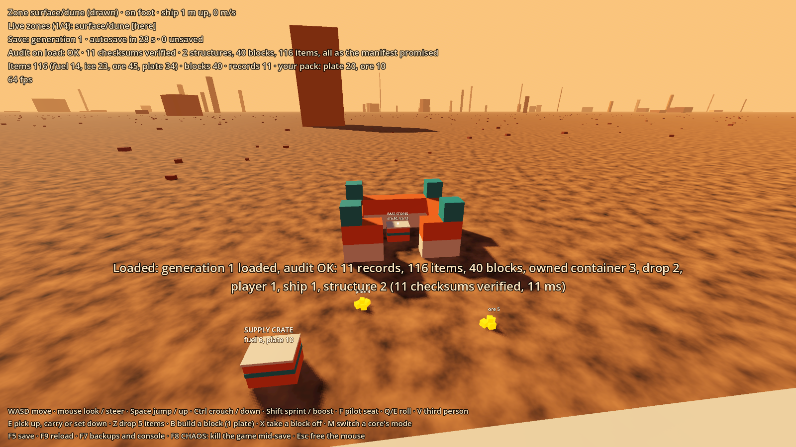
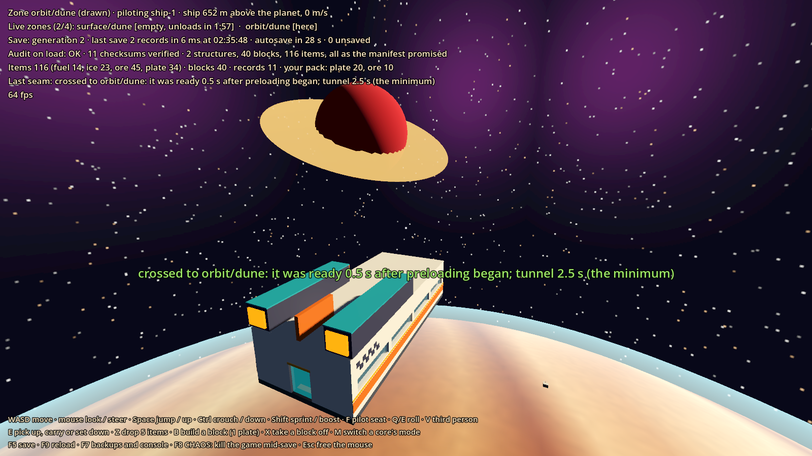
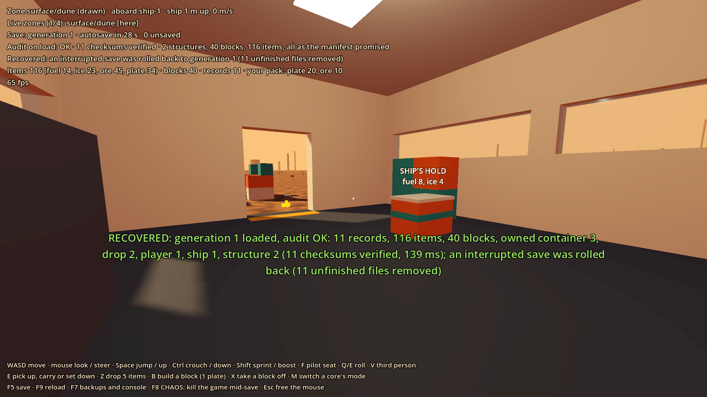

# Prototype: saves and zone transitions

Proves the most important stability system in GalHack: **nothing a player builds, drops or stores ever disappears.** The game the team learned from had a save database that slowly lost things. This one is plain files, written so that a crash, a killed process, a damaged file or a bug in the game can't lose anything that was saved, and can't save a loss either.

It also proves the zones: each place with a player in it is its own isolated Godot world, only the one you stand in is drawn, and the seams between them (climbing to orbit, re-entry) load in the background behind a tunnel that waits as long as a slow PC needs, never freezing a frame.






## What it proves

- **One writer, small separate records.** Only the host's `SaveStore` writes. Every structure, crate, player, ship, loose stack and zone's terrain edits is its own record, in its own file, with a SHA-256 checksum, so damage to one can't spread.
- **Location is one field.** A record has exactly one zone id, plus a ship id if it is aboard a ship. Things aboard live in the ship's cabin zone, so when the ship crosses to orbit, one record is written and the passengers and cargo ride through untouched.
- **Atomic commits without a database**, by shadow paging (below). A crash at any write step leaves exactly the old save or exactly the new one: tested at every step, and by killing a real process 200 times.
- **No silent cleanup.** Nothing owned or touched by a player can be cleaned up, a zone never drops records when it unloads, and the record table refuses to save if items or blocks vanished (or appeared) without being declared.
- **An audit on every load.** Every checksum is verified, and the counts of records, items, blocks and player-owned structures are compared with the manifest. If anything is missing or damaged, the load refuses, says why, changes nothing, and offers the backups.
- **Rolling backups**: a snapshot every 15 minutes, all kept for a day, then one a day for a month, restorable from the host console.
- **Versioned saves**: a container format change from v1 to v2, with a checked-in v1 save that must keep loading.
- **Core modes**: a structure's core is in base or capital-ship mode, one field that can switch back and forth without touching a block or a crate.
- **Zones**: up to 4 live, an empty one lingers 2 minutes, zones save before they unload, load in the background, and check that everything recorded came back.

## Play it

From the repo root, in PowerShell:

```powershell
.\tools\godot.ps1 -Project prototypes/saves -Play
```

The world is saved in `prototypes/saves/.saves/world` (git-ignored). Arguments go after `--`, e.g. with the Godot binary from `tools/env.ps1`:

```powershell
& $GodotEditor --path prototypes/saves -- --new --slow-pc=5
```

| Argument | What it does |
| --- | --- |
| `--save-dir=PATH` | Use another save folder |
| `--new` | Start a fresh world. The old one is moved aside, never deleted |
| `--slow-pc=SECONDS` | Every background zone load takes this much longer: watch the tunnel stretch |
| `--chaos-after=SECONDS` | Kill the game in the middle of a save after this long |

You start aboard your ship, parked beside your base. Walk out of the back door, or take the pilot seat at the front and fly up: past 420 m the orbit zone starts loading in the background, at 600 m the climb tunnel plays until it is ready, then you are in orbit with the planet below. Fly down below 400 m above the planet to re-enter; you come down above the spot where you crossed.

| Key | Action |
| --- | --- |
| WASD, mouse | Walk and look; fly and steer when seated |
| Space / Ctrl / Shift | Jump or up / crouch or down / sprint or boost |
| F | Sit in or leave the pilot seat |
| Q / E (flying) | Roll |
| V | Third person (a chase camera when flying) |
| R | Back aboard |
| E | Pick up a loose stack, pick up a crate to carry, or set it down |
| Z | Drop 5 items from your pack |
| B | Build a block where you look (uses one hull plate) |
| X | Take a block off (gives the plate back) |
| M | Switch the core you look at between base and capital-ship mode |
| F5 | Save now (the game also autosaves every 30 s) |
| F9 | Reload: back to what is on disk |
| F7 | Host console with the backup list. `restore 3` restores backup 3 |
| F8 | **Chaos**: kills the game in the middle of a save. Launch it again to see it recover |
| Esc | Free the mouse |

Console commands: `save`, `reload`, `audit`, `backups`, `backup`, `restore N`, `zones`, `cleanup ID` (try it on `base-1`: refused), `mode ID base|capital-ship`, `chaos`.

The HUD shows the zone you are in, every live zone and its linger timer, the last save's generation and timing, the load audit, whether the last launch recovered from an interrupted save, and the item and block totals.

## How a save is stored

```
.saves/world/
  manifest.json              the commit point: every record's file, size and SHA-256, plus audit totals
  records/crate-a.g41.rec    one file per record per generation, never changed once written
  backups/auto-20261104-183000-g40.zip
  quarantine/                raw copies of a damaged save, kept before a restore replaces it
```

Every file starts with one text line naming what it is, its format and the checksum of the rest, so any file can be checked on its own:

```
GALHACK-RECORD 1 sha256=b8712f8d57b6a21e...
{"id":"crate-a","type":"container","zone":"surface/dune","ship":null,"owner":"p1","touched":true,"version":2,"items":42,"blocks":0,"payload":{...}}
```

### The commit protocol

A commit writes generation N:

1. Each changed record goes to a **new** file named for generation N. They are all written, then all flushed to the disk.
2. The new manifest goes to `manifest.json.tmp`, and is flushed.
3. `manifest.json.tmp` is renamed over `manifest.json`: one atomic step, the **commit point**.
4. Only then are the files that no manifest lists any more deleted.

Steps 1 and 2 never touch a file the current manifest lists, so a crash at any moment leaves the previous manifest and all its files intact. The next load verifies everything, then sweeps away whatever the crash left: unfinished files from a save that never reached its commit point (it is rolled back, as if it never started), or old files whose deletion was cut short (the save had landed).

Saves are incremental: the record table tracks what changed, a commit writes only those records plus the manifest, and it runs on a worker thread while the game keeps playing. Zone crossings and unloads commit synchronously, hidden by the tunnel.

### What else stops data being lost

- **The ledger.** The record table knows the item and block totals of the last commit. Anything that creates or destroys items or blocks on purpose (building a block from a plate, generating a world) must declare it. If the totals don't add up, the commit is refused before anything touches the disk, and the last good save is kept. A bug that loses one ore can't be saved.
- **The cleanup guard.** `RecordTable.Cleanup` is the only way to tidy anything up, and it refuses anything a player owns or has touched. `Remove` refuses a record that still holds items or blocks.
- **Records are never overwritten by new ones.** A new record whose id is taken is refused. A record can never change type.
- **Unknown record types are kept exactly as they are**, and shown in-game as marked boxes.
- **A restore can't lose data either.** Before a backup replaces the live save, the live save is kept: as a `prerestore` backup if it is intact, or copied raw into `quarantine/` if it is damaged. The restore itself is one more atomic commit.
- **Retention never empties the backups.** The newest 3 are kept however old they are.

### Versions

Every record carries its payload's version, and `RecordSchemas` holds a migration from each old version to the next. A load migrates old records in memory and recounts them: a migration that changes a record's item or block count fails the load. The old files stay until the next save writes the new format. A record from a newer build than this one is refused, never guessed at. `tests/fixtures/save-v1` is a save from before containers changed format; it is checked in, marked binary in `.gitattributes` so git can't change its bytes, and must load forever.

## Zones

`src/Zones/ZoneManager.cs` runs each live zone as a `SubViewport` with its own `World3D`. Every live zone simulates; only the active one renders, and the screen shows its texture. Ship cabins are zones too, carried inside their ship (the cabin worlds from walkable-ship), so they ride along without being reloaded.

- **Background loading.** A zone generates on a worker thread (terrain layout, star field, planet texture), then builds its nodes a few milliseconds per frame, then spawns its records.
- **The load audit.** When a zone finishes loading it checks that every record in it (and aboard its ships) came back. Anything that didn't is named on the HUD, and stays in the table.
- **Cap and linger.** At most 4 live zones; an empty zone lingers 120 s; when there is no room, the empty zone closest to unloading anyway goes first. A zone always saves before it unloads, and stays live if the save fails.
- **Crossing.** `ZoneManager.Cross` writes the record's new zone and commits, then takes the node out of the old world and puts it in the new one. A crash at any step leaves it in one zone or the other on disk, never both, never neither.
- **Hidden seams.** Climbing past 420 m starts loading orbit; at 600 m the climb tunnel starts and lasts at least 2.5 s, and as long as the zone still needs. Re-entry works the same way down. Surface points map to the point on the planet straight above them and back, so you land where you crossed in.

Only players, their ships and their cargo cross between zones.

## Test it

```powershell
.\tools\test.ps1 -Project prototypes/saves -Scene res://tests/SaveTest.tscn
```

Runs everything headless (about 3 minutes on the dev machine; most of it is the 200 process kills) and exits 0 or 1. `-- --only=crash,soak` runs some groups: `crash`, `restore`, `kills`, `soak`, `corruption`, `cleanup`, `coremode`, `retention`, `migration`, `perf`, `zones`. A watchdog fails the run if anything hangs.

| Group | What it checks |
| --- | --- |
| crash | A commit that changes 7 records, adds one and removes one is crashed after every one of its write steps in turn (25, including half-written files). Each time, a fresh start comes back exactly as before or exactly as after the save, never a mix, nothing missing, no stray files. The recovery's own clean-up is crashed at each of its steps too |
| restore | A restore is crashed at every step: the live save is untouched or the backup is fully in place |
| kills | `tests/SaveWorker`, a console app built from the same sources with no Godot reference, saves in a loop and is killed at random moments 200 times. After each kill the save loads, every checksum passes, and the item and block totals are exactly what they were |
| soak | 5,000 random edit, save and load cycles: items moved, dropped and picked up, crates moved between zones and the ship's hold, blocks moved, the ship crossing zones, cores switching mode, and saves crashed on purpose. Totals stay the same throughout, and every reload matches the last commit exactly |
| corruption | A deleted, damaged or cut-short record, a damaged or missing manifest, a manifest missing an entry, and a record from a newer build each make the load refuse with a clear reason, list the backups and change nothing. Restoring a backup then loads cleanly |
| cleanup | Cleanup refuses anything owned or touched; a bug that loses one item can't be saved |
| coremode | Switching a core's mode changes one field of one record; crashing the switch at every step leaves one mode or the other, never a block short |
| retention | 40 simulated days of evening play: exactly the right 50 snapshots are kept; after a 90-day break the newest 3 survive |
| migration | The checked-in v1 save loads, every item in every v1 container is in its v2 stacks, and it saves back as v2 |
| perf | An incremental save of 100 dirty records out of 20,000, and a full load of 20,000 records |
| zones | The cap, linger and save-before-unload; the load audit; a crossing (one record written, passengers untouched); a crossing crashed at each step; landing where you crossed; preload against the tunnel on a normal and a slow PC, with the longest frame; a hidden zone still simulating; and the player's hands (pick up, carry, drop, build, remove, switch mode) through the real look ray |

`tests/Screenshot.tscn -- --view=base|tunnel|orbit|recovery --out=file.png --save-dir=DIR [--new]` renders a view to a PNG (windowed, not headless). For `recovery`, run the game first with `--chaos-after=2` on the same save folder.

## Using the persistence core elsewhere

`src/Persistence` is plain C# with no Godot dependency (the kill-test worker compiles it without Godot, so this is enforced by the build). To adopt it in another prototype, copy the folder or add `<Compile Include="../saves/src/Persistence/**/*.cs" />`, then:

1. Register your record types and their versions in a `RecordSchemas` (see `src/Records/GameRecords.cs`), with a counter for anything holding items or blocks.
2. Keep your saved state in a `RecordTable`: immutable `SaveRecord`s, put back with `with { ... }` when they change. Declare anything you create or destroy on purpose.
3. On the host only: `SaveStore.Load()`, then `PrepareCommit()` on the game thread, `Commit(plan)` on any thread, `CompleteCommit(plan)` back on the game thread. Tick a `BackupScheduler` after saves.
4. Never delete a record except through `Cleanup` or a `Remove` whose contents went somewhere else first.

## Known limits

- Single player: only the host saves, as designed, but there is no networking yet. One local player decides which zone is occupied.
- Every record is in memory on the host, and zones find their records by scanning. Fine for tens of thousands; millions would want an index, and lazy loading per zone.
- The manifest is rewritten whole on every save: 2.7 MB at 20,000 records. A much bigger world would want a manifest per zone under a small root.
- Power loss: files are flushed before the manifest is written, and on Windows the manifest rename is write-through, but only process kills are tested, not pulled plugs. On Linux the folder itself should also be flushed after the rename; .NET has no call for that yet.
- A first save, a full restore or a migration of everything writes every record: about 10 s at 20,000 records. Incremental saves don't.
- Only the surface and its orbit exist, and the surface is one flat 7 km patch: re-entering far round the planet lands you at its edge. No spacewalks: in space a force field closes the ship's door.
- A core in capital-ship mode is still where it was built: the mode field switches and is saved, but turning a base into a flying ship is future work.
- Loose things rest as static bodies: physics never moves a stored item, so nothing can roll away or fall through the floor.
- No sound in this prototype. The on-screen text is a debug overlay, not the diegetic UI.
