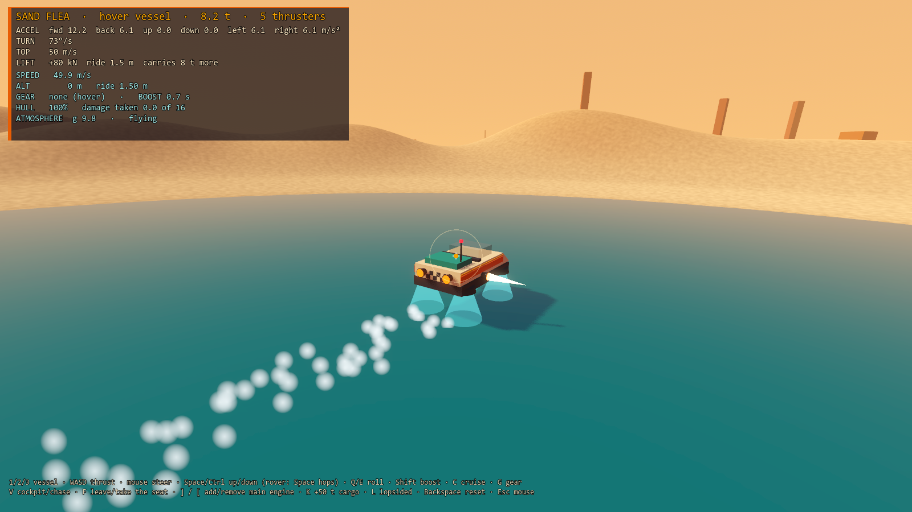
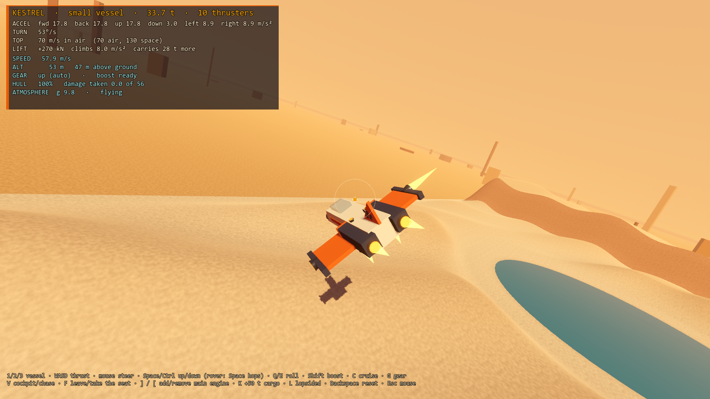
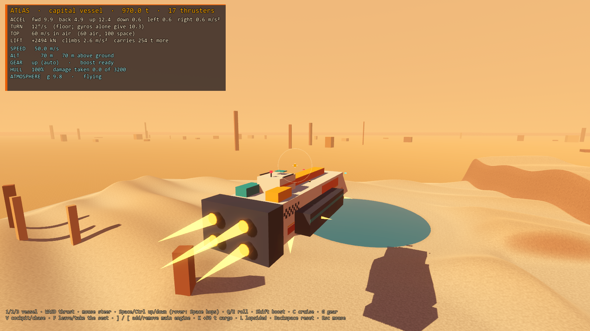
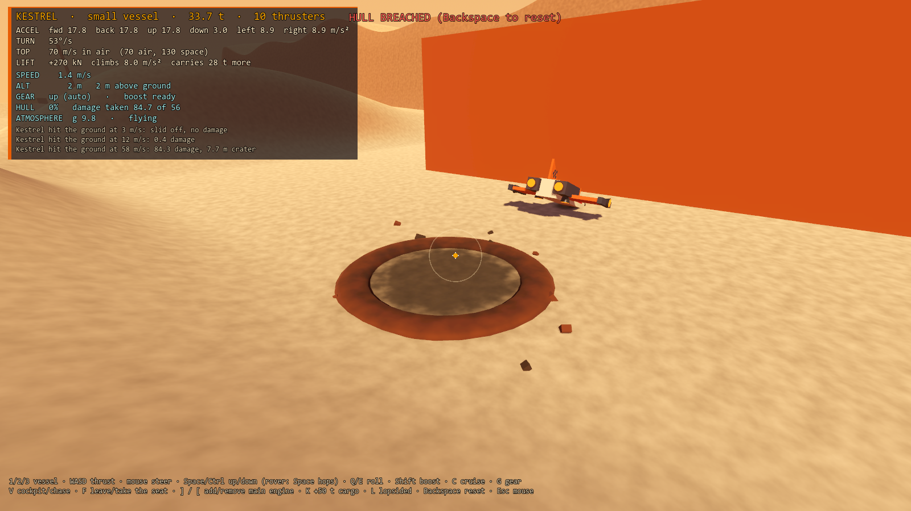

# Prototype: ship handling

Proves that ships can handle like their build with rules simple enough to read off a console: **gamey, not simulationy**. Every vessel shows four numbers (acceleration per direction, turn rate, top speed, lift margin), and flight does exactly what they say. A hover rover, a small fighter and a capital ship fly over one planet, bump into it, crash into it and land on it, all through one small physics module.






## How it works

Three separate pieces:

| Piece | Where | What it does |
| --- | --- | --- |
| Handling model | `src/Handling/` | Pure C#, no scene nodes. Turns component data into the four numbers, and steps the flight rules one tick at a time. Deterministic. |
| Physics module | `src/Physics/` | One kinematic body per vessel (never one per block). Moves vessels with the handling model, resolves contacts, runs hover engines and landing gear, freezes landed ships. Talks to the rest of the game through three events: `Impact`, `Landed`, `LiftedOff`. |
| Presentation | `src/Presentation/` | The planet, the Chris Foss-style vessels, flames, spray, craters, sky, cameras and the HUD. Reads the other two, never moves anything. |

Vessels are plain component data behind `IVesselStructure` (thrusters with facing, thrust and mass; gyros; hover engines; landing gear; hull and cargo mass; the blocks they're drawn and collided from). The canonical block-and-component model can implement that interface later and nothing else changes. The three designs are in `src/Handling/VesselDesigns.cs`; part numbers come from the tunables file.

### The rules

Mass is in tonnes and thrust in kN, so thrust / mass reads straight as m/s².

| Rule | How it works |
| --- | --- |
| Thrust | Each thruster pushes along its facing. Acceleration in a direction is that direction's thrust / mass. Bigger thrusters give more per tonne (small 100 kN/t, large 150, capital 200). |
| Turning | Turn rate (°/s) is total gyro torque / mass, never below a floor of 12°/s. Roll is 1.5× faster. Thrusters never add torque, so a lopsided build flies true. |
| Top speed | By mass band: under 100 t 70 in air, 130 in space; 100 to 1,000 t 60 and 100; over 1,000 t 50 and 80. Hover Mode 50 m/s whatever its mass. The turn rate is capped by band too: 90, 60, 30 and 15 °/s at under 20, 20 to 100, 100 to 1,000 and over 1,000 t. Thrust can never push total speed past it, even mid-turn. |
| Lift margin | Upward thrust (plus hover lift) minus weight on the planet. Negative means it can't take off, and the console says so before anyone tries. In air, climbing acceleration is lift margin / mass. |
| Flight assist | Always on. Per ship axis the vessel chases stick × top speed. Let go and it brakes with whichever thrusters face the right way (never weaker than 8 m/s²), easing out the last few m/s: smooth, no overshoot. Cruise (C) holds a speed. With the pilot out of the seat (F) the autopilot holds course. Assist never turns the ship: a flying vessel keeps whatever attitude the pilot leaves it in, in air and in space (no horizon assist, no self-levelling). |
| Boost | Shift: 1.5× thrust for 1.5 s, then a 4 s cooldown. Never raises top speed. |
| Bumps | Contacts slide along and glance off (restitution 0.2). Below 8 m/s closing speed: no damage, ever. |
| Damage | mass × (closing speed − 8)² × 0.001, at the contact point. Ramming uses the reduced mass m₁m₂/(m₁+m₂) and both sides take it. Hull points = 4 per tonne of hull. A ship with none left loses power and falls as a wreck. |
| Craters | Ground hits over 25 m/s blast a crater of 2 × ∛(energy in MJ) metres, capped at 14 m. Visual only (decal, rim, debris). |
| Atmosphere | One altitude switch at 600 m: above it there's no weight and space top speeds apply, and the sky fades to stars. |

**Hover vessels** hold ride height (1.5 m small engines, 3 m large) with a velocity servo, not a spring. Each engine probes straight down for ground or water. The servo's target climb rate is the ground's own rise rate from the probe normals, plus a gain times the height error, within fixed acceleration limits. It tracks bumps tightly and can't oscillate. Look-ahead probes along the direction of travel lift the vessel early for any rise sharper than the slope it's already on (a rock step), and refuse slopes steeper than 30°. Over water the probes see the surface, so it rides at full height and never sinks. Tilt follows the ground normal and settles at 6/s, so a knock is gone within a second. Space hops.

**Landing gear** drops by itself below 15 m when slower than 20 m/s and comes up again past them (with hysteresis). There is no button. Each foot is a stiff, probe-based suspension. A ship on its gear, slower than 3 m/s and with hands off for 0.3 s, settles level over 0.5 s, raises `Landed` and stops simulating (zero cost). Thrust wakes it (`LiftedOff`), unless it's too heavy: then the console says by how much.

### The vessels

| | Sand Flea (hover) | Kestrel (small) | Atlas (capital) |
| --- | --- | --- | --- |
| Mass | 8.2 t | 33.7 t | 970 t |
| Accel fwd / back / up / side | 12.2 / 6.1 / hover / 6.1 | 17.8 / 17.8 / 17.8 / 8.9 | 9.9 / 4.9 / 12.4 / 0.6 |
| Turn | 73°/s | 53°/s | 12°/s (floor; gyros give 10.3) |
| Top speed | 50 | 70 air / 130 space | 60 air / 100 space |
| Lift margin | +80 kN (8 t spare) | +270 kN (28 t spare) | +2494 kN (254 t spare) |

The Kestrel is the first ship a player flies, so it's forgiving: two chin retros stop it from 70 m/s in 4.8 s, and its wingtip jets jink it 50 m sideways (67 m boosted) in the 3.3 s a 300 m/s capital shot takes to cross 1000 m.

## Play it

From the repo root, in PowerShell:

```powershell
.\tools\godot.ps1 -Project prototypes/ship-handling -Play
```

| Key | Action |
| --- | --- |
| 1 / 2 / 3 | Fly the hover rover / fighter / capital ship |
| W / S, A / D | Thrust forward and back, strafe left and right |
| Mouse | Steer: it moves a virtual stick that recentres by itself |
| Space / Ctrl | Up / down (the rover hops on Space) |
| Q / E | Roll |
| Shift | Boost |
| C | Cruise: hold the current speed, W/S trim it |
| V | Cockpit or chase camera |
| F | Leave the seat (the autopilot holds course) or take it again |
| ] / [ | Add or remove a main engine: watch acceleration, mass and turn rate change |
| K | Load 50 t of cargo: one press grounds the fighter; five leave the capital ship barely climbing, six ground it |
| L | Bolt every thruster onto the left flank: the numbers don't change and it still flies true |
| Backspace | Reset this vessel: build, damage, spawn |
| Esc | Free the mouse |

Things to try: drive the rover over the rock steps east of the pad and up the two ramps beyond them (it takes the 20° ramp, refuses the 40° one), skim it across the lake to the west, then jump it. Fly the fighter above 600 m into space and back down again. Load the fighter with K and watch the console refuse to take off. Ram the parked capital ship. Dive into the pad at 60 m/s.

## Tunables

Every number lives in [`data/handling.json`](data/handling.json), with a note per section saying what each one means: the planet (gravity, atmosphere ceiling), top speeds and turn caps by mass band, turning (floor, roll factor, spin-up), assist (brake floor, ease rate, cruise), boost, hover (servo gain and limits, look-ahead, step allowance, levelling, slope limit, jump), gear (deploy altitude and speed, landing speed, settle time), contacts (safe speed, damage scale, hull points, restitution, craters) and the parts catalogue (thrust and mass per thruster size, gyro torque, hover lift and ride height, gear length).

## Test it

```powershell
.\tools\test.ps1 -Project prototypes/ship-handling -Scene res://tests/HandlingTest.tscn
```

Runs `tests/HandlingTest.tscn` headless in about 20 s and exits 0 or 1. The pure model first:
- acceleration is thrust / mass on all six axes; doubling the mass halves it and leaves top speed alone; in flight it really accelerates at its number
- turn rate is torque / mass, with the floor for the capital ship, and it really turns at that rate
- a lopsided build has the same numbers and full thrust adds zero spin
- mass band top speeds and turn caps are right, air is below space, and neither full boost nor hard turns at full boost ever pass them
- let go at top speed and each vessel stops within the expected time, with no overshoot
- boost is ×1.5, lasts its duration, is refused during its cooldown and fires again after
- lift margin is correct at 0, 3.7, 9.8 and 24 m/s²; an overloaded ship gets the console warning and sinks at its deficit
- the autopilot holds course, cruise holds speed, and nothing re-orients a flying vessel: a fighter left banked or pitched stays at that attitude for 10 s, in air and in space
- jink: the fighter strafes more than its own length while a 300 m/s shot crosses 1000 m (and a 350 m/s one crosses 800 m)

Then real vessels on the real planet, through the physics module:
- the rover holds ride height within ±0.25 m over ±0.4 m bumps at 30 m/s (also reports flat-out 50 m/s as info)
- it clears a 2 m rock step at 15 m/s with look-ahead, and snags on it without (proving the look-ahead is what does it)
- it rides the lake at full height; it's level again within 1 s of a jump and a 26° knock; it refuses a 40° ramp and climbs a 20° one
- gear deploys by itself; a ship touching down settles, raises `Landed` and stops simulating; thrust wakes it with `LiftedOff`; 50 t of cargo keeps it down with a console message
- a 4 m/s nudge into a wall does no damage and slides along it
- impact damage follows the formula and scales with speed and mass; craters are blasted and capped; ramming hurts both sides and knocks a parked ship loose
- a lopsided build flown through the physics module never turns
- the same inputs give exactly the same trajectory, twice
- performance: the per-tick cost of 20 moving vessels

`tests/Screenshot.tscn -- --view=lake|hills|capital|crater|space --out=file.png` renders a scripted moment to a PNG (windowed, not headless).

## Replacing the walkable-ship flight model

`prototypes/walkable-ship/src/Ship.cs` keeps the same conventions (forward −Z, ship-local spin x pitch, y yaw, z roll, moves at physics priority −10), so the swap is mechanical:
- `Ship.FlyPiloted` becomes `FlightModel.Step`, and its constants move to `data/handling.json`
- the ground clamp becomes the physics module's contacts
- `Velocity`, `LocalAngularVelocity`, `WorldAngularVelocity` and `PointVelocity` map to `Vessel.State.Velocity`, `State.AngularVelocity`, `WorldAngularVelocity` and `PointVelocity`, which is what stepping off needs
- `Piloted = false` becomes `PilotInput.Seated = false`: the autopilot holds course while the pilot walks around
- stunts are just another input source

The cabin world stays a child of the ship node and never sees any of this.

## Known limits

- **Hover at top speed:** at flat-out 50 m/s over the ±0.4 m bumps, ride height wanders ±0.6 m, because the servo's acceleration limits let it float over crests. It reads as skimming, not bouncing, but it's outside ±0.25 m.
- **Slope refusal is abrupt:** the rover stops a few metres short of a too-steep slope; there's no push-back or sliding feel, and it creeps forward in small steps if you hold W.
- **Look-ahead anticipates ramps too:** on flat ground, a ramp ahead looks like a step, so the rover lifts slightly early before climbing it.
- **Gamey lift:** weight is cancelled for free whenever lift margin is positive, whatever the ship's attitude, and climbing uses the ship's local up axis. A ship rolled on its side still "climbs" with its belly jets.
- **No angular response to hits:** the only exceptions are a small tilt kick on hover vessels (which the levelling removes) and wrecks easing flat. This is deliberate for stability, but crashes look stiff.
- **Ramming exchanges momentum along the contact normal only.** One ship can't slowly push another (docking pushes); it just stops against it.
- **Craters are decals plus a rim:** the terrain's collision is unchanged. Hulls pass through water (no buoyancy); landing gear can set down on it.
- **Determinism is same-build, same-machine:** fine for replays and tests, not proven for cross-machine lockstep.
- **The hull is a CharacterBody3D moved with `MoveAndCollide`:** players standing on the outside of a moving hull won't get its platform velocity yet. walkable-ship used a synced `AnimatableBody3D` for that; the physics module will need to report the hull's velocity to the physics server.
- **Inputs:** mouse and keyboard only, and the HUD is a debug overlay, not the diegetic console.
- **Silent:** no audio yet.
