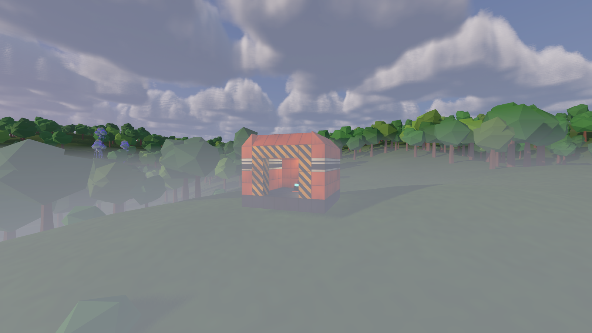
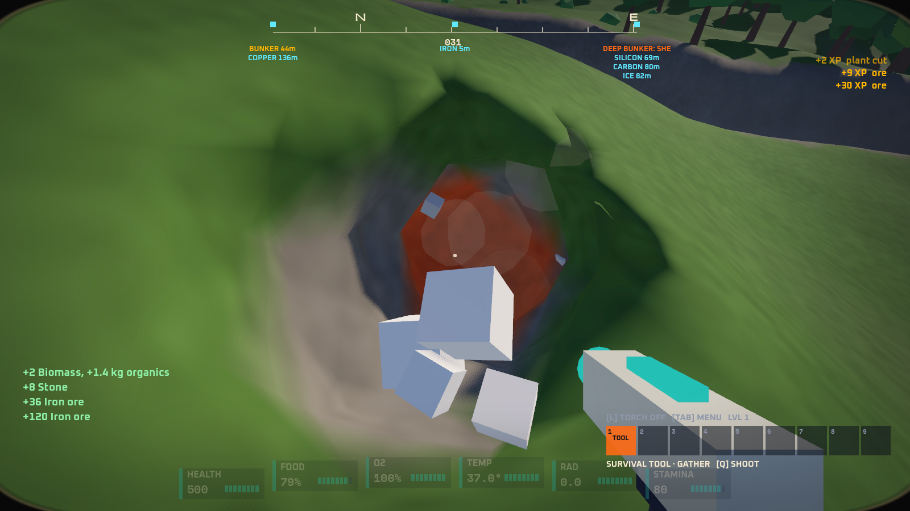
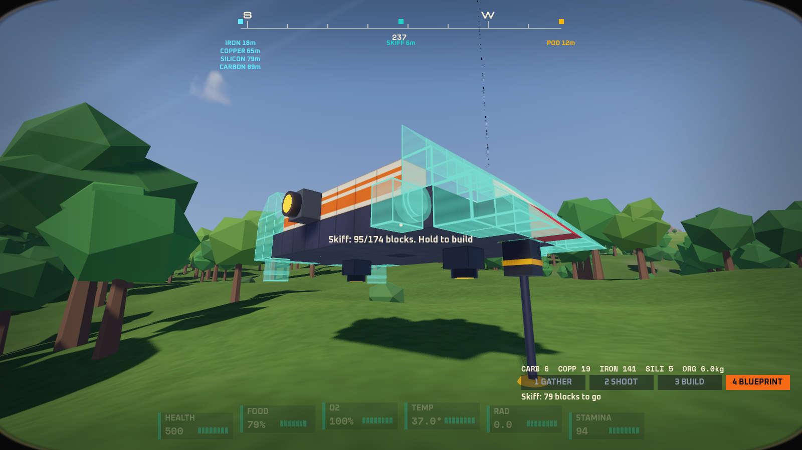
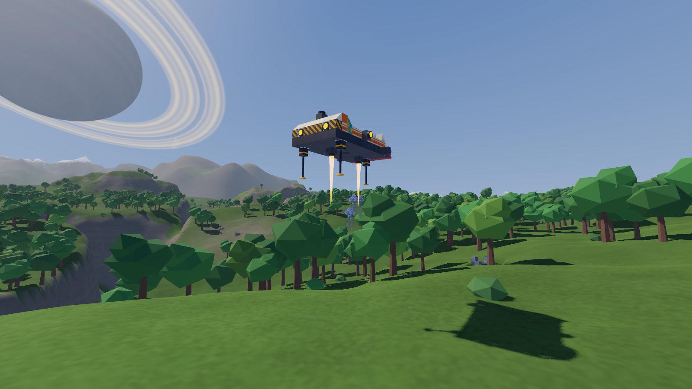
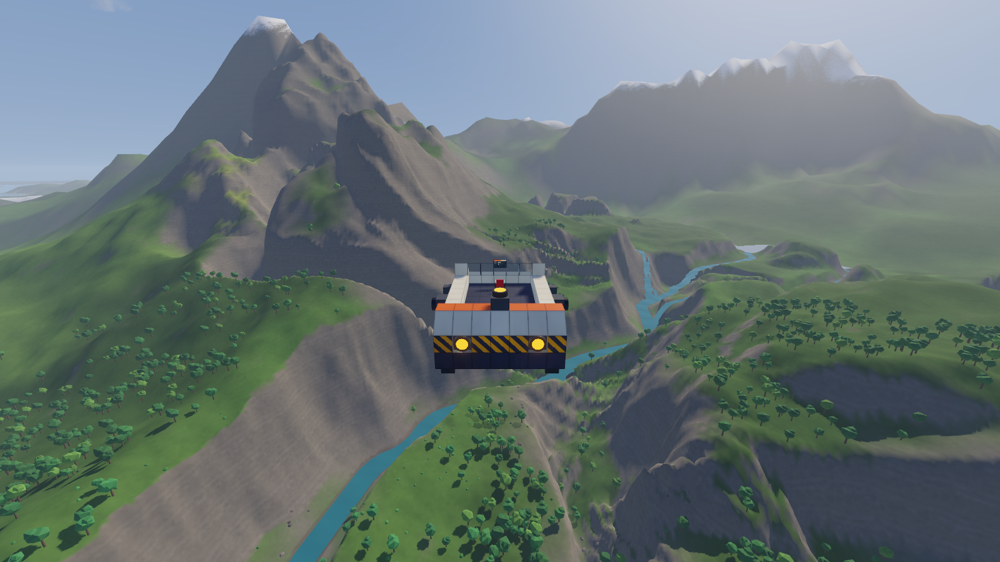
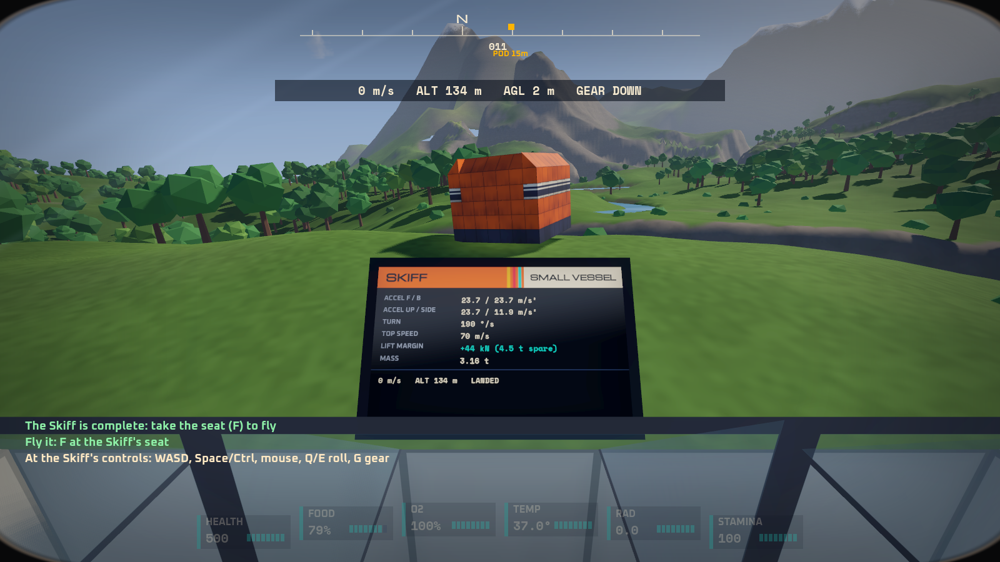

# Prototype: the slice (phase 1, the ground loop)

The first playable slice of GalHack's core loop, built from the proven prototypes and nothing else: crash-land in an escape pod on a generated planet, survive, gather, build a small vessel from blocks and fly it across the planet. Every system is compiled in from where it lives; the slice itself is glue, a game layer and its tests.








Phase 1 is the ground loop. Orbit and boarding (phase 2) and saves across everything (phase 3) come next.

## Play it

```powershell
.\tools\godot.ps1 -Project prototypes/slice -Play
```

The pod comes down at dawn at the starter planet's landing site. **F** unstraps you; the locker (**E** on the yellow container inside) holds what the pod could carry. The compass shows the nearest deposit of each building material.

| Key | On foot | In a seat |
| --- | --- | --- |
| WASD, mouse | Walk and look | Thrust; the mouse moves a stick that recentres by itself |
| Shift | Sprint | Boost |
| Space / Ctrl | Jump, hold in the air for the jetpack | Up / down |
| 1 | Survival tool, gather: hold LMB to dig ore, or click a plant to cut it | |
| 2 | Survival tool, shoot | |
| 3 | Build: LMB place, RMB take down (refunds), wheel or [ ] block, R / T rotate, X mirror | |
| 4 | Blueprint: click open ground to set the Skiff down, then hold LMB to build it block by block | |
| E | Use: take everything from a container (Shift+E: store your materials in it); feed at your replicator | |
| F | Sit in the seat within reach | Get up |
| Q / E | | Roll |
| G / C | | Landing gear / cruise |
| B | Set the survival replicator down, or pack it up | |
| H | Helmet | |
| Tab | Wrist computer: pack, the Skiff's cost against what you have, nearest deposits | |
| V | Third person | Chase camera |
| R (dead) | Wake at the escape pod | |
| F3 | Debug numbers | |
| Esc | Free the mouse | |

The loop, the way the test plays it: empty the pod's locker, walk to the iron deposit by the pod and dig it out (about 25 cells), find two more for the rest of the iron, one of copper, one of carbon, set the Skiff's blueprint down beside the pod and hold the button until it is whole (a few seconds), take its seat, lift off with Space and fly. Landing: let go of W, come down with Ctrl, and the legs drop by themselves below 15 m.

## How it fits together

| Piece | From | What the slice does with it |
| --- | --- | --- |
| Physics | `shared/Physics` | One physics world for the zone: the survivor walks on the shared walk controller, rides hulls in cabin worlds, and every vessel is one body flown by the handling model through the physics sandbox's bridges (`HandlingBridge`, `StructureBridge`, `WeatherBridge`, compiled in from there) |
| Terrain | `shared/Terrain`, `terrain-digging` | The planet as diggable voxels (`PlanetTerrain`). `PlanetEdits` is the physics module's `ITerrainEditor` (craters and digs on every copy across a seam); `PlanetGround` is its stuck field, reading only ground the streamer has built |
| Planet | `planet-generator`, `planet-surface` | The generator's temperate starter world, streamed by planet-surface's `TerrainStreamer` with its sky, sea, valley fog and flora, all used unchanged |
| Weather | `weather`, `planet-surface` | The weather model pushes bodies through `WeatherBridge`; planet-surface's lightning and tornado effects draw it (through a small `IWeatherScene` interface); the slice adds rain, snow and dust around the camera |
| Wildlife | `wildlife` | The planet's own fauna from its seed, on a 600 m patch of the planet's real heights that follows the survivor. Creatures telegraph every attack (sound and the visor's THREAT); nothing appears on screen when you meet one |
| Survival | `survival-vitals` | The suit is `SurvivalSim`, its exposure supplied by the planet: the generator's temperature field, the weather's swing, day and night, height, the sky's air for oxygen. Food, oxygen, body temperature, radiation and stamina warn before they cost health. The pod's rations, the survival replicator and respawn at the pod are survival-vitals' own |
| Building | `building` | Its structure model, rules, blueprint format, mesher and ghosts. The Skiff and the pod are blueprints in `data/blueprints` |
| Handling | `ship-handling` | The four readable numbers and the flight rules, unchanged. No levelling is added |
| UI | `diegetic-ui` | Its theme, fonts, visor glass and in-world screens: the visor, the wrist computer and the cockpit console are the slice's own pages on them |

The other prototypes' shaders and fonts load from their own `res://` paths. `src/Boot/ResourceMount` packs them at startup from where they live and mounts the pack at `res://`, so their code runs here unchanged and nothing is copied.

### Building costs (placeholder)

Materials and manufacturing aren't designed yet. Until they are, digging gives the building catalogue's recipe materials directly (`data/slice.json`: 6 iron, or 4 copper, silicon or carbon, per 1 m cell of ore), cutting a plant gives organics and carbon, and every block costs its catalogue recipe (`smallCost` for small-grid blocks). This lives behind `IBuildCosts` (`src/Construction/BuildCosts.cs`), the one place the build mode is checked, so `shared/Items` can replace it.

**Survival** pays for every block from the pack, then from the target's storage. **Creative** (a per-world setting, `Game.BuildMode`) builds anything for free and takes nothing.

### The starter vessel

The **Skiff** (`data/blueprints/starter.gbp`), 174 small-grid blocks in a Chris Foss livery: an open cockpit behind a glass windscreen, low striped rails, an engine hump with the generator, gyro and a container, two main engines, retros, side jets, two lift jets and three landing legs.

| Mass | Accel fwd / back / up / side | Turn | Top speed | Lift margin | Cost |
| --- | --- | --- | --- | --- | --- |
| 3.16 t | 23.7 / 23.7 / 23.7 / 11.9 m/s² | 190°/s | 70 m/s | +44 kN (4.5 t spare) | 344 iron, 39 copper, 9 silicon, 7 carbon |

### Rules the slice adds

- **Warned before any harm.** Survival's alerts flash before health drains. Impacts use the physics module's one formula in full; the visor flashes IMPACT whenever the body is airborne faster than the formula's safe speed (8 m/s), and sprinting tops out just under it (7.9 m/s), so running into a rock never hurts. A creature's wind-up is heard and shown (THREAT) before its lunge.
- **A calm opening.** Of the weather seeds that follow from the planet's, the slice takes the first whose forecast has no severe weather in the first 12 minutes. After that it is the planet's own weather, every storm warned before it arrives.
- **Gamey cockpits.** A seat counts as a sealed, heated cockpit (survival's cockpit volume): oxygen refills and the weather stays outside.
- **Streaming follows a vessel ahead of it,** and a flying vessel gets terrain collision a column further out, so the ground it flies over is solid when it gets there.

## Test it

```powershell
.\tools\test.ps1 -Project prototypes/slice -Scene res://tests/SliceTest.tscn
```

`tests/SliceTest.tscn` plays the loop headless, through the game's own controls (`tests/Driver.cs`: look, walk, press and hold), in about 40 s with `--fixed-fps 60` (from `SliceTest.args`). `-- --quick` hands over the gathered materials instead of digging, to iterate on the later steps. It checks:

- **Determinism:** the starter planet generates identically twice; its fauna rolls the same species; the starter blueprint's four numbers come out the same; the same inputs fly the same 4 s hop twice, tick for tick (difference 0)
- **The pod:** it stands landed at the generator's landing site; the castaway spawns standing beside it; the site is survivable (16.8 °C, 21% oxygen); 44 creatures of 9 species live around it
- **The locker:** E takes its materials and the rations
- **Gathering:** walking to the nearest deposits and digging them fills the pack with exactly the yield per ore cell dug; the dug ground is real terrain; the nearest deposits hold enough for the Skiff; cutting a plant gives organics and carbon, and the plant is gone
- **Building:** a click sets the blueprint down and pays for its core; holding the button builds all 174 blocks one at a time, each where the blueprint has it; every block was paid for exactly; the body's mass, the four numbers and the lift margin are the blueprint's; its three legs are its controller's
- **Creative:** the same blueprint builds in Creative and the pack and the spend don't change
- **Flight:** F boards it; Space lifts it off; it flies over 2 km at up to 70 m/s and lands on its gear with no damage, standing within the gear's 12° settle limit; the pilot is unhurt; the game's main-thread cost per frame while flying, judged on the best of several 300-frame windows (about 1 ms against an 8 ms budget)
- **Creatures:** the wildlife follows the castaway 2 km; a hunter's attack shows THREAT about 1.4 s before its bite lands
- **Throughout:** every loss of health came after its warning; no body ends inside the ground; no vessel ever needed rescuing

Screenshots render windowed:

```powershell
. .\tools\env.ps1
dotnet build prototypes/slice/Slice.csproj
& $GodotEditor --path prototypes/slice res://tests/Screenshot.tscn -- --view=pod --out="$PWD/pod.png"
```

Views: `pod`, `dig`, `build`, `liftoff`, `flying`, `cockpit` and `descent` (the pod on its retros), each staged through the game's controls. `--hud=0` hides the visor.

## Changes to shared code and other prototypes

All additive; each prototype's own tests still pass.

| Where | Change | Why |
| --- | --- | --- |
| `planet-surface/src/WeatherView` | `IWeatherScene` interface; `LightningFx` and `TornadoFx` take it instead of `WeatherRig` (which implements it) | Run the weather effects without planet-surface's `Main` |
| `planet-surface/src/Terrain/TerrainStreamer.cs` | `FloraNear(point, radius)`: the plants the far chunks scattered | Find and cut plants from data, with or without a renderer |
| `wildlife/src/Core/Terrain.cs` | A constructor that bakes someone else's heights | Creatures on a patch of the real planet |
| `wildlife/src/Game/ProceduralAudio.cs` | `Origin`, added to every sound's position (zero in wildlife) | Calls from a sim living on a patch |
| `survival-vitals/src/Model/SurvivalSim.cs` | Optional `Environment` in place of the data file's planet | The generated planet's climate, sky and weather |

`shared/Physics` is untouched.

## Known limits

- **Phase 1 only:** no orbit, boarding or saves yet (F5/F9 do nothing). The planet is the starter world every time.
- **Placeholder materials:** ore turns straight into the catalogue's recipe materials; no manufacturing, no constructor.
- **Wildlife lives on a 600 m patch** around the survivor on foot; a new patch is baked when they walk far from its middle. Creatures don't collide with the player or vessels (wildlife's own limit), and they read the natural ground, not dug holes.
- **The pod is a box.** It doesn't tumble on the way down; the descent is scripted.
- **Plants are cut whole** with one click; they don't regrow yet.
- **Terrain collision streams around the focus only:** anything left far away (a parked vessel) sleeps until you come back.
- **The open Skiff** has no cabin: in the seat it counts as a sealed cockpit, out of it you are on its deck.
- **Turn rate:** the Skiff is light, so its one gyro turns it at 190°/s; the mouse stick is gentle to compensate.
