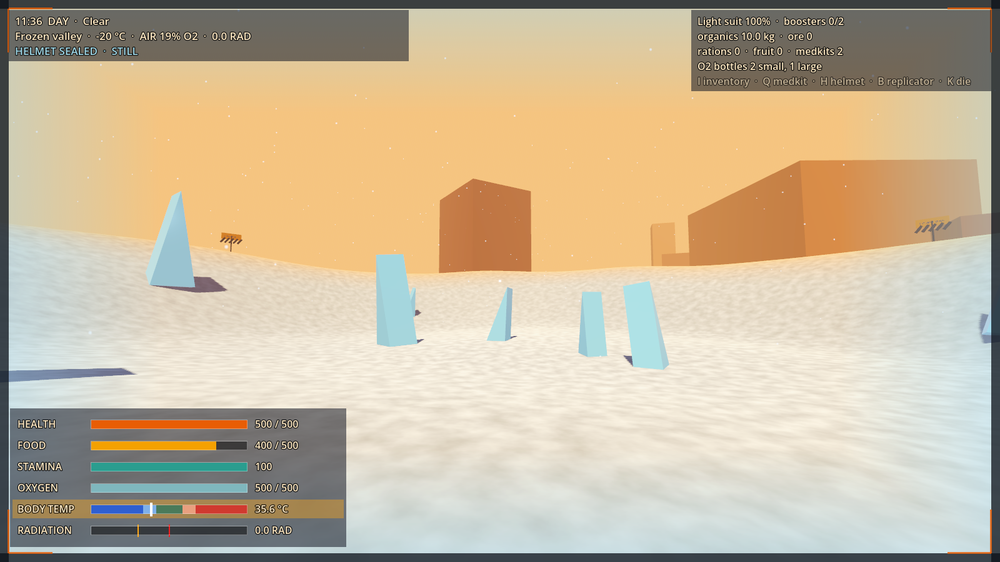
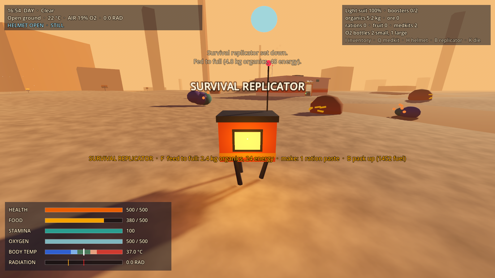
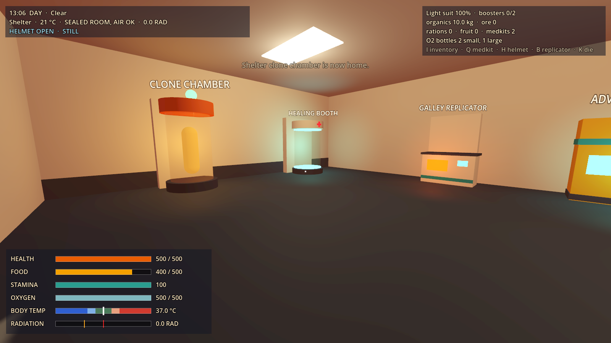
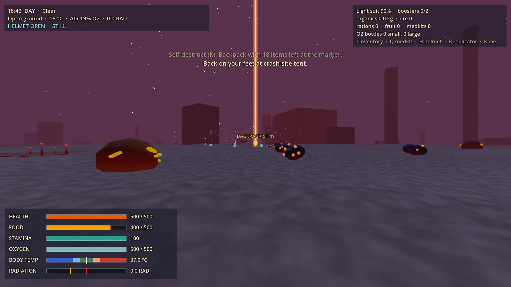

# Prototype: survival vitals

Proves that GalHack's survival can be light pressure, never chores: six vitals, food replicators, healing, death and respawn, all driven by data, with every hazard flashing on the visor before it costs health.






## What it proves

- **Warned, never silent.** Exposure vitals (body temperature, radiation, breath) lag behind the environment on purpose, and the lag is the warning: a vital crosses its warning line and flashes amber, and only seconds later crosses the line where health drains (cold and heat give 10 s, radiation 5 s, holding your breath 12 s). Falls flash IMPACT once you're falling faster than a safe landing, and only a fall the visor flashed for can hurt. Lava flashes 12 m from the pool's edge. The visor's edges also frost over, shimmer with heat, tint green or darken, so you feel a hazard before you read a number.
- **Harm stops when the cause does.** There are no ailments: no injuries, illnesses or anything else that lingers. Health drains only while the cause is still there, so stepping out of the cold stops harm on the very next tick while body temperature recovers. A test scans every code and data file, type, member and enum value to keep it that way.
- **No damage cap in vitals.** A hit takes what it takes; armor softens hits and falls. Fairness against hostiles (warning shots, inaccuracy at range) belongs in combat code.
- **Light pressure in a condensed early game.** An experienced player should reach a small vessel in 1 to 2 hours. Tuned so 90 minutes of mixed walking, running, sprinting and mining costs two feeds at the survival replicator (17 kg of organics: the starting kit plus three bushes) and no health.
- **Replicators instead of farming.** Every tier feeds you straight to full, at a cost in organics and energy proportional to your hunger; higher tiers get more from each kilogram. Carried food ages: tier 1 ration paste in 2 h, tier 2 meals over 3 days, tier 3 long-haul rations never. Aged food bottoms out at 25%; it never becomes worthless and never disappears.
- **Rule 1: nothing disappears.** A death backpack stays where you fell, under a beam and on the visor, until you pick it up. The test checks it is still there after 1,000 in-game hours. Packing up a replicator keeps its fuel. Swapping suits never loses a booster.
- **No death spiral.** You respawn at full health with at least half your food, at home, the nearest clone chamber or healing booth, the nearest survival tent, or in a fresh escape pod that keeps level, unlocks, structures and standing. Worn armor loses 10% durability.
- **Deterministic.** The same seed and the same inputs give exactly the same result, bit for bit. Weather is a hash of the seed and the time, never a stateful random stream.

## How it's built

`src/Model/` is plain C# with no engine types: vitals, exposure, armor, replicators, inventory, healing, death and respawn. `SurvivalSim` is its single entry point. The scene sets the player's position and activity each physics tick and calls actions on key presses; the tests drive exactly the same calls without a scene.

The scene (`src/Main.cs` and friends) is built in code from `Main.tscn`: a 280 m heightfield shaped from `planet.json`, props from primitive meshes in the 1970s paperback palette of the walkable-ship prototype, a day and night sky, and a visor HUD drawn in code.

## Play it

From the repo root, in PowerShell:

```powershell
.\tools\godot.ps1 -Project prototypes/survival-vitals -Play
```

| Key | Action |
| --- | --- |
| WASD, mouse | Walk and look |
| R | Toggle a running pace (1.5x food) |
| Shift | Sprint (3x food, spends stamina) |
| Space | Jump; hold in the air for the suit jetpack |
| Ctrl (hold) | Crouch |
| Left mouse (hold on a rock) | Mine ore (2x food while mining) |
| E | Use: loot the pod, pick fruit, healing booth, flag a clone chamber as home, take organics from storage, recover a backpack |
| B | Set the survival replicator down (refused on faction land) or pack it up. With no kit, builds one from 6 ore |
| F | Feed to full at a replicator |
| 1 / 2 / 3 | Make ration paste / a meal / a long-haul ration (up to the replicator's tier) |
| H | Helmet (it also seals by itself when you walk into bad air) |
| I | Inventory: wear suits, fit boosters, eat, use bottles and medkits, pick what drops on death |
| Q | Use a medkit |
| K | Die, to try death and respawn |
| 1 to 4 (dead) | Choose where to respawn |
| T | Skip two hours, to see the night |
| Esc | Free the mouse |

You start at a crashed escape pod with a light suit, a survival replicator kit, 10 kg of organics and every suit and booster to try on. From the crash site: the shelter (healing booth, clone chamber, galley and advanced replicators, organics storage) is to the north-east, the frozen valley to the north-west, the radiation crater to the north, the volcanic vent to the north-east beyond the shelter, the airless sinkhole to the east and Vharn Dominion land, ringed in red, to the west. Signs mark every hazard's edge.

Try the valley in a light suit, then with the insulation booster, by day and by night (T). Try the sinkhole with the helmet open (H) to see the breath warning. Set the replicator down inside the red ring to see it refused.

## Data files

Every number lives in `data/`. The model never hard-codes a rate, and unknown fields are an error, so a typo fails loudly.

| File | What's in it |
| --- | --- |
| `vitals.json` | Maxima, drain and restore rates, warning and harm lines for health, food, stamina, oxygen, body temperature and radiation; falls, lava, medkits, death drop rule and durability loss, movement speeds and mining |
| `armor.json` | Light, medium, heavy and epic heavy suits (2, 3, 4 and 0 booster slots) and the eight boosters, as modifier sets |
| `food.json` | Food items with nourishment and shelf life, the three replicator tiers with their efficiency, and foraging |
| `planet.json` | Climate, day and night swing, seeded weather, hazard zones, breathable rooms and cockpits, faction land, respawn points, structures, bushes, rocks and the starting kit |

## Test it

```powershell
.\tools\test.ps1 -Project prototypes/survival-vitals -Scene res://tests/VitalsTest.tscn
```

`tests/VitalsTest.tscn` exits 0 if every check passes and 1 if any fails. It checks:
- food drain walking, running, sprinting and mining against the data; stamina running dry costs no health; at zero food health drains and healing is blocked
- every timed hazard (food, suit oxygen, holding your breath, cold, heat, radiation) flashes at least 3 s before health drains; lava flashes 12 m out; falls flash before the landing hurts, and a 4 m drop does neither
- the frozen valley harms a light suit only once body temperature leaves the comfort band, an insulation booster makes it harmless by day and by night, and stepping out stops harm on the next tick
- radiation above 5 RAD drains health, a radiation booster cuts it, and just below the line nothing is lost
- suit oxygen drains with the helmet on in no air (half as fast in thin air), not at all in breathable air, refills to exactly full in a room and in a cockpit, bottles add 75 and 250 and never overfill, and the helmet and a bottle step in by themselves
- feeding costs in proportion to hunger, higher tiers cost less, a short supply feeds part way, and the galley draws from base storage first
- the survival replicator is refused on faction land, sets down outside it, and can be built from ore
- food decays per tier: T1 fast, T2 slowly, T3 never, and nothing disappears after 1,000 hours
- the booth restores everything; a medkit restores part
- no lingering-condition words in any code or data file, type, member or enum value
- each drop setting (everything, inventory only, nothing) drops the right things, the survival tool always stays, and the backpack is still there and marked after 1,000 in-game hours
- each respawn choice puts you at the chosen point at full health with food, and armor loses durability; a fresh start lands a new pod and keeps progress and structures
- vitals don't cap a hit, and armor softens it
- the same seed and inputs give a bit-identical 25-minute trace; another seed gives other weather
- 90 minutes of condensed early game costs two feeds and no health
- in the real scene, with real key presses: B is refused on faction land and works outside it, F feeds, 1 makes ration paste, E loots the pod, holding the mouse on a rock mines it, the helmet seals in the sinkhole, H opens it and the breath warning flashes, K shows the death screen and the backpack beam, 3 respawns at the tent, and a 25 m drop flashes IMPACT before it hurts

`tests/Screenshot.tscn -- --view=frozen|replicator|shelter|backpack|death --out=file.png` renders a view to a PNG (run it windowed, not headless).

## Known limits

- Heaters, coolers, drinks, showers, water, the immunity shot and melee stamina costs are not in yet; nor is a way to refuel the survival replicator (its 1,500 fuel lasts about 15 full feeds).
- Days are 12 minutes long so the cycle shows in a short session; a real day length is a data change.
- The inventory has no weight or capacity limit, so recovering a backpack always takes everything.
- There is no map yet: backpacks are marked by a beam and a visor beacon.
- The HUD is a simple visor overlay; the full diegetic UI comes from another prototype.
- The Mobile renderer lights each mesh with at most eight omni lights, so the big terrain mesh ignores some prop lights.
- Exports need `data/*.json` added to the export filter.
- Single player only. The model is deterministic and has no engine state, ready for a server to own it.
