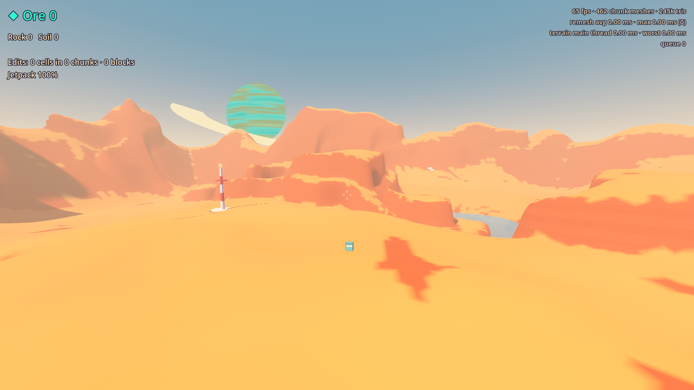
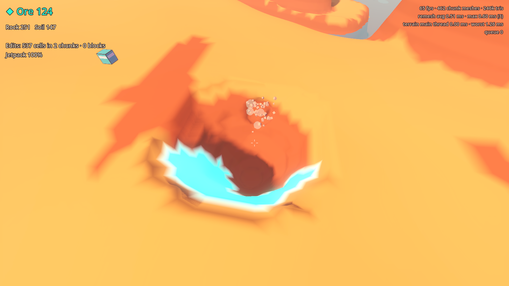
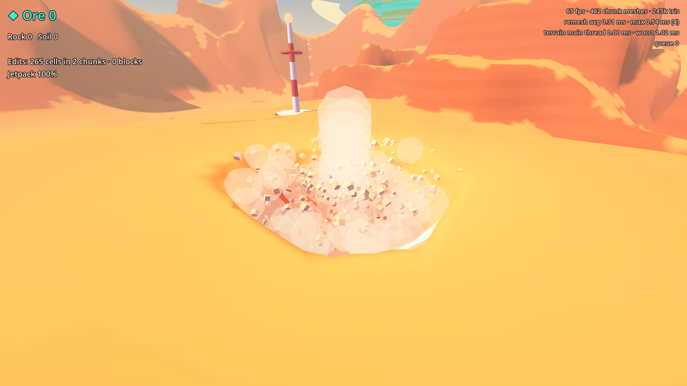
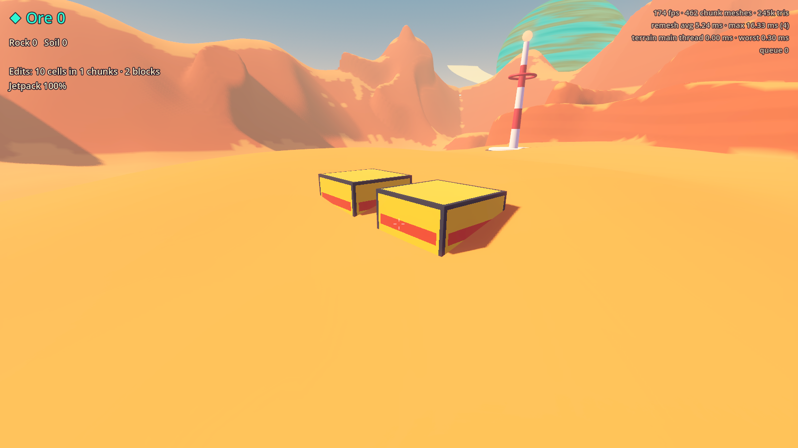
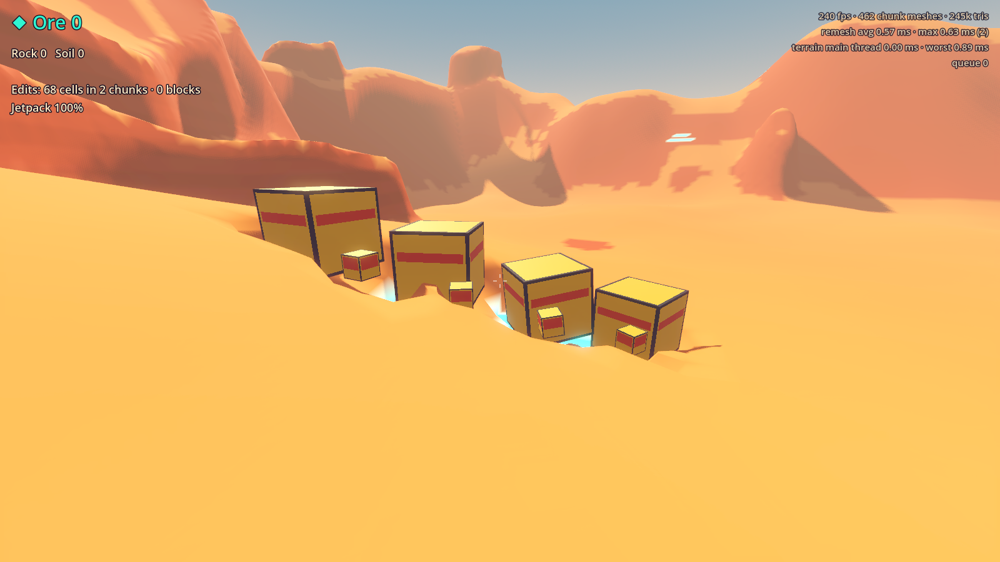
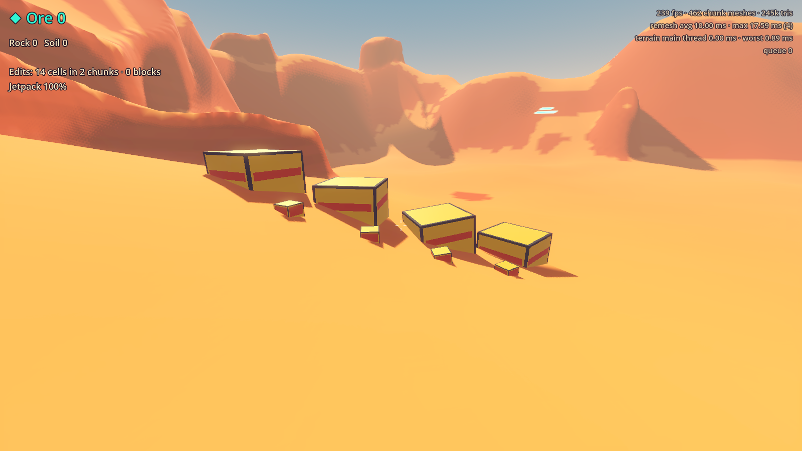
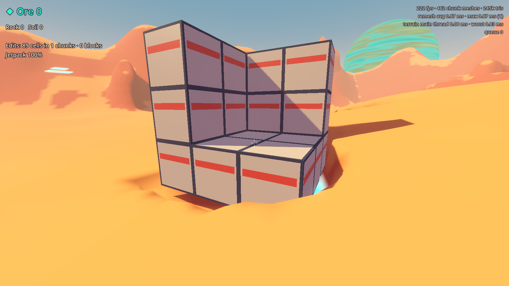
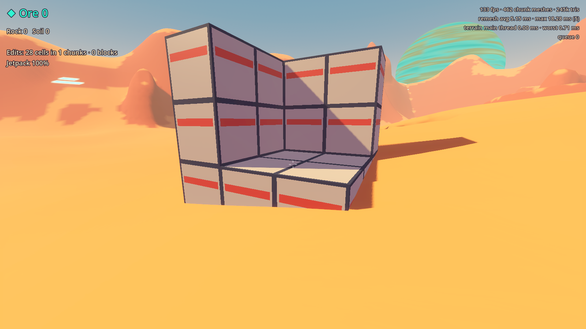
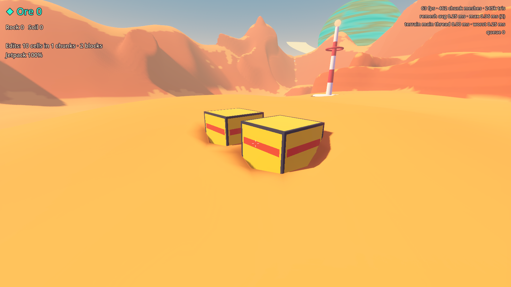

# Prototype: terrain digging

Proves that GalHack's deliberately limited digging is rock-solid, fast on modest PCs and fun. The genre's usual voxel troubles are terrain growing into things, holes that differ between players, saves that lose edits, and cracks at chunk seams. Here each one is ruled out by design and checked by a headless test.






Blocks set into the ground, before (the old clearing: the block plus a margin, cell by cell, smoothed into a moat) and after (flush):

| Before | After |
| --- | --- |
|  |  |
|  |  |
|  |  |

## The rules, and how they hold

| Rule | How |
| --- | --- |
| 1. Remove only, 1 m cells | Edits are a per-chunk set of removed cells (a 4096-bit mask) over the seed-generated base. Nothing can add to the base, and the set only grows. |
| 2. Shallow | The generator puts bedrock 30 m below the original surface. Bedrock refuses every kind of edit. Ore sits 1.2–10 m down. |
| 3. Dig anywhere | Ground under and around structures and POIs digs like any other (design doc rev 372, as in Empyrion): players tunnel under a base or into a POI to breach it. Structures are static: undermining one never moves it. Only bedrock refuses the tool, craters and building. |
| 4. Blocks meet the ground flush | `ChunkStore.ClearForStructure(key, volume)` takes any box at any angle (a block of a base or vessel): the cells whose centres lie inside are cleared, and the volume is registered. The mesher draws those cells as the ground they were and cuts the surface off exactly at the block's faces, so the ground outside is untouched to the bit, with no sag ring and no gap under the edges (as in Empyrion, placing a block doesn't reshape the ground round it). Collision is built from the same triangles. Taking the block down (`RemoveVolume`) leaves the cleared cells as a plain dug hole. A block can't be built into bedrock. |
| 5. No terrain physics | There is none. A carved-free island floats forever. |
| 6. Static water | One flat plane, masked to the columns whose *natural* surface is below water level. Digging never changes the mask, so a pit beside a lake stays dry. |
| 7. Stuck-safe | A stuck guard samples the density field at each body's core every physics tick. Anything inside the ground for two ticks moves to the nearest spot with standing room, preferring up. |
| 8. Edits as differences | `EditLog` is a canonical, checksummed diff (about 1.2 bytes per dug cell). Removal sets are grow-only, so diffs can arrive in any order or twice and every player still converges on the same holes. |
| 9. Caves only from the generator | Two winding generator caves; players have no carving tool. |
| 10. Crashes and liftoffs | `ChunkStore.Crater`: a sphere centred above the ground cuts a capped bowl (≤ 6 m, ≤ 900 cells). It's remove-only, stops at bedrock, and cuts right up to and under structures. |
| 11. Atomic, audited saves | Write `.tmp`, flush, read back and verify, then an atomic replace that keeps `.bak`. Loading rebuilds on a separate store and audits every cell, the counts, the structures and a state fingerprint before swapping in. |
| 12. A grid world | `ChunkStore.IsSolid(cell)` is the whole query plain A* needs. |

## How it works

**Terrain core** (`src/Terrain`, pure C#, no engine types, deterministic):
- `ITerrainSource` / `SimpleTerrainSource` is the seeded generator, behind the interface the planet-generator will implement. It is built only from integer hashing and exact float ops, so every machine generates identical cells. `GeneratorId` is saved, so edits never load onto different terrain.
- `ChunkStore`: 16³ chunks of 1 m cells. All the rules live here and return clear verdicts: `Removable`, `AlreadyAir`, `Bedrock` or `OutsideWorld` (`Anchored` is obsolete and never returned). Masks are copy-on-write, so mesh workers hold an exact snapshot without locks. Structure volumes are indexed per chunk the same way: immutable arrays a worker can keep.
- `SurfaceNetsMesher`: Surface Nets over cell-centre densities, with one-cell padding from the 26 neighbours. I chose it over Marching Cubes because it has no ambiguous cases or tables and never produces cracks or slivers. A dug cell becomes a softly chamfered hole that blends into natural slopes. Vertices are in world space, so the two sides of a seam compute bit-identical floats.
- `StructureVolume`, `VolumeKey` and `StructureClipper`: rule 4, below.
- `EditLog`, `TerrainSave` and `StuckResolver`, as described above.

**Blocks in the ground (rule 4).** Surface Nets smooths every edge it draws, so a hole cleared for a block, however exact, reads as a sag ring round it and a gap under its edges; with 1 m cells and blocks at any angle, no density trick puts the surface on a block face. So the terrain is cut, not smoothed:
1. `ClearForStructure` removes the cells whose centres lie inside the block (half-open, so a centre on the face two blocks share belongs to one of them). That is the gameplay truth: the tool, the stuck guard, saves and diffs see those cells as air, and remove-only holds.
2. While the block stands, the mesher reads those cells at their generated density (`ChunkNeighborhood`), so the surface it builds is the ground exactly as it was. The exception is a cleared cell beside dug ground outside the block: that one stays open, so a tunnel dug up to a block meets its face rather than a ledge of ground nobody can dig.
3. `StructureClipper` then cuts away whatever of that surface lies inside the block. For each block, a triangle touching it loses the convex polygon T ∩ box and the rest is ear-clipped. The only new points on a triangle's edges are where the edge enters or leaves the box, computed from the edge alone with its ends in canonical order, so the triangle across the edge, in this chunk or the next, gets the same points to the bit: no cracks and no T-junctions across seams. Tolerances scale with distance from the origin, so it holds 20 km out on a streamed planet.

I chose this over the two other options. Clearing only cells inside plus a "hard boundary" density still smooths the corner where ground meets face (a chamfer up to half a cell). Leaving the terrain untouched and masking it in the shader leaves collision inside the block, puts terrain back if the block is removed, and needs every block's box in the shader. Cutting the mesh gives exact contact for drawing and collision at once, costs about 0.6 ms per chunk remesh with a 30-block base cut in (0.2 ms without), and only chunks near blocks pay it.

**Presentation** (`src`):
- `TerrainView` snapshots each dirty chunk's neighbourhood (just references), meshes it on a worker, and swaps finished meshes in under a 2 ms frame budget. Collision is split into eight hashed 8³ blocks per chunk, each on its own body, so a dig only makes Jolt rebuild the blocks it changed. That was the one expensive main-thread step.
- `GatherTool` aims by walking the cell grid, not the collision mesh, so it always targets the real terrain even mid-rebuild.
- The look is a 1970s paperback after Chris Foss: toon light, lavender shadows, orange soil, banded rust rock, ore in a glowing aqua nothing else uses, bedrock with a faint cell grid, and a ringed giant over the rim mountains.
- Sound is synthesised in code at startup (`Sfx.cs`): filtered noise and decaying sines. There are no audio files, so nothing to license.

## Play it

From the repo root, in PowerShell:

```powershell
.\tools\godot.ps1 -Project prototypes/terrain-digging -Play
```

| Key | Action |
| --- | --- |
| WASD, mouse | Walk and look |
| Shift | Sprint |
| Space | Jump; hold in the air for the jetpack (climb out of pits) |
| Ctrl | Crouch: smaller capsule, lower eye, slower. You stay down until there is room to stand. |
| Left mouse (hold) | Dig the cells under the crosshair, anywhere but bedrock (under blocks and the POI too). Ore goes to the counter. |
| Right mouse | Place a 2 m block: clears the cells inside it, the ground around meets it flush |
| C | Test crater (crash or liftoff) at the crosshair |
| Q | Ore detector ping: marks nearby deposits through the ground |
| F5 / F9 | Save / load (atomic, audited). Saves go to `saves/`, which is git-ignored. |
| F8 | Wipe every chunk mesh and collider, regenerate from seed + edits, and confirm every mesh hash is identical |
| B | Chunk borders; chunks flash yellow as they're remeshed |
| H | Hide the controls |
| Esc | Free the mouse |

The crosshair turns red on bedrock, and orange on a block.

## Test it

```powershell
.\tools\test.ps1 -Project prototypes/terrain-digging -Scene res://tests/DigTest.tscn
```

`tests/DigTest.tscn` runs 69 checks headless in about 23 s and exits 0 or 1 (`-- --flush` runs only the flush-contact ones, in 2 s):
- **Rules 1–6, 9 and 10:** remove-only under 1000 random edits of every kind (with exact accounting); bedrock depth and refusals; dig anywhere (the tool under, beside and 6 m below a block, a tunnel right under it, a crater cutting up to and under it, the POI's ground dug, cratered and built into, bedrock under a block still refused, and the block never moves); blocks clearing their volume; capped craters; dry pits beside the lake; generator caves; a floating island.
- **Rule 4, blocks meet the ground flush** (`tests/DigTest.Contact.cs`): 28 blocks on flat ground and a 30° slope (2 m and 0.5 m; square, turned 17° to 90°, tilted, off the cell grid, barely in the ground and buried nine tenths; slabs; rows of touching blocks). For each:
  1. no solid cell is left whose centre is inside, and exactly those cells were cleared
  2. no cell outside changed, density or material (tolerance: none)
  3. every vertex of the new surface is an old one to the bit, or a cut point on a block face that lies on the old surface (within 2 mm), and nothing is drawn inside a block
  4. rays straight down within 1.5 m find the ground where it was (143,000 rays, worst 0.003 mm, which is float rounding), and 3 cm outside every bottom edge the ground is untouched, so the face runs down into it with no gap

  Also: three blocks across an 8-chunk corner leave open edges only along block faces (no cracks or T-junctions across seams), with the winding kept; no cut needs a fallback; taking blocks down leaves exactly the mesh of the same cells dug with no block, closed, nothing floating; the same blocks in either order on two separate worlds give bit-identical meshes; a save and load bring the meshes back identical; the same holds 20 km from the origin; and in the running scene, a block turned 28° into the slope leaves the ground's collision exactly where it was outside it and none inside it, then a tunnel is dug under it with the player standing on it, and neither moves. For comparison, the old clearing (the slice's `BuildTool.ClearGround`) on the same blocks cut 317 cells outside them and dropped the ground nearby by up to 2.8 m.
- **Rules 8 and 11:**
  - 400 edits replicated to two separate instances, one serialised and one shuffled with duplicates, give identical cell and mesh hashes.
  - Logs and saves round-trip byte for byte.
  - A simulated crash after the temp write but before the swap leaves the old save intact, and it loads.
  - The audit refuses a flipped bit, a truncated file, a save that silently lost a chunk of edits, an edit on bedrock, and a buried structure. With a corrupt save and a good backup, loading falls back to the backup and says so.
- **Mesher:** shared seam vertices around an 8-chunk corner match bit for bit; no open edges across seams; winding agrees with normals.
- **Scene:**
  - Stuck rescue for a player and a crate (2 physics frames), and no false rescue while standing.
  - Crouch: the capsule shrinks, you can't stand under a 1 m overhang, a crouched player in a crawlspace is left alone, and a buried crouched player is rescued to standing room.
  - The keys end to end: dig, place, F5, dig into a fresh hole, F9, rescued. Then crater and detector.
  - F8: all 2048 chunks identical, and nobody falls while the colliders are rebuilt.
  - Procedural sound levels.
- **Performance:** 1000 random digs through the real pipeline, 10 per frame.

Typical numbers on a Ryzen 7 5800X3D:

| | |
| --- | --- |
| Surface Nets remesh, one thread | avg 0.22 ms, max 0.4–0.6 ms per chunk (~550 triangles) |
| Remesh job on the workers | avg 0.75 ms. A handful of 1000s go over 5 ms when the OS descheduled a worker or the GC paused it. |
| Mesh swap-in on the main thread | avg 0.5 ms (render 0.08, collision 0.45) |
| Worst frame of terrain work | 3.4–5.4 ms at 10 digs per frame, which is far more than a player can do |
| Startup | 462 chunk meshes, 246k triangles in ~2 s headless, ~4.5 s windowed (behind a loading message) |
| Remesh with a 30-block base cut in, one thread | avg 0.6 ms, max about 4 ms per chunk (0.2 ms for the same holes without it) |

`tests/Screenshot.tscn -- --view=landscape|pit|crater|block|row|corner --out=file.png` renders a view (windowed). `--legacy` clears `row` and `corner` the old way, for before-and-after pictures. `--view=map` writes a top-down layout map headless; `--debug=1|2` shows normals or unlit albedo.

## Known limits

- The world is a fixed 256 × 256 × 128 m box with rim mountains; streaming chunks in and out is future work.
- Collision rebuilds still cost about 0.45 ms per chunk on the main thread. Fine for a player digging; a heavy multiplayer dig-fest would want collision near bodies prioritised, or Jolt shapes built off-thread.
- Occasional worker and frame spikes are GC pauses from per-job array allocation; pooling those arrays would remove most of them.
- The prototype's own blocks can't be removed or stacked, and placement checks the player's body but not crates or creatures. (`ChunkStore.RemoveVolume` is there for games that take blocks down; the tests use it.)
- A block is cut as its whole cell: a slope or wedge shaped block buried in the ground clips the ground over its full box, so its open side would show the hollow under the ground. A window block likewise. Shaped volumes would fix it; nothing needs them yet.
- The ground inside a base's rooms is natural ground: a floor laid level on a slope has ground above it on the uphill side, as in Empyrion, until it is dug out. A game that wants rooms cleared can pass their air cells to `ClearForStructure` as volumes too.
- Where a block was built into ground that was already dug, a cleared cell next to the dug ground outside is drawn open, so the old hole's rim shows against the block's face (a dug look, never ground growing).
- `SampleDensity` and the stuck guard read cells, so within half a cell of a block face they see the cleared cells as air even where the ground is drawn up to the face. That errs on the side of open space.
- Structure volumes registered by callers aren't saved by `TerrainSave` (the store's own blocks are): the game re-registers them when it rebuilds its structures, and `ReplaceStateWith` keeps them across a terrain load.
- A verified `.tmp` left by a crash is ignored on load rather than recovered. Recovering it is a safe follow-up.
- Water is visual and static: you walk on the lake bed, and there's no swimming.
- The generator's ore and caves are tuned for this map; the planet-generator replaces `SimpleTerrainSource` wholesale.
- The HUD is a debug overlay, not the diegetic UI. Single player only, though edits are already diffs, ready for networking.

## Integration

The API, all in `src/Terrain` (compiled into the slice, planet-surface, capital-base and physics-sandbox):
- `StructureVolume`: a box at any angle. `new StructureVolume(centre, rotation, size)`, `StructureVolume.Box(cellBox)`, `CellsInside()`, `Offset(by)`.
- `VolumeKey(owner, x, y, z, copy = 0)`: who owns a volume (your structure id and the block's cell); `copy` tells copies across a seam apart, and removing a key removes all its copies.
- `ChunkStore.ClearForStructure(key, volume)` (or a list of parts): clears the cells inside, registers the volume, returns an `EditResult` whose `DirtyChunks` cover both. `AddVolume(key, volume)` registers only (a load, a copy across a seam). `RemoveVolume(key)` / `RemoveVolumes(owner)` let go and return the chunks to remesh. `IsCovered(cell)`, `Volumes`, `ChunksNear(volume)`.
- `PlaceStructure(CellBox)` and `RestoreStructure` (the store's own blocks, so planet-surface's `PlanetTerrain.PlaceStructure` too, copies included) register their volumes themselves. `RestoreStructure` now returns the chunks to remesh (it returned nothing).
- Compatibility: `Verdict.Anchored`, `PlaceVerdict.AnchoredByPoi` and `EditResult.Anchored` stay as `[Obsolete]` and are never returned or counted, so old callers compile (with a warning). `AnchorZone`, `Anchors`, `IsAnchored`, `AnchorBoxFor` and the `Anchor*` constants are gone; nothing outside terrain-digging used them.

**The slice** (`prototypes/slice`, not changed here). Two files.

`src/Surface/PlanetEdits.cs`, three new methods (PlanetTerrain copies cells across seams itself; the volume's copies are registered here):

```csharp
    /// <summary>
    /// A block of a base reaching into the ground (terrain-digging's rule 4): the cells whose
    /// centres lie inside it are dug like any others (every copy across a seam, logged, flora
    /// cleared, bodies woken), and its volume is registered, with its copies across the seams, so
    /// the ground is drawn and collides flush against its faces. Harmless to repeat for a standing block.
    /// </summary>
    public PlanetEdit ClearForStructure(VolumeKey key, StructureVolume volume)
    {
        var dirty = new HashSet<Int3>();
        int copy = 0;
        for (int a = -1; a <= 1; a++)
        for (int b = -1; b <= 1; b++)
        {
            bool self = a == 0 && b == 0;
            StructureVolume v = self ? volume : volume.Offset(new N.Vector3(a * Terrain.Width, 0f, b * Terrain.Height));
            CellBox box = v.CellBounds;
            if (!self && !Terrain.InFrame(box.Min) && !Terrain.InFrame(box.Max - Int3.One)) continue;
            dirty.UnionWith(Terrain.Store.AddVolume(key.AsCopy(self ? 0 : ++copy), v));
        }
        PlanetEdit edit = Terrain.DigCells(volume.CellsInside());
        Commit(edit, notify: true);
        _streamer.MarkDirty(dirty); // the volume changes how the ground near it is drawn, dug or not
        return edit;
    }

    /// <summary>A block taken off: the ground it cleared stays cleared, drawn as the dug hole it is.</summary>
    public void ReleaseStructure(VolumeKey key) => _streamer.MarkDirty(Terrain.Store.RemoveVolume(key));

    /// <summary>Every block of one structure let go at once (the base taken down).</summary>
    public void ReleaseStructures(int owner) => _streamer.MarkDirty(Terrain.Store.RemoveVolumes(owner));
```

`src/Construction/BuildTool.cs`: replace `ClearGround` (about line 584) with this, and add the key helper:

```csharp
    /// <summary>
    /// A base's block reaching into the ground: the cells whose centres lie inside it are cleared
    /// and its volume registered, so the ground meets its faces flush (terrain-digging's rule 4).
    /// </summary>
    void ClearGround(Vessel v, Int3 cell)
    {
        var volume = new TerrainDigging.Terrain.StructureVolume(
            v.Body.ToParent(StructureBridge.CellCenter(v.Structure, cell)), v.Body.Rotation, new N.Vector3(v.Structure.Grid.CellSize));
        _zone.Edits.ClearForStructure(BlockKey(v, cell), volume);
    }

    static TerrainDigging.Terrain.VolumeKey BlockKey(Vessel v, Int3 cell) => new(v.Body.Id, cell.X, cell.Y, cell.Z);
```

and in `Remove(Vessel v, Int3 cell)`, let go of every block that leaves the base (the one taken off, and any section cut loose with it, which falls as a wreck):

```csharp
        Structure s = v.Structure;
        if (!s.TryGet(cell, out Block b)) return;
        var before = v.IsBase ? s.Blocks().Select(x => x.pos).ToList() : null;     // new
        ...
        RemoveResult r = Building.Remove(s, cell, null);
        ...
        if (r.Status != RemoveStatus.Removed) return;
        if (before != null)                                                           // new
            foreach (Int3 p in before)
                if (!s.Has(p)) _zone.Edits.ReleaseStructure(BlockKey(v, p));
```

The two existing `ClearGround` calls (a new base's core in `StartStructure`, each block in `TryPlace`) stay as they are. Checked on a scratch copy of the slice branch (9d6f974) with this terrain core: it builds, its `PlayerTest` passes all 76 checks (a base founded, five blocks built onto it, one taken down), and its `base` view goes from a sag ring round the base ([before](screenshots/slice-base-before.png)) to grass meeting the blocks ([after](screenshots/slice-base-after.png)). If vessels are ever saved and loaded, call `ClearGround` for each block of a restored base: its cells are already cleared, so that only re-registers the volumes.

Optional tidying in the slice: `Player/SurvivalTool.cs` (the "ANCHORED" message) and `Start/Bunker.cs` (`Diggable`) test `Verdict.Anchored`, which compiles with an obsolete warning and is never true; drop those branches. `Bunker.Dig` digs the bunker's whole volume plus a margin on purpose (rooms underground); registering its blocks with `ClearForStructure` as well would make its stairwell meet the ground flush.

**planet-surface and `shared/Terrain`** (the POI agent's): nothing needed. `PlanetTerrain.PlaceStructure` goes through `Store.PlaceStructure` and `RestoreStructure`, so its blocks and their seam copies are flush already. `PlanetTerrain.Check`'s copy check and `PlanetEdit.Anchored` still mention `Verdict.Anchored` (obsolete warnings, dead code now) and can be dropped; `PlanetWorld` still passes POI footprints as `PoiSite`s, which no longer anchor anything.

**capital-base** uses it already: `Ground.SetInto` for blocks built into the ground, released on block removal, lift-off, release and loads (see its README).
