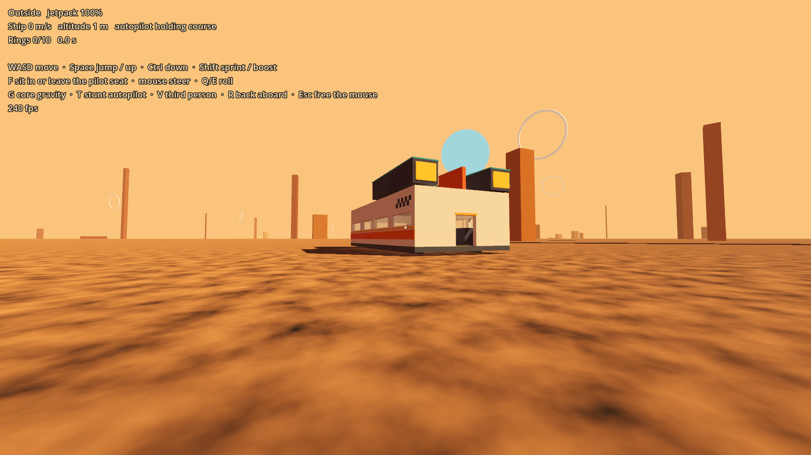
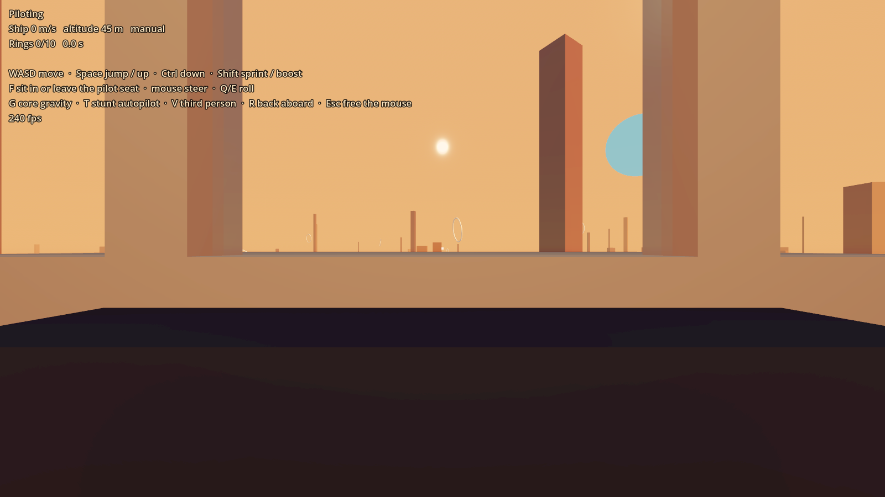

# Prototype: walkable moving ship

Proves the riskiest feature in GalHack: walking around inside a ship while it flies, rolls and stunts, then stepping off it (or back on) without anything glitching.




## How it works

The ship you see flies through the world. Anyone aboard actually walks in the ship's **cabin world**: a small private physics world (a `SubViewport` with its own `World3D`, never drawn) holding a motionless copy of the interior at ship-local coordinates. The player's camera is drawn at `ship transform × position in the cabin world`. However hard the ship turns, the character controller only ever sees a still room with gravity pointing at the floor. Loose cargo works the same way: simulated in the cabin world, drawn inside the real ship.

Every ship has its own cabin world, so there are no slots to run out of, two cabins can never collide, and moving a ship (a zone change, a teleport) never touches its passengers.

Stepping off the back moves your body into the main world, converting position, velocity and view direction into the world frame and adding the ship's velocity at the door. Walking into any ship does the reverse, and that ship becomes yours: the one you fly, and the one the HUD and the G and T keys act on. The camera and your visible body always stay in the main world. A cabin world gets no input of its own, so `Main` hands input to the player wherever its body is.

`tests/WorldProbe.tscn` proves the engine side: bodies in a never-drawn SubViewport world fall, land and collide, never touch bodies in other worlds, and a character reparented into another world takes that world's collisions.

## Play it

From the repo root, in PowerShell:

```powershell
.\tools\godot.ps1 -Play
```

| Key | Action |
| --- | --- |
| WASD, mouse | Walk and look; fly and steer when seated |
| Space | Jump, or up (zero-g, flying, jetpack outside) |
| Ctrl | Crouch on foot (you can't stand under a low ceiling), or down (zero-g, flying) |
| Shift | Sprint, or boost when flying |
| F | Sit in or leave the pilot seat (front of the cabin) |
| Q / E | Roll |
| G | Toggle core gravity: cargo and you start to float |
| T | Stunt autopilot: barrel rolls while you walk around |
| V | Third person |
| R | Back aboard |
| Backspace | Restart the ring course |
| Esc | Free the mouse |

Fly through the 10 rings in order for a lap time. Try jumping out of the back during a stunt and catching up with the jetpack. A second ship is parked 40 m to the right: walk off the first, board it and fly that one instead.

## Test it

```powershell
.\tools\test.ps1
```

Runs `tests/FrameTest.tscn` headless and checks that the player:
- stays on the deck through 15 s of barrel rolls
- stays inside the cabin in zero-g, while the other ship's cargo, in its own world, never feels it
- keeps the ship's velocity when stepping off at 40 m/s
- boards when walking back in
- steps off one ship into the main world, walks into the other ship's cabin world, sits in its seat with F and flies it
- crouches with Ctrl (but not in the seat), and can't stand up under a low overhang

`.\tools\test.ps1 -Scene res://tests/WorldProbe.tscn` runs the engine probe for cabin worlds.

`tests/Screenshot.tscn -- --view=cabin|stunt|cockpit|outside --out=file.png` renders a view to a PNG.

## Known limits

- The ship ignores terrain apart from a ground clamp; collisions belong to the physics module.
- Every cabin world is simulated all the time, occupied or not. It is cheap (about 0.8 MB each, and resting crates sleep), but a big fleet would want empty cabins paused.
- Only players change worlds. A crate pushed out of the door falls away forever inside its cabin world.
- The on-screen text is a debug overlay, not the diegetic UI.
- Single player only; positions inside ships are already ship-relative, ready for networking.
