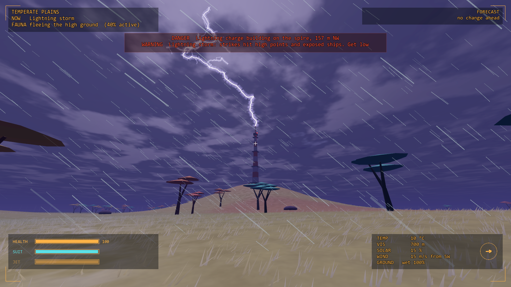
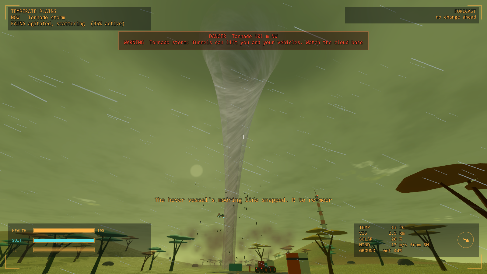
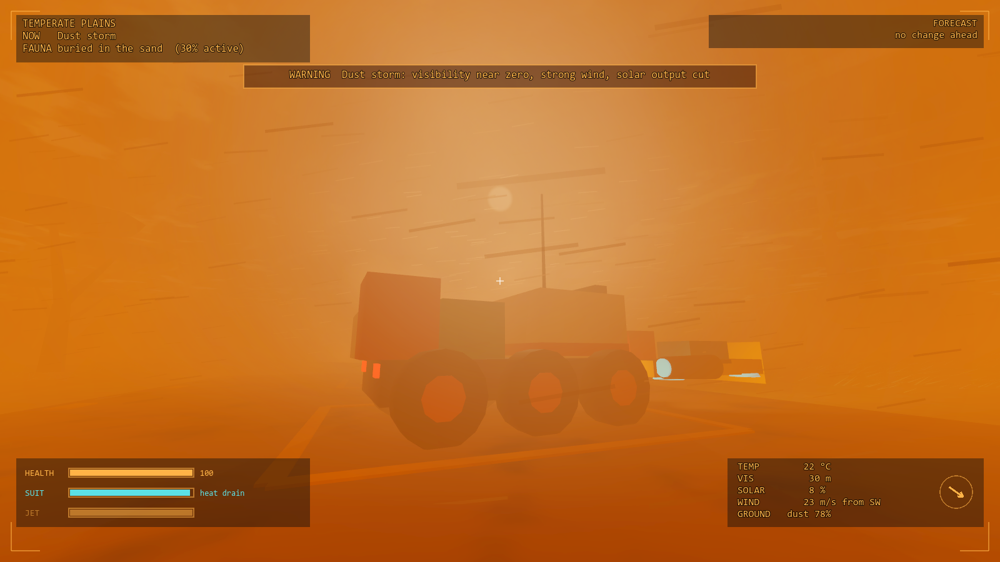
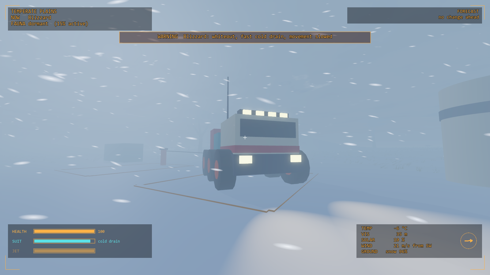
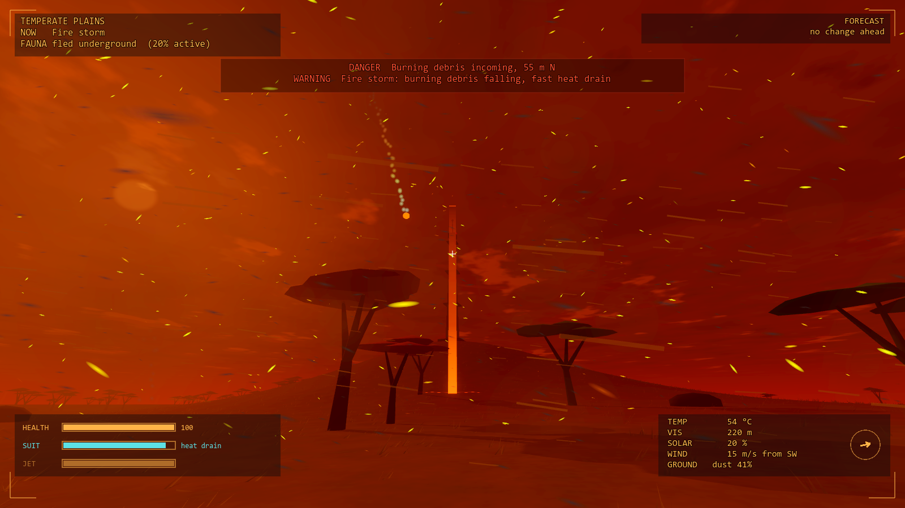

# Prototype: weather and wind

Proves that GalHack's weather can be a strong sense of place and a real force in play, while staying cheap, deterministic and fair: forecast before it arrives, warned when it's dangerous, and never a silent killer.







## What it proves

- **A pure, deterministic weather model.** `src/Model` is plain C# with no scene nodes. Weather states and planet archetypes are data (`data/weather.json`, with a schema). The timeline is generated from a seed and always known well ahead, so a forecast is just a look at segments that haven't started yet. Conditions at any moment are a pure function of the timeline: a smoothstep blend from one weather to the next, stretched so no parameter ever changes faster than its data-defined rate. Hazards (lightning, falling debris, tornadoes) draw from a second random stream, so where the player walks never changes what weather comes next.
- **Weather that matters.** Each state sets temperature, visibility, solar output, wind, movement speed, suit exposure and a creature-activity hint. Rain leaves the ground wet, snow settles and melts, dust storms leave a coat of dust.
- **Lightning with a visible build-up.** A strike charges for 4 s, glowing and crackling on whatever is highest within 70 m (the spire, a tree, an exposed vehicle, or you if you're up on your jetpack), then strikes it. Get low and the strike goes elsewhere.
- **Tornadoes that lift and fling, but never kill.** A funnel lowers out of the cloud base for 14 s before touchdown, roars from about 700 m, and drags the wind round toward it before it can catch you. Inside, a caught body is carried up and around, then let go. The fall that follows a fling can't take the player below 15% health; that floor belongs to the tornado, and an ordinary fall has no such cap. Below 25% health a short last stand cuts damage.
- **One small force module.** `src/Forces` applies wind (plain drag, ½ρ·CdA·|v|·v) and vortex forces to anything that implements `IForceBody`. It knows nothing about weather; `src/Glue.cs` is the only place the two meet. Acceleration is force over mass, so the 280 kg skiff strains at its mooring line while the 6.5 t rover doesn't move.
- **Cheap.** A weather tick costs about 3 µs and a force tick about 1 µs per body. Particles stay under 3,300 in the worst weather (a 5,000 budget). There's no fluid or cloud simulation, no volumetric fog (the Mobile renderer has none): just depth and height fog, a sky shader with two cloud layers, and camera-following particle boxes. Everything allocates nothing per tick.

Everything is generated in code or in shaders: terrain, foliage, vehicles, textures and even the sound (wind, rain, the tornado's roar, thunder and visor alerts are synthesised from filtered noise). There are no third-party assets.

## Play it

From the repo root, in PowerShell:

```powershell
.\tools\godot.ps1 -Project prototypes/weather -Play
```

You start on a landing pad on temperate plains, with a light hover vessel moored beside a heavy block-built rover and a lone weather mast on the hill to the north. The weather cycles by itself; watch the forecast in the top right.

| Key | Action |
| --- | --- |
| WASD, mouse | Walk and look |
| Shift | Sprint |
| Space | Jump; hold in the air for the jetpack (soften a fling's landing) |
| Ctrl (hold) | Crouch: you can't stand up under something low, and you catch less wind |
| 1 to 9 | Force a weather: clouds, rain (again for monsoon), fog, snow (again for blizzard), dust storm, lightning storm, fire storm, hurricane, tornado storm |
| 0 | Clear skies |
| T | A tornado forms 260 m ahead of where you're looking and comes for you |
| B | Move to the next planet archetype (temperate, swamp, ocean, ice, arid, storm, lava) |
| R | Re-moor the vehicles on the pad |
| V | Third person |
| F1 | Hide the key help |
| Esc | Free the mouse |

Forced weather still blends in smoothly from whatever the sky is doing, but it arrives without a forecast; the warning goes up at once.

## Test it

```powershell
.\tools\test.ps1 -Project prototypes/weather -Scene res://tests/WeatherTest.tscn
```

Runs `tests/WeatherTest.tscn` headless and exits 0 or 1. It checks that:

- the same seed gives the same timeline, conditions and hazards over two hours, and another seed doesn't
- every forecast appears at least its lead time ahead, and every severe weather is warned first (7 planets × 3 hours)
- wind acceleration is exactly inverse to mass, and the hover vessel drifts at least 5× further than the rover
- a body at a tornado's base is caught, rises, orbits and is let go; the rover is lifted far less
- a tornado is never silent: the visor warns, the funnel shows, the roar is audible and the wind swings round, each well before it arrives
- a fling and its landing never take you below the floor, from full, low or very low health, while the same fall without a fling can kill
- the last stand opens below 25%, cuts damage and closes again
- lightning strikes only after its build-up, hits the highest point in its radius, and moves to you if you're the highest thing around
- each weather sets its own temperature, visibility, solar output, wind and creature hint
- no parameter changes faster than its max rate, even when weather is forced every 9 s mid-transition
- the tick cost and per-weather particle counts (printed), within budget
- in the real scene on Jolt: a hurricane pushes the skiff and not the rover; a tornado lifts the skiff; the player is caught, carried, thrown and lands alive; the debug keys work

`tests/Screenshot.tscn -- --view=thunder|tornado|dust|blizzard|fire|hurricane|fog|clear --out=file.png` renders a view to a PNG (run it windowed, not headless).

## How it fits together

| Piece | Where | Knows about |
| --- | --- | --- |
| Weather model | `src/Model` | Data only. Plain C#, no nodes |
| Force module | `src/Forces` | `IForceBody` and vortex volumes. Plain C#, no nodes |
| Glue | `src/Glue.cs`, `src/WeatherDirector.cs` | Both, and the scene: steps the model around the player, copies tornadoes into the force module, hands out strikes |
| Presentation | `src/Fx`, `src/Hud.cs`, `shaders/` | Reads the model, never changes it |
| World | `src/World`, `src/Main.cs` | Terrain, foliage, spire, vehicles, player |

## Known limits

- The weather is global with one wind field: no fronts sweeping across a planet, no regional differences. The model already takes an observer position for hazards; regions would be the next step.
- Clouds are a flat noise layer, not volumes, and nothing feeds the orbit view yet (the cloud cover number is there for it).
- Creatures are only a hint (an activity number and a line on the visor); there are no creatures here to obey it.
- Time is compressed: a monsoon's "days of downpour" last six to ten minutes.
- The vehicles can't be driven; they're there to show mass-dependent drift. The rover only feels the tornado's pull by mass share, so it slides and lifts a little but never tumbles.
- Lightning and debris damage can kill (only tornado flings have a floor); you respawn at the pad.
- Particle boxes follow the camera, so rain and snow fall inside closed spaces too. The full game would mask them with shelter volumes.
- Sound is a placeholder synth: functional (every danger is audible) but not final audio.
- Single player.
