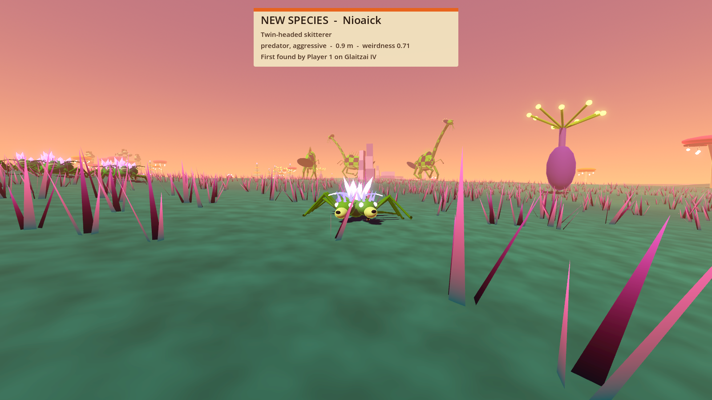
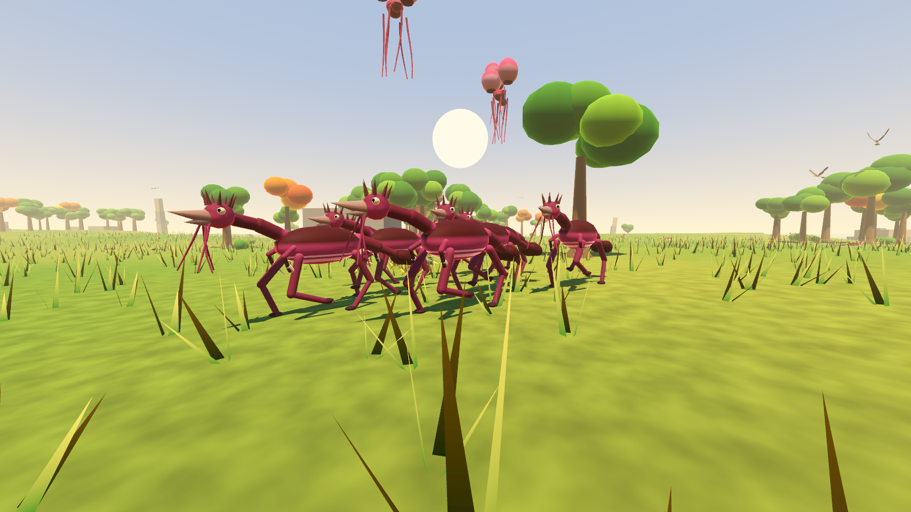

# Prototype: procedural wildlife and the harvester hovercraft

Proves that every planet can roll its own fauna, from near-familiar grazers to properly weird things, on a handful of reliable procedural rigs, cheaply enough for a world full of them on a low-end PC. Also proves the harvester hovercraft: mow through a forest or run down wildlife and watch the hold fill.







## How it works

**The generator** (`src/Core/FaunaGenerator.cs`) is plain C# with no nodes: planet seed + alienness (0 to 1) + Bloom flag in, 6 to 10 species out, identical on every machine. Each species gets:
- a body plan and form (walkers, crawlers and slitherers, hoppers, fliers and floaters, swarms, giants, oddities: 19 forms in all)
- swappable parts (heads, horns, backs, tails, extra limbs, tendrils)
- proportions, palette, skin pattern and glow
- a behaviour plus a temperament
- size, stats and drops
- a name from syllables that each planet narrows to its own flavour

Alienness pulls every roll towards options of matching weirdness, so temperate worlds get near-familiar animals and alien worlds get crystal-backed seven-legged things. The chance of an off-script pairing also rises with alienness: a skittish giant, a herd that hunts. A Bloom world rolls the same local fauna and then corrupts it: same bodies, darker, veined, glowing pink, tendrils sprouting, angrier.

All tunables live in `data/wildlife.json` (shape in `src/Core/WildlifeData.cs`): forms, parts, patterns, behaviours, temperaments, palettes, syllables, combat, harvesting and the clock.

**Rigs** (`src/Rigs`). Six rigs carry every body plan; variety comes from parts and proportions, not new animation:

| Rig | Used by | Animation |
| --- | --- | --- |
| Legged | walkers, giants, walking plants, crystal grazers | IK foot stepping with a diagonal gait for 2 to 8 legs, the body sagging onto planted feet; FK necks, tails, tendrils, extra limbs |
| Chain | crawlers, slitherers, burrowers | follow-the-leader segments, a travelling wave, rowing legs, sinking to burrow, cobra rear |
| Hopper | hoppers, living boulders | spring hops with squash and stretch, inflating throat sacs; boulders tumble a quarter turn per hop |
| Winged | fliers | flapping with the outer panel lagging, gliding, banking, folding wings to land and eat |
| Gas bag | floaters | breathing bags, a bobbing drift on the wind, trailing tendrils |
| Swarm | insect clouds, skitter packs | boids round one shared brain and health pool |

Each rig is pure C# that writes a world transform per rigid piece. `src/View` builds one shared low-poly mesh per piece (vertex colours, procedural pattern and glow in `shaders/creature.gdshader`) and copies poses on. Distant creatures re-pose every 2, 4 or 12 frames and the farthest are hidden.

**Behaviour** (`src/Sim/Brain.cs`) covers:
- grazing and wandering, and herds (boids with a shared goal and a shared alarm)
- predators that stalk crouched, then chase
- ambushers that stay buried or curled by day and strike at night
- scavengers that find corpses, and swarms
- territorial giants that rear and roar before they charge
- oddities: walking plants root by day, living boulders only move while you're not looking, others trail you curiously

Movement is simple steering over the height-function terrain. It goes straight at the goal when a line test on a 3 m nav grid is clear, otherwise along a bounded A* path. Felled trees free their cells, and regrown trees block them again.

**Combat fairness comes from warning, not damage reduction.** Every attack is wind-up, lunge, recover (`src/Sim/Attacks.cs`):
- A creature's first attack on a player always uses its telegraph: a long wind-up per behaviour from data (0.9 to 1.8 s), with the creature rearing and a growl, hiss, buzz or roar that swells until the lunge.
- Part way through the wind-up it commits to where you stood. The lunge flies at that spot, so stepping aside dodges it.
- Later attacks use the short normal wind-up. A creature that hasn't attacked you for 20 s must telegraph again.
- Damage is never capped. There is no last stand.
- No creature is ranged yet, so the warning-shot rule for ranged attackers has nothing to apply to.

**Harvesting** (`src/Core/Harvest.cs`):
- The blades are a box on the front of the vessel. Plants in it pay out wood and plant matter as they are chipped, and creatures in it are chewed and their meat (and the odd rare part) goes straight into storage.
- Storage is one shared inventory with a capacity, and nothing harvested is ever thrown away. The blades only bite into a plant or creature whose whole remaining yield fits in the hold; otherwise they idle and the vessel shoves it aside.
- Felled plants regrow on a timer, but only while no player is within 70 m.
- Killing something on foot leaves a corpse: E butchers it into your pack, which empties into the hold when you board. Scavengers eat whatever you leave.

**Discovery.** Get a good look at a species and the codex names it and records who found it first. The card is a deliberately minimal placeholder for the diegetic UI.

All sounds are synthesised at start-up (`src/Game/ProceduralAudio.cs`). The prototype uses no third-party assets.

## Play it

From the repo root, in PowerShell:

```powershell
.\tools\godot.ps1 -Project prototypes/wildlife -Play
```

| Key | Action |
| --- | --- |
| WASD, mouse | Walk and look; drive and orbit the camera in the hovercraft |
| Shift | Sprint, or boost the hovercraft |
| Space | Jump |
| Ctrl (hold) | Crouch: creatures find you less alarming |
| Left mouse | Fire the blaster |
| E | Butcher a kill into your pack |
| F | Board or leave the harvester hovercraft (parked to your right at the start) |
| 1 / 2 / 3 | Switch the planet: temperate, alien, Bloom-infested (new fauna and forest) |
| N | Skip a quarter day (ambushers strike at night, walking plants wander) |
| Esc | Free the mouse |

You start on the alien world with a herd on the plain ahead and a grove to the left to drive the harvester into.

## Test it

```powershell
.\tools\test.ps1 -Project prototypes/wildlife -Scene res://tests/WildlifeTest.tscn
```

Runs headless and exits 0 or 1. It checks:
- **Generator:** the same seed gives the same species, and a different one doesn't. Every planet rolls 6 to 10 species, with at least 4 body plans in 8 and no two identical part sets (120 planets). Weirdness rises with alienness. Bloom species are marked corrupted and are corrupted versions of the local fauna.
- **Animation:** every species on five planets animates for 60 s, through day, night, hunts and deaths, with no NaNs, bodies in range and nothing flying off. Planted walker feet stay within contact tolerance.
- **Combat:** every attacking species (90 across 12 planets) opens with a wind-up of at least its configured telegraph. It is dodged by stepping aside after the commit, hits a target that stands still, and attacks at the normal rate afterwards.
- **Behaviour:** herds stay together over 60 s, and bolt and regroup when spooked. Ambushers stay hidden by day and strike at night.
- **Harvesting:** a harvested tree adds its wood, is removed, frees the nav grid, and regrows only when no player is near. Running a creature down puts its meat in the hold. The storage cap is enforced, and the blades leave alone anything the hold can't take in full.
- **Codex:** a discovery is recorded once, to the first finder.
- **Performance:** the per-frame cost of 200 creatures plus a swarm is printed, with and without distance LOD.
- **Playable scene:** the real scene, through its input path. Keys 1 to 3 switch worlds, and F, W, F board, drive and leave the hovercraft.

On a Ryzen 7 5800X3D: 200 creatures plus a 76-insect swarm cost about 3.4 ms per frame at full rate, almost all of it rigs. With the distance LOD, and syncing about 5,600 mesh nodes, it's 1.8 ms. A real planet has 60 to 80 creatures about.

Screenshots: `godot --path prototypes/wildlife res://tests/Screenshot.tscn -- --view=herd|predator|bloom|harvester|temperate --out=file.png`, run windowed. Add `--hud` to keep the debug HUD.

## Known limits

- **Rigid pieces, no skinning.** Joints read as overlapping capsules, which suits the chunky look but is not organic. Each piece is a draw call (about 30 per creature on average); a skinned single mesh per creature would be cheaper on the GPU.
- **Animation quality is uneven:**
  - Legged walkers are the best: feet plant and step properly. Very fast turns and lunges can still make a foot slide for a step.
  - Hoppers' spring legs are posed, not planted.
  - Crawler legs row on a sine wave, without ground contact.
  - Tendrils, tails and necks are procedural sway, not physics.
- **Few collisions.** Creatures don't collide with each other (herd members keep apart) or with the player on foot. The hovercraft shoves them aside.
- **Behaviour scope.** Day and night only change ambushers, walking plants and lighting. No creature is ranged, and nothing fights anything else; predators only hunt players.
- **Single player.** The codex finder is always "Player 1"; nothing is networked or saved.
- **Placeholder world.** The terrain is a simple height function, not the planet generator's. Every planet shares the same land shape and forest layout, restyled.
- **Debug JIT optimiser.** The project enables the JIT optimiser in Debug builds (`Wildlife.csproj`), because play-testing from the editor was noticeably slower without it.
