# Prototype: procedural wildlife and the harvester hovercraft

**The code now lives in `shared/Bestiary`**, the one module everything that moves comes from: wildlife, people and machines (`Bestiary.Roll(data, WorldConditions)` gives a world's `WorldLife`). Folder paths below that say `src/Core`, `Rigs`, `Sim`, `Space`, `View`, `Game/ProceduralAudio.cs` or `data/` mean the same folders under `shared/Bestiary`. This prototype is its showroom and runs its tests, including `tests/BestiaryTest.tscn` (bodies fit the world, people, mutation, spit, senses, voices, young, block-breakers, reactions, tempers). The slice stages proof with `--view=folk`, `--view=crowd` and `--view=fauna`.

Proves that every planet can roll its own fauna on a handful of reliable procedural rigs, from near-familiar grazers to properly weird things, and that they come out looking like animals rather than accidents. It also covers:
- herds and hunting packs
- telegraphed, dodgeable attacks
- a brief discovery card the first time a species is met
- no wildlife spawning near bases, and fauna that respawns
- rare space fauna: drifting grazers in nebulae, rays in asteroid fields, mantas in gas giants' skies, leeches on derelicts and, very rarely, a void leviathan
- the harvester hovercraft: mow through a forest or run down wildlife and watch the hold fill
- day and night: every species keeps its hours (by day, by night, at dawn and dusk) and rests in dens, burrows, roosts and nests the rest of the time
- caves, tunnels and places (POIs): crawlers that hold walls and ceilings and drop onto prey, lurkers, prowlers, ambushers in vents, on ceilings and behind doors, nests that get worse with depth, subsisters grazing moss and scraps, and the food chain between them; derelict ships' nesters; every ambush gives itself away first
- mutagenic worlds: growths, asymmetry and the odd extra part, at a strength from 0 to 1
- settlements: wildlife keeps out of towns, preys on townsfolk outside them, and towns keep their own stock, working beasts and pets
- an underground showroom to walk through all of it

All of it runs cheaply enough for a world full of creatures on a low-end PC.

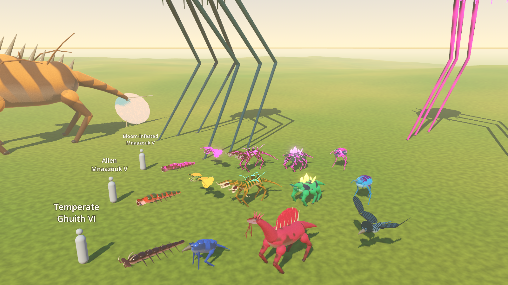
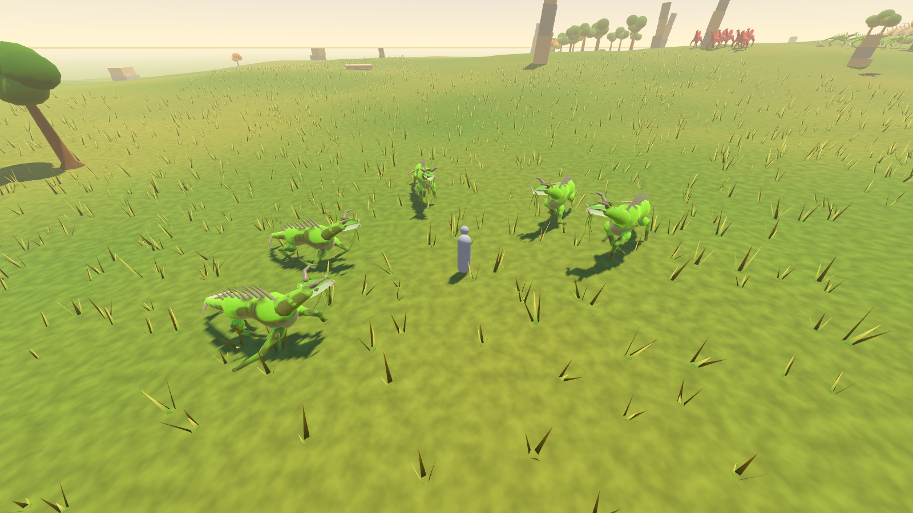
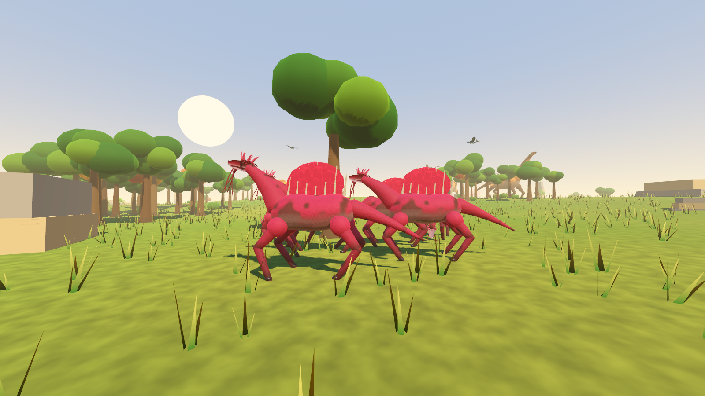
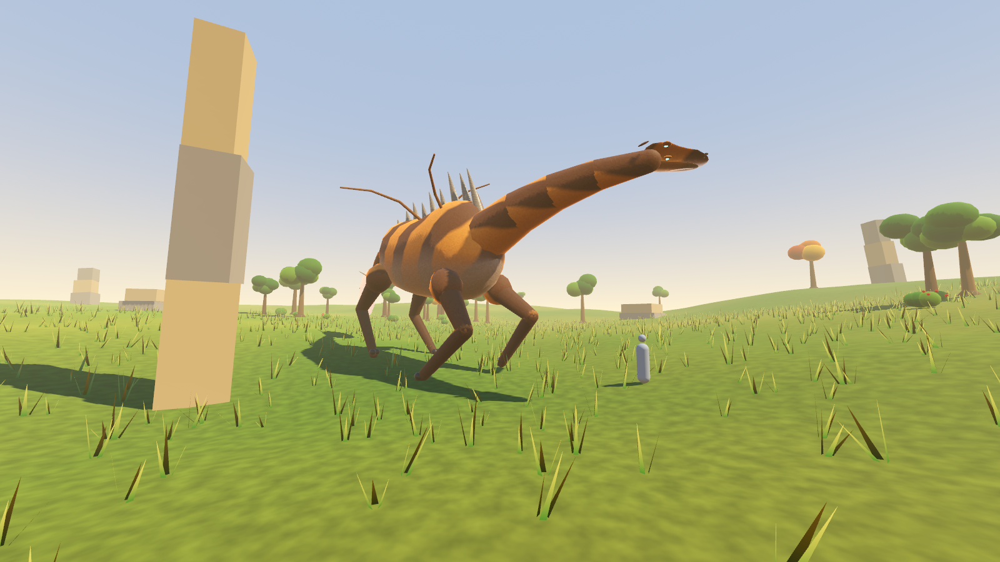
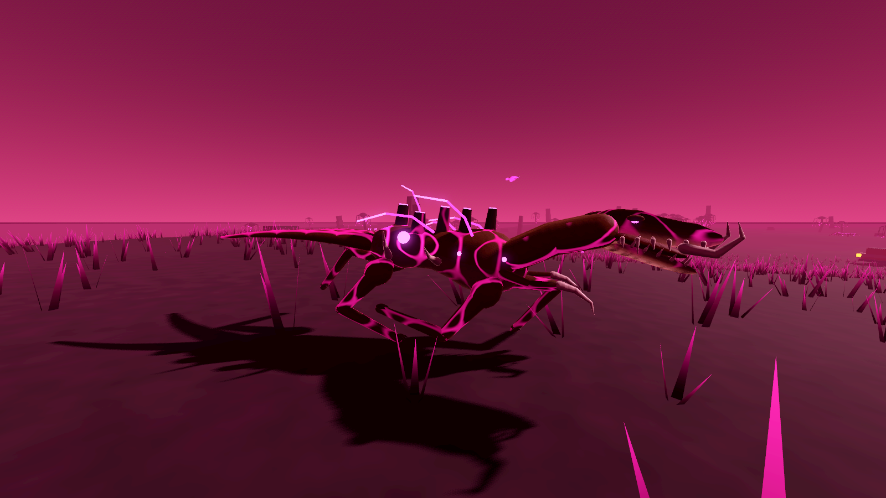
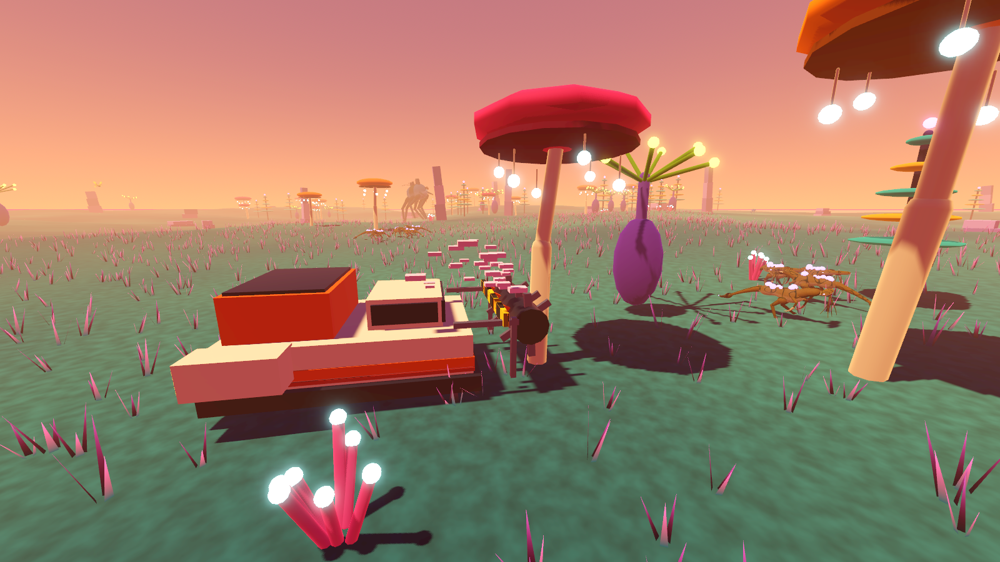
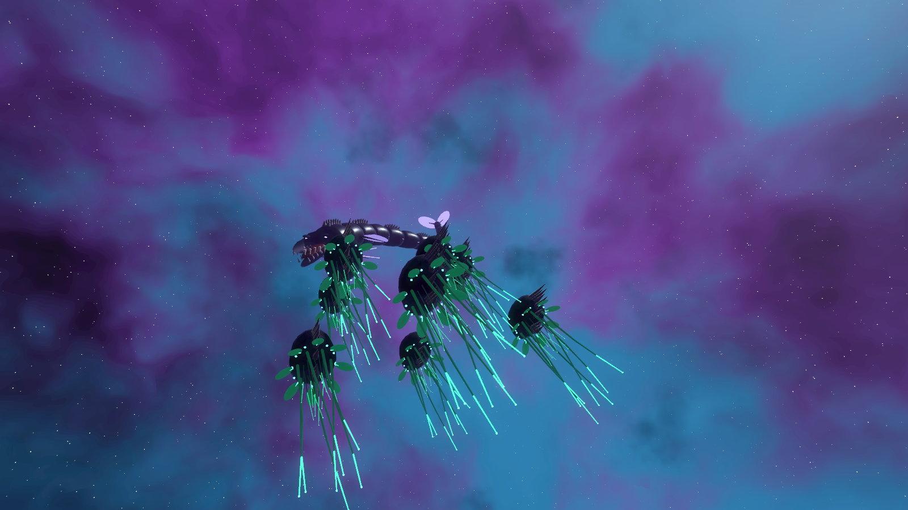
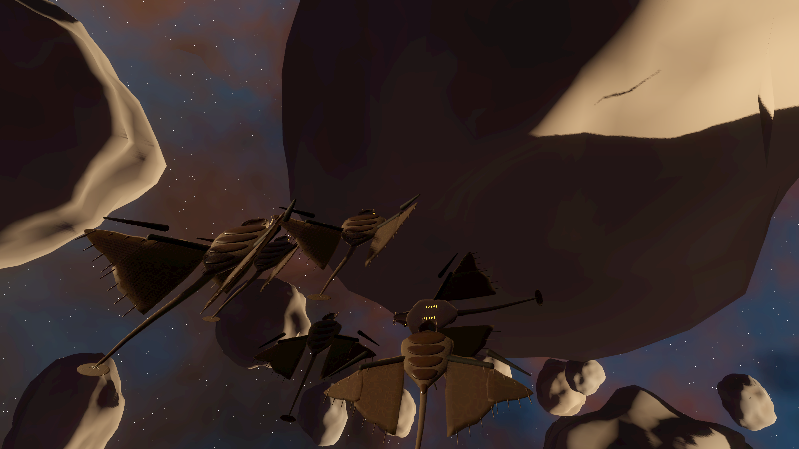
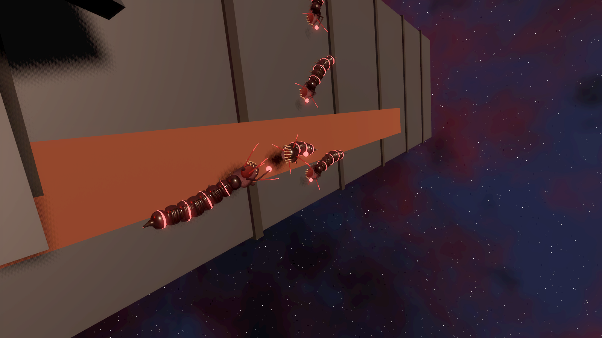
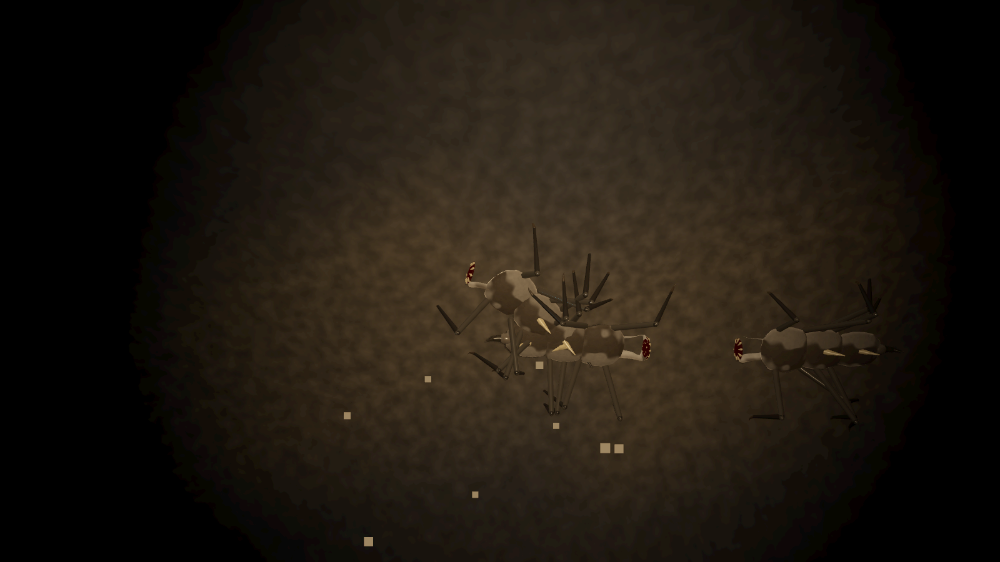
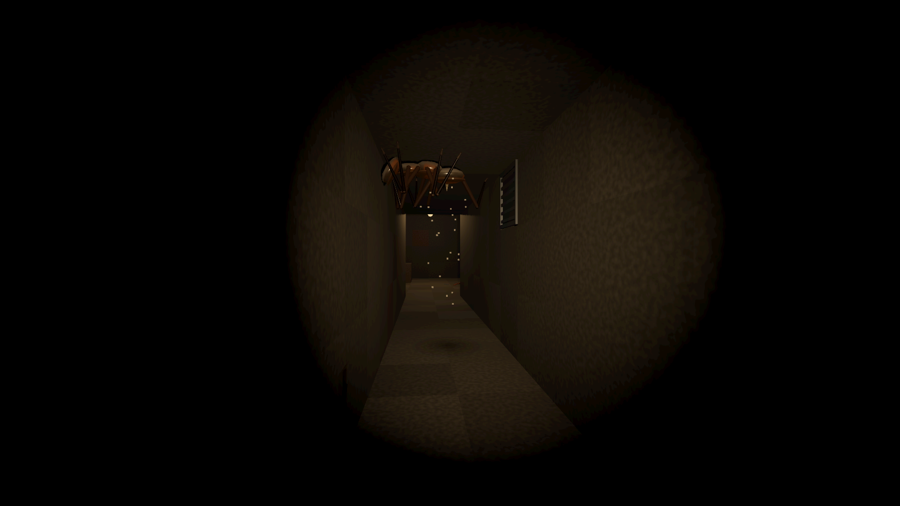
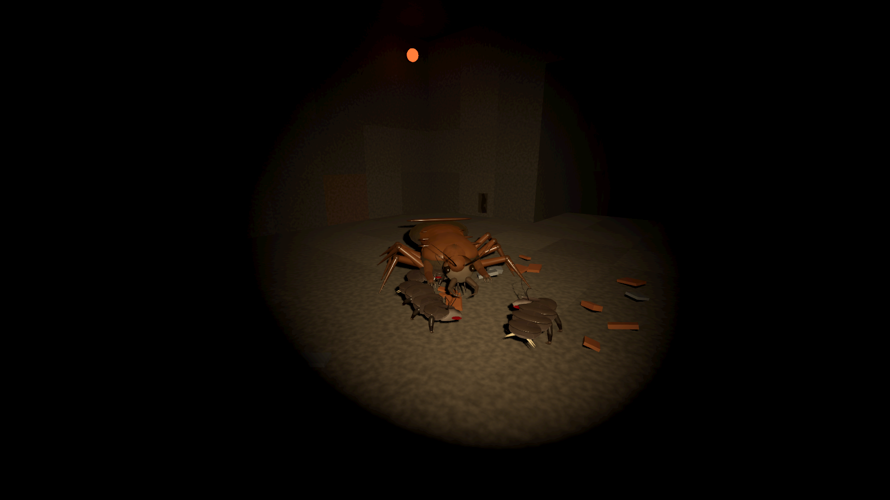
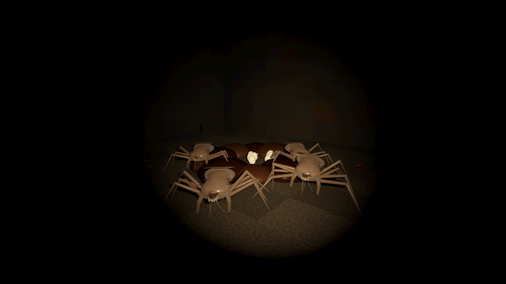
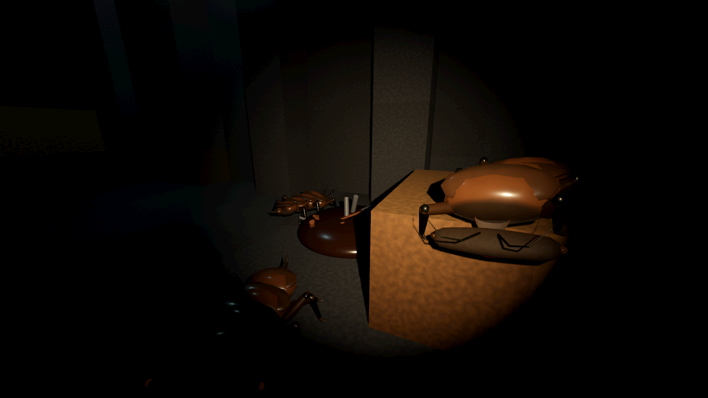
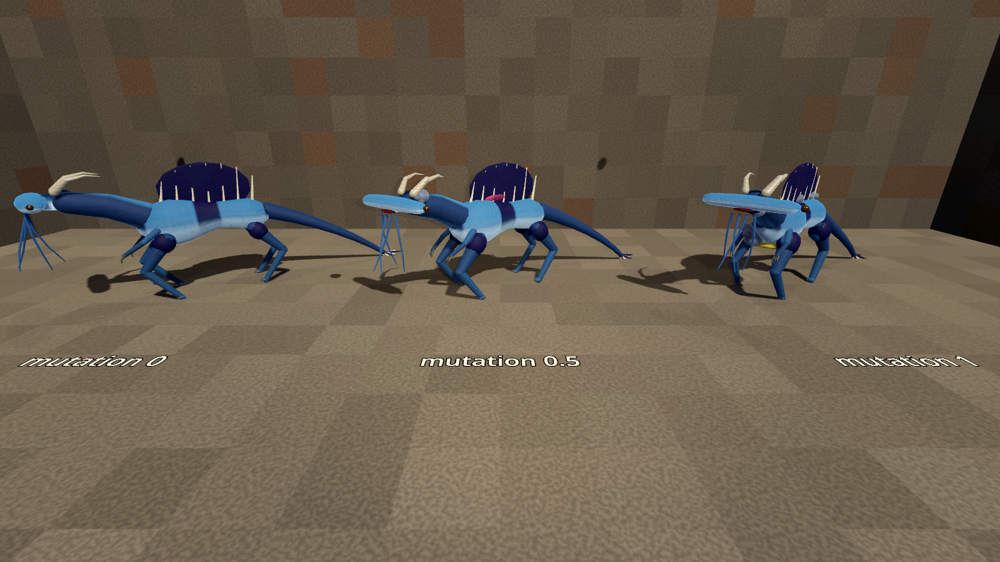
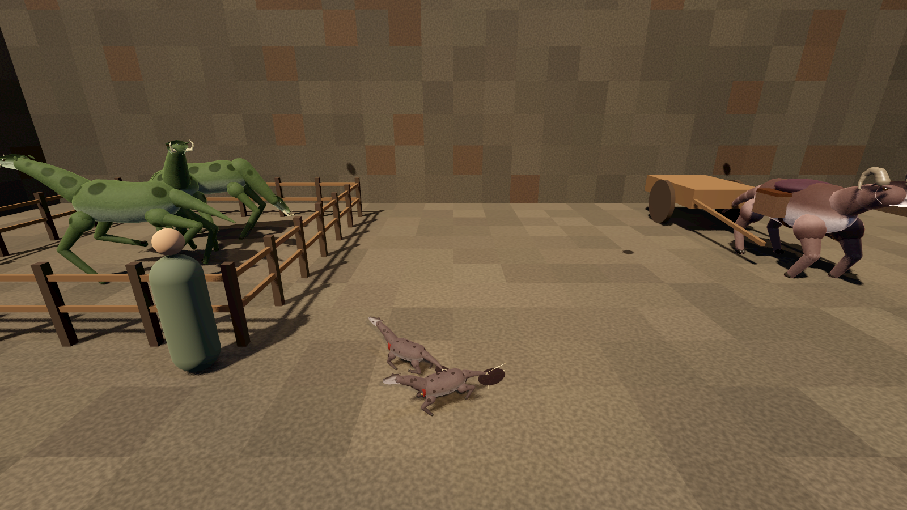

## How it works

**The generator** (`src/Core/FaunaGenerator.cs`) is plain C# with no nodes. Its inputs are the planet seed, alienness (0 to 1) and a Bloom flag; its output is 6 to 10 species, identical on every machine. Each species gets:
- a body plan and form (walkers, crawlers and slitherers, leapers, fliers and floaters, swarms, giants, oddities: 20 forms in all)
- a behaviour and a temperament, rolled first so the body is built for the job
- swappable parts (heads, horns, backs, tails, extra limbs, tendrils)
- proportions, palette, skin pattern and glow
- a signature attack, size, stats and drops
- a name from syllables that each planet narrows to its own flavour

Alienness pulls every roll towards options of matching weirdness, so temperate worlds get near-familiar animals and alien worlds get crystal-backed, lamprey-mouthed things. The chance of an off-script pairing also rises with alienness: a skittish giant, a herd that hunts. A Bloom world rolls the same local fauna and then corrupts it: same bodies, darker, veined, glowing pink, tendrils sprouting, angrier.

**Keeping it cool, not broken.** Infinite variety is fine; silly combinations are not. The rules are mostly data (`data/wildlife.json`), and `FaunaQuality` checks them:
- **Roles:** parts carry the behaviours they suit. Hunters get jaws, beaks, maws and claws, never a grazer's snout. Antlers, ram horns and hooves go on grazers. Scythes and stingers go on hunters.
- **Forms:** some parts only go on some bodies. Insect heads, antennae and feelers only go on arthropod forms (skitterers, crawlers, leapers, swarms), never on a mammal-like strider.
- **Excludes and requires:** pairs that clash can't be assembled, whichever is rolled first. Examples: horns on a lamprey mouth, tusks under a beak, antennae without an insect head, feelers on top of antennae, back tendrils through a shell.
- **Proportions:** alien worlds may push a form's ranges only slightly. Heads stay inside a band so nothing reads as a baby animal, and legs, necks and tails have upper limits. Stilts may be long on a small body, but a giant's stilts never outreach 1.2 times its body length. Giants also get thick, knee-capped stilts under a heavy hull, not poles under a pebble.
- **Gone for good:**
  - odd leg counts, except the tripod form, which is built round three legs
  - checkerboard skins, which read as a missing texture
  - eye-stalks, pom-pom and disc tails, frog throat sacs and big pale cartoon eyes

**Meshes** (`src/Rigs/Shapes.cs`, `Parts.cs`, `src/View/MeshBuilder.cs`) go beyond overlapping capsules:
- **Lofted bodies:** elliptical sections along the body, shaped by job:
  - grazers are deep-bellied barrels
  - hunters are deep-chested with a tucked waist
  - giants carry a shoulder hump
  - skitterers have a front body and a swollen abdomen joined at a waist
  - leapers are hunched
  - floaters are long bladders with a crest, not balloons
- **Lofted heads:** a cranium, a brow, a hinged lower jaw, rows of teeth, and small deep-set eyes (glowing species get slit eyes).
- **Sphere-swept tapers** for legs, necks, tails, horns, claws and teeth. Joints share radii, so knees and neck bends meet without a seam at any angle.
- **One material per species**, with each surface's kind baked into the mesh (`shaders/creature.gdshader`):
  - pebbled hide with a fine bump
  - glossy horn with growth rings
  - clear-coated shell
  - thin wing and bag membrane lit from behind
  - wet eyes with a glint

  Undersides darken as if shadowed by the body.

**Rigs** (`src/Rigs`). Six rigs carry every body plan; variety comes from parts and proportions, not new animation:

| Rig | Used by | Animation |
| --- | --- | --- |
| Legged | walkers, giants, walking plants, crystal grazers | IK foot stepping with a diagonal gait for 2 to 8 legs, the body sagging onto planted feet; FK necks, tails, tendrils, extra limbs |
| Chain | crawlers, slitherers, burrowers | follow-the-leader segments, a travelling wave, rowing legs, sinking to burrow, cobra rear, mantis scythes |
| Hopper | leapers, living boulders | spring hops with squash and stretch; boulders tumble a quarter turn per hop |
| Winged | fliers | flapping with the outer panel lagging, wings held out on a glide and swept back in a dive, rolling into turns, folding wings to land; on a hoverer, an upright body under a blur of wings |
| Gas bag | floaters | breathing bladders, a bobbing drift on the wind, trailing stinging tendrils |
| Swarm | insect clouds, skitter packs | boids round one shared brain and health pool |

Each rig is pure C# that writes a world transform per rigid piece. `src/View` builds one shared mesh per piece and copies poses on. Distant creatures re-pose every 2, 4 or 12 frames, and the farthest are hidden.

**Behaviour** (`src/Sim/Brain.cs`) covers:
- **Grazing and wandering, and herds:** boids with a shared goal and a shared alarm. Spooked herds bolt together and regroup.
- **Pack hunters:** 3 to 6 that roam behind a leader and share one prey. See below.
- **Lone predators:** stalk crouched, then chase.
- **Ambushers:** stay buried or curled by day and strike at night.
- **Scavengers** find corpses, and **swarms** hunt as one cloud.
- **Territorial giants:** rear and roar before they charge.
- **Oddities:** walking plants root by day, living boulders only move while you're not looking, others trail you curiously.

Movement is simple steering over the terrain. It goes straight at the goal when a line test on a 3 m nav grid is clear, otherwise along a bounded A* path. Felled trees free their cells, and regrown trees block them again.

**Pack hunters.** A planet's second species is a pack 60% of the time (otherwise a lone predator); packs can also roll later. They appear on 71 of 100 test planets. Packs are only ever ground walkers, never giants. A pack:
1. **Roams** in a wedge behind its leader.
2. **Stalks** together, crouched, once any member spots prey.
3. **Surrounds** the prey inside 20 m. The member nearest the side they came from holds the front. The others take the flanks at ±110°, then the rear quarters, then behind, circling round the ring rather than across it.
4. **Engages.** The front member feints: it darts in snarling and backs off without biting. Meanwhile the flankers close from their own sides and attack in turn.
5. **Retreats** together when the leader dies or half the pack is hurt, then regroups somewhere else before hunting again.

**Signature attacks and fairness.** Each behaviour has a signature attack in data: a name, a style, its telegraph, its reach and lunge time, and its wind-up sound. Each rig adapts it to the body. Every attack is wind-up, lunge, recover (`src/Sim/Attacks.cs`).

| Behaviour | Attack | Wind-up | Telegraph | Sound |
| --- | --- | --- | --- | --- |
| Herd | Stampede charge | head down, pawing the ground | 1.2 s | bellow |
| Grazer | Head butt | head down | 1.0 s | bellow |
| Predator | Pounce | crouched low and coiled | 1.1 s | growl |
| Pack hunter | Flank bite | rears back | 1.0 s | snarl |
| Ambusher | Eruption | bursts up out of hiding | 0.9 s | hiss |
| Scavenger | Snap | rears back | 1.0 s | chitter |
| Swarm | Sting cloud | cloud pulls in tight | 1.0 s | buzz |
| Territorial giant | Trample | rears right up | 1.8 s | roar |

Rig adaptations: gliders turn their attack into a swoop, hoverers into a dart and a sting, crawlers coil and strike like a snake, leapers leap, and floaters lash with their tendrils.

**How flyers fly** (`src/Sim/Flight.cs`, numbers in `Heft`). Every winged species is one of two kinds, decided by its body (`Species.Flight`): up to 0.55 m long it is a hoverer, past that a glider. Gas bags and swarm clouds are neither and drift as they always did.

- **Gliders** are always flying forward along their heading. They never fall below a stall speed that grows with their size, turn only by banking, round a radius that grows with size and weight, flap to climb and to gain speed, and glide the rest. They land on a gliding approach with a flare and a short run-out, refusing rock, trees, water and a steep slope, and take off with a run. The brain's `Desired` is only where they would like to go.
- **Swoops** (`Swoop`) are the ordinary wind-up, commit and strike, on the wing. A glider comes in at height, lines up, gives its tell in flight, commits to where you stand, stoops down the line with its wings back, strikes in passing over your head, climbs away and comes round. Everything scales with the body, so a big one comes slower, from further out, and swings wider.
- **Hoverers** (the darter form) stay small, light and upright, with wings too fast to see drawn as a blur that never stops while they are up, and a hum. Only they may stop, hold, back up and dart. They sting from the hover.
- **Looking ahead:** near a player, flyers cast a few rays through `WildSim.SightLine` (about 15 a second each), bank away from walls, and break off a dive that has something in its way. The ground is handled by height, not by rays. No place or cave role uses a winged form, so no flyer is put in a room it can't turn in.

The rules that keep it fair:
- **Senses** (`src/Sim/Senses.cs`): sight needs range, a cone and a clear line through the ground and the world's own collision; hearing is shorter, works all round, depends on how much noise you make and barely passes a wall; the blind have only hearing. An awareness meter fills while something is sensed and it only notices at the top, then holds on to where it last knew you for 5 s. Brains run on a staggered 0.2 to 0.5 s timer with the target scan inside, and paths are followed between thinks.
- **Weight** (`src/Sim/Heft.cs`): acceleration, braking and turning go by body size. Bodies go where they face, so a big one swings wide and overshoots.
- **Reach:** a body stops so its jaws meet your skin, however long its neck, and nothing passes through you (`Locomotion.KeepOff`). A lunge from your blind side swings round to land in front of you.
- **First attack:** a creature's first attack on a player always uses the full telegraph, with its pose and its sound swelling until the lunge.
- **Commit:** part way through the wind-up the creature commits to where you stood. The lunge flies at that spot, so stepping aside dodges it.
- **Later attacks** use the short normal wind-up. A creature that hasn't attacked you for 20 s must telegraph again.
- **Packs take turns:**
  - only one member winds up at a time
  - each commit comes at least a full telegraph after the last
  - so several lunges never land on you at once without warning
- **Damage** is never capped or reduced. There is no last stand. No creature is ranged yet.

**Discovery card.** The first time anyone gets a good look at a species (close by, or near the middle of the view), a brief card names it: its name, what it looks like, its form, behaviour and size, the planet, and who found it first. A short synthesised chime, two soft rising bell notes, plays with it. The codex records the first finder; later sightings, by anyone, bring up nothing. The card is built never to get in the way:
- It slides in at the top of the screen, holds for 3.6 s and fades: about 4.4 s in all. Several new species queue up and show one at a time.
- Nothing on the HUD takes the mouse or keyboard focus, so clicks and keys go straight to the game while it is up.
- It never shows while a creature is winding up or lunging at you, or while you are down. A card already up vanishes the moment an attack starts and slides back in a second after it is over, for the rest of its time.

Holding Q on a creature still scans it at any time: name, form, behaviour, temperament, size, distance, signature attack and damage, and who found it first.

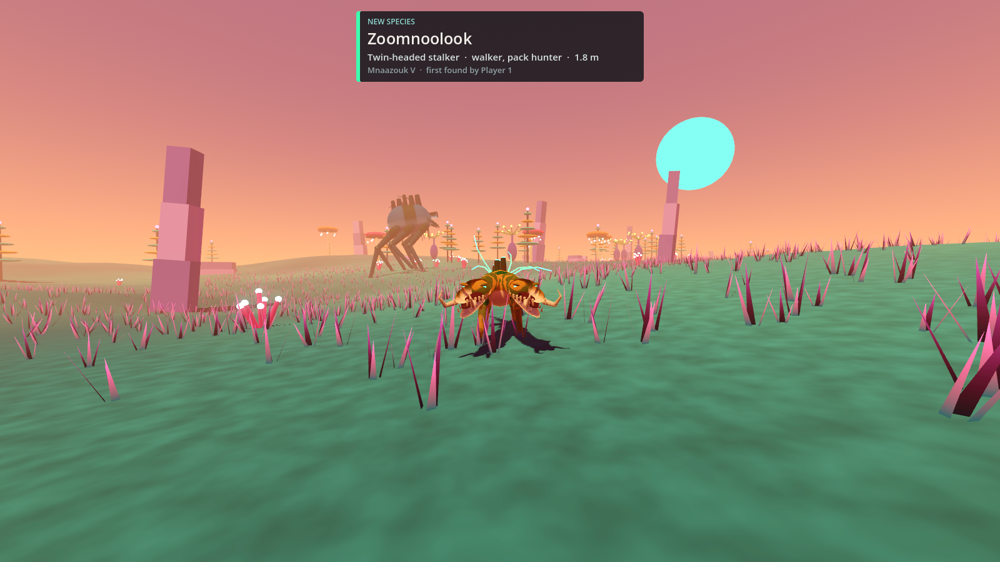

**Harvesting** (`src/Core/Harvest.cs`):
- The blades are a box on the front of the vessel. Plants in it pay out wood and plant matter as they are chipped, and creatures in it are chewed and their meat (and the odd rare part) goes straight into storage.
- Storage is one shared inventory with a capacity, and nothing harvested is ever thrown away. The blades only bite into a plant or creature whose whole remaining yield fits in the hold; otherwise they idle and the vessel shoves it aside.
- Felled plants regrow on a timer, but only while no player is within 70 m.
- Every tree has a trunk: a cylinder collider from the ground to where its crown starts, which the player and the gun's rays hit, and a nav-grid obstacle the same size, which creatures and the hovercraft keep off. The hovercraft is held off any tree it isn't cutting. Felling a tree drops both at once; a regrown tree gets them back.
- Killing something on foot leaves a corpse: E butchers it into your pack, which empties into the hold when you board. Scavengers eat whatever you leave.

**Spawning, respawning and bases** (`src/Sim/Spawner.cs`, `src/Core/Structures.cs`). The spawner puts each species where its behaviour belongs at the start: herds on the plain, giants far off, ambushers by the groves, hunters out in the hills. Every 5 s it counts heads. A species that has fallen short through kills, harvests or scavenged corpses gets a group back 90 s later.
- **No spawning near bases.** No creature spawns or respawns within **80 m** of any base, measured from the structure's footprint edge, so a big base keeps a bigger zone. A base is a structure whose core is in base mode; a capital-mode structure (a ship) blocks nothing. A group is only placed where its whole spread stays outside every zone, and any member whose spot still lands inside one is left out.
- **Why 80 m.** It is past the longest perception any creature rolls (67 m: a giant scavenger, over 200 test planets), so nothing new appears already close enough to notice you at home. The radius is `spawning.baseClearance` in `data/wildlife.json`.
- **Only spawning is blocked.** Creatures already outside may wander in, and a creature with a reason to come (you shot at it from the base) comes all the way. Nothing in the zone pushes wildlife out, and the zone doesn't touch anything else that attacks bases: invasions are their own system.
- **Respawns stay out of sight.** They also land at least 90 m from every player and outside the view cone of anyone within 220 m. Nothing comes back round someone who has stayed within 30 m of one spot for a minute, and a colony's cracks stay shut while a player is within 25 m or can see them.
- **Thinned by the world.** `spawning.density` keeps half of a species' natural groups at most, and the slice scales that by how livable the world is (`wildlife.livable` in its data: temperate 1, alien 0.6, arid 0.35, ice 0.3, lava 0.08).
- **The playable outpost.** The planet has a small outpost of placeholder blocks with a cyan core in base mode, about 90 m behind you and to the right at the start. The status line says when you are inside its zone.

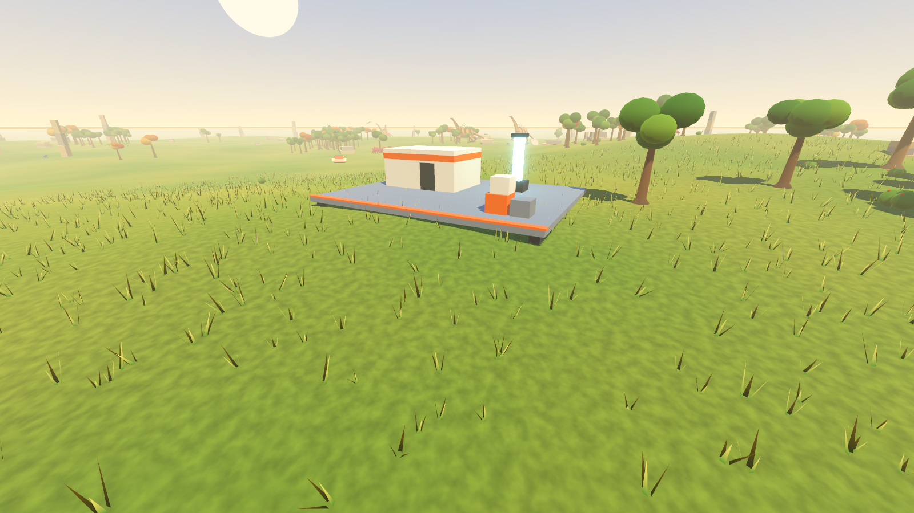

Empyrion was a reference here. Its forums have players finding creatures spawning inside and under their bases ([Fixed Bugs: spawning inside of bases](https://empyriononline.com/goto/post?id=292759)), which is exactly what this rule rules out. Creature spawns there are capped per type and come back on a respawn delay after a kill ([Mob spawning issue](https://empyriononline.com/posts/153842/)), which the respawn timer follows. Nothing was copied; the radius and its rules are GalHack's own.

**Space fauna** (`src/Space`, `data/space_fauna.json`, rigs in `src/Rigs/SwimRig.cs` and `ClingRig.cs`). Space has its own rare creatures, built the way planet wildlife is. The generator (`SpaceFaunaGenerator`) rolls, for each habitat of a region, one species of every kind that lives there:
- a form gives the body plan, rig, job and size ranges
- swappable parts go on by the same combination rules as on planets (roles, forms, excludes): heads, fins, backs, tails and tendrils
- then come proportions, a palette of dark hides lit by their own glow, stats, a signature attack and a drop table

The same region always rolls the same creatures. The five kinds:

| Kind | Lives in | Body and movement | Behaviour | Signature attack | Drops |
| --- | --- | --- | --- | --- | --- |
| Veil drifter, 3.5 to 7 m | nebulae | a bell that pulses like a jellyfish, veil lobes sweeping back on each beat, streamers and filaments trailing | shoals of 5 to 9 grazers; skittish, scatter together | Stinging veil, 1.3 s telegraph | fold crystal (rare, always), voidglass (exotic, 12%) |
| Rock ray, 2.5 to 5 m | asteroid fields | flat armoured body, broad swept wings flapping slowly, a whip or fluke tail | shoals of 3 to 6 grazing beside the rocks; bold ones ram whatever crowds them | Ram, 1.2 s | starsilver (rare), rimefire (exotic, 10%) |
| Sky manta, 14 to 28 m | gas giants' upper atmospheres | wings over 30 m across, long glides between beats | calm shoals of 2 to 4 | Wing slam, 1.6 s | emberite (rare), stormcore (exotic, 45%) |
| Hull leech, 1.6 to 3.2 m | derelict wrecks | a ringed body that crawls flat on the hull, humping as it goes; it swims back after a strike | an ambusher: it freezes and watches anything near, rears off the hull and strikes within reach, then latches on again | Latching strike, 1.1 s | starsilver (rare), lattice cores (unique, 4%) |
| Void leviathan, 70 to 120 m, very rare | the void and nebulae | a segmented serpent swimming by a wave down its body, pectoral paddles beating | territorial: it warns an intruder off with a rearing display, then charges anyone who stays | Engulfing lunge, 2.6 s, 140 damage | fold crystal and voidglass (always), echo shards (unique, 20%) |

How they work:
- **Drops.** Space creatures drop only rare and better materials from the design's rarity ladder: always something rare or exotic, unique only sometimes (the data refuses a unique chance over 25%, or anything common).
- **Zero-g rigs.** The two rigs pose from the creature's full orientation, not a yaw over ground. Swimmers (`SwimRig`) pulse, flap or undulate; clingers (`ClingRig`) lie on the hull face they hold.
- **The space simulation.** `SpaceSim` runs shoals, leeches on a wreck's hull and the leviathan's loop round its home. Creatures slide off rocks and hulls.
- **Fair attacks.** Attacks follow the planet rules exactly: the first is the full telegraph, the creature commits part way and lunges at where you were, sidestepping dodges it, and damage is never capped. A leviathan's 140 can kill outright.
- **How players meet them.** In the game the encounter director brings them: its deck (`prototypes/encounters/data/deck.json`) has a card for each kind, gated by where it lives, with life-sign leads.
- **Space screenshots.** The `space-*` views build a patch of space (`src/Game/SpaceScene.cs`): a procedural nebula sky (`shaders/space_sky.gdshader`), lumpy noise-displaced asteroids and a block-built derelict.

**Day and night** (`src/Core/Activity.cs`, `src/Sim/Rests.cs`, `"activity"` in `data/wildlife.json`). Every species has an activity cycle, rolled from its behaviour's weights on a stream of its own (so nothing else about a planet's fauna changes): **diurnal**, **nocturnal**, **crepuscular** (dawn and dusk) or **cathemeral** (any hour; underground there is no day). Glowing species lean nocturnal. A planet's herd always grazes by day and at least one of its hunters always hunts by night. Outside its hours a creature walks to its rest site and rests there:
- **Dens** (walking hunters) on a slope or against a rock; **burrows** (crawlers, burrowers, small leapers) in flat ground near cover, half dug in; **roosts** (fliers, drifters) on high ground, landed and folded; **nests** (herds bed down together, swarms settle into a hive) on flat ground at a grove's edge. Never in rock, a tree, the sea (where the nav grid marks it) or a base's zone. A herd or a pack shares one site and lies spread round it.
- Each creature's hours shift a little (`stagger`), so a herd doesn't stand up in one second.
- A sleeper wakes for 45 s if a player comes within 7 m (crouch and it is about 4.5 m), if it is hurt, or if its herd takes fright; a woken herd gets up and runs together. A pack mid-hunt or a herd in flight doesn't go to bed.
- It is opt-in per sim (`WildSim.ActivityCycles`): the planet here turns it on; a sim that predates it behaves as before. Natural spawns get rest sites; creatures put down by hand stay awake unless given one (`WildSim.AssignRest`). Ambushers hiding by day and walking plants rooting by day were already their own kind of rest.
- **T** on the planet jumps between noon and midnight: the same valley, other animals out. In the test valley at noon a tendrilled strider herd, two colossi and a swarm are out; at midnight the herd is bedded down and a crowned leaper and a crystal-backed crawler hunt.

Empyrion was a reference: its creatures have separate night speeds (`NightWanderSpeed`, `NightApproachSpeed` in its EClassConfig.ecf) and night-only groups (a `RaptorsNight` group in EGroupsConfig.ecf), so the dark is more dangerous there too. Hours and rest sites are GalHack's own; nothing was copied.

**Caves, tunnels and places** (`src/Sim/SolidSpace.cs`, `Crawl.cs`, `SpaceNav.cs`, `Brain.Deep.cs`, `PoiFauna.cs`, `src/Core/DeepFauna.cs`, `src/Rigs/CrawlRig.cs`, `src/Bridges/VoxelSpace.cs`, `"deep"` in `data/wildlife.json`).
- **Spaces.** A creature with a solid space lives inside it instead of on the terrain's heights. A space is anything with a density (positive in rock) and 1 m solid cells: the voxel terrain (`VoxelSpace` over terrain-digging's `ChunkStore`, the same density the Surface Nets mesh is drawn from, so a crawler holds exactly the rock you see and a hole dug under one drops it) or a place built of blocks (`BlockSpace`: an exact distance to the nearest block, inside corners filleted a little). Both take a whole-metre offset, so a sim can work in its own frame.
- **Crawling.** A climber's body rides a surface held its clearance off the rock, found by Newton steps along the density gradient: it can't sink in. Corners need no special case: walking into a wall pulls the body onto the wall, and the heading is carried over the bend by the smallest rotation taking the old normal to the new one (parallel transport), so "into the wall" becomes "up the wall" and then "along the ceiling". When the way it wants to go points straight out of the surface (an inside corner), it keeps crawling the way it faces, round the corner. Floor walkers (prowlers, lurkers, nesters) walk level over floors instead, up small steps, never off a ledge they couldn't climb back, held off walls by their body's clearance. Anything that lets go (a drop, a leap, a death on a ceiling) falls until it lands on its feet; if a creature ever lost every surface it would be put back where it last stood firmly, and the sim counts it (`Rescues`: zero in every test).
- **Paths.** A bounded A* over 1 m cells: climbers use any open cell touching rock, round any corner; walkers need floor and headroom.
- **The rig** (`CrawlRig`): a chain of segments following the head, each pressed back onto the surface every frame (so the body bends from floor to wall to ceiling with the creature, and nothing trails through rock even in a leap), legs planting on the surface in two alternating sets, knees high. A telegraph lifts the front off the surface; hidden in a crack, nothing is drawn.
- **Cracks** too small to follow: crawlers and subsisters slip into one and travel through the rock to another of its network (scratching as they go, heard where they are), or are gone for good if it leads nowhere. Vents and the dark behind doors are holes of the same kind.

**The deep fauna** (`DeepFauna`). For each role, kind of place and depth band, one species per planet, rolled by the surface generator's own rules (`FaunaGenerator.RollOne`: behaviour first, parts that suit it, proportions that read as an animal) and then themed. Four new deep-only forms: **creepers** (a low body slung between long hooked legs, which drop from ceilings), **duct eels**, soft **moss grubs** and armoured **scrappers**; lurkers, prowlers and nesters borrow surface bodies (stalkers, striders, skitterers). The places theme their looks:
- **Natural** (caves, mines): earthy; **pale** from level 2 down, **blind** from level 3 (sensing pits where eyes would be; they find you by sound and click).
- **Industrial** (garrisons, labs, stations): armoured, oily and rust-dark. **Derelict** (wrecks): armoured scrap-eaters. **Alien** (alien places, Precursor ruins): glossy, saturated, glowing.
- Warning colours (rust bands on dark armour) only on what can hurt you; subsisters wear none.
- An infested place's species are taken by the Bloom. All 3,360 species of 40 planets pass every body rule.

| Role | Body | What it does | Its tell |
| --- | --- | --- | --- |
| Crawler (caves) | creeper, duct eel | waits on a cave ceiling; drops onto prey below, or stalks along the ceiling until it is over your head | grit trickling down and a shadow gathering on the floor; clicks if blind |
| Lurker | stalker, skitterer | still in a dark room's far corner, eyes shut; strikes what comes close, takes subsisters that wander in | slow breathing, its eyes opening (they light up) |
| Prowler | stalker, strider, skitterer | walks a beat through the corridors; hunts what it notices | a growl; blind ones click as they walk |
| Ambusher | creeper, duct eel | on a corridor ceiling, in a vent, behind a door | dust from the ceiling; the vent grille rattling; knocking behind the door; scratching in the wall |
| Nester | skitterer, creeper | guards a nest in the deepest levels: a warning display between you and the nest, the bite only if you come on or linger; more and bigger guards the deeper the nest | a hiss and a rear |
| Subsister | moss grub, scrapper | grazes moss and fungus, or picks at scraps; runs from hunters and players into cracks; its colony keeps coming back out of them | none: it is what gets eaten |
| Wreck nester | scrapper, creeper | builds a nest from the hold's scraps (you can watch it grow) in holds, ducts and engine rooms, and defends it | a hiss, a rattle |

**Frightening, but fair.** No creature of a cave or place may start an attack on a player until it has given itself away with a tell that has run for its species' tell time (1 to 1.4 s, never under a second). Then the attack begins with its own telegraphed wind-up on top, so a tell always comes at least about 2 s before anything lands (2.67 s at the tightest in the tests). An ambush's drop or burst can be escaped by running when the tell comes; a hunter's committed lunge, by stepping back. Creatures notice a player inside their notice radius, which crouching shrinks and sprinting grows, by sight (a clear line) or, blind, by sound; until then the place's hunters go after its subsisters, creeping in and pouncing through the same telegraphed attacks: a food chain you can watch, crouched in a doorway.

**The population function** (`PoiFauna.Populate(plan, deepFauna, data.Deep)`): a place describes its rooms (a box each, its kind, its depth, whether it is dark, its links, vents and doors), its theme, its state and whether it is a derelict ship; it gets back the creatures (role, species, spot, how each hides), nests, food patches, cracks and the food chain, or `Silent` for an empty, silent place. Deterministic from the place's seed. By state: active places are kept clear by their garrison (at most vermin down in the dark; 100% silent in the tests), about a third of abandoned places and two in five ruined ones are empty and silent, and infested places hold about twice what an abandoned place does (9 creatures against 5) with nests on some of their lower levels. A place holds a few things you hear before you see: `population` in the data caps each room and each place, and a room only takes what fits and can turn in it (`Species.TurnCircle`; `DeepFauna.Fitted` puts a young one where the grown one can't turn, and nothing at all where even that won't do). `PoiFauna.Spawn(sim, population, space)` puts it into a sim. `CaveFauna.Populate` does the same for a voxel cave round a point (and `CaveFauna.FindChamber` finds one).

Empyrion was a reference: there, a POI's creatures come from spawner blocks its builder places by hand (`EntitySpawner` blocks with a `SpawnClass`, a `SpawnCount` and `AllowWander` in BlocksConfig.ecf); GalHack places asks a function with the place's rooms instead, so every generated place is populated. Its cave crawler tilts to the ground it stands on (`RotateToGround: true` in EClassConfig.ecf); GalHack's hold walls and ceilings. Its configs also warn that spawned creatures "might clip/vanish into walls" without room behind them, which is the thing the tests here rule out. Nothing was copied.

**Mutagenic worlds** (`src/Rigs/Mutation.cs`, `FaunaGenerator.Mutate`). A world or region's mutation strength, 0 to 1, twists its fauna: a few tumorous growths (paler, swollen tissue) on the body, the head or a limb; one side heavier than the other (legs thicker, never longer, so feet still plant; one side of the head bigger, as a heavier horn or a wider eye); from 0.3 up, now and then (always at 1) an extra part: a cluster of extra eyes, a withered spare limb on the flank, or tendrils that split at the tip; and a patch of skin in a hue off the species' palette. The rig decorates the pieces after it builds them, so it works on every rig. Same species and strength, same mutation; strength 0 returns the species itself, untouched. It stays bounded (at most five growths, the heavier side at most 1.32 times, growths at most about a fifth of the body's bulk), passes every body rule and animates cleanly. No player ailments: the doc has none.

**Settlements** (`src/Core/Domestic.cs`, `src/Sim/Brain.Town.cs`). A settlement registers its area with the sim (`WildSim.AddSettlement(name, centre, radius)`), and wildlife treats it like a base: nothing wild spawns in it or within the base clearance of its edge, roaming creatures steer round it (a herd stampeded straight at one veers round, closest 9 m), and nobody inside it is hunted. Townsfolk are targets like players (`WildSim.Targets`): out on the road a predator takes them with its usual telegraphed attack; once they are home it stops at the edge. A wild creature that gets in raises `StrayEntered`, and the town's guards call `CullStray` (the guard AI comes later). Towns keep their own animals (`FaunaGenerator.RollDomestic(planetSeed, kind, alienness)`, `WildSim.SpawnDomestic`): **stock** grazing a pen, **working** beasts by their carts (blanket, girth strap and packs), and **pets** that follow their owner at heel and lie down when they stop (a collar). They are calm, plainly coloured, smooth-backed, unarmed, with no signature attack; they keep to their pens and run from anything wild rather than fight. Each has a `DomesticKind`, so callers can place them by the rule: working animals only in low-tech places, stock in low-tech places and on farms of any tech level, pets anywhere.

**The underground showroom** (`Showroom.tscn`, key 4 on the planet): stations, one at a time, keys 1 to 6:
1. a chamber of terrain-digging's first generator cave (real voxel terrain): cave crawlers on the ceiling, moss grubs at the moss, cracks in the walls;
2. a tunnel dug with the survival tool into the same rock, a creeper on its ceiling;
3. an abandoned outpost built of blocks, three levels deep: an entrance hall with a lamp still burning, a corridor with a creeper on its ceiling and a vent, a store behind a door, a dark room with a lurker and grazing grubs (its food chain), an emergency lamp blinking, stairs down to a lower hall and a deep, fungus-choked room with a nest;
4. a derelict freighter's hold, where wreck nesters have built in the hold and the engine room;
5. the mutation row; 6. a settlement's animals. 7 goes back to the planet.
Your shoulder lamp (L) is the light; listen for scratching, rattling vents, grit falling, breathing. The discovery card is the planet's, unchanged.

**Terrain.** A gentle plain in the middle rises into rolling hills. The height function is baked into a 2 m grid at the ground mesh's own spacing and read back bilinearly, which is cheaper for creature legs and matches the drawn ground.

All sounds are synthesised at start-up (`src/Game/ProceduralAudio.cs`), the discovery chime included. Everything is made in code: the prototype uses no third-party assets at all (no Kenney or other packs, no sound, model, texture or font files).

**Quitting** goes through `src/Game/Shutdown.cs` in a fixed order, from the test, the screenshot harness and the game window alike:
1. Stop every sound.
2. Wait a quarter of a second of real time for the engine's audio mixing thread to retire the playbacks. The hovercraft's hum is a looping stream; quitting straight after freeing the scene used to leave it live on the mixer thread during engine teardown, an intermittent crash on exit.
3. Dispose the shared meshes and materials on the main thread.
4. Flush pending finalizers while the engine is still whole.
5. Quit.

The prototype starts no threads of its own.

### The Husks and the Hollows

**Husks** (`shared/Bestiary/People/Husks.cs`, `Sim/Seizing.cs`, `Sim/Brain.Husk.cs`, `Sim/WormMass.cs`) are the galaxy's main threat: people (human or a world's own folk) taken over by worm-like parasites. Nothing is drawn by hand. A world's Husks are several of its own people rolled the usual way (any grown job, their world's clothes) and then taken (`Husks.Take`): their own clothes torn (rents with skin through them, hanging strips, grime), grey skin, nothing over the face; worms out of the mouth, the nostrils, the eye sockets and the ears (`Piece.Worm`, material 5, which the creature shader sways from a still root to a lashing tip and stirs when something moves near: `worm_scale`, `worm_stir`, `worm_reach`); and one or two wrong shapes from the mutation set (`Wrong`: a jaw hanging too low, an arm too long, a hunch, a head held off true) so the outline reads wrong at 30 m while still a person. Each spawned Husk is one of its kind's hosts (`Species.Hosts`), so no two in a group match. They move like puppets: a hitching stride with one foot dragged and the other thrown up, arms out of time with the legs, the head lolling at its wrong angle, sudden jerks, and in the sim a stall-shamble-lurch gait that rushes the last few metres. They keep the bestiary's rules (senses, a wind-up before every attack, groups) but are eager rather than staggered (`Reaction`), go for the living (players, townsfolk, people, then animals) and gather on whatever one of them is after, and are quiet: their host's voice murmured through the worms.

Attacks: the **seize** (`AttackStyle.Seize`, `Seizing`): arms up for the head, then face to face. It goes by reach and room (`Seizing.CanReach`): only a Husk tall enough to bring its face to the victim's head (a Husked child can't take a standing adult's, but can a crouched one's), with open ground to stand on face to face and a clear line from its face to the head; checked when it lunges and again where it lands, else the blow is a strike. Nothing moves the victim: only the Husk comes to them. A person the sim keeps (a wildlife person, or a townsperson the game hands over as an `IHost`) turns after `TurnSeconds` into a Husk of the same body (`Husks.Turn`, `WildSim.Turned`); an animal dies of it; only people turn. The player is held (`WildSim.Seized`) for the game to settle: in the slice its face fills the view (the held tool hidden), the player's stance holds, an open helmet is a quick death and a sealed one a struggle; any shot or blow goes straight into it and breaks the hold, as does mashing Space or wrenching the view away, and it is thrown back (`Seizing.Break`). The player is never infected. They also swing an arm (the other share of close attacks) and bring up pale, squirming maggots at short range (`SpitKind.Maggots`, the spit attack, 6 m).

Where: they spread outward from the core (`WorldConditions.Coreward`, `HuskRules.WorldChance` and `Scarcity`, rim to core), and they hold **dens**: a place whose occupancy is the Turned (`Occupant.Turned`, code HSK) gets Husks prowling its corridors and lurking in its rooms (`DeepFauna.HuskFor`) and **worm masses** on its floors and walls (`PoiFauna.Den`, `PoiPopulation.Masses`): fleshy mounds generated from a seed with worms reaching for whatever comes near (`WormMassView`), which can be shot apart (`WormMasses.Damage`). A den has no eggs: Husks spread only by the worms getting into someone, so a place the Turned hold alone has no nests, and one they share with others (floors, a front line, layers; fewer Husks then) keeps the others' nests out of its rooms.

A hold that ends leaves its victim **spared** for `HuskRules.SeizeCooldown` (4 s; `Seizing.Spare`, every sim the game keeps), so a ring of Husks can't pass you hand to hand: they strike instead.

**Dens hide.** The worms spread by stealth, so a den never shows from outside: nothing in the way in or the rooms that open off it (`PoiFauna.Hops`). How much there is deeper in goes by the den's **severity** (`PoiPlan.Severity`, which the game takes from the place's occupancy roll: `HuskRules.SeverityAlone`, `SeverityShared`, `SeveritySecond`, `SeverityTrace`). Light, a Husk or two in the furthest rooms (by doorways and levels down) and a faint vein in a corner (`PoiPopulation.VeinRoots`); severe, worm masses and veins room after room once past the way in. **Veins** (`Veins`, `VeinView`) walk the place's own surfaces out from every mass, over the floor, up the walls and onto the ceiling, thick and many near it and thinning to nothing; a place's are one mesh. A mass made of someone (`WormMass.Host`, one of the world's Husks' bodies) shows what is left of them, their own hand, foot or part of a face from their body as `HumanBody` builds it (`WormMasses.Remnant`).

**Silent carriers** (`Carriers`) are a settlement's own people, rolled and moved like anyone, with nothing showing (`CarrierTownChance`, `CarrierShare`, more coreward, none on a world without Husks). Alone with you (within `CarrierReach`, nobody else of theirs within `CarrierAlone`), one rises a Husk where it stands (`Seizing.Rise`) and goes for your head; alone long enough with one of its own (`CarrierPass`), the worms pass to them; once carriers are `CarrierOpenShare` of the place, they all drop the act. A Husk that rose inside a town hunts inside it, and its guards don't cull it as a stray.

**The wrongness** (`Wrongness.At`): the Husks are mildly psionic, more so together. One number, 0 to 1, from every Husk within `WrongReach` (nearer counts more), every worm mass for its size, a cluster for more than the sum of it (`WrongCluster`), and a den's severity (`WildSim.DenSeverity`): faint near a few, strong in a deep den. Animals keep `AnimalShun` off any Husk or den (`Wrongness.Shunned`, `WildSim.WrongPlaces` for dens a game holds elsewhere). The slice reads it for what you notice: past an onset several things go wrong together with a low pressure in the ears, then grow with it (the compass drifts off true, the light that casts shadows turns a little off the sun, which stays put in the sky, and sound dies away), and nothing names it; at most a digit of the heading garbles.

**Later, not now: Husk ships.** Worm-packed ships crashing into settlements to spread the infection need ships and events. The hook: a crash site calls `Bestiary`'s `WorldLife.Turn` for the settlement's people it takes, spawns the ship's Husks with `WildSim.Spawn` (the world's Husk species, its hosts picked per body) around the wreck, and seeds its hold with worm masses through `PoiFauna.Den` (a wreck place with `PoiPlan.Husks`). Nothing triggers it yet.

**Hollows** (`FaunaGenerator.Corrupt`, `Parts.Corruption`) are the lesser thing now: wildlife taken by a parasitic fungus, with caps on stalks, mould patches and clusters of fruiting bodies growing out of the animal, mottled hide gone towards the fungus's colours. Slower, weaker and edgy rather than furious, and they keep their own way of living. On a Hollow world (`WorldConditions.Bloom`, set by the world's own layer) most of the wildlife is Hollow; elsewhere a few of one kind may be, beside the healthy ones (`CorruptionRules.ScarceChance`, `ScarceShare`). Only animals carry it. How it travels on travellers' boots is data for later (`FungalSpread`).

**Nothing lives inside walls** (`Sim/Interpenetration.cs`): a spawn inside a wall, a pillar or a stair is moved to the nearest open floor or not made; walkers out on the surface never step or lunge into a standing place's blocks (`WildSim.SolidAt`); and the sim scans every creature once a second and frees any found inside (`WildSim.Freed`, which should stay at zero).

### Built for landforms

Design doc rev 423, end of "Landforms": "each region's creatures are adapted to its ground ... so crossing into new country means meeting new creatures."

| | |
| --- | --- |
| 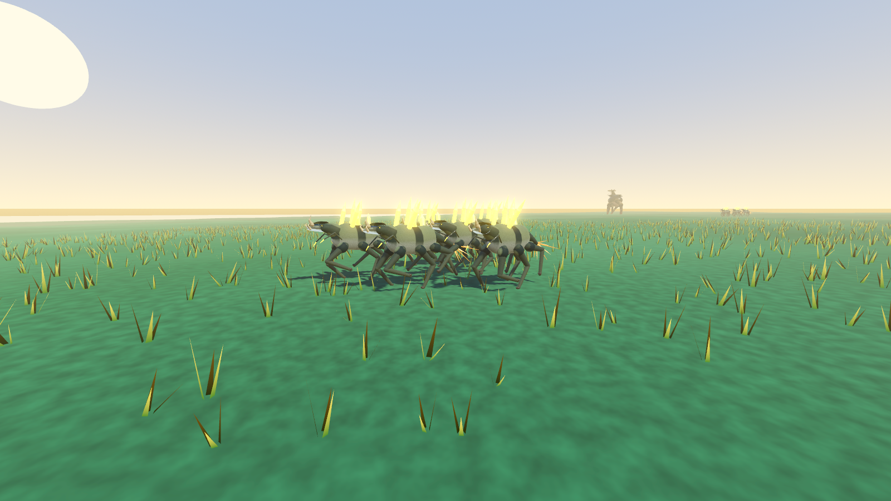 | 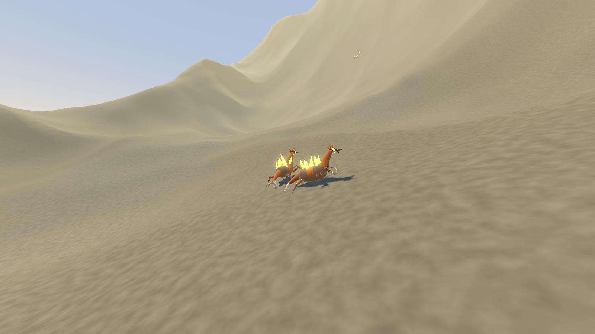 |
| 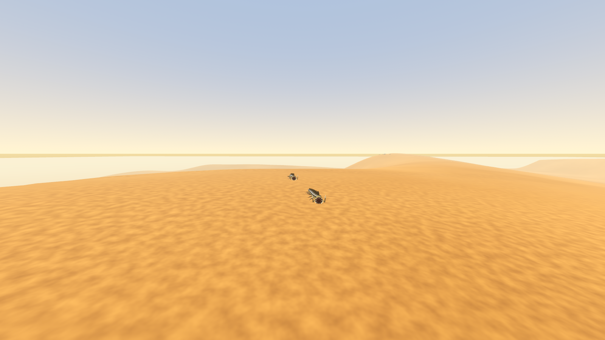 | 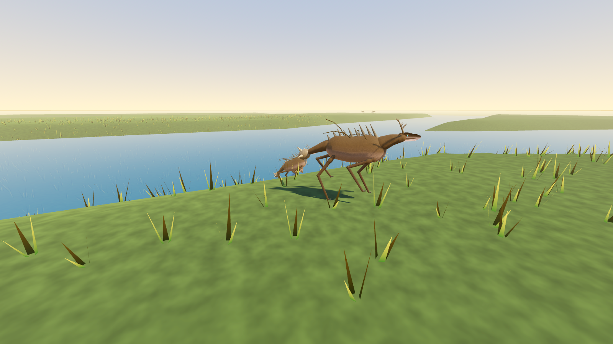 |

**Species per landform.** `FaunaGenerator.Generate(seed, alienness, bloom, landforms, ground)` rolls a planet's wildlife for its landform mix (planet-generator's [LANDFORMS.md](../planet-generator/LANDFORMS.md)). Each landform gets two or three species of its own, filling the niches its ground offers (`src/Core/LandformFauna.cs`):

| Ground | Landforms | Niches, and how the bodies are built |
| --- | --- | --- |
| Open | plains, steppe, ice and basalt plains, rocky desert, ringlands | a herd of runners (longer, lighter legs, faster); pack hunters that run them down; the odd territorial giant |
| Steep | mountains, fjords, coastal cliffs, mesas, canyonlands, plateau, karst, shard fields | climbers (splayed, thick legs low to the rock); cliff gliders; ambushers on the ledges |
| Sand | dune sea, badlands | burrowers; sand-swimmers (sleek, burrowing chain bodies); quick leapers |
| Wet | delta, wetlands, lake district, river valleys, archipelago | waders (stilt legs, a long neck); ambushers in the shallows; scavenging fliers |
| Broken | hills, dome fields, volcanic field | grazers; lone predators; armoured crawlers (plates or shell) |

How the species are built:
- **Ranging species.** Landforms of the same kind share one ranging species too (a herd that roams plains and steppe alike).
- **The usual rules.** Bodies are built by the planet's usual rules (parts that suit the job, proportions that read as animals, quality checked), then adapted.
- **Coats.** Coats take on their home ground's colour, from the planet's own biome colours when it passes them in, less so on alien worlds.
- **Names.** Common names say how a body is built: "running banded crystalback", "wading tendrilled strider", "sand-swimming lamprey-mouthed crawler".
- **Species count.** It grows with the mix: 2-3 on a one-landform world, about 15-17 with five or six landforms.

**Homes and spawning.** Each species knows its home landforms (`Species.Homes`) and how its body is adapted (`Species.Adaptation`):
- `LandformFauna.PickFor(fauna, blend, rng)` picks a species for a spot from the landforms there. Deep in a region it is always one of the region's own; near a border, either side's, as much as each holds there.
- `Spawner.LandformAt` keeps the prototype's spawner to home ground.
- The old `Generate(seed, alienness, bloom)` is unchanged, and so is everything else: the discovery card, no spawns near bases or towns, day and night, cave and POI fauna, domestic animals.

`tests/Screenshot.tscn -- --view=home --landform=Plains [--archetype --variant --seed]` stands the prototype on a patch of a real generated planet, in its biome colours, with that landform's signature creature in front of the camera.

## Play it

From the repo root, in PowerShell:

```powershell
.\tools\godot.ps1 -Project prototypes/wildlife -Play
```

| Key | Action |
| --- | --- |
| WASD, mouse | Walk and look; drive and orbit the camera in the hovercraft |
| Shift | Sprint, or boost the hovercraft |
| Space | Jump |
| Ctrl (hold) | Crouch: creatures find you less alarming |
| Left mouse | Fire the blaster |
| Q (hold) | Scan the creature under the crosshair: name, form, behaviour, size, signature attack, first finder |
| E | Butcher a kill into your pack |
| F | Board or leave the harvester hovercraft (parked to your right at the start) |
| 1 / 2 / 3 | Switch the planet: temperate, alien, Bloom-infested (new fauna and forest) |
| N | Skip a quarter day (ambushers strike at night, walking plants wander) |
| T | Noon or midnight: the same valley with different animals out |
| 4 | The underground showroom (1 to 6 its stations, L lamp, 7 back to the planet) |
| Esc | Free the mouse |

You start on the alien world with a herd on the plain ahead and a grove to the left to drive the harvester into. Packs roam 50 to 120 m out.

## Test it

`tests/FlightTest.tscn` measures how winged animals fly on fresh random worlds: the two kinds, airspeed and heading over long stretches, wings against flight, swoops across species and sizes, dodging, buildings and ridges, landings, roosting, deaths in the air, and hoverers. `prototypes/slice/tests/FlightShots.tscn` (windowed, not in the gate) films them from the player's eyes.

```powershell
.\tools\test.ps1 -Project prototypes/wildlife -Scene res://tests/WildlifeTest.tscn
.\tools\test.ps1 -Project prototypes/wildlife -Scene res://tests/CreaturesTest.tscn
.\tools\test.ps1 -Project prototypes/wildlife -Scene res://tests/ShowroomProbe.tscn
.\tools\test.ps1 -Project prototypes/wildlife -Scene res://tests/LandformFaunaTest.tscn
```

`tests/LandformFaunaTest.tscn` (headless, 8 checks, on a real generated planet) checks:
- **Same seed, same species.** Seventeen species are identical twice over, and another seed differs.
- **Species grow from the mix.** 3 on a one-landform world, 6 with two landforms, 17 with six.
- **Distinct per landform.** Each landform of a mixed world has two or more species of its own, and every pair of landforms differs.
- **Built for the ground** (six planets):
  - plains have herds and their hunters
  - mountains have splay-legged climbers and gliders
  - dune seas have burrowers and sand-swimmers
  - wetlands have stilt-legged waders and ambushers
  - all 77 species pass the quality rules
- **Colours fit the ground.** 12 of 14 species are nearer their own ground's colour than other landforms'.
- **Spawns by landform.** Of 2000 picks deep in regions, none was off its home ground. Of 3724 picks near borders, 1506 came from the landform next door.
- **The spawner keeps to home ground.** 33 creatures on a patch across a border, none off home ground.
- **Old fauna unchanged.** Fauna rolled without landforms has no homes and no adaptations.

Runs headless and exits 0 or 1. `tests/QuitProbe.tscn` checks the game's own way out: it drives the hovercraft with its sounds playing, closes the window, and must exit 0 with nothing leaked. `WildlifeTest` checks:
- **Generator:**
  - The same seed gives the same species, and a different one doesn't.
  - Every planet rolls 6 to 10 species, with at least 4 body plans in 8 and no two identical part sets (120 planets).
  - Weirdness rises with alienness (0.28 at 0, 0.47 at 0.5, 0.63 at 1).
  - Bloom species are marked corrupted and are corrupted versions of the local fauna.
- **Quality:**
  - All 4,904 species from 600 planets (alienness 0 to 1, a fifth Bloom-infested) pass every part, form, behaviour and proportion rule.
  - Spot checks find no grazer snouts on hunters, scythes on grazers, insect heads on beasts, odd-legged walkers or horned lamprey mouths.
- **Signature attacks:** every attacker carries one, in 7 styles and 13 named attacks.
- **Animation:**
  - Every species on five planets animates for 60 s, through day, night, hunts and deaths, with no NaNs, bodies in range and nothing flying off.
  - Planted walker feet stay within contact tolerance (worst 0.13 m of 0.21 m over 578,000 checks).
- **Combat:** every attacking species (85 across 12 planets) opens with a wind-up of at least its telegraph. It is dodged by stepping aside after the commit (85/85), hits a target that stands still at full damage (85/85), and attacks at the normal rate afterwards.
- **Herds:** they stay together over 60 s, and bolt and regroup when spooked.
- **Packs:**
  - They appear on most planets (71 of 100).
  - A roaming pack stays together (widest 4.8 m from the middle).
  - Members surround the prey before anyone commits (spread over 218 degrees, on both sides of the front).
  - Commits are at least a telegraph apart (closest 1.02 s for a 1.0 s telegraph).
  - Every member's first bite lands full damage.
  - The pack breaks off together when its leader dies, or when half of it is hurt.
- **Ambushers:** they stay hidden by day and strike at night.
- **Harvesting:**
  - A harvested tree adds its wood, is removed, frees the nav grid, and regrows only when no player is near.
  - Running a creature down puts its meat in the hold.
  - The storage cap is enforced, and the blades leave alone anything the hold can't take in full.
  - Trunks are solid: a creature pushed straight at one slides round it, and a hunter goes round one to reach its prey. In the real scene every tree has its collider, the player walking into a trunk stops against it, and the hovercraft with a full hold is held off a tree. Felling a tree drops its collider at once, and the player then walks over the stump.
- **Bases:**
  - An hour of a planet's fauna being killed every 4 s and respawned, with a small base where the herd would start, a large one in the hills, a capital ship parked between and a player strolling through: of about 930 spawns, none lands inside a base's zone (nearest 89 m from an edge), and no respawn comes nearer the player than 90 m.
  - A large base gets a larger zone: the zone runs 80 m from the footprint's edge, 83 m out from a 6 m hut's centre and 120 m from an 80 x 56 m fortress's.
  - Capital-mode structures don't block spawns: a capital core parked where the herd starts gets creatures right round it; switched to base mode, none come within 80 m.
  - Creatures already outside may wander in: a herd spawned just outside a zone grazes into it within 10 minutes. A hunter shot at from a base runs 90 m in and attacks.
  - The clearance is past the longest perception any creature rolls.
  - The playable planet's outpost is a base, and nothing spawns within 80 m of it.
- **Discovery card**, in the real scene through its input path:
  - The codex records the first finder once and raises one discovery per species.
  - A never-seen species in front of the camera brings up its card (name, form, behaviour, size, planet, finder) with the chime, for about 4.4 s.
  - A second one of the same species brings up nothing: one card per species.
  - While a card is up, every HUD control ignores the mouse and focus, nothing is under the cursor at the card, a key still reaches the game and the player walks under it.
  - A never-seen hunter lunges at the player: no card shows on any frame of its wind-up or lunge, sidestepping still dodges it, and its card comes once the attack is over.
  - No card shows while the player is down; it comes once they are back up.
- **Space fauna:**
  - Seeded: the same region rolls the same creatures, another region others.
  - Every habitat has its fauna. Across 300 regions, all 1,800 space creatures pass the part, form and behaviour rules: no eyeless grazer heads on hunters, no stingers on grazers, and every leech has a mouth to bite with. Each kind comes in 145 to 577 distinct builds.
  - Drops, over 4,000 kills of each kind: every kill drops rare or better, from the ladder; exotic sometimes; unique as often as the data says and never more than 25%. The data refuses a creature that drops a common material, and a real kill leaves its loot.
  - Zero-g animation: every habitat's fauna, with a ship flying through, animates 60 s with no NaNs, orthonormal bodies and nothing drifting off. Clinging leeches stay on their hull (0.000 m off) and shoals hold together.
  - Fair attacks: every kind's first attack, in three regions each, has at least its telegraph of wind-up. Sidestepping at a suited player's 6 m/s after the commit dodges it (15/15). Holding still takes the full damage, never capped (a leviathan's 140). The next attack comes at the normal rate. A leech lets go of the hull to strike and latches back on.
  - A skittish shoal scatters together from a ship that comes too close; a leviathan warns an intruder before it charges.
  - The encounter deck's creature cards name exactly the space forms.
  - Cost: 61 space creatures (shoals, leeches on a wreck, a leviathan), every rig posed every frame, must stay under 2.5 ms, judged on the best of three windows (about 1.1 ms).
- **`tests/CreaturesTest.tscn`** (headless, 53 checks) covers day and night, caves, places, mutation and settlements:
  - Every one of 200 planets has animals out by day and a hunter out by night, its herd grazing by day; rest sites suit the body (dens, burrows, roosts, nests); the same seed gives the same hours.
  - The same valley at noon and at midnight has different species out (4 at noon, 2 at midnight), and every resting animal is at its rest site (furthest 1.1 m past its edge). A sleeping herd wakes at 7.5 m from someone walking, 4.7 m crouched, and runs together. Dens lie on slopes, bedding grounds on the flat, none in rock or a base's zone.
  - All 3,360 cave and place species of 40 planets pass every body rule; they go pale below level 2 (saturation 0.10 against 0.37) and blind below level 3 (all of them); industrial places and wrecks breed armour (92%), alien places glow (75%); subsisters are harmless and wear no warning colours.
  - In a tunnel dug with the tool (1,114 cells, 6 m floor to ceiling) and in the generator's cave (a chamber 6 m high, nothing dug), a creeper crawls floor > wall > ceiling, drops onto a walker below with dust first (3.13 s before the hit), lands on its feet and reaches a target 18 m (11 m in the cave) along the rock. It stays attached (worst 0.004 m off its surface, no slips) and is never inside the rock (body and every segment checked every step, no rescues).
  - A populated cave runs 3 minutes with a caver walking through: nothing in the rock, nothing put back, and every hit came after a tell from its creature (tightest 6.7 s).
  - Spaces fit any sim frame: a cave chamber is found from nearby, and offset voxel and block spaces agree cell for cell.
  - 400 generated places: silent shares by state (abandoned 25%, ruined 33%, infested 0%, active 100%), infested overrun, nests only in the deepest levels (451 of 451), every place with hunters and subsisters has a food chain, every derelict has wreck nesters, every role appears, populations are deterministic. Nests get worse with depth: 3, 4 and 6 guards at levels 1, 3 and 5, the same species growing from 0.94 to 1.13 m and 31 to 45 health from level 3 to 5.
  - Every ambush (a creeper on a ceiling, a duct eel in a vent, something behind a door, a lurker, a prowler, a nest guard) gives itself away at least a second before it lands (tightest 2.67 s), and every one can be escaped. Walking right through the outpost (17 creatures), every hit came after a tell (tightest 3.17 s), and nothing ever ends up inside a block.
  - The food chain runs while a crouched player watches unnoticed: 7 subsisters taken in 7 minutes, each after a full wind-up; subsisters run into cracks and their colony keeps coming back; the hunters feed and leave the watcher alone.
  - Wreck nesters build up their nests (1.10 to 2.00 over 2.5 minutes), warn an intruder with a hiss and bite only after (tightest 5.8 s).
  - Mutation: the same seed gives the same mutation and strength 0 changes nothing (46 of 46 species); it grows with strength (46, 105 and 181 growths at 0.25, 0.5 and 1); at full strength every species has an extra part and a patch, passes every body rule, stays within bounds (heavier side at most 1.31 times, growths at most 23% of the body) and animates 20 s cleanly.
  - Settlements: no wild spawn within 80 m of a town over 15 minutes of respawns (closest 89 m); a stampeding herd veers round one; a predator takes a townsperson on the road (telegraphed) but stops at the town's edge once they are home; a stray inside is reported and killed through the guards' hook. Domestic animals of each kind (120) are calm, plain, unarmed and have no signature attack; working beasts are the biggest, pets the smallest; they keep to their pens for 2 minutes, a pet keeps up with its owner, and stock scatter from a wild hunter inside the pen without fighting.
  - Cost: 29 cave and place creatures, every one posed every frame, about 1 ms per frame (budget 2 ms, best of three windows).
- **`tests/ShowroomProbe.tscn`** drives the real scenes: on the planet T flips between midnight and noon; the showroom builds every station, each has its creatures drawn, none inside the rock or a block, and the settlement's animals are all inside the town.
- **Performance:** 200 creatures plus a swarm must cost under 4 ms per frame as the game runs them: sim, rigs on their distance schedule, and syncing every mesh. The worst case, every rig posed every frame, must stay under 6 ms. Each is judged on the best of three 300-frame windows, all printed, so another program busy on the machine can't fail it.
- **Playable scene:** the real scene, through its input path. Keys 1 to 3 switch worlds, and F, W, F board, drive and leave the hovercraft.

On a Ryzen 7 5800X3D with nothing else running, 200 creatures plus a 51-insect swarm cost about 1.7 ms per frame as the game runs them, including syncing about 5,500 mesh nodes. Posing every rig every frame costs about 3.2 ms, almost all of it rigs. A real planet has 60 to 80 creatures about.

Screenshots run windowed, from the prototype folder:

```
godot --path prototypes/wildlife res://tests/Screenshot.tscn -- --view=<view> --out=file.png
```

- **Views:** `lineup`, `herd`, `pack`, `giant`, `bloom`, `predator`, `harvester`, `outpost`, `discovery` (the only one that shows a discovery card).
- **Space views:** `space-nebula`, `space-asteroids`, `space-derelict`.
- **Showroom views:** `deep-ceiling` (a crawler on a cave ceiling), `deep-tell` (grit falling from a corridor ceiling as someone walks under), `deep-food` (a lurker taking a grub), `deep-nest`, `deep-hold`, `mutation`, `domestic`.
- **For checking the generator by eye:**
  - `sheet` renders a contact sheet with one camera per species. `--pick=0,3` narrows it to chosen species.
  - `--worlds=temperate,alien,bloom` or `seed123:0.6[:bloom]` picks the planets for `lineup` and `sheet`.
  - `survey` (headless) lists seeds that would make good demo worlds.
- `--hud` keeps the debug HUD.

## Integration

Everything here is additive: no public name was renamed or removed, and a sim that doesn't opt in (day and night, settlements) behaves exactly as before. These are the changes for other folders, to make after the merges; none of them is made here.

### The slice (`prototypes/slice`)

0. **Landforms.** To roll the planet's wildlife for its landforms and spawn by home ground, see item 6 of planet-generator's [Integration](../planet-generator/README.md#integration) (`WildlifePatch.SetWorld` and `Populate`). The wildlife csproj now also compiles planet-generator's `src/Gen` and `src/Look`, which the slice compiles already, so nothing changes in `Slice.csproj`.

1. **Compile list.** `src/Core`, `Rigs`, `Sim`, `View`, `Game/ProceduralAudio.cs` and `Game/Shutdown.cs` gained new files that compile with what the slice already includes. For the voxel caves add one line to `Slice.csproj`, next to the other wildlife lines (it needs terrain-digging's `src/Terrain`, already compiled there):
   ```xml
   <Compile Include="..\wildlife\src\Bridges\**\*.cs" />
   ```
2. **Merging the wildlife files the slice also edited.** `Species.cs`: my fields sit after `InSpace`, its `Stats.Xp` is untouched; `Species.Copy()` clones by `MemberwiseClone`, so `Xp` carries into variants. `FaunaGenerator.cs`: `RollStats`'s first switch gained a `RigKind.Crawler` row (about 20 lines above its `Xp` lines) and `HeadBand` a row; new methods follow `Generate`. `ProceduralAudio.cs`: `_Ready` gained one call (`MakeTells(rng)`) after `GrindLoop`, new methods sit at the end of the class; its `Origin` field and `Play` change are untouched. `Terrain.cs`: unchanged. Expect clean merges; if not, keep both sides.
3. **Day and night** in `src/Surface/WildlifePatch.cs`, `Swap`:
   ```csharp
   var sim = new WildSim(Zone.Data.Wildlife, terrain, nav) { Frozen = _frozen, ActivityCycles = true };
   // ... after carrying creatures across with sim.Spawn(...), give each a rest site again:
   //     var carriedNow = new List<Creature>();  carriedNow.Add(sim.Spawn(c.Species, local));
   foreach (Creature c in carriedNow) sim.AssignRest(new List<Creature> { c });
   ```
   `Populate` already uses `SpawnGroup`, which gives rest sites when `ActivityCycles` is on. Its `_PhysicsProcess` already sets `Sim.Clock.Time01` from the sky every frame.
4. **Tells** (sounds and grit) for whatever lives in the patch, in `SetWorld` after `Audio` is made, and in `Swap` after `View.Bind(sim, null)`:
   ```csharp
   Tells = new TellView { Name = "Tells", Audio = Audio };  AddChild(Tells);   // once, in SetWorld
   Tells.Bind(sim);                                                            // in Swap
   ```
   `TellView` and `LairView` place their effects in their own node's frame, the sim's, so as children of `WildlifePatch` (at `Origin`) they land in the right place.
5. **Planet-surface caves.** The planet's voxel store is `planet.Terrain.Store`; the patch frame is the zone frame minus `Origin` (snapped to whole metres). When the survivor is near or under ground, find a chamber and fill it once per patch:
   ```csharp
   var deep = new DeepFauna(Zone.Data.Wildlife, Fauna);                     // once per planet
   var caves = new VoxelSpace(planet.Terrain.Store, new Vector3I((int)Origin.X, 0, (int)Origin.Z));
   if (CaveFauna.FindChamber(caves, PatchLocal(feet), 24f, out Vector3 chamber,
           (x, z) => planet.Source.SurfaceHeight(x + Origin.X, z + Origin.Z)))
       CaveFauna.Populate(Sim, caves, deep, chamber + Vector3.Up, 16f, seedFor(chamber), depth: 1);
   Lairs.Build(Sim);   // a LairView child of the patch, for the cracks and moss
   ```
   Cave creatures move on the voxel rock, so a hole the player digs under one drops it. Their `Space` is per creature, so they share the patch's sim with the surface fauna.
6. **Settlements** (when towns exist): per settlement in the patch `Sim.AddSettlement(name, PatchLocal(centre), radius)`; townsfolk are `ITarget`s added to `Sim.Targets` like the player (wildlife hunts them only outside town); `Sim.StrayEntered += (creature, town) => /* send guards */ Sim.CullStray(creature, guard)`; a town's animals from `new FaunaGenerator(fauna, activity).RollDomestic(planet.Spec.Seed, kind, alienness)` placed with `Sim.SpawnDomestic(species, at, penCentre, penRadius, owner)`, filtered by `species.Domestic` (working only in low-tech places, stock in low-tech places and on farms, pets anywhere).
7. **Mutagenic worlds**: generate with `Generate(seed, alienness, bloom, mutation)` (or `Mutate(species, strength)` per region).

### The POI generator (`prototypes/poi-generator`)

Call the population function once per place instance, after `PoiFactory.Spawn` (or `Generate`) gives a `PoiInstance inst`; it needs only plain numbers, no wildlife types inside the generator if you keep the call at the game side:
```csharp
var plan = new Wildlife.PoiPlan
{
    Seed = inst.SpawnSeed,
    State = (Wildlife.PlaceState)(int)inst.State,           // Active, Abandoned, Infested, Ruined: same order
    Theme = ThemeOf(inst.Kit.Faction),                       // see below (Kit.Faction)
    Derelict = IsShip(inst.Family),                          // the crashed freighter (and any wreck)
};
foreach (PlacedModule m in inst.Layout.Modules)
{
    if (m.Kind == ModuleKind.Outdoor) continue;
    var room = new Wildlife.PoiRoom
    {
        Index = m.Index,
        Kind = KindOf(m.Kind, m.Purpose),                    // see below
        Min = new Vector3(m.Min.X, m.Min.Y, m.Min.Z) + interiorInset,   // the open interior: floor at Min.Y, ceiling at Max.Y
        Max = new Vector3(m.Max.X + 1, m.Max.Y + 1, m.Max.Z + 1) - interiorInset,
        Depth = Math.Max(0, -m.Storey),                      // levels below the way in
        Dark = inst.State != PoiState.Active || m.Underground,
    };
    // Links: from inst.Layout.Links (or m.Parent), both ways round.
    // Vents: room.Vents.Add((mouth, normalIntoRoom)) for each vent or grille block; doors: room.Doors.Add((doorwayMiddleAtFloor, normalIntoRoom)).
    plan.Rooms.Add(room);
}
PoiPopulation pop = Wildlife.PoiFauna.Populate(plan, deepFauna, wildlifeData.Deep);   // deepFauna = new DeepFauna(data, planetFauna), once per planet
```
- **Kinds:** `Entrance` to Entrance, `Corridor` to Corridor, `Room` and `Tower` to Room, `Hall` to Hall, `Vault` to Vault, `Descent`, `Stair` and `Lift` to Descent, `Cave` to Cave, `Outdoor` skipped; in a ship, purposes `hold`/`cargo` to Hold, `engine`/`reactor` to EngineRoom, ducts and crawlways to Duct.
- **Themes:** `meridian`, `exchange`, `reavers`, `freeholders` to Industrial; `vharn`, `kessari`, `hollow` and `none` (Precursor) to Alien; a mine's cave levels to Natural; ships set `Derelict = true` (theme Derelict).
- **The space:** the place's blocks, 1 m cells, in the frame the game's sim uses (`Offset` = where grid cell (0,0,0) sits):
  `new Wildlife.BlockSpace((x, y, z) => inst.Blocks.InBounds(new Int3(x, y, z)) && IsSolid(inst.Blocks.Get(new Int3(x, y, z))), min, max) { Offset = placeOriginInSim }`, where `IsSolid` is true for walls, floors, roofs and machines, false for air, doors, vents, glass panes you can see through and props a creature could walk under. For a place set into the voxel terrain, `new CombinedSpace(blockSpace, voxelSpace)`.
- **Into the game:** `Wildlife.PoiFauna.Spawn(sim, pop, space)` when the place streams in; its `LairView.Build(sim)` draws cracks, food and nests. `pop.Silent` places stay empty. `pop.FoodChain` lists who eats whom, for a codex or a scanner.
- The generator's own `EnemyKind.Fauna` roster lines can give way to this; its defenders and Bloom bosses are unaffected.

## Known limits

- **Caves and places:**
  - Floor walkers stay on their own storey: they step up 0.4 m at most, so 1 m block stairs are climbers' only (the outpost's prowlers, lurkers and guards each keep to one level; crawlers go anywhere). Ramp blocks would fix it once places have them.
  - Paths are a bounded A* on 1 m cells, replanned now and then; a crawler can be slow to find its way round a large, convoluted cave.
  - The block places here are the showroom's own, small and hand-built; the POI generator's places plug in through the population function (see Integration).
  - Hidden creatures travel through the rock in a straight line between cracks; nothing models the passages.
  - Drifting derelicts in space would use the same crawlers with gravity off; only crashed ones (with gravity) are built here.
- **Mutation** decorates bodies only: no behaviour or stats change, and no player ailments (the doc has none; mutagen exposure is a later environmental hazard).
- **Settlements:** the town side (townsfolk, guards, placement by tech level) comes later; here a stand-in townsperson and the hooks.

- **Rigid pieces, no skinning.** Lofts and tapers hide most joints, but a piece is still rigid: bellies don't bulge and skin doesn't slide. Each piece is a draw call (about 30 per creature on average); a skinned single mesh per creature would be cheaper on the GPU.
- **Some combinations are still plain or odd.** Leapers still read a little like round frogs on stilts. Variety means the odd creature is merely dull rather than broken.
- **Animation quality is uneven:**
  - Legged walkers are the best: feet plant and step properly. Very fast turns and lunges can still make a foot slide for a step.
  - A pounce on legs is a deep crouch and a long forward lunge, not a leap: planted feet can't leave the ground.
  - Leapers' spring legs are posed, not planted.
  - Crawler legs row on a sine wave, without ground contact.
  - Tendrils, tails and necks are procedural sway, not physics.
- **Few collisions.** Creatures don't collide with each other (herd and pack members keep apart) or with the player on foot. The hovercraft shoves them aside.
- **Behaviour scope.**
  - Day and night change who is out and where the rest sleep, but not how far anything sees; the planet's light changes, the caves' doesn't.
  - No creature is ranged.
  - On the open surface nothing fights anything else; there predators and packs only hunt players (and townsfolk). In caves and places the hunters eat the subsisters.
  - A pack's feinter never bites while it has flankers left.
- **Single player.** The codex finder is always "Player 1"; nothing is networked or saved.
- **Space fauna are not playable here.** They run in the tests and the screenshot views. In the encounters prototype the director spawns and moves them as cards, drawn as simple stand-ins. Nothing yet lets a player fight one in space, harvest its drops or meet one in a gas giant's skies, which has no scene. Space creatures don't fight each other, and only rocks and hulls block them.
- **Bases are placeholders.** The wildlife only reads a footprint rectangle and a core mode. Real structures, and switching a core between modes, belong to the building prototype; this one has its own small `CoreMode` until both use a shared one.
- **Placeholder world.**
  - The terrain is a height function with hills, not the planet generator's.
  - Every planet shares the same land shape and forest layout, restyled.
- **Debug JIT optimiser.** The project enables the JIT optimiser in Debug builds (`Wildlife.csproj`), because play-testing from the editor was noticeably slower without it.
